# 桌面组合任务 51–100

第二批 50 项桌面组合任务，编号 51–100。场景已摆好，动作开发未开始；没有轨迹或物理验收结果。复用 50 种已有资产，其中 20 种新转换为静态场景版本。

[在首页查看本批任务](https://davidlxu.github.io/RevoBench/#batch=tabletop100) · [公开任务说明](https://davidlxu.github.io/RevoBench/pending-51-100/)

每项的“区别”说明新增的组合或约束；不把这些变体称作 50 种独立的新操作原语。

## 使用与资产恢复


```bash
python -m pip install -e .
python tools/asset_sources.py fetch tabletop100-scene-v1 --host gpu21 --work outputs/restore_second50_001
python tools/verify_assets.py --manifest configs/assets/tabletop100_scene_v1_manifest.json
revobench show proposal_51_wrench_nut_turn
source tools/activate-server.sh
python tools/render_task_layouts.py --group tabletop100 --gpu 6 --output outputs/second50_view_001
```

GPU 改为当前空闲设备；输出目录必须全新。机器人和桌面运行资源仍按主 README 恢复。此选集恢复本批全部 50 种道具（包括复用的 30 种），不必再恢复第一批全部 87 种。
资产均为 kinematic 静态初态版本，planner/oracle 为空，collect 拒绝录制。开发时需新建动态版本，验证质量、摩擦、碰撞、开口和可达性。任务中的接触、稳定、周期、放置指标是待实现验收规范，不是本次测量结果。

## 重建本批场景与图册

依赖沿用第一批几何工具：NumPy、SciPy、trimesh、Pillow、numba、usd-core、python-fcl、rtree。源码选择在 `configs/tabletop100/assets.json`，不修改第一批已固定资产。

```bash
python tools/define_tabletop100.py
python tools/prepare_tabletop50.py --source-assets /path/to/source/assets --config configs/tabletop100/assets.json --namespace tabletop100
python tools/build_tabletop100_scenes.py --source-assets /path/to/source/assets --output outputs/second50_geometry_001
python tools/render_tabletop100_assets.py --source-assets /path/to/source/assets
python tools/document_tabletop100.py --site-root /path/to/DavidLXu.github.io
```

带机器人的渲染及增量发布见 [缩略图说明](../ROBOT_TASK_THUMBNAILS.md)。修改初态后必须重新检查几何、渲染和更新布局/图片哈希。

## 统一动作要求

- 机器人从默认姿态出发，结束后通过真实运动回到默认姿态。
- 阶段连续，避免跳变、突兀加减速和无意义停顿；任务规定的观察或释放停顿除外。
- 肩肘腕协调，避免异常抬肘、腕部反折和绕远。
- 以手指内侧形成合理抓持，无明显穿透、撞击或滑脱。
- 物体运动由真实接触产生；禁用瞬移、隐藏附件和把静态摆放算作完成。

## 任务索引

| 编号 | 任务 | 类型 |
|---|---|---|
| 51 | [用扳手端部拨转螺母](#proposal_51_wrench_nut_turn) | 工具操作 |
| 52 | [锅铲和勺子协作托住苹果](#proposal_52_two_tools_apple) | 双工具协作 |
| 53 | [用叉柄穿过杯把牵引杯子](#proposal_53_fork_mug_drag) | 工具操作 |
| 54 | [持记号笔沿笔记本折线路径移动](#proposal_54_marker_zigzag) | 接触轨迹 |
| 55 | [双手用擀面杖沿海绵往返滚动](#proposal_55_roller_sponge) | 接触轨迹 |
| 56 | [勺子沿碗内壁绕一圈](#proposal_56_spoon_bowl_wall) | 接触轨迹 |
| 57 | [翻起鞋子后刷扫鞋底](#proposal_57_brush_shoe_sole) | 双手清洁 |
| 58 | [持盘擦拭正反两面](#proposal_58_wipe_plate_faces) | 双手清洁 |
| 59 | [用餐刀辅助捏起薄罐头](#proposal_59_knife_can_edge) | 工具操作 |
| 60 | [用螺丝刀柄端依次触碰计算器按键](#proposal_60_driver_key_targets) | 接触轨迹 |
| 61 | [倾斜餐盘让橙子滚入碗](#proposal_61_plate_orange_chute) | 非抓取操作 |
| 62 | [端着杯与罐头绕过高瓶](#proposal_62_loaded_tray_curve) | 平衡搬运 |
| 63 | [端盘移动时让球留在中央](#proposal_63_ball_plate_level) | 平衡搬运 |
| 64 | [转动量壶通过两盒之间](#proposal_64_pitcher_gate) | 受限空间 |
| 65 | [搭出书本斜坡让球滚入托盘](#proposal_65_book_ramp_ball) | 搭建与引导 |
| 66 | [用书和罐头搭桥让小车穿过](#proposal_66_build_car_bridge) | 搭建与引导 |
| 67 | [抬杯后把杯垫送到杯底](#proposal_67_insert_coaster_mug) | 双手协作 |
| 68 | [用盘盖住碗后夹持翻转](#proposal_68_invert_bowl_plate) | 双手协作 |
| 69 | [用两只盘子夹住面包搬运](#proposal_69_clamp_bread_plates) | 双手协作 |
| 70 | [把勺子横搭在杯口](#proposal_70_spoon_rest_mug) | 平衡放置 |
| 71 | [从杯中逐个倒出三颗骰子](#proposal_71_meter_dice_cup) | 定量释放 |
| 72 | [双手在两只杯间转移球](#proposal_72_cup_to_cup_ball) | 双手协作 |
| 73 | [把毛笔穿过杯把](#proposal_73_thread_marker_handle) | 插装与对准 |
| 74 | [逐件把水果放到秤面再取下](#proposal_74_scale_single_fruit) | 顺序操作 |
| 75 | [把三只罐头搭成小拱堆](#proposal_75_can_pyramid) | 平衡放置 |
| 76 | [把餐刀调整成刀柄朝向接收手](#proposal_76_utensil_safe_handover) | 安全交接 |
| 77 | [把食品与清洁用品分区摆开](#proposal_77_separate_food_cleaners) | 语义与空间 |
| 78 | [按餐具关系摆一份早餐托盘](#proposal_78_breakfast_tray) | 语义与空间 |
| 79 | [把碗居中放上电子秤](#proposal_79_bowl_scale_center) | 精确放置 |
| 80 | [把三件长工具摆成可抓取扇形](#proposal_80_fan_tools) | 语义与空间 |
| 81 | [让小车倒退进入托盘停车位](#proposal_81_park_car_tray) | 受限空间 |
| 82 | [铺好书本坡道再让小车上托盘](#proposal_82_ramp_car_tray) | 搭建与引导 |
| 83 | [扶正侧倒的带柄量壶](#proposal_83_right_pitcher) | 姿态恢复 |
| 84 | [让浇水壶嘴依次对准两个杯口](#proposal_84_aim_wateringcan) | 端点对准 |
| 85 | [转动罐头让标签依次朝向两个观察方向](#proposal_85_inspect_can_label) | 视觉朝向 |
| 86 | [按最长尺寸排列三种水果](#proposal_86_fruit_size_order) | 语义与空间 |
| 87 | [把草莓放在香蕉弯曲内侧](#proposal_87_banana_cup_curve) | 形状配合 |
| 88 | [利用桌边露出的盘沿抓起餐盘](#proposal_88_edge_plate_retrieve) | 抓取策略 |
| 89 | [喷雾瓶喷嘴沿海绵三个位置对准](#proposal_89_nozzle_sponge_alignment) | 端点对准 |
| 90 | [把牙膏管倒立在盖端](#proposal_90_toothpaste_cap_stand) | 平衡放置 |
| 91 | [托住锅柄与锅底搬运带载煎锅](#proposal_91_loaded_skillet_support) | 双手协作 |
| 92 | [用勺子从书本桥下取出球](#proposal_92_spoon_under_bridge) | 工具避障 |
| 93 | [排好包装盒后触发顺序倒下](#proposal_93_book_domino_chain) | 顺序接触 |
| 94 | [用两只罐头支住竖放的书](#proposal_94_bookend_upright) | 搭建与支撑 |
| 95 | [让横放罐头沿两本书之间滚动](#proposal_95_can_roll_rails) | 非抓取操作 |
| 96 | [让毛笔同时穿过两个杯把](#proposal_96_marker_two_handles) | 插装与对准 |
| 97 | [把托盘侧转后送过两只高瓶](#proposal_97_tray_bottle_gate) | 受限空间 |
| 98 | [用叉柄推海绵绕开瓶子](#proposal_98_fork_sponge_detour) | 工具避障 |
| 99 | [握住手摇铃完成三次往复摆动](#proposal_99_handbell_oscillation) | 姿态轨迹 |
| 100 | [扶稳托盘同时交换两侧载荷](#proposal_100_balanced_tray_exchange) | 双手协作 |

<a id="proposal_51_wrench_nut_turn"></a>
## 51 · 用扳手端部拨转螺母

`proposal_51_wrench_nut_turn` · 未开始 · 0 条轨迹

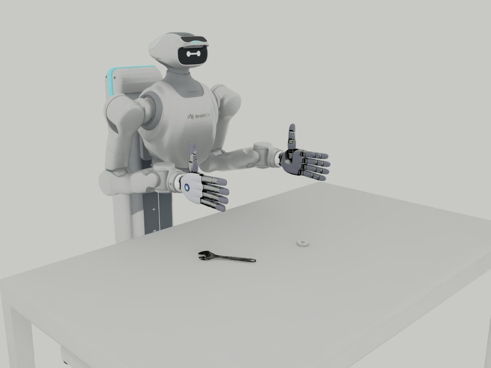

**区别：** 使用工具传递平面转矩，不是双手直接旋合螺纹。

**初态：** 扳手与六角螺母分开放在桌面，螺母平放。

### 使用的资产

| 道具 | 数量 | 注册 ID | 预览 |
|---|---:|---|---|
| 活动扳手 | 1 | `obj.tabletop100.wrench@scene_v1` | [实物网格](assets/wrench.jpg) |
| 薄六角螺母 | 1 | `obj.tabletop50.fastener_9@scene_v1` | [实物网格](assets/fastener_9.jpg) |

准备后的运行路径（相对 checkout）：

```text
assets/library/prepared/obj.tabletop100.wrench/scene_v1/model.usdc
assets/library/prepared/obj.tabletop50.fastener_9/scene_v1/model.usdc
```

原始路径（相对原始资产根目录）：

```text
library/external/bench2dex/bf65215f844d/Objects/042_adjustable_wrench/textured.obj
library/external/bench2dex/bf65215f844d/Objects/327_bolt_nuts/01_bolt_nuts/01/nuts_and_bolts_Object_9.glb
```

### 怎么做

1. 抓住扳手柄，用端部接触螺母外侧。
2. 沿切向连续拨动，必要时换接触边，使螺母转过四分之一圈。
3. 退出扳手并回位。

### 验收标准

1. 螺母绕桌面法向转动 90°±10°，中心平移不超过 3 cm。
2. 主要接触来自扳手端部外表面，手不直接拨动螺母。
3. 工具退出后螺母静止 2 s。

### 开发前检查

1. 该固定扳手开口尚未证明能套住当前螺母，因此只用端部切向拨转；不得伪造钳口配合。

<a id="proposal_52_two_tools_apple"></a>
## 52 · 锅铲和勺子协作托住苹果

`proposal_52_two_tools_apple` · 未开始 · 0 条轨迹

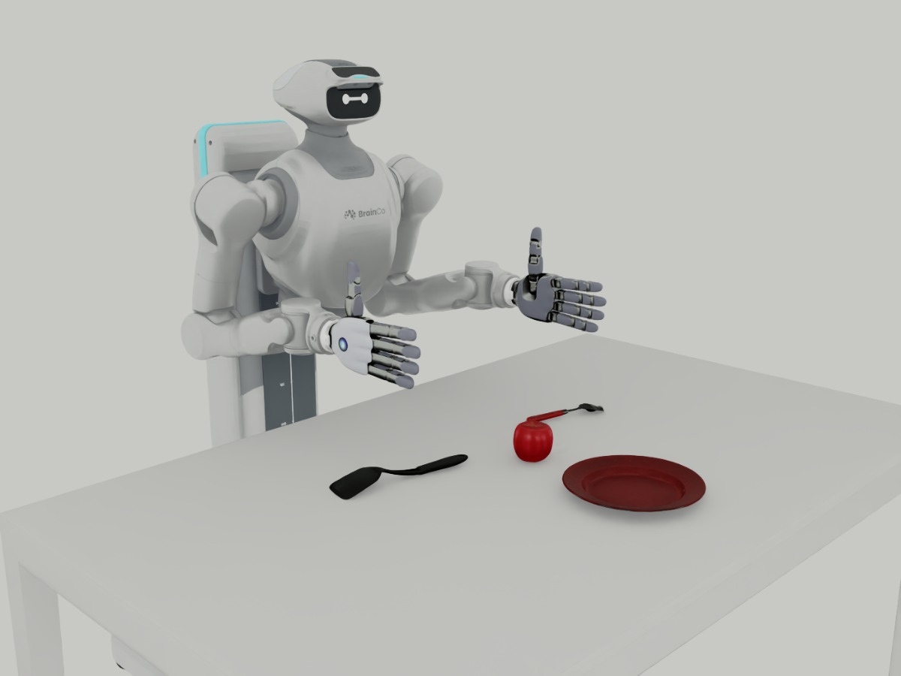

**区别：** 增加双工具相互配合和曲面物体防滚约束。

**初态：** 苹果在中央，两种工具在两侧，空盘在后方。

### 使用的资产

| 道具 | 数量 | 注册 ID | 预览 |
|---|---:|---|---|
| 苹果 | 1 | `obj.tabletop50.apple@scene_v1` | [实物网格](assets/apple.jpg) |
| 锅铲 | 1 | `obj.tabletop50.spatula@scene_v1` | [实物网格](assets/spatula.jpg) |
| 金属勺 | 1 | `obj.tabletop50.spoon@scene_v1` | [实物网格](assets/spoon.jpg) |
| 餐盘 | 1 | `obj.tabletop50.plate@scene_v1` | [实物网格](assets/plate.jpg) |

准备后的运行路径（相对 checkout）：

```text
assets/library/prepared/obj.tabletop50.apple/scene_v1/model.usdc
assets/library/prepared/obj.tabletop50.spatula/scene_v1/model.usdc
assets/library/prepared/obj.tabletop50.spoon/scene_v1/model.usdc
assets/library/prepared/obj.tabletop50.plate/scene_v1/model.usdc
```

原始路径（相对原始资产根目录）：

```text
library/external/bench2dex/bf65215f844d/Objects/013_apple/textured.obj
library/external/bench2dex/bf65215f844d/Objects/033_spatula/textured.obj
library/external/bench2dex/bf65215f844d/Objects/031_spoon/textured.obj
library/external/bench2dex/bf65215f844d/Objects/029_plate/textured.obj
```

### 怎么做

1. 一手握铲，另一手握勺。
2. 铲面托起苹果，勺面从侧面阻止滚落。
3. 把苹果放入盘中后依次撤出工具。

### 验收标准

1. 苹果离桌至少 3 cm，转移至少 15 cm。
2. 运输时由两件工具共同约束，手不接触苹果。
3. 苹果留在盘内稳定 2 s，两工具均撤离。

### 开发前检查

1. 使用实际网格核对抓取空间、支撑面与机器人可达性；转成动态资产后再测试。

<a id="proposal_53_fork_mug_drag"></a>
## 53 · 用叉柄穿过杯把牵引杯子

`proposal_53_fork_mug_drag` · 未开始 · 0 条轨迹


**区别：** 用杯把形成工具约束，区别于抓杯放杯或挂杯。

**初态：** 杯子直立，杯把朝侧面，叉子横放在前方。

### 使用的资产

| 道具 | 数量 | 注册 ID | 预览 |
|---|---:|---|---|
| 带柄马克杯 | 1 | `obj.tabletop100.mug@scene_v1` | [实物网格](assets/mug.jpg) |
| 餐叉 | 1 | `obj.tabletop50.fork@scene_v1` | [实物网格](assets/fork.jpg) |

准备后的运行路径（相对 checkout）：

```text
assets/library/prepared/obj.tabletop100.mug/scene_v1/model.usdc
assets/library/prepared/obj.tabletop50.fork/scene_v1/model.usdc
```

原始路径（相对原始资产根目录）：

```text
library/external/bench2dex/bf65215f844d/Objects/025_mug/textured.obj
library/external/bench2dex/bf65215f844d/Objects/030_fork/textured.obj
```

### 怎么做

1. 将叉柄穿过杯把。
2. 保持杯底接触桌面，用叉柄牵引杯子到旁侧目标。
3. 退回叉柄并放下。

### 验收标准

1. 杯子平移 12–18 cm，倾角始终小于 15°。
2. 牵引阶段只允许叉柄内穿杯把接触，不能直接抓杯。
3. 杯把无穿透，杯子释放后稳定 2 s。

### 开发前检查

1. 先测量叉柄截面与杯把孔径，验证完整插入及退出路径。

<a id="proposal_54_marker_zigzag"></a>
## 54 · 持记号笔沿笔记本折线路径移动

`proposal_54_marker_zigzag` · 未开始 · 0 条轨迹

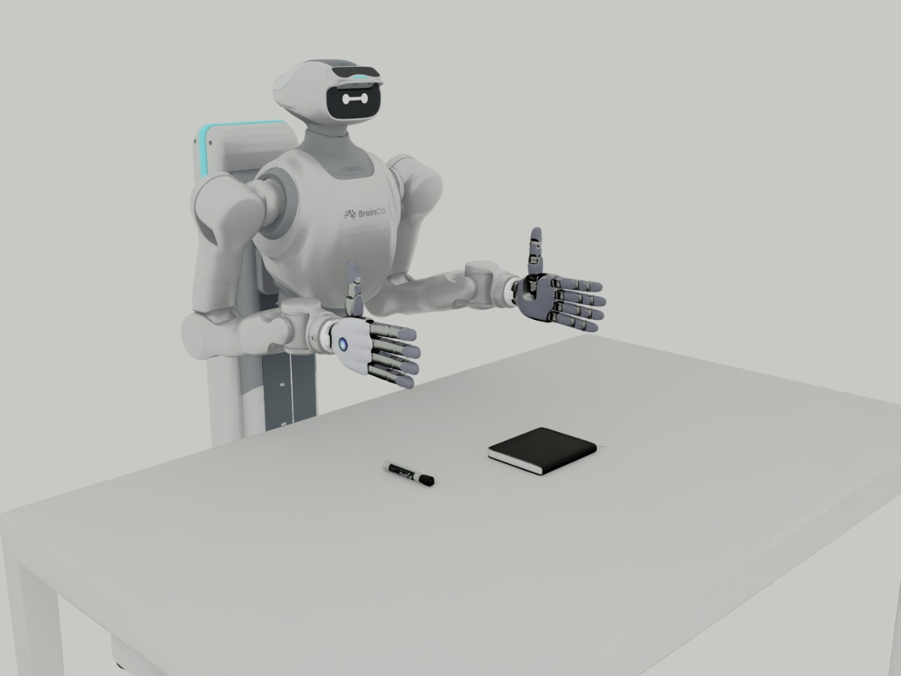

**区别：** 评估连续笔端接触轨迹，不生成笔迹，也不同于一次盖印。

**初态：** 笔记本平放，记号笔在右侧；路径由笔记本表面坐标定义，不添加实体标记。

### 使用的资产

| 道具 | 数量 | 注册 ID | 预览 |
|---|---:|---|---|
| 笔记本 | 1 | `obj.tabletop50.notebook@scene_v1` | [实物网格](assets/notebook.jpg) |
| 粗记号笔 | 1 | `obj.tabletop100.marker@scene_v1` | [实物网格](assets/marker.jpg) |

准备后的运行路径（相对 checkout）：

```text
assets/library/prepared/obj.tabletop50.notebook/scene_v1/model.usdc
assets/library/prepared/obj.tabletop100.marker/scene_v1/model.usdc
```

原始路径（相对原始资产根目录）：

```text
library/external/bench2dex/bf65215f844d/Objects/196_notebook/base2.glb
library/external/bench2dex/bf65215f844d/Objects/040_large_marker/textured.obj
```

### 怎么做

1. 握笔并把笔端移到路径起点。
2. 连续经过笔记本表面四个折线点。
3. 抬笔，放回桌面。

### 验收标准

1. 笔端按顺序经过四个目标点，每点误差小于 5 mm。
2. 段内笔端到表面距离在 0–3 mm，不能穿透纸面。
3. 折线转角处连续减速，笔记本位移不超过 2 cm。

### 开发前检查

1. 资产为整体记号笔；先标定端部坐标，不假设笔盖可拆或存在墨水模型。

<a id="proposal_55_roller_sponge"></a>
## 55 · 双手用擀面杖沿海绵往返滚动

`proposal_55_roller_sponge` · 未开始 · 0 条轨迹

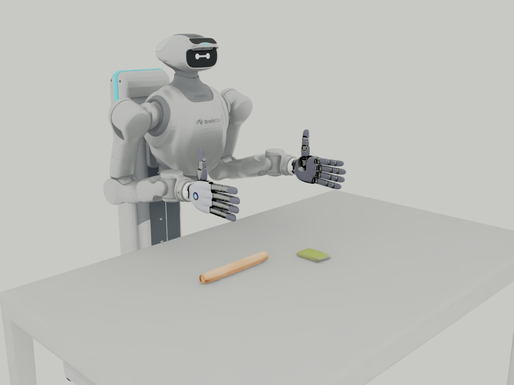

**区别：** 考察滚动接触和工具朝向，不把刚体海绵当成可压缩材料。

**初态：** 海绵平放，擀面杖在右前方。

### 使用的资产

| 道具 | 数量 | 注册 ID | 预览 |
|---|---:|---|---|
| 海绵 | 1 | `obj.tabletop50.sponge@scene_v1` | [实物网格](assets/sponge.jpg) |
| 擀面杖 | 1 | `obj.tabletop100.roller@scene_v1` | [实物网格](assets/roller.jpg) |

准备后的运行路径（相对 checkout）：

```text
assets/library/prepared/obj.tabletop50.sponge/scene_v1/model.usdc
assets/library/prepared/obj.tabletop100.roller/scene_v1/model.usdc
```

原始路径（相对原始资产根目录）：

```text
library/external/bench2dex/bf65215f844d/Objects/026_sponge/textured.obj
library/external/bench2dex/bf65215f844d/Objects/205_roller/base2.glb
```

### 怎么做

1. 双手扶住擀面杖两端，将圆柱曲面贴到海绵一端。
2. 保持曲面接触，让擀面杖整体转动，完成一次前进和返回。
3. 抬起工具并放下。

### 验收标准

1. 接触覆盖海绵长度至少 80%，往返各一次，擀面杖绕自身长轴转动。
2. 接触使用擀面杖曲面，海绵平移不超过 2 cm。
3. 曲面不穿透海绵；不能只平移而不转动。

### 开发前检查

1. 源模型为整根刚体擀面杖，滚动由整体姿态变化实现；不假设独立轮轴。

<a id="proposal_56_spoon_bowl_wall"></a>
## 56 · 勺子沿碗内壁绕一圈

`proposal_56_spoon_bowl_wall` · 未开始 · 0 条轨迹

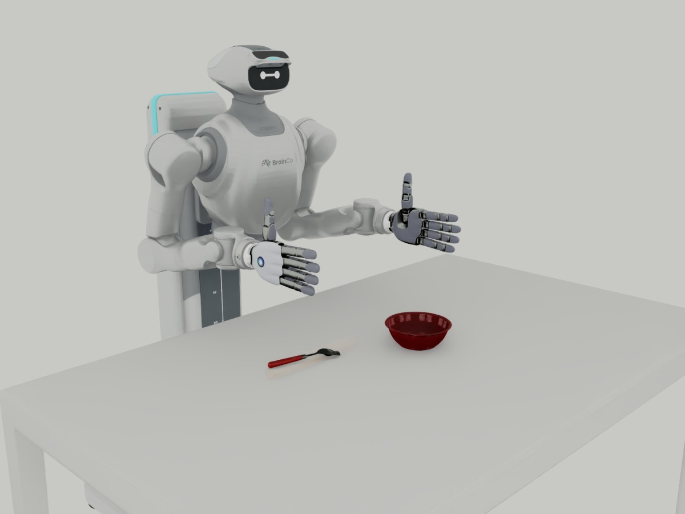

**区别：** 沿凹面保持接触，不是从碗内舀取物体。

**初态：** 空碗在中央，勺子在右侧。

### 使用的资产

| 道具 | 数量 | 注册 ID | 预览 |
|---|---:|---|---|
| 碗 | 1 | `obj.tabletop50.bowl@scene_v1` | [实物网格](assets/bowl.jpg) |
| 金属勺 | 1 | `obj.tabletop50.spoon@scene_v1` | [实物网格](assets/spoon.jpg) |

准备后的运行路径（相对 checkout）：

```text
assets/library/prepared/obj.tabletop50.bowl/scene_v1/model.usdc
assets/library/prepared/obj.tabletop50.spoon/scene_v1/model.usdc
```

原始路径（相对原始资产根目录）：

```text
library/external/bench2dex/bf65215f844d/Objects/024_bowl/textured.obj
library/external/bench2dex/bf65215f844d/Objects/031_spoon/textured.obj
```

### 怎么做

1. 一手扶住碗外壁，另一手握勺。
2. 勺面沿碗内壁连续绕行一周。
3. 退出勺子并松开碗。

### 验收标准

1. 接触点绕碗轴累计至少 330°。
2. 勺面与碗内壁保持非穿透接触，不能从碗外绕过。
3. 碗位移不超过 2 cm，勺子顺利退出。

### 开发前检查

1. 使用实际网格核对抓取空间、支撑面与机器人可达性；转成动态资产后再测试。

<a id="proposal_57_brush_shoe_sole"></a>
## 57 · 翻起鞋子后刷扫鞋底

`proposal_57_brush_shoe_sole` · 未开始 · 0 条轨迹

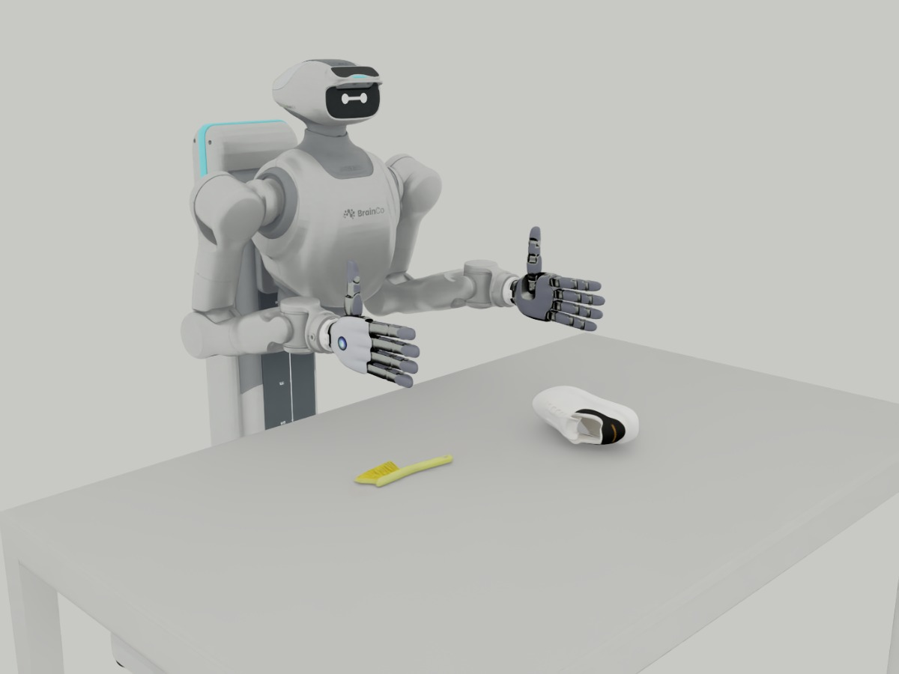

**区别：** 被清洁物体也在手中，需要双手持续相对定位。

**初态：** 鞋子侧放，刷子在右侧。

### 使用的资产

| 道具 | 数量 | 注册 ID | 预览 |
|---|---:|---|---|
| 鞋 | 1 | `obj.tabletop50.shoe@scene_v1` | [实物网格](assets/shoe.jpg) |
| 刷子 | 1 | `obj.tabletop50.brush@scene_v1` | [实物网格](assets/brush.jpg) |

准备后的运行路径（相对 checkout）：

```text
assets/library/prepared/obj.tabletop50.shoe/scene_v1/model.usdc
assets/library/prepared/obj.tabletop50.brush/scene_v1/model.usdc
```

原始路径（相对原始资产根目录）：

```text
library/external/bench2dex/bf65215f844d/Objects/153_shoe/base9.glb
library/external/bench2dex/bf65215f844d/Objects/189_brush/base3.glb
```

### 怎么做

1. 一手抓住鞋面，把鞋底转向刷子。
2. 另一手沿鞋底纵向刷三次。
3. 将鞋放正，再放下刷子。

### 验收标准

1. 刷毛接触覆盖鞋底长度至少 70%。
2. 三次刷扫期间鞋子由另一手持续支撑。
3. 鞋底最终朝桌面，鞋与工具均稳定 2 s。

### 开发前检查

1. 使用实际网格核对抓取空间、支撑面与机器人可达性；转成动态资产后再测试。

<a id="proposal_58_wipe_plate_faces"></a>
## 58 · 持盘擦拭正反两面

`proposal_58_wipe_plate_faces` · 未开始 · 0 条轨迹

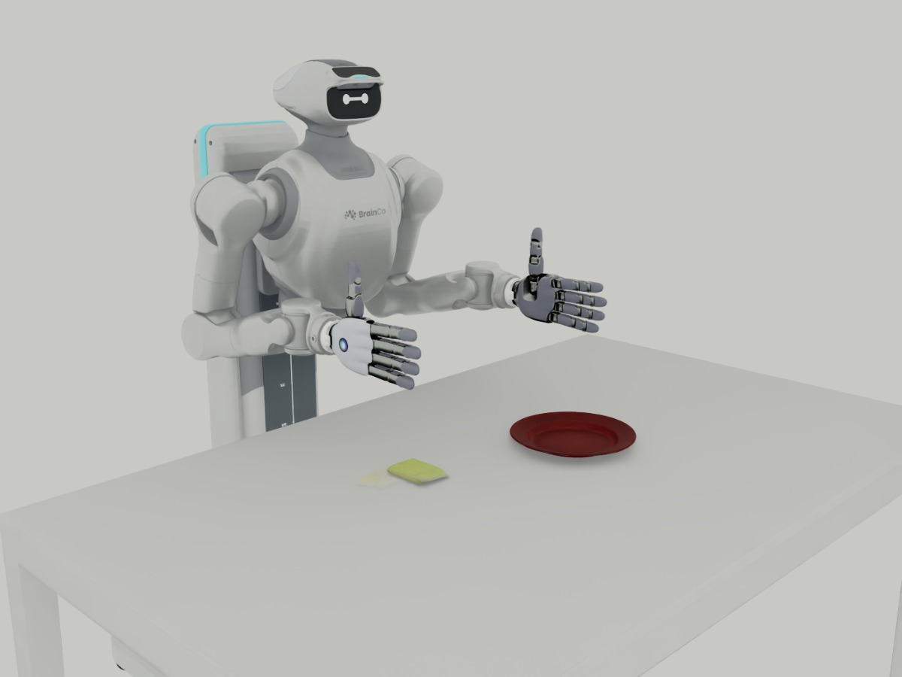

**区别：** 增加持物翻面与双面接触，区别于扶直瓶子擦外壁。

**初态：** 餐盘平放，海绵在右侧。

### 使用的资产

| 道具 | 数量 | 注册 ID | 预览 |
|---|---:|---|---|
| 餐盘 | 1 | `obj.tabletop50.plate@scene_v1` | [实物网格](assets/plate.jpg) |
| 海绵 | 1 | `obj.tabletop50.sponge@scene_v1` | [实物网格](assets/sponge.jpg) |

准备后的运行路径（相对 checkout）：

```text
assets/library/prepared/obj.tabletop50.plate/scene_v1/model.usdc
assets/library/prepared/obj.tabletop50.sponge/scene_v1/model.usdc
```

原始路径（相对原始资产根目录）：

```text
library/external/bench2dex/bf65215f844d/Objects/029_plate/textured.obj
library/external/bench2dex/bf65215f844d/Objects/026_sponge/textured.obj
```

### 怎么做

1. 一手抓住盘沿，另一手持海绵擦盘内面。
2. 重新调整盘子握持，翻转后擦外底面。
3. 将盘子放正，放回海绵。

### 验收标准

1. 内面和外底面分别覆盖预先定义的三个接触区。
2. 翻面时盘子全程有真实手部支撑。
3. 盘子不撞桌，最终正放并稳定 2 s。

### 开发前检查

1. 使用实际网格核对抓取空间、支撑面与机器人可达性；转成动态资产后再测试。

<a id="proposal_59_knife_can_edge"></a>
## 59 · 用餐刀辅助捏起薄罐头

`proposal_59_knife_can_edge` · 未开始 · 0 条轨迹

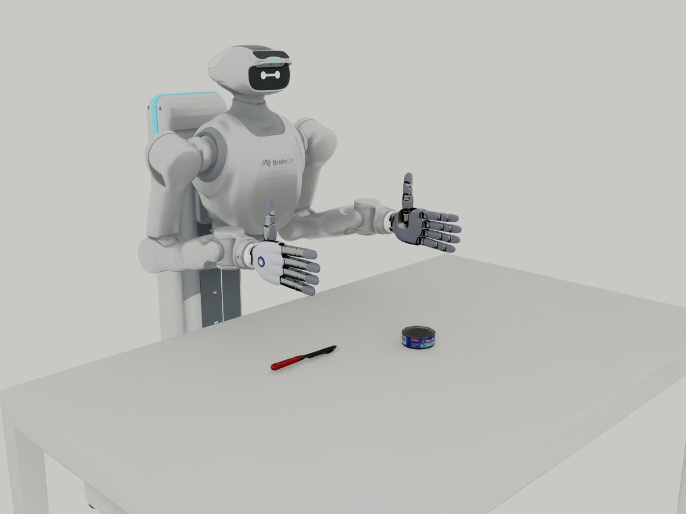

**区别：** 工具创造手指抓取间隙，并完成工具到手的支撑交接。

**初态：** 薄金枪鱼罐平放，餐刀在旁。

### 使用的资产

| 道具 | 数量 | 注册 ID | 预览 |
|---|---:|---|---|
| 金枪鱼罐 | 1 | `obj.tabletop50.tuna@scene_v1` | [实物网格](assets/tuna.jpg) |
| 餐刀 | 1 | `obj.tabletop100.knife@scene_v1` | [实物网格](assets/knife.jpg) |

准备后的运行路径（相对 checkout）：

```text
assets/library/prepared/obj.tabletop50.tuna/scene_v1/model.usdc
assets/library/prepared/obj.tabletop100.knife/scene_v1/model.usdc
```

原始路径（相对原始资产根目录）：

```text
library/external/bench2dex/bf65215f844d/Objects/007_tuna_fish_can/textured.obj
library/external/bench2dex/bf65215f844d/Objects/032_knife/textured.obj
```

### 怎么做

1. 将餐刀薄边伸到罐体底缘，轻抬一侧。
2. 另一只手利用新增间隙捏住罐沿。
3. 撤刀后把罐头放到旁侧。

### 验收标准

1. 先由工具抬起罐体一侧至少 8 mm，再由手接管。
2. 手接管前刀具不能穿透罐底；不能切割罐体。
3. 罐头移开至少 12 cm，放稳 2 s。

### 开发前检查

1. 使用实际网格核对抓取空间、支撑面与机器人可达性；转成动态资产后再测试。

<a id="proposal_60_driver_key_targets"></a>
## 60 · 用螺丝刀柄端依次触碰计算器按键

`proposal_60_driver_key_targets` · 未开始 · 0 条轨迹

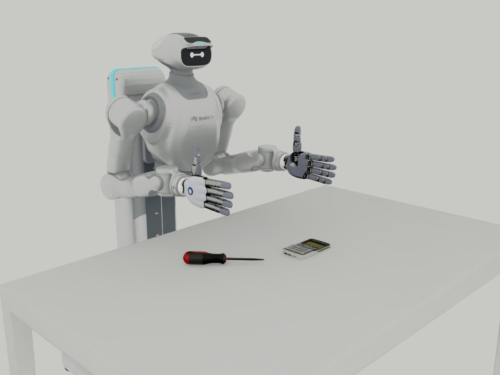

**区别：** 考察工具端点定位及接触顺序，不宣称静态网格有按键电路。

**初态：** 计算器朝上，螺丝刀在右侧；选定三个不同按键表面。

### 使用的资产

| 道具 | 数量 | 注册 ID | 预览 |
|---|---:|---|---|
| 计算器 | 1 | `obj.tabletop50.calculator@scene_v1` | [实物网格](assets/calculator.jpg) |
| 一字螺丝刀 | 1 | `obj.tabletop50.driver@scene_v1` | [实物网格](assets/driver.jpg) |

准备后的运行路径（相对 checkout）：

```text
assets/library/prepared/obj.tabletop50.calculator/scene_v1/model.usdc
assets/library/prepared/obj.tabletop50.driver/scene_v1/model.usdc
```

原始路径（相对原始资产根目录）：

```text
library/external/bench2dex/bf65215f844d/Objects/135_calculator/base5.glb
library/external/bench2dex/bf65215f844d/Objects/044_flat_screwdriver/textured.obj
```

### 怎么做

1. 握住螺丝刀杆，让钝柄端朝下。
2. 按顺序轻触三个按键表面，每次离开后再到下一键。
3. 放回工具。

### 验收标准

1. 柄端按序进入三个按键中心半径 4 mm 范围。
2. 每次触碰持续 0.1–0.5 s，间隔有可观测离面。
3. 计算器位移小于 1 cm；不要求数字显示或电子功能变化。

### 开发前检查

1. 标定柄端及三个按键表面；后续若要求按键行程需另接真实关节。

<a id="proposal_61_plate_orange_chute"></a>
## 61 · 倾斜餐盘让橙子滚入碗

`proposal_61_plate_orange_chute` · 未开始 · 0 条轨迹

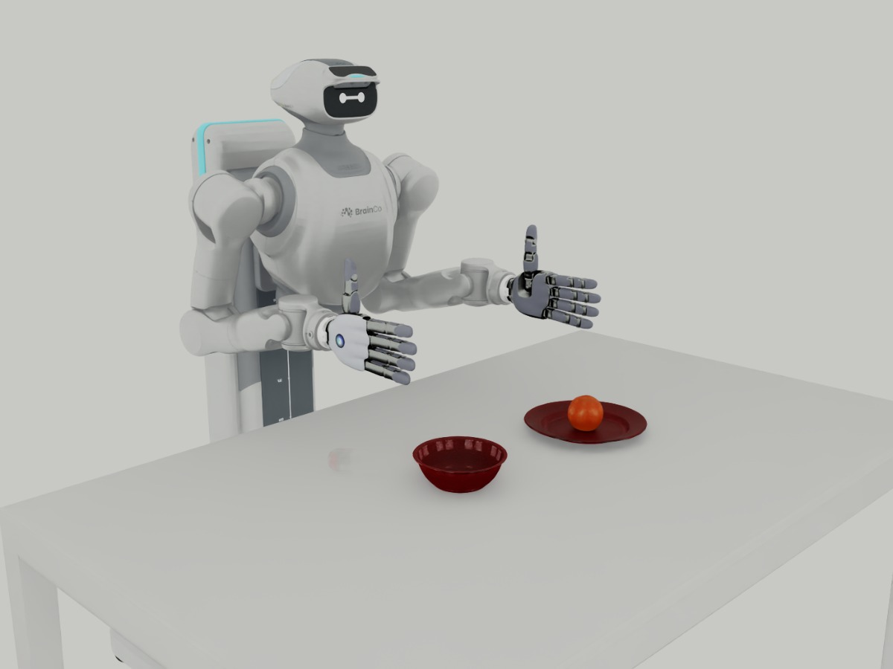

**区别：** 开放盘面的倾角控制与球形物滚动，区别于罐中倒料。

**初态：** 橙子在盘中央，空碗在旁侧。

### 使用的资产

| 道具 | 数量 | 注册 ID | 预览 |
|---|---:|---|---|
| 餐盘 | 1 | `obj.tabletop50.plate@scene_v1` | [实物网格](assets/plate.jpg) |
| 橙子 | 1 | `obj.tabletop100.orange@scene_v1` | [实物网格](assets/orange.jpg) |
| 碗 | 1 | `obj.tabletop50.bowl@scene_v1` | [实物网格](assets/bowl.jpg) |

准备后的运行路径（相对 checkout）：

```text
assets/library/prepared/obj.tabletop50.plate/scene_v1/model.usdc
assets/library/prepared/obj.tabletop100.orange/scene_v1/model.usdc
assets/library/prepared/obj.tabletop50.bowl/scene_v1/model.usdc
```

原始路径（相对原始资产根目录）：

```text
library/external/bench2dex/bf65215f844d/Objects/029_plate/textured.obj
library/external/bench2dex/bf65215f844d/Objects/017_orange/textured.obj
library/external/bench2dex/bf65215f844d/Objects/024_bowl/textured.obj
```

### 怎么做

1. 双手拿稳盘子并把低侧盘沿靠近碗口。
2. 逐渐倾盘，使橙子滚入碗。
3. 把空盘放回。

### 验收标准

1. 橙子通过重力及盘面接触进入碗，手不直接接触橙子。
2. 滚落高度小于 5 cm，盘子不击打碗沿。
3. 橙子留在碗内稳定 2 s。

### 开发前检查

1. 使用实际网格核对抓取空间、支撑面与机器人可达性；转成动态资产后再测试。

<a id="proposal_62_loaded_tray_curve"></a>
## 62 · 端着杯与罐头绕过高瓶

`proposal_62_loaded_tray_curve` · 未开始 · 0 条轨迹

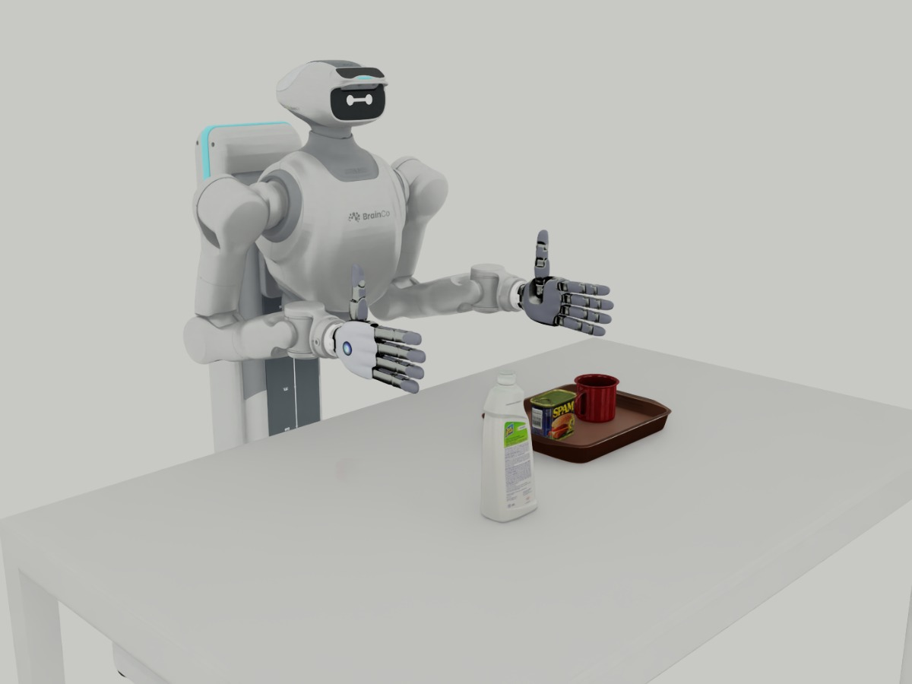

**区别：** 非对称真实载荷加绕障，不只是空托盘搬运。

**初态：** 杯与罐头分放托盘两端，清洁剂瓶在运输路径旁。

### 使用的资产

| 道具 | 数量 | 注册 ID | 预览 |
|---|---:|---|---|
| 长方托盘 | 1 | `obj.tabletop100.tray@scene_v1` | [实物网格](assets/tray.jpg) |
| 带柄马克杯 | 1 | `obj.tabletop100.mug@scene_v1` | [实物网格](assets/mug.jpg) |
| 午餐肉罐 | 1 | `obj.tabletop100.meatcan@scene_v1` | [实物网格](assets/meatcan.jpg) |
| 清洁剂瓶 | 1 | `obj.tabletop100.cleanser@scene_v1` | [实物网格](assets/cleanser.jpg) |

准备后的运行路径（相对 checkout）：

```text
assets/library/prepared/obj.tabletop100.tray/scene_v1/model.usdc
assets/library/prepared/obj.tabletop100.mug/scene_v1/model.usdc
assets/library/prepared/obj.tabletop100.meatcan/scene_v1/model.usdc
assets/library/prepared/obj.tabletop100.cleanser/scene_v1/model.usdc
```

原始路径（相对原始资产根目录）：

```text
library/external/bench2dex/bf65215f844d/Objects/130_tray/base3.glb
library/external/bench2dex/bf65215f844d/Objects/025_mug/textured.obj
library/external/bench2dex/bf65215f844d/Objects/010_potted_meat_can/textured.obj
library/external/bench2dex/bf65215f844d/Objects/021_bleach_cleanser/textured.obj
```

### 怎么做

1. 双手端起托盘。
2. 绕过高瓶移动到桌面另一侧。
3. 平稳放下，松手。

### 验收标准

1. 托盘移动至少 25 cm，与瓶子保持至少 2 cm 几何间隙。
2. 杯和罐头始终受托盘支撑，相对滑移各不超过 2 cm。
3. 高瓶位移小于 1 cm，载荷不倾倒。

### 开发前检查

1. 使用实际网格核对抓取空间、支撑面与机器人可达性；转成动态资产后再测试。

<a id="proposal_63_ball_plate_level"></a>
## 63 · 端盘移动时让球留在中央

`proposal_63_ball_plate_level` · 未开始 · 0 条轨迹

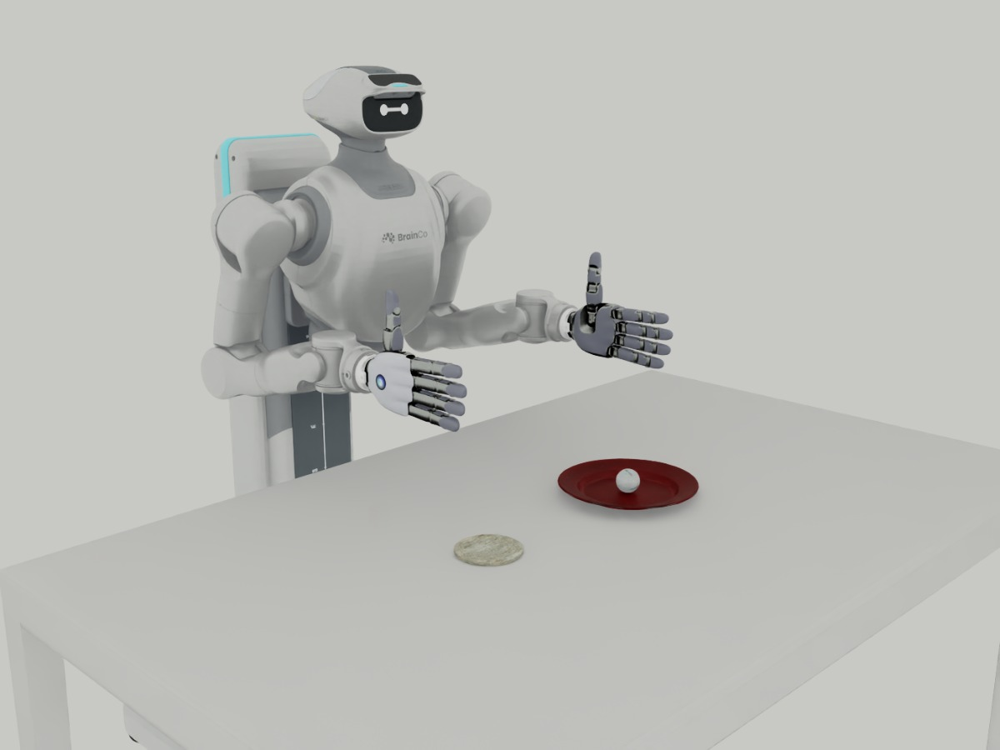

**区别：** 控制自由滚动物相对位置，比勺托草莓更强调姿态反馈。

**初态：** 高尔夫球在盘中央，杯垫标示目标区域旁边。

### 使用的资产

| 道具 | 数量 | 注册 ID | 预览 |
|---|---:|---|---|
| 餐盘 | 1 | `obj.tabletop50.plate@scene_v1` | [实物网格](assets/plate.jpg) |
| 高尔夫球 | 1 | `obj.tabletop50.golf@scene_v1` | [实物网格](assets/golf.jpg) |
| 杯垫 | 1 | `obj.tabletop50.coaster@scene_v1` | [实物网格](assets/coaster.jpg) |

准备后的运行路径（相对 checkout）：

```text
assets/library/prepared/obj.tabletop50.plate/scene_v1/model.usdc
assets/library/prepared/obj.tabletop50.golf/scene_v1/model.usdc
assets/library/prepared/obj.tabletop50.coaster/scene_v1/model.usdc
```

原始路径（相对原始资产根目录）：

```text
library/external/bench2dex/bf65215f844d/Objects/029_plate/textured.obj
library/external/bench2dex/bf65215f844d/Objects/058_golf_ball/textured.obj
library/external/bench2dex/bf65215f844d/Objects/137_coaster/base0.glb
```

### 怎么做

1. 双手抬盘。
2. 把盘平移到杯垫旁并停稳。
3. 放下盘子，保持球不滚出。

### 验收标准

1. 盘子离桌至少 4 cm、平移至少 20 cm。
2. 球与盘中心距离不超过盘有效半径的 50%。
3. 手不能按住球，放下后球稳定 2 s。

### 开发前检查

1. 使用实际网格核对抓取空间、支撑面与机器人可达性；转成动态资产后再测试。

<a id="proposal_64_pitcher_gate"></a>
## 64 · 转动量壶通过两盒之间

`proposal_64_pitcher_gate` · 未开始 · 0 条轨迹

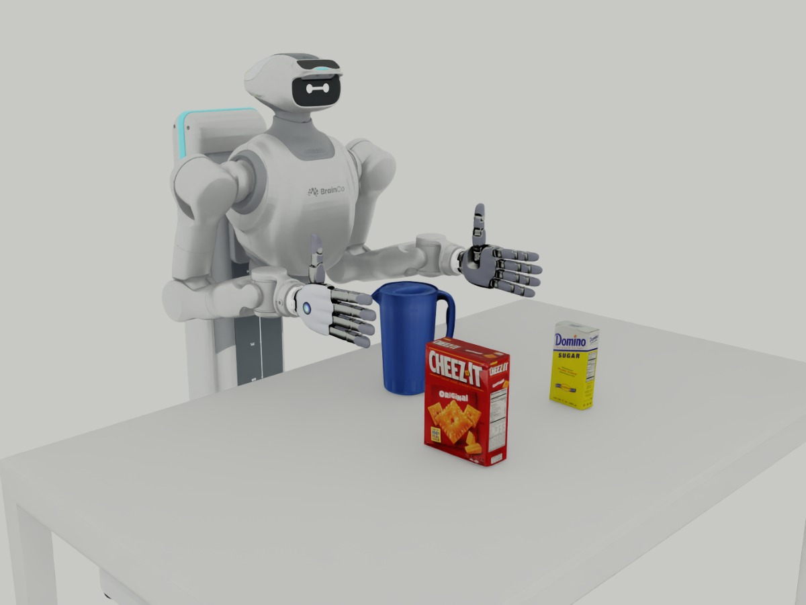

**区别：** 不对称带柄容器的全物体避障，不是长法棍的轴向穿越。

**初态：** 量壶在前方，两只高包装盒形成通道；壶把初始横向。

### 使用的资产

| 道具 | 数量 | 注册 ID | 预览 |
|---|---:|---|---|
| 带柄量壶 | 1 | `obj.tabletop100.pitcher@scene_v1` | [实物网格](assets/pitcher.jpg) |
| 糖盒 | 1 | `obj.tabletop100.sugar@scene_v1` | [实物网格](assets/sugar.jpg) |
| 饼干盒 | 1 | `obj.tabletop50.cracker@scene_v1` | [实物网格](assets/cracker.jpg) |

准备后的运行路径（相对 checkout）：

```text
assets/library/prepared/obj.tabletop100.pitcher/scene_v1/model.usdc
assets/library/prepared/obj.tabletop100.sugar/scene_v1/model.usdc
assets/library/prepared/obj.tabletop50.cracker/scene_v1/model.usdc
```

原始路径（相对原始资产根目录）：

```text
library/external/bench2dex/bf65215f844d/Objects/019_pitcher_base/textured.obj
library/external/bench2dex/bf65215f844d/Objects/004_sugar_box/textured.obj
library/external/bench2dex/bf65215f844d/Objects/003_cracker_box/textured.obj
```

### 怎么做

1. 握住壶把与壶身，抬起。
2. 把量壶转到窄侧朝向通道，低位通过。
3. 通道后方放下并恢复壶嘴朝向。

### 验收标准

1. 完整壶体含把手从两盒之间通过，最低点离桌不高于 8 cm。
2. 途中与盒子无接触，盒子位移小于 1 cm。
3. 量壶最终直立，壶嘴朝向误差小于 10°。

### 开发前检查

1. 根据完整壶体凸包核对通道窄向可通过、宽向需转动；不可只检查壶身。

<a id="proposal_65_book_ramp_ball"></a>
## 65 · 搭出书本斜坡让球滚入托盘

`proposal_65_book_ramp_ball` · 未开始 · 0 条轨迹

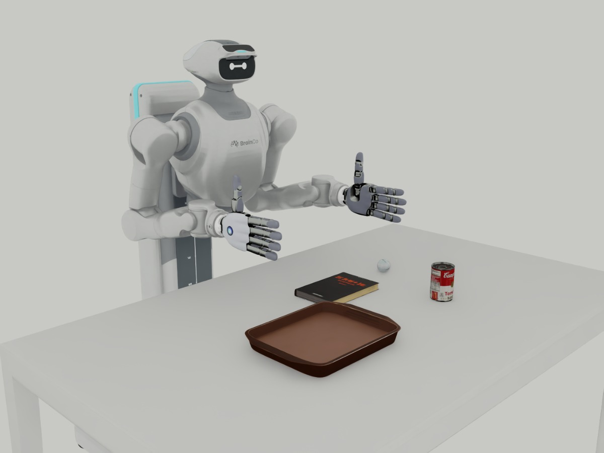

**区别：** 先建立几何关系再利用重力输送；区别于直接滚球交接。

**初态：** 书、罐头、托盘和球分开放置。

### 使用的资产

| 道具 | 数量 | 注册 ID | 预览 |
|---|---:|---|---|
| 书 | 1 | `obj.tabletop50.book@scene_v1` | [实物网格](assets/book.jpg) |
| 汤罐 | 1 | `obj.tabletop100.soupcan@scene_v1` | [实物网格](assets/soupcan.jpg) |
| 长方托盘 | 1 | `obj.tabletop100.tray@scene_v1` | [实物网格](assets/tray.jpg) |
| 高尔夫球 | 1 | `obj.tabletop50.golf@scene_v1` | [实物网格](assets/golf.jpg) |

准备后的运行路径（相对 checkout）：

```text
assets/library/prepared/obj.tabletop50.book/scene_v1/model.usdc
assets/library/prepared/obj.tabletop100.soupcan/scene_v1/model.usdc
assets/library/prepared/obj.tabletop100.tray/scene_v1/model.usdc
assets/library/prepared/obj.tabletop50.golf/scene_v1/model.usdc
```

原始路径（相对原始资产根目录）：

```text
library/external/bench2dex/bf65215f844d/Objects/155_book/base1.glb
library/external/bench2dex/bf65215f844d/Objects/005_tomato_soup_can/textured.obj
library/external/bench2dex/bf65215f844d/Objects/130_tray/base3.glb
library/external/bench2dex/bf65215f844d/Objects/058_golf_ball/textured.obj
```

### 怎么做

1. 用罐头支撑书本一端，另一端接近托盘。
2. 把球放在坡顶后松手。
3. 等待球滚入托盘。

### 验收标准

1. 书本形成 10°–35°斜坡，两个支撑接触真实。
2. 球释放后靠重力滚过书面并进入托盘，手不再推球。
3. 搭建物不塌落，球留在托盘内 2 s。

### 开发前检查

1. 使用实际网格核对抓取空间、支撑面与机器人可达性；转成动态资产后再测试。

<a id="proposal_66_build_car_bridge"></a>
## 66 · 用书和罐头搭桥让小车穿过

`proposal_66_build_car_bridge` · 未开始 · 0 条轨迹

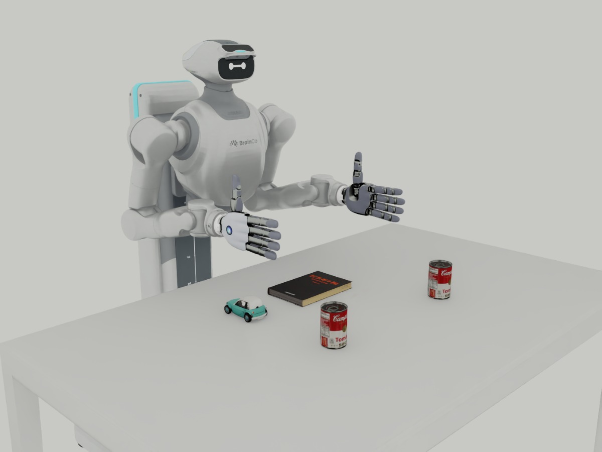

**区别：** 搭建必须满足另一物体的通行需求，不只是横放毛笔。

**初态：** 书本、两只汤罐和小车分开放置。

### 使用的资产

| 道具 | 数量 | 注册 ID | 预览 |
|---|---:|---|---|
| 书 | 1 | `obj.tabletop50.book@scene_v1` | [实物网格](assets/book.jpg) |
| 汤罐 | 2 | `obj.tabletop100.soupcan@scene_v1` | [实物网格](assets/soupcan.jpg) |
| 玩具车 | 1 | `obj.tabletop50.toycar@scene_v1` | [实物网格](assets/toycar.jpg) |

准备后的运行路径（相对 checkout）：

```text
assets/library/prepared/obj.tabletop50.book/scene_v1/model.usdc
assets/library/prepared/obj.tabletop100.soupcan/scene_v1/model.usdc
assets/library/prepared/obj.tabletop50.toycar/scene_v1/model.usdc
```

原始路径（相对原始资产根目录）：

```text
library/external/bench2dex/bf65215f844d/Objects/155_book/base1.glb
library/external/bench2dex/bf65215f844d/Objects/005_tomato_soup_can/textured.obj
library/external/bench2dex/bf65215f844d/Objects/165_toycar/base5.glb
```

### 怎么做

1. 把两罐间隔摆好，用书本横搭桥面。
2. 扶住桥面，另一手让小车从桥下经过。
3. 撤手检查桥是否稳定。

### 验收标准

1. 桥下净空大于小车外形，书本同时支撑在两罐上。
2. 小车完整从桥下穿过，未推倒支撑罐。
3. 撤手后桥保持 2 s。

### 开发前检查

1. 使用实际网格核对抓取空间、支撑面与机器人可达性；转成动态资产后再测试。

<a id="proposal_67_insert_coaster_mug"></a>
## 67 · 抬杯后把杯垫送到杯底

`proposal_67_insert_coaster_mug` · 未开始 · 0 条轨迹


**区别：** 在持杯期间插入支撑物，时序与抽走杯垫相反。

**初态：** 杯子直立在桌上，杯垫在右前方。

### 使用的资产

| 道具 | 数量 | 注册 ID | 预览 |
|---|---:|---|---|
| 带柄马克杯 | 1 | `obj.tabletop100.mug@scene_v1` | [实物网格](assets/mug.jpg) |
| 杯垫 | 1 | `obj.tabletop50.coaster@scene_v1` | [实物网格](assets/coaster.jpg) |

准备后的运行路径（相对 checkout）：

```text
assets/library/prepared/obj.tabletop100.mug/scene_v1/model.usdc
assets/library/prepared/obj.tabletop50.coaster/scene_v1/model.usdc
```

原始路径（相对原始资产根目录）：

```text
library/external/bench2dex/bf65215f844d/Objects/025_mug/textured.obj
library/external/bench2dex/bf65215f844d/Objects/137_coaster/base0.glb
```

### 怎么做

1. 一手握杯把，只把杯子抬起少量。
2. 另一手把杯垫平移到杯底正下方。
3. 把杯子落到杯垫并依次松手。

### 验收标准

1. 杯子抬起高度为 2–6 cm，杯垫不撞杯底。
2. 杯底投影完全落在杯垫有效支撑范围内。
3. 双手释放后杯子直立稳定 2 s。

### 开发前检查

1. 使用实际网格核对抓取空间、支撑面与机器人可达性；转成动态资产后再测试。

<a id="proposal_68_invert_bowl_plate"></a>
## 68 · 用盘盖住碗后夹持翻转

`proposal_68_invert_bowl_plate` · 未开始 · 0 条轨迹

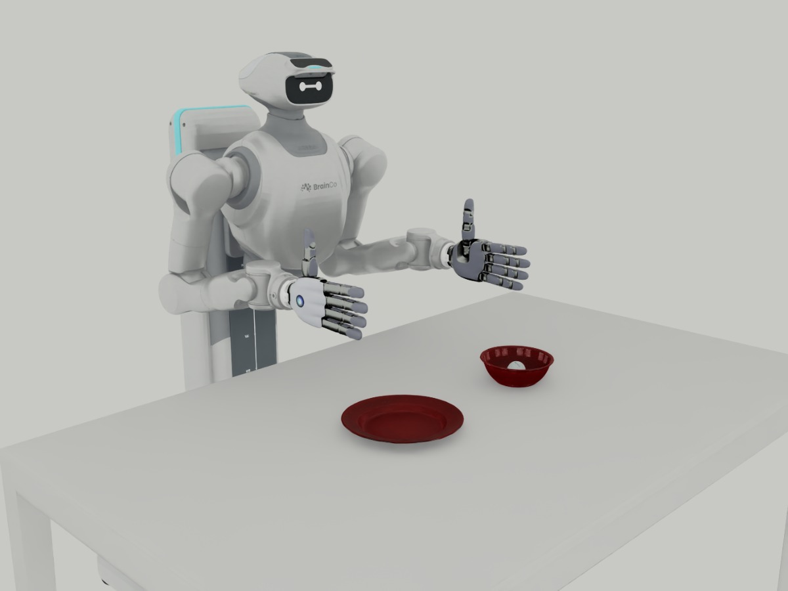

**区别：** 两容器协同封闭和整体翻面，不是单独倒扣杯子。

**初态：** 球在碗内，餐盘在旁侧。

### 使用的资产

| 道具 | 数量 | 注册 ID | 预览 |
|---|---:|---|---|
| 碗 | 1 | `obj.tabletop50.bowl@scene_v1` | [实物网格](assets/bowl.jpg) |
| 高尔夫球 | 1 | `obj.tabletop50.golf@scene_v1` | [实物网格](assets/golf.jpg) |
| 餐盘 | 1 | `obj.tabletop50.plate@scene_v1` | [实物网格](assets/plate.jpg) |

准备后的运行路径（相对 checkout）：

```text
assets/library/prepared/obj.tabletop50.bowl/scene_v1/model.usdc
assets/library/prepared/obj.tabletop50.golf/scene_v1/model.usdc
assets/library/prepared/obj.tabletop50.plate/scene_v1/model.usdc
```

原始路径（相对原始资产根目录）：

```text
library/external/bench2dex/bf65215f844d/Objects/024_bowl/textured.obj
library/external/bench2dex/bf65215f844d/Objects/058_golf_ball/textured.obj
library/external/bench2dex/bf65215f844d/Objects/029_plate/textured.obj
```

### 怎么做

1. 用餐盘覆盖碗口。
2. 双手夹持盘碗组合，连续翻转 180°。
3. 盘朝下放到桌面，拿走倒扣的碗。

### 验收标准

1. 翻转期间球一直被盘碗围住，没有逃逸。
2. 盘和碗始终有真实接触与手部夹持，不能绑定成一体。
3. 移走碗后球留在盘内并稳定 2 s。

### 开发前检查

1. 核对盘径覆盖整个碗口，碰撞网格必须保留真实内腔。

<a id="proposal_69_clamp_bread_plates"></a>
## 69 · 用两只盘子夹住面包搬运

`proposal_69_clamp_bread_plates` · 未开始 · 0 条轨迹

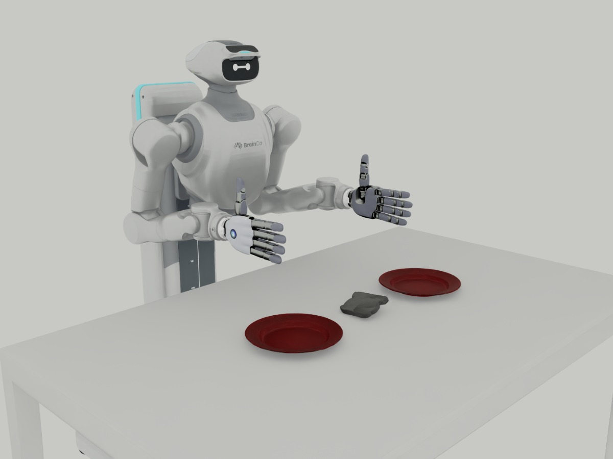

**区别：** 以两块现有餐具构成夹具，区别于叉铲翻面。

**初态：** 面包在中央，两只盘子分别放在两侧。

### 使用的资产

| 道具 | 数量 | 注册 ID | 预览 |
|---|---:|---|---|
| 餐盘 | 2 | `obj.tabletop50.plate@scene_v1` | [实物网格](assets/plate.jpg) |
| 面包片 | 1 | `obj.tabletop50.bread@scene_v1` | [实物网格](assets/bread.jpg) |

准备后的运行路径（相对 checkout）：

```text
assets/library/prepared/obj.tabletop50.plate/scene_v1/model.usdc
assets/library/prepared/obj.tabletop50.bread/scene_v1/model.usdc
```

原始路径（相对原始资产根目录）：

```text
library/external/bench2dex/bf65215f844d/Objects/029_plate/textured.obj
library/external/bench2dex/bf65215f844d/Objects/222_bread_slice/uploads_files_2384335_pan.obj
```

### 怎么做

1. 用两盘的平面从两侧夹住面包。
2. 保持夹持将面包抬起并移动。
3. 把面包放回桌面后分开盘子。

### 验收标准

1. 面包离桌至少 3 cm、平移至少 15 cm。
2. 手不直接触碰面包，支撑来自两盘的真实摩擦接触。
3. 面包无穿透，释放后两盘分离至少 5 cm。

### 开发前检查

1. 使用实际网格核对抓取空间、支撑面与机器人可达性；转成动态资产后再测试。

<a id="proposal_70_spoon_rest_mug"></a>
## 70 · 把勺子横搭在杯口

`proposal_70_spoon_rest_mug` · 未开始 · 0 条轨迹

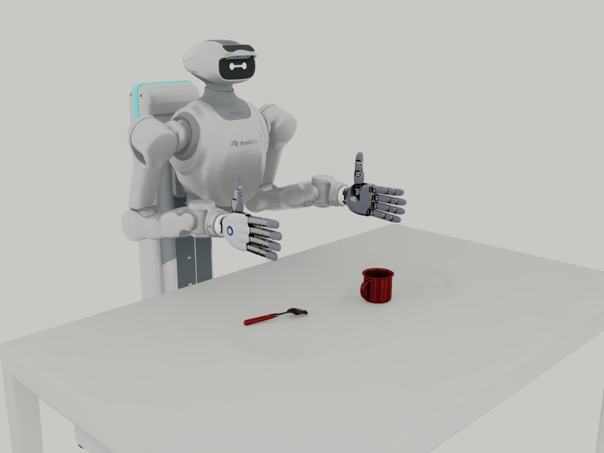

**区别：** 将不对称餐具平衡在曲面窄支撑上，区别于毛笔搭两盒。

**初态：** 空杯直立，勺子平放在右侧。

### 使用的资产

| 道具 | 数量 | 注册 ID | 预览 |
|---|---:|---|---|
| 带柄马克杯 | 1 | `obj.tabletop100.mug@scene_v1` | [实物网格](assets/mug.jpg) |
| 金属勺 | 1 | `obj.tabletop50.spoon@scene_v1` | [实物网格](assets/spoon.jpg) |

准备后的运行路径（相对 checkout）：

```text
assets/library/prepared/obj.tabletop100.mug/scene_v1/model.usdc
assets/library/prepared/obj.tabletop50.spoon/scene_v1/model.usdc
```

原始路径（相对原始资产根目录）：

```text
library/external/bench2dex/bf65215f844d/Objects/025_mug/textured.obj
library/external/bench2dex/bf65215f844d/Objects/031_spoon/textured.obj
```

### 怎么做

1. 抓起勺柄，调整勺子重心。
2. 把勺子横放杯口，形成两侧接触。
3. 缓慢释放并撤手。

### 验收标准

1. 勺子跨过杯口且接触杯沿至少两处。
2. 勺子未掉入杯中，杯子未倾倒。
3. 双手离开 3 cm 后保持 3 s。

### 开发前检查

1. 使用实际网格核对抓取空间、支撑面与机器人可达性；转成动态资产后再测试。

<a id="proposal_71_meter_dice_cup"></a>
## 71 · 从杯中逐个倒出三颗骰子

`proposal_71_meter_dice_cup` · 未开始 · 0 条轨迹

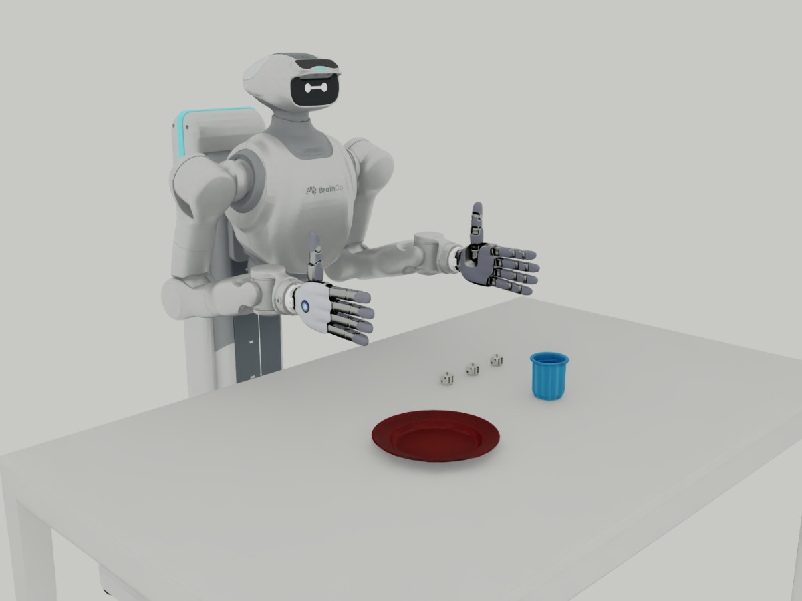

**区别：** 验收离散释放次数和节奏，不是一次倒空。

**初态：** 三颗骰子在杯前分开放置，空盘在右侧。

### 使用的资产

| 道具 | 数量 | 注册 ID | 预览 |
|---|---:|---|---|
| 套杯 B | 1 | `obj.tabletop50.cup_b@scene_v1` | [实物网格](assets/cup_b.jpg) |
| 骰子 | 3 | `obj.tabletop50.dice@scene_v1` | [实物网格](assets/dice.jpg) |
| 餐盘 | 1 | `obj.tabletop50.plate@scene_v1` | [实物网格](assets/plate.jpg) |

准备后的运行路径（相对 checkout）：

```text
assets/library/prepared/obj.tabletop50.cup_b/scene_v1/model.usdc
assets/library/prepared/obj.tabletop50.dice/scene_v1/model.usdc
assets/library/prepared/obj.tabletop50.plate/scene_v1/model.usdc
```

原始路径（相对原始资产根目录）：

```text
library/external/bench2dex/bf65215f844d/Objects/065-b_cups/google_16k/textured.obj
library/external/bench2dex/bf65215f844d/Objects/062_dice/textured.obj
library/external/bench2dex/bf65215f844d/Objects/029_plate/textured.obj
```

### 怎么做

1. 先把三颗骰子放入杯中，再拿起杯子把杯口移到盘上方。
2. 控制倾角，一次只释放一颗，间隔停留。
3. 三颗倒完后把空杯放正。

### 验收标准

1. 三次出杯事件各只有一颗骰子，事件间隔至少 0.3 s。
2. 三颗都留在盘内，无手指伸进杯中取物。
3. 杯子最终直立，骰子静止 2 s。

### 开发前检查

1. 检查三颗骰子的初始不穿插，以及杯口允许分次释放；该有意义停顿不视为无意义停顿。

<a id="proposal_72_cup_to_cup_ball"></a>
## 72 · 双手在两只杯间转移球

`proposal_72_cup_to_cup_ball` · 未开始 · 0 条轨迹

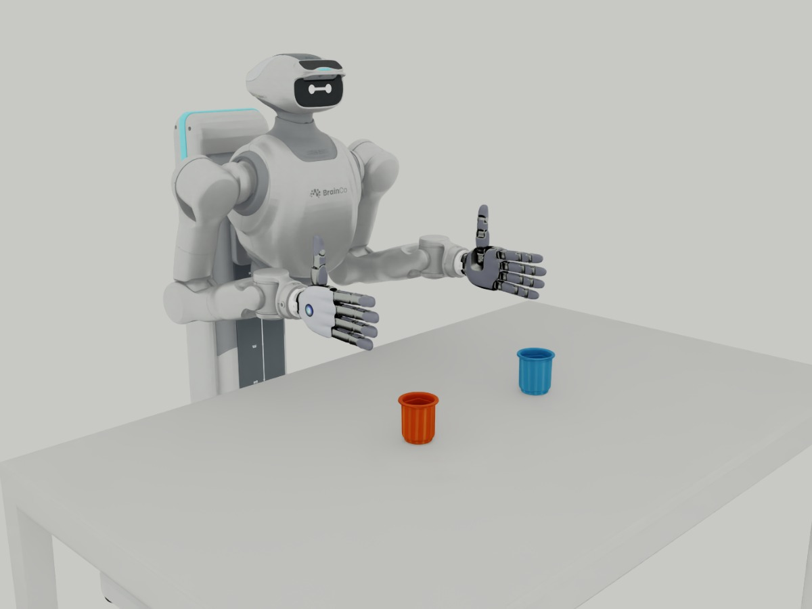

**区别：** 两个运动容器相对对准与接收，不是固定碗接料。

**初态：** 球在左杯，右杯为空。

### 使用的资产

| 道具 | 数量 | 注册 ID | 预览 |
|---|---:|---|---|
| 套杯 B | 1 | `obj.tabletop50.cup_b@scene_v1` | [实物网格](assets/cup_b.jpg) |
| 高尔夫球 | 1 | `obj.tabletop50.golf@scene_v1` | [实物网格](assets/golf.jpg) |
| 套杯 A | 1 | `obj.tabletop50.cup_a@scene_v1` | [实物网格](assets/cup_a.jpg) |

准备后的运行路径（相对 checkout）：

```text
assets/library/prepared/obj.tabletop50.cup_b/scene_v1/model.usdc
assets/library/prepared/obj.tabletop50.golf/scene_v1/model.usdc
assets/library/prepared/obj.tabletop50.cup_a/scene_v1/model.usdc
```

原始路径（相对原始资产根目录）：

```text
library/external/bench2dex/bf65215f844d/Objects/065-b_cups/google_16k/textured.obj
library/external/bench2dex/bf65215f844d/Objects/058_golf_ball/textured.obj
library/external/bench2dex/bf65215f844d/Objects/065-a_cups/google_16k/textured.obj
```

### 怎么做

1. 双手分别拿起一只杯。
2. 对齐杯口并倾斜左杯，把球转入右杯。
3. 分开杯子并放回。

### 验收标准

1. 球从左杯进入右杯，全程不接触手和桌面。
2. 接收时两杯口最短距离小于 3 cm，不能用杯体穿透传球。
3. 两杯放稳，球留在右杯 2 s。

### 开发前检查

1. 使用实际网格核对抓取空间、支撑面与机器人可达性；转成动态资产后再测试。

<a id="proposal_73_thread_marker_handle"></a>
## 73 · 把毛笔穿过杯把

`proposal_73_thread_marker_handle` · 未开始 · 0 条轨迹

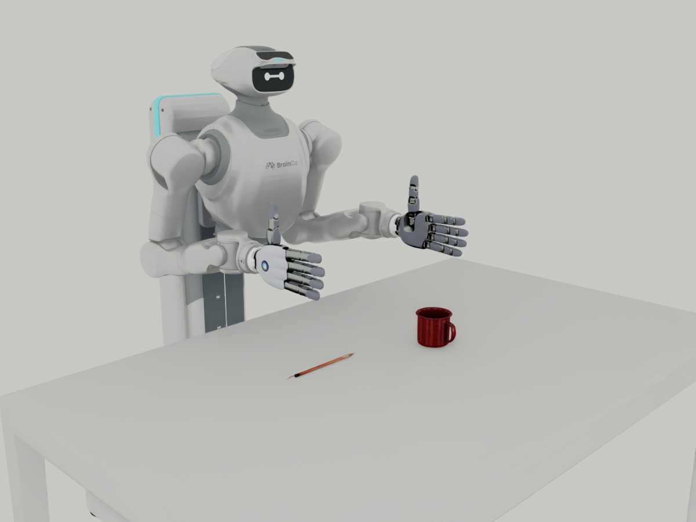

**区别：** 侧向环孔插入和退出，不是向竖直笔筒落笔。

**初态：** 杯把向侧面，细毛笔平放在右前方。

### 使用的资产

| 道具 | 数量 | 注册 ID | 预览 |
|---|---:|---|---|
| 带柄马克杯 | 1 | `obj.tabletop100.mug@scene_v1` | [实物网格](assets/mug.jpg) |
| 毛笔 | 1 | `obj.tabletop50.brushpen@scene_v1` | [实物网格](assets/brushpen.jpg) |

准备后的运行路径（相对 checkout）：

```text
assets/library/prepared/obj.tabletop100.mug/scene_v1/model.usdc
assets/library/prepared/obj.tabletop50.brushpen/scene_v1/model.usdc
```

原始路径（相对原始资产根目录）：

```text
library/external/bench2dex/bf65215f844d/Objects/025_mug/textured.obj
library/external/bench2dex/bf65215f844d/Objects/197_brush-pen/base5.glb
```

### 怎么做

1. 一手稳住杯身，另一手抓笔。
2. 将细毛笔沿杯把孔轴穿过。
3. 再沿原方向抽出并放下。

### 验收标准

1. 笔穿过杯把孔并在另一侧露出至少 2 cm。
2. 穿入和抽出均沿真实孔道，无穿透杯把。
3. 杯子中心位移小于 2 cm。

### 开发前检查

1. 核对笔径与杯把最小孔径；仅使用现有尺寸，不为配合拉伸物体。

<a id="proposal_74_scale_single_fruit"></a>
## 74 · 逐件把水果放到秤面再取下

`proposal_74_scale_single_fruit` · 未开始 · 0 条轨迹

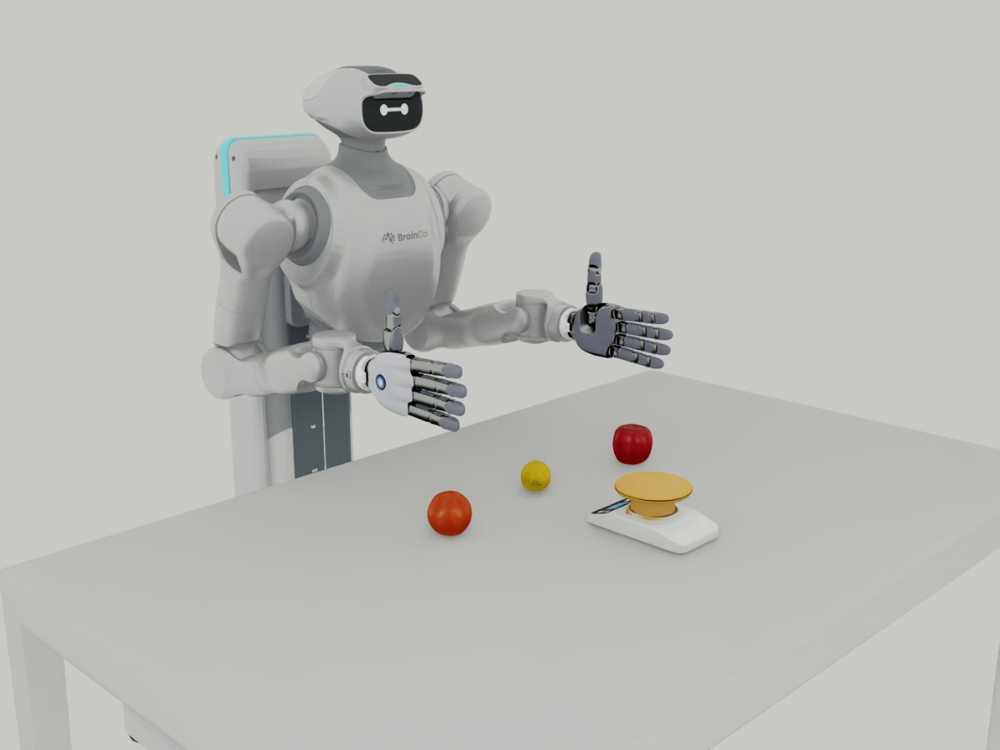

**区别：** 单件占用约束与循环取放，使用真实秤面而不模拟未接入的称重电路。

**初态：** 电子秤在后方，三种水果在前方分开放置。

### 使用的资产

| 道具 | 数量 | 注册 ID | 预览 |
|---|---:|---|---|
| 电子秤 | 1 | `obj.tabletop100.scale@scene_v1` | [实物网格](assets/scale.jpg) |
| 苹果 | 1 | `obj.tabletop50.apple@scene_v1` | [实物网格](assets/apple.jpg) |
| 柠檬 | 1 | `obj.tabletop100.lemon@scene_v1` | [实物网格](assets/lemon.jpg) |
| 橙子 | 1 | `obj.tabletop100.orange@scene_v1` | [实物网格](assets/orange.jpg) |

准备后的运行路径（相对 checkout）：

```text
assets/library/prepared/obj.tabletop100.scale/scene_v1/model.usdc
assets/library/prepared/obj.tabletop50.apple/scene_v1/model.usdc
assets/library/prepared/obj.tabletop100.lemon/scene_v1/model.usdc
assets/library/prepared/obj.tabletop100.orange/scene_v1/model.usdc
```

原始路径（相对原始资产根目录）：

```text
library/external/bench2dex/bf65215f844d/Objects/179_electronicscale/base6.glb
library/external/bench2dex/bf65215f844d/Objects/013_apple/textured.obj
library/external/bench2dex/bf65215f844d/Objects/014_lemon/textured.obj
library/external/bench2dex/bf65215f844d/Objects/017_orange/textured.obj
```

### 怎么做

1. 按苹果、柠檬、橙子的顺序逐个放到秤面中央。
2. 每次停稳后取下，再放下一件。
3. 把三件放回各自初始区域。

### 验收标准

1. 秤面同时最多只有一件水果，每件独立停稳至少 1 s。
2. 果体完全由秤面支撑，不能仍握在手里假称放置完成。
3. 顺序正确，秤不移动超过 1 cm；不要求电子读数。

### 开发前检查

1. 标定秤台有效支撑区域；禁止把纹理数字当作测量质量。

<a id="proposal_75_can_pyramid"></a>
## 75 · 把三只罐头搭成小拱堆

`proposal_75_can_pyramid` · 未开始 · 0 条轨迹

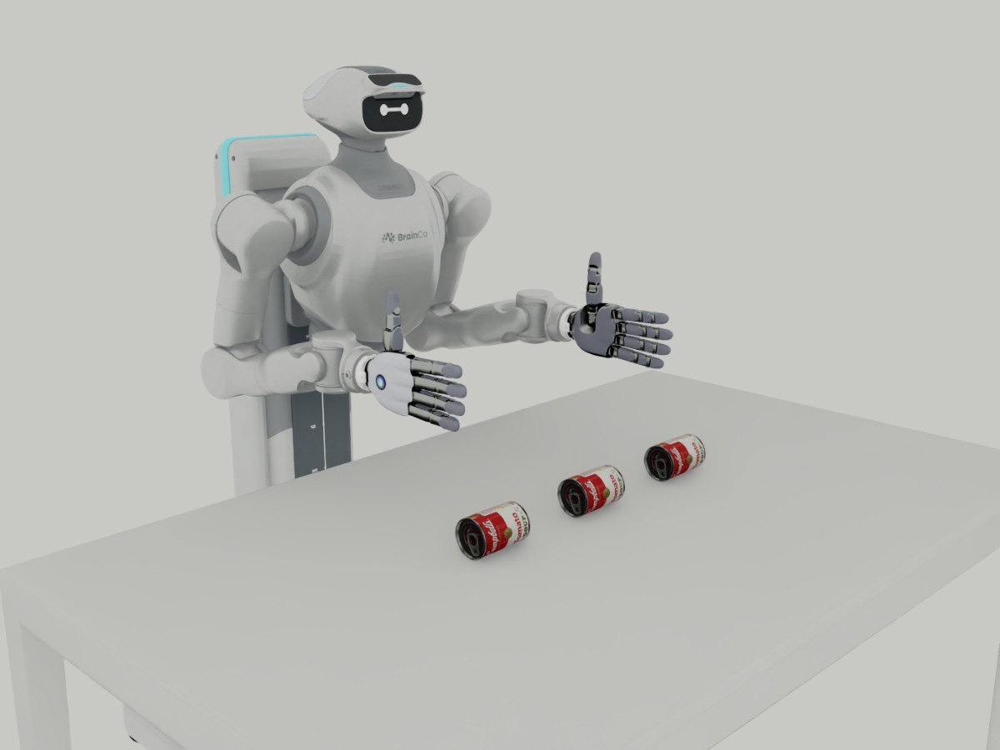

**区别：** 圆柱曲面的多点稳定堆叠，不是方块单面堆高。

**初态：** 三只同款汤罐横放且彼此分离。

### 使用的资产

| 道具 | 数量 | 注册 ID | 预览 |
|---|---:|---|---|
| 汤罐 | 3 | `obj.tabletop100.soupcan@scene_v1` | [实物网格](assets/soupcan.jpg) |

准备后的运行路径（相对 checkout）：

```text
assets/library/prepared/obj.tabletop100.soupcan/scene_v1/model.usdc
```

原始路径（相对原始资产根目录）：

```text
library/external/bench2dex/bf65215f844d/Objects/005_tomato_soup_can/textured.obj
```

### 怎么做

1. 将两只罐并排横放作为底层。
2. 把第三只横放在两罐形成的槽中。
3. 依次撤手，检查稳定。

### 验收标准

1. 上罐同时接触两只下罐，轴线夹角各小于 10°。
2. 上罐离桌，三罐没有隐藏固定或穿透。
3. 完全松手后结构保持 3 s。

### 开发前检查

1. 使用实际网格核对抓取空间、支撑面与机器人可达性；转成动态资产后再测试。

<a id="proposal_76_utensil_safe_handover"></a>
## 76 · 把餐刀调整成刀柄朝向接收手

`proposal_76_utensil_safe_handover` · 未开始 · 0 条轨迹

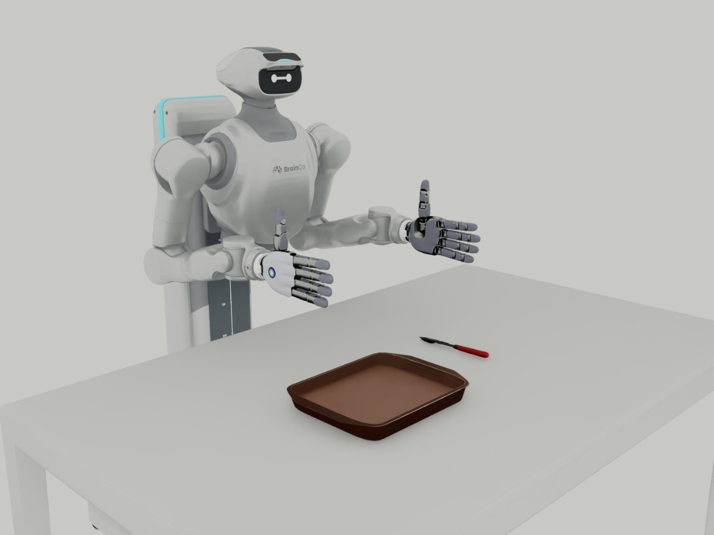

**区别：** 交接有明确禁止接触区域及可握持端方向，区别于对称哑铃换手。

**初态：** 餐刀平放在左侧，空托盘在右侧。

### 使用的资产

| 道具 | 数量 | 注册 ID | 预览 |
|---|---:|---|---|
| 餐刀 | 1 | `obj.tabletop100.knife@scene_v1` | [实物网格](assets/knife.jpg) |
| 长方托盘 | 1 | `obj.tabletop100.tray@scene_v1` | [实物网格](assets/tray.jpg) |

准备后的运行路径（相对 checkout）：

```text
assets/library/prepared/obj.tabletop100.knife/scene_v1/model.usdc
assets/library/prepared/obj.tabletop100.tray/scene_v1/model.usdc
```

原始路径（相对原始资产根目录）：

```text
library/external/bench2dex/bf65215f844d/Objects/032_knife/textured.obj
library/external/bench2dex/bf65215f844d/Objects/130_tray/base3.glb
```

### 怎么做

1. 抓住刀柄并调整朝向，把可握持的柄端送向另一手。
2. 接收手确认握住刀柄后，交出手松开。
3. 接收手把餐刀放入托盘。

### 验收标准

1. 交接期间至少一只手持续握持刀柄。
2. 任何手指都不能把刀刃作为主握持面。
3. 刀进入托盘，刀尖朝向托盘内部并稳定 2 s。

### 开发前检查

1. 使用实际网格核对抓取空间、支撑面与机器人可达性；转成动态资产后再测试。

<a id="proposal_77_separate_food_cleaners"></a>
## 77 · 把食品与清洁用品分区摆开

`proposal_77_separate_food_cleaners` · 未开始 · 0 条轨迹

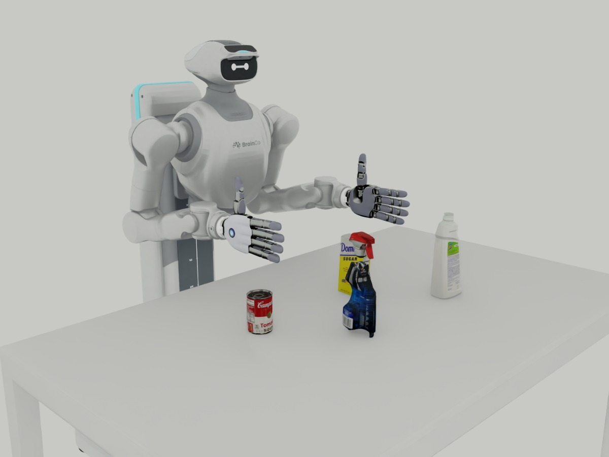

**区别：** 按用途分区并满足隔离间距，区别于紧固件结构分类。

**初态：** 两件食品和两件清洁用品交错摆放。

### 使用的资产

| 道具 | 数量 | 注册 ID | 预览 |
|---|---:|---|---|
| 清洁剂瓶 | 1 | `obj.tabletop100.cleanser@scene_v1` | [实物网格](assets/cleanser.jpg) |
| 糖盒 | 1 | `obj.tabletop100.sugar@scene_v1` | [实物网格](assets/sugar.jpg) |
| 喷雾瓶 | 1 | `obj.tabletop100.spray@scene_v1` | [实物网格](assets/spray.jpg) |
| 汤罐 | 1 | `obj.tabletop100.soupcan@scene_v1` | [实物网格](assets/soupcan.jpg) |

准备后的运行路径（相对 checkout）：

```text
assets/library/prepared/obj.tabletop100.cleanser/scene_v1/model.usdc
assets/library/prepared/obj.tabletop100.sugar/scene_v1/model.usdc
assets/library/prepared/obj.tabletop100.spray/scene_v1/model.usdc
assets/library/prepared/obj.tabletop100.soupcan/scene_v1/model.usdc
```

原始路径（相对原始资产根目录）：

```text
library/external/bench2dex/bf65215f844d/Objects/021_bleach_cleanser/textured.obj
library/external/bench2dex/bf65215f844d/Objects/004_sugar_box/textured.obj
library/external/bench2dex/bf65215f844d/Objects/022_windex_bottle/textured.obj
library/external/bench2dex/bf65215f844d/Objects/005_tomato_soup_can/textured.obj
```

### 怎么做

1. 把食品移到桌面左侧，清洁用品移到右侧。
2. 调整两组内部间距，保证直立。
3. 双手回位。

### 验收标准

1. 食品中心 x 小于 -0.12 m，清洁用品中心 x 大于 0.12 m。
2. 两组完整物体表面距离至少 10 cm。
3. 所有物体直立且不互相支撑，稳定 2 s。

### 开发前检查

1. 使用实际网格核对抓取空间、支撑面与机器人可达性；转成动态资产后再测试。

<a id="proposal_78_breakfast_tray"></a>
## 78 · 按餐具关系摆一份早餐托盘

`proposal_78_breakfast_tray` · 未开始 · 0 条轨迹

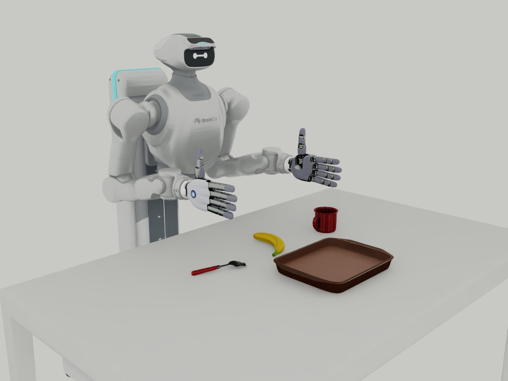

**区别：** 验收成组摆放的用途关系和后续可抓取性，区别于装满篮筐。

**初态：** 托盘为空，杯、香蕉和勺子在托盘外。

### 使用的资产

| 道具 | 数量 | 注册 ID | 预览 |
|---|---:|---|---|
| 长方托盘 | 1 | `obj.tabletop100.tray@scene_v1` | [实物网格](assets/tray.jpg) |
| 带柄马克杯 | 1 | `obj.tabletop100.mug@scene_v1` | [实物网格](assets/mug.jpg) |
| 香蕉 | 1 | `obj.tabletop100.banana@scene_v1` | [实物网格](assets/banana.jpg) |
| 金属勺 | 1 | `obj.tabletop50.spoon@scene_v1` | [实物网格](assets/spoon.jpg) |

准备后的运行路径（相对 checkout）：

```text
assets/library/prepared/obj.tabletop100.tray/scene_v1/model.usdc
assets/library/prepared/obj.tabletop100.mug/scene_v1/model.usdc
assets/library/prepared/obj.tabletop100.banana/scene_v1/model.usdc
assets/library/prepared/obj.tabletop50.spoon/scene_v1/model.usdc
```

原始路径（相对原始资产根目录）：

```text
library/external/bench2dex/bf65215f844d/Objects/130_tray/base3.glb
library/external/bench2dex/bf65215f844d/Objects/025_mug/textured.obj
library/external/bench2dex/bf65215f844d/Objects/011_banana/textured.obj
library/external/bench2dex/bf65215f844d/Objects/031_spoon/textured.obj
```

### 怎么做

1. 将杯放在托盘后侧，杯把朝外便于拿取。
2. 把香蕉放前侧，勺柄朝机器人。
3. 检查物体间有取物间隙。

### 验收标准

1. 三件完整落在托盘内，不互相接触。
2. 杯把朝外误差小于 15°，勺柄朝前误差小于 15°。
3. 杯和香蕉之间有至少 1 cm 间隙，释放后稳定 2 s。

### 开发前检查

1. 使用实际网格核对抓取空间、支撑面与机器人可达性；转成动态资产后再测试。

<a id="proposal_79_bowl_scale_center"></a>
## 79 · 把碗居中放上电子秤

`proposal_79_bowl_scale_center` · 未开始 · 0 条轨迹

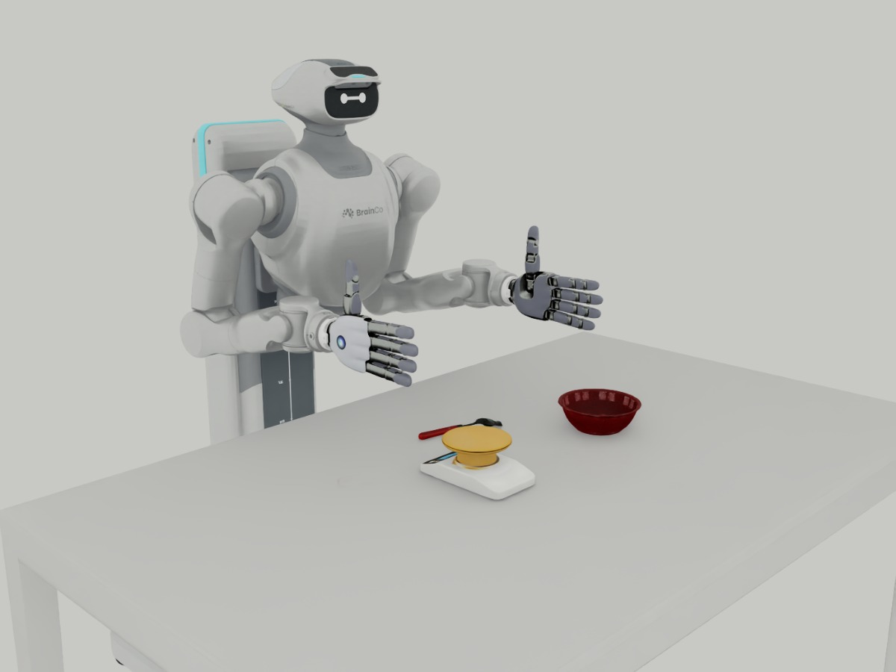

**区别：** 小支撑平台上的精准落底和物体接触关系，区别于直接桌面摆杯。

**初态：** 碗、秤和勺子分开放置。

### 使用的资产

| 道具 | 数量 | 注册 ID | 预览 |
|---|---:|---|---|
| 碗 | 1 | `obj.tabletop50.bowl@scene_v1` | [实物网格](assets/bowl.jpg) |
| 电子秤 | 1 | `obj.tabletop100.scale@scene_v1` | [实物网格](assets/scale.jpg) |
| 金属勺 | 1 | `obj.tabletop50.spoon@scene_v1` | [实物网格](assets/spoon.jpg) |

准备后的运行路径（相对 checkout）：

```text
assets/library/prepared/obj.tabletop50.bowl/scene_v1/model.usdc
assets/library/prepared/obj.tabletop100.scale/scene_v1/model.usdc
assets/library/prepared/obj.tabletop50.spoon/scene_v1/model.usdc
```

原始路径（相对原始资产根目录）：

```text
library/external/bench2dex/bf65215f844d/Objects/024_bowl/textured.obj
library/external/bench2dex/bf65215f844d/Objects/179_electronicscale/base6.glb
library/external/bench2dex/bf65215f844d/Objects/031_spoon/textured.obj
```

### 怎么做

1. 双手把碗放到秤面中央。
2. 将勺子放到秤旁，勺柄朝前。
3. 撤手等待稳定。

### 验收标准

1. 碗底中心距秤面中心小于 8 mm，碗底在有效支撑区内。
2. 勺子不搭在秤或碗上，最近间隙至少 1 cm。
3. 碗只受秤面支撑并稳定 2 s，不要求去皮或读数。

### 开发前检查

1. 使用实际网格核对抓取空间、支撑面与机器人可达性；转成动态资产后再测试。

<a id="proposal_80_fan_tools"></a>
## 80 · 把三件长工具摆成可抓取扇形

`proposal_80_fan_tools` · 未开始 · 0 条轨迹

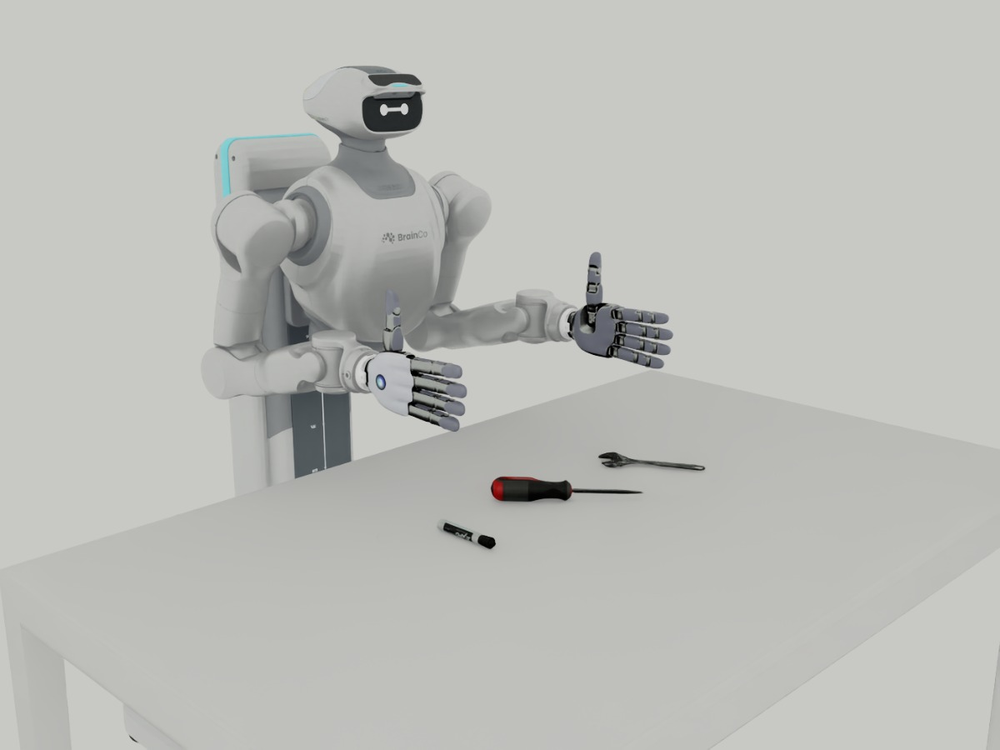

**区别：** 异形工具按功能端和抓取间距组织，不是只把物体排成一行。

**初态：** 扳手、螺丝刀、记号笔平行放置。

### 使用的资产

| 道具 | 数量 | 注册 ID | 预览 |
|---|---:|---|---|
| 活动扳手 | 1 | `obj.tabletop100.wrench@scene_v1` | [实物网格](assets/wrench.jpg) |
| 一字螺丝刀 | 1 | `obj.tabletop50.driver@scene_v1` | [实物网格](assets/driver.jpg) |
| 粗记号笔 | 1 | `obj.tabletop100.marker@scene_v1` | [实物网格](assets/marker.jpg) |

准备后的运行路径（相对 checkout）：

```text
assets/library/prepared/obj.tabletop100.wrench/scene_v1/model.usdc
assets/library/prepared/obj.tabletop50.driver/scene_v1/model.usdc
assets/library/prepared/obj.tabletop100.marker/scene_v1/model.usdc
```

原始路径（相对原始资产根目录）：

```text
library/external/bench2dex/bf65215f844d/Objects/042_adjustable_wrench/textured.obj
library/external/bench2dex/bf65215f844d/Objects/044_flat_screwdriver/textured.obj
library/external/bench2dex/bf65215f844d/Objects/040_large_marker/textured.obj
```

### 怎么做

1. 逐件旋转并移动，使工作端朝后、握持端朝前。
2. 工具轴线依次朝向 -30°、0°、30°目标方向。
3. 保持各握持区相互分离。

### 验收标准

1. 轴向相对各自目标误差小于 10°，工作端方向正确。
2. 工具网格互不相交，握持区两两间距至少 3 cm。
3. 三件均由桌面支撑且稳定 2 s。

### 开发前检查

1. 为每件工具标定工作端、握持区与轴向，目标角度用同一桌面坐标系。

<a id="proposal_81_park_car_tray"></a>
## 81 · 让小车倒退进入托盘停车位

`proposal_81_park_car_tray` · 未开始 · 0 条轨迹

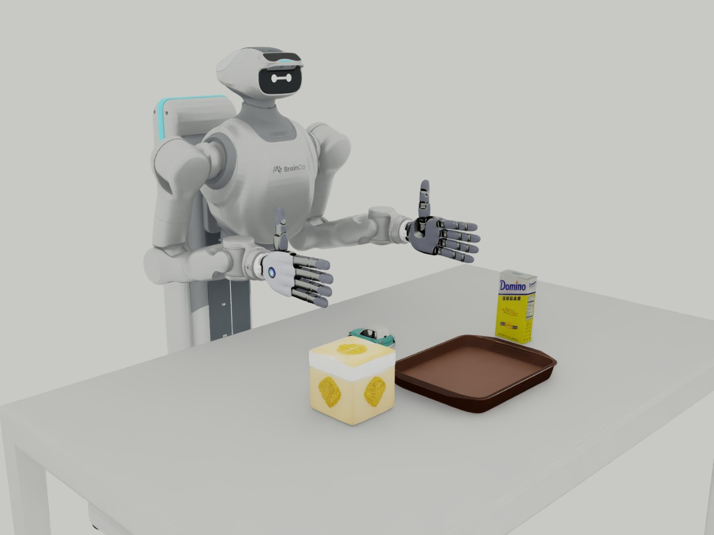

**区别：** 有方向约束的容器入位，区别于平面绕障。

**初态：** 托盘在后方，两盒限定入口两侧，小车在前方。

### 使用的资产

| 道具 | 数量 | 注册 ID | 预览 |
|---|---:|---|---|
| 玩具车 | 1 | `obj.tabletop50.toycar@scene_v1` | [实物网格](assets/toycar.jpg) |
| 长方托盘 | 1 | `obj.tabletop100.tray@scene_v1` | [实物网格](assets/tray.jpg) |
| 糖盒 | 1 | `obj.tabletop100.sugar@scene_v1` | [实物网格](assets/sugar.jpg) |
| 茶叶盒 | 1 | `obj.tabletop50.tea@scene_v1` | [实物网格](assets/tea.jpg) |

准备后的运行路径（相对 checkout）：

```text
assets/library/prepared/obj.tabletop50.toycar/scene_v1/model.usdc
assets/library/prepared/obj.tabletop100.tray/scene_v1/model.usdc
assets/library/prepared/obj.tabletop100.sugar/scene_v1/model.usdc
assets/library/prepared/obj.tabletop50.tea/scene_v1/model.usdc
```

原始路径（相对原始资产根目录）：

```text
library/external/bench2dex/bf65215f844d/Objects/165_toycar/base5.glb
library/external/bench2dex/bf65215f844d/Objects/130_tray/base3.glb
library/external/bench2dex/bf65215f844d/Objects/004_sugar_box/textured.obj
library/external/bench2dex/bf65215f844d/Objects/214_tea-box/base5.glb
```

### 怎么做

1. 抓控小车调整车尾朝向入口。
2. 低位越过托盘边缘，倒向进入托盘。
3. 把车轮落到盘底并释放。

### 验收标准

1. 小车以车尾先进入，完整停在托盘内。
2. 入位过程中不接触两侧包装盒。
3. 车轮落底，最终航向误差小于 10°并稳定 2 s。

### 开发前检查

1. 托盘有凸沿，不假装模型可以自行开过；允许手持低位跨沿再落轮。

<a id="proposal_82_ramp_car_tray"></a>
## 82 · 铺好书本坡道再让小车上托盘

`proposal_82_ramp_car_tray` · 未开始 · 0 条轨迹

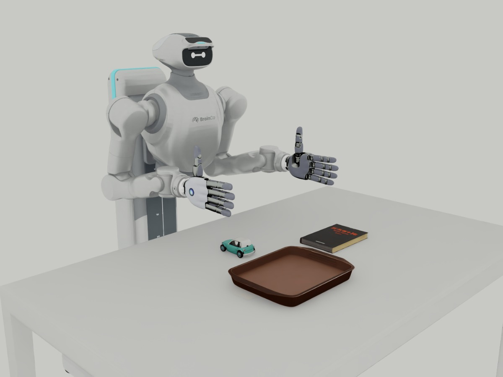

**区别：** 先搭建可行走通路，再进行轮式接触转移。

**初态：** 书本平放在托盘旁，小车在前方。

### 使用的资产

| 道具 | 数量 | 注册 ID | 预览 |
|---|---:|---|---|
| 书 | 1 | `obj.tabletop50.book@scene_v1` | [实物网格](assets/book.jpg) |
| 长方托盘 | 1 | `obj.tabletop100.tray@scene_v1` | [实物网格](assets/tray.jpg) |
| 玩具车 | 1 | `obj.tabletop50.toycar@scene_v1` | [实物网格](assets/toycar.jpg) |

准备后的运行路径（相对 checkout）：

```text
assets/library/prepared/obj.tabletop50.book/scene_v1/model.usdc
assets/library/prepared/obj.tabletop100.tray/scene_v1/model.usdc
assets/library/prepared/obj.tabletop50.toycar/scene_v1/model.usdc
```

原始路径（相对原始资产根目录）：

```text
library/external/bench2dex/bf65215f844d/Objects/155_book/base1.glb
library/external/bench2dex/bf65215f844d/Objects/130_tray/base3.glb
library/external/bench2dex/bf65215f844d/Objects/165_toycar/base5.glb
```

### 怎么做

1. 把书的一端搭在托盘沿，另一端接地。
2. 推控小车沿书面进入托盘。
3. 车轮落底后移走坡道。

### 验收标准

1. 车轮沿坡面连续经过，不允许抬车越过坡道。
2. 书本没有滑脱，车身未穿过盘沿。
3. 小车停在盘内，书本最终回到桌面。

### 开发前检查

1. 使用实际网格核对抓取空间、支撑面与机器人可达性；转成动态资产后再测试。

<a id="proposal_83_right_pitcher"></a>
## 83 · 扶正侧倒的带柄量壶

`proposal_83_right_pitcher` · 未开始 · 0 条轨迹

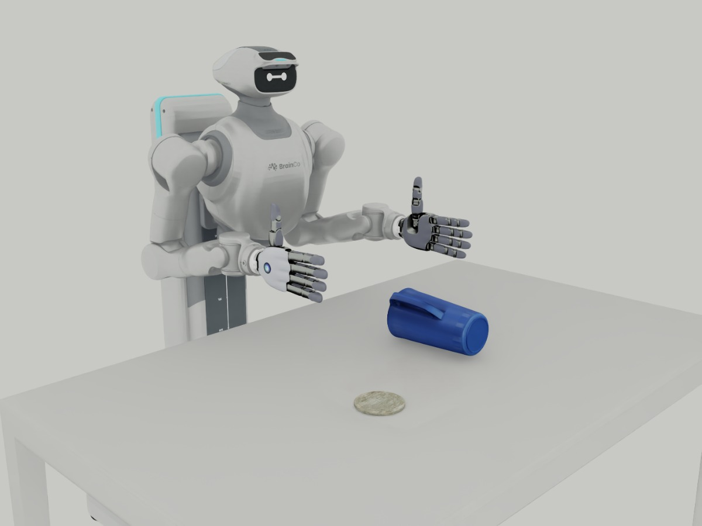

**区别：** 带柄偏心容器的双手恢复姿态，区别于扶正鞋或单手翻沙漏。

**初态：** 量壶侧倒，杯垫在旁侧作为避让物。

### 使用的资产

| 道具 | 数量 | 注册 ID | 预览 |
|---|---:|---|---|
| 带柄量壶 | 1 | `obj.tabletop100.pitcher@scene_v1` | [实物网格](assets/pitcher.jpg) |
| 杯垫 | 1 | `obj.tabletop50.coaster@scene_v1` | [实物网格](assets/coaster.jpg) |

准备后的运行路径（相对 checkout）：

```text
assets/library/prepared/obj.tabletop100.pitcher/scene_v1/model.usdc
assets/library/prepared/obj.tabletop50.coaster/scene_v1/model.usdc
```

原始路径（相对原始资产根目录）：

```text
library/external/bench2dex/bf65215f844d/Objects/019_pitcher_base/textured.obj
library/external/bench2dex/bf65215f844d/Objects/137_coaster/base0.glb
```

### 怎么做

1. 一手抓壶把，另一手支撑壶身。
2. 抬离桌面并把壶底转向下方。
3. 把壶放正，松手。

### 验收标准

1. 翻正过程中壶嘴不刮桌，壶把无穿透。
2. 壶轴相对竖直误差小于 5°，杯垫位移小于 1 cm。
3. 放下后稳定 2 s，双手回位。

### 开发前检查

1. 使用实际网格核对抓取空间、支撑面与机器人可达性；转成动态资产后再测试。

<a id="proposal_84_aim_wateringcan"></a>
## 84 · 让浇水壶嘴依次对准两个杯口

`proposal_84_aim_wateringcan` · 未开始 · 0 条轨迹

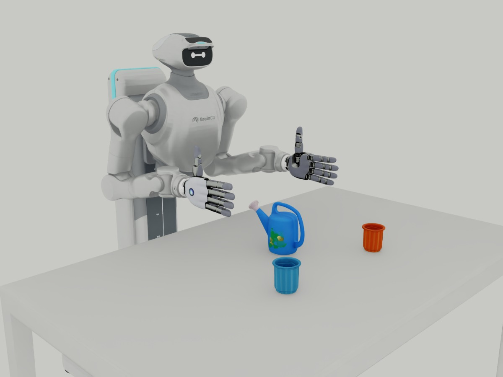

**区别：** 长偏置端点在多个目标间连续对准，不是液体倾倒。

**初态：** 浇水壶在前方，两只杯在后方分开摆放。

### 使用的资产

| 道具 | 数量 | 注册 ID | 预览 |
|---|---:|---|---|
| 浇水壶 | 1 | `obj.tabletop100.wateringcan@scene_v1` | [实物网格](assets/wateringcan.jpg) |
| 套杯 A | 1 | `obj.tabletop50.cup_a@scene_v1` | [实物网格](assets/cup_a.jpg) |
| 套杯 B | 1 | `obj.tabletop50.cup_b@scene_v1` | [实物网格](assets/cup_b.jpg) |

准备后的运行路径（相对 checkout）：

```text
assets/library/prepared/obj.tabletop100.wateringcan/scene_v1/model.usdc
assets/library/prepared/obj.tabletop50.cup_a/scene_v1/model.usdc
assets/library/prepared/obj.tabletop50.cup_b/scene_v1/model.usdc
```

原始路径（相对原始资产根目录）：

```text
library/external/bench2dex/bf65215f844d/Objects/193_waterer/base7.glb
library/external/bench2dex/bf65215f844d/Objects/065-a_cups/google_16k/textured.obj
library/external/bench2dex/bf65215f844d/Objects/065-b_cups/google_16k/textured.obj
```

### 怎么做

1. 抓住壶把并托住壶身。
2. 依次将壶嘴移到两个杯口上方，做小幅倾斜。
3. 回正放下。

### 验收标准

1. 壶嘴投影依次进入两杯口中心 1 cm 范围。
2. 嘴端距杯口高度 2–5 cm，壶体不碰杯。
3. 顺序正确，每处保持 0.5 s；不宣称实际出水。

### 开发前检查

1. 源资产无液体；标定壶嘴坐标，只验收姿态与相对位置。

<a id="proposal_85_inspect_can_label"></a>
## 85 · 转动罐头让标签依次朝向两个观察方向

`proposal_85_inspect_can_label` · 未开始 · 0 条轨迹

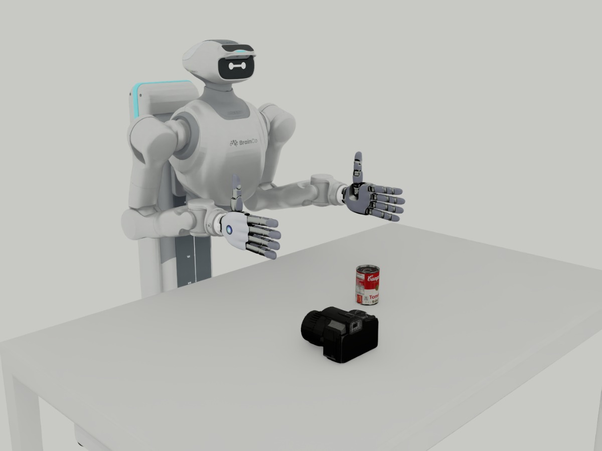

**区别：** 连续多视点展示带语义正面的物体，不是骰子面朝上。

**初态：** 带纹理汤罐在中央，相机作为第二观察方位参照。

### 使用的资产

| 道具 | 数量 | 注册 ID | 预览 |
|---|---:|---|---|
| 汤罐 | 1 | `obj.tabletop100.soupcan@scene_v1` | [实物网格](assets/soupcan.jpg) |
| 相机 | 1 | `obj.tabletop50.camera@scene_v1` | [实物网格](assets/camera.jpg) |

准备后的运行路径（相对 checkout）：

```text
assets/library/prepared/obj.tabletop100.soupcan/scene_v1/model.usdc
assets/library/prepared/obj.tabletop50.camera/scene_v1/model.usdc
```

原始路径（相对原始资产根目录）：

```text
library/external/bench2dex/bf65215f844d/Objects/005_tomato_soup_can/textured.obj
library/external/bench2dex/bf65215f844d/Objects/083_camera/02_camera/01/mobility.urdf
```

### 怎么做

1. 抓起罐头，让正面标签朝向机器人。
2. 继续转动，使标签朝向相机参考点。
3. 保持最后朝向放回桌面。

### 验收标准

1. 两阶段标签法向与各自视线夹角均小于 15°，保持各 0.5 s。
2. 标签面不能被手完全遮挡。
3. 罐头直立放稳 2 s，不能只移动相机代替转罐。

### 开发前检查

1. 在纹理网格上标定标签正面法向；相机道具本身不假定有传感器。

<a id="proposal_86_fruit_size_order"></a>
## 86 · 按最长尺寸排列三种水果

`proposal_86_fruit_size_order` · 未开始 · 0 条轨迹

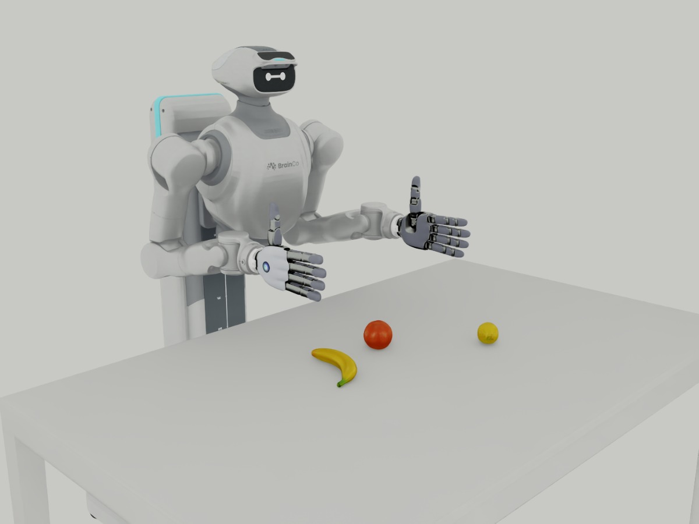

**区别：** 连续尺寸排序加长轴约束，区别于按紧固件类别分箱。

**初态：** 香蕉、柠檬和橙子在桌面分散放置。

### 使用的资产

| 道具 | 数量 | 注册 ID | 预览 |
|---|---:|---|---|
| 香蕉 | 1 | `obj.tabletop100.banana@scene_v1` | [实物网格](assets/banana.jpg) |
| 柠檬 | 1 | `obj.tabletop100.lemon@scene_v1` | [实物网格](assets/lemon.jpg) |
| 橙子 | 1 | `obj.tabletop100.orange@scene_v1` | [实物网格](assets/orange.jpg) |

准备后的运行路径（相对 checkout）：

```text
assets/library/prepared/obj.tabletop100.banana/scene_v1/model.usdc
assets/library/prepared/obj.tabletop100.lemon/scene_v1/model.usdc
assets/library/prepared/obj.tabletop100.orange/scene_v1/model.usdc
```

原始路径（相对原始资产根目录）：

```text
library/external/bench2dex/bf65215f844d/Objects/011_banana/textured.obj
library/external/bench2dex/bf65215f844d/Objects/014_lemon/textured.obj
library/external/bench2dex/bf65215f844d/Objects/017_orange/textured.obj
```

### 怎么做

1. 比较固定资产网格的实际最长尺寸。
2. 从左到右按长到短排列，并让长轴方向一致。
3. 保留取物间隙。

### 验收标准

1. 排序依据固定缩放后的网格尺寸，不凭类别猜测。
2. 三个物体中心到同一 y 线距离小于 1 cm。
3. 相邻完整网格间距 2–4 cm，稳定 2 s。

### 开发前检查

1. 使用实际网格核对抓取空间、支撑面与机器人可达性；转成动态资产后再测试。

<a id="proposal_87_banana_cup_curve"></a>
## 87 · 把草莓放在香蕉弯曲内侧

`proposal_87_banana_cup_curve` · 未开始 · 0 条轨迹

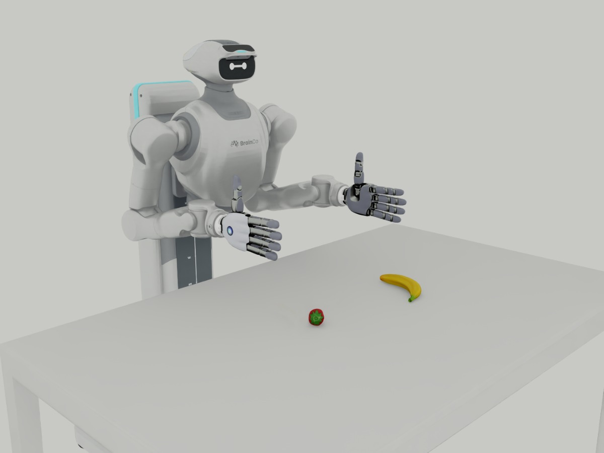

**区别：** 利用不规则曲率建立空间关系，而不是把水果直接装盘。

**初态：** 香蕉与草莓分开放在桌面。

### 使用的资产

| 道具 | 数量 | 注册 ID | 预览 |
|---|---:|---|---|
| 香蕉 | 1 | `obj.tabletop100.banana@scene_v1` | [实物网格](assets/banana.jpg) |
| 草莓 | 1 | `obj.tabletop50.strawberry@scene_v1` | [实物网格](assets/strawberry.jpg) |

准备后的运行路径（相对 checkout）：

```text
assets/library/prepared/obj.tabletop100.banana/scene_v1/model.usdc
assets/library/prepared/obj.tabletop50.strawberry/scene_v1/model.usdc
```

原始路径（相对原始资产根目录）：

```text
library/external/bench2dex/bf65215f844d/Objects/011_banana/textured.obj
library/external/bench2dex/bf65215f844d/Objects/012_strawberry/textured.obj
```

### 怎么做

1. 调整香蕉朝向，让弯曲内侧朝机器人。
2. 拿起草莓，放到香蕉弯曲内侧。
3. 轻放草莓并撤手。

### 验收标准

1. 草莓中心落在香蕉两端连线与内弧围成的凹侧区域。
2. 香蕉与草莓至少留 3 mm 间隙，二者不互相支撑。
3. 香蕉落桌并稳定 2 s。

### 开发前检查

1. 先从网格核对草莓与香蕉内弧关系；目标为空间配合，不要求紧嵌或形变。

<a id="proposal_88_edge_plate_retrieve"></a>
## 88 · 利用桌边露出的盘沿抓起餐盘

`proposal_88_edge_plate_retrieve` · 未开始 · 0 条轨迹

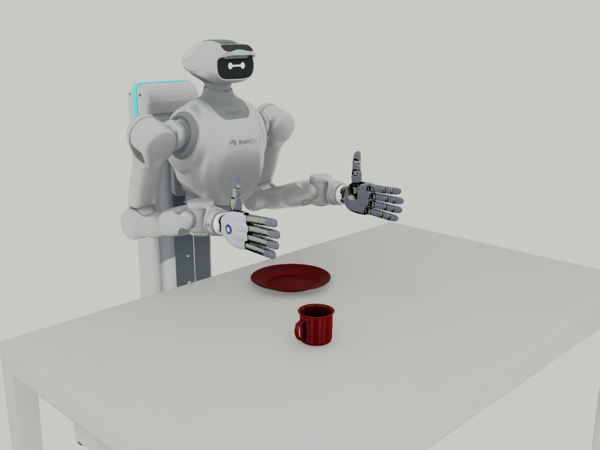

**区别：** 主动创造桌边抓取空间，与使用工具铲入或直接抓盘不同。

**初态：** 餐盘靠近桌前沿，但完整网格仍在桌面范围内；杯子在后侧。

### 使用的资产

| 道具 | 数量 | 注册 ID | 预览 |
|---|---:|---|---|
| 餐盘 | 1 | `obj.tabletop50.plate@scene_v1` | [实物网格](assets/plate.jpg) |
| 带柄马克杯 | 1 | `obj.tabletop100.mug@scene_v1` | [实物网格](assets/mug.jpg) |

准备后的运行路径（相对 checkout）：

```text
assets/library/prepared/obj.tabletop50.plate/scene_v1/model.usdc
assets/library/prepared/obj.tabletop100.mug/scene_v1/model.usdc
```

原始路径（相对原始资产根目录）：

```text
library/external/bench2dex/bf65215f844d/Objects/029_plate/textured.obj
library/external/bench2dex/bf65215f844d/Objects/025_mug/textured.obj
```

### 怎么做

1. 先沿桌面把盘沿送出桌边 2–3 cm。
2. 用露出的下缘完成上下对捏。
3. 抬盘，移动回桌面内部并放下。

### 验收标准

1. 对捏前盘沿确实越过桌边，盘重心仍在支撑域内。
2. 抓取时下指从桌边外侧进入，不能穿过桌面。
3. 餐盘最终完整落回桌面，杯子无碰撞。

### 开发前检查

1. 运行时先核对真实桌沿坐标；静态初态不把物体悬空预摆成功。

<a id="proposal_89_nozzle_sponge_alignment"></a>
## 89 · 喷雾瓶喷嘴沿海绵三个位置对准

`proposal_89_nozzle_sponge_alignment` · 未开始 · 0 条轨迹

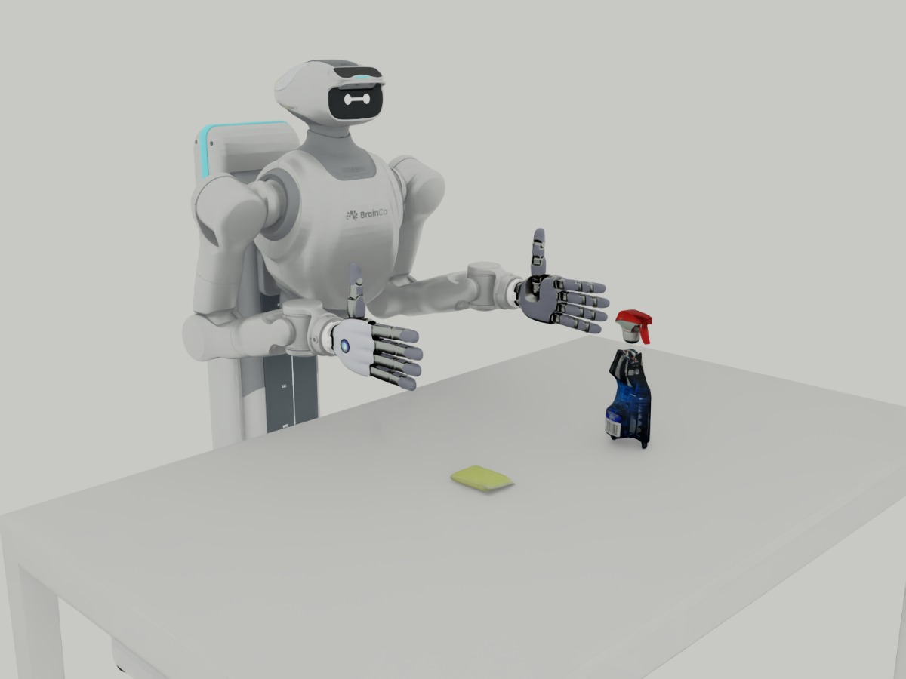

**区别：** 有射线方向及距离约束的工具姿态控制，不是擦拭或持麦巡检。

**初态：** 喷雾瓶直立，海绵平放。

### 使用的资产

| 道具 | 数量 | 注册 ID | 预览 |
|---|---:|---|---|
| 喷雾瓶 | 1 | `obj.tabletop100.spray@scene_v1` | [实物网格](assets/spray.jpg) |
| 海绵 | 1 | `obj.tabletop50.sponge@scene_v1` | [实物网格](assets/sponge.jpg) |

准备后的运行路径（相对 checkout）：

```text
assets/library/prepared/obj.tabletop100.spray/scene_v1/model.usdc
assets/library/prepared/obj.tabletop50.sponge/scene_v1/model.usdc
```

原始路径（相对原始资产根目录）：

```text
library/external/bench2dex/bf65215f844d/Objects/022_windex_bottle/textured.obj
library/external/bench2dex/bf65215f844d/Objects/026_sponge/textured.obj
```

### 怎么做

1. 拿起喷雾瓶并把喷嘴朝向海绵。
2. 依次对准海绵近端、中央和远端。
3. 放回喷雾瓶。

### 验收标准

1. 喷嘴轴线依次与三个表面目标相交，横向误差小于 8 mm。
2. 喷嘴距表面 8–12 cm，不能撞击海绵。
3. 瓶子放正；不要求扳机动作或喷出液体。

### 开发前检查

1. 使用实际网格核对抓取空间、支撑面与机器人可达性；转成动态资产后再测试。

<a id="proposal_90_toothpaste_cap_stand"></a>
## 90 · 把牙膏管倒立在盖端

`proposal_90_toothpaste_cap_stand` · 未开始 · 0 条轨迹

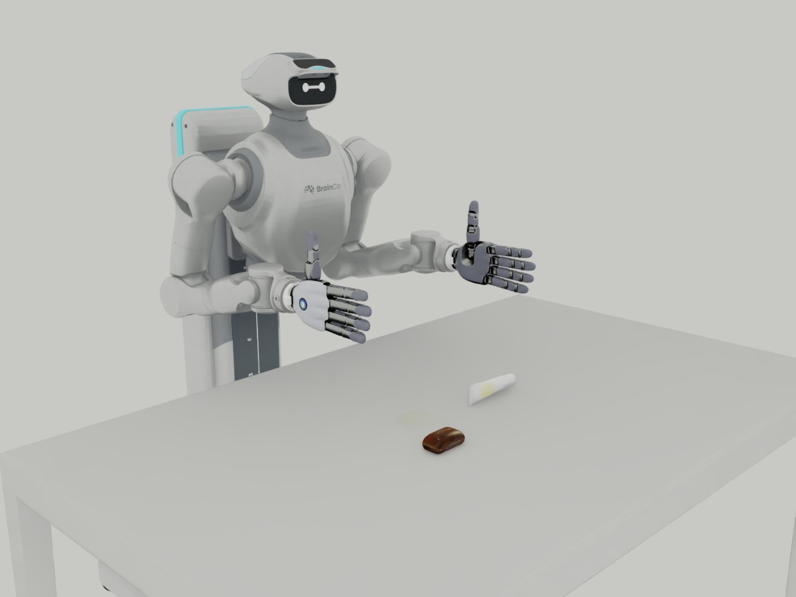

**区别：** 不对称软包装外形的窄底自立；本阶段使用源刚体外形。

**初态：** 牙膏管横放，香皂在后侧作为避让物。

### 使用的资产

| 道具 | 数量 | 注册 ID | 预览 |
|---|---:|---|---|
| 牙膏管 | 1 | `obj.tabletop100.toothpaste@scene_v1` | [实物网格](assets/toothpaste.jpg) |
| 香皂 | 1 | `obj.tabletop50.soap@scene_v1` | [实物网格](assets/soap.jpg) |

准备后的运行路径（相对 checkout）：

```text
assets/library/prepared/obj.tabletop100.toothpaste/scene_v1/model.usdc
assets/library/prepared/obj.tabletop50.soap/scene_v1/model.usdc
```

原始路径（相对原始资产根目录）：

```text
library/external/bench2dex/bf65215f844d/Objects/218_tooth-paste/base0.glb
library/external/bench2dex/bf65215f844d/Objects/209_soap/base3.glb
```

### 怎么做

1. 夹住管身并识别盖端。
2. 翻转到盖端向下，缓慢放到桌面。
3. 撤手，检查自立。

### 验收标准

1. 由盖端实际支撑，管身不接触其他物体。
2. 主轴相对竖直误差小于 8°，稳定 3 s。
3. 无挤压变形或牙膏挤出声明。

### 开发前检查

1. 先检查该源盖端是否有足够平面支撑；不能用隐藏固定使其站立。

<a id="proposal_91_loaded_skillet_support"></a>
## 91 · 托住锅柄与锅底搬运带载煎锅

`proposal_91_loaded_skillet_support` · 未开始 · 0 条轨迹

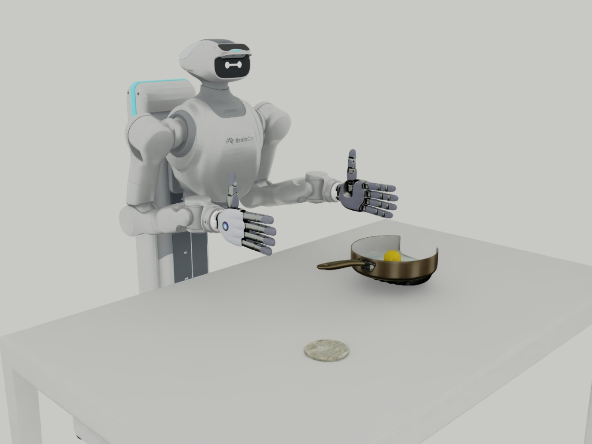

**区别：** 长柄负载力矩下的非对称双手分工，不是放空锅到炉上。

**初态：** 柠檬在煎锅内，杯垫在目标区域旁。

### 使用的资产

| 道具 | 数量 | 注册 ID | 预览 |
|---|---:|---|---|
| 带柄煎锅 | 1 | `obj.tabletop100.skillet@scene_v1` | [实物网格](assets/skillet.jpg) |
| 柠檬 | 1 | `obj.tabletop100.lemon@scene_v1` | [实物网格](assets/lemon.jpg) |
| 杯垫 | 1 | `obj.tabletop50.coaster@scene_v1` | [实物网格](assets/coaster.jpg) |

准备后的运行路径（相对 checkout）：

```text
assets/library/prepared/obj.tabletop100.skillet/scene_v1/model.usdc
assets/library/prepared/obj.tabletop100.lemon/scene_v1/model.usdc
assets/library/prepared/obj.tabletop50.coaster/scene_v1/model.usdc
```

原始路径（相对原始资产根目录）：

```text
library/external/bench2dex/bf65215f844d/Objects/027-a_skillet/google_16k/textured.obj
library/external/bench2dex/bf65215f844d/Objects/014_lemon/textured.obj
library/external/bench2dex/bf65215f844d/Objects/137_coaster/base0.glb
```

### 怎么做

1. 一手握长柄，另一手从锅底侧托住。
2. 把带载锅移到目标区域，保持锅面水平。
3. 先落锅底再释放。

### 验收标准

1. 锅平移至少 20 cm，柠檬始终留在锅内。
2. 运输阶段同时存在柄部抓握和锅底支撑。
3. 锅最终落稳，柠檬相对位移不超过锅内半径一半。

### 开发前检查

1. 源扫描的锅壁有局部缺口；当前只考察锅底托物，不能宣称密闭盛放。动态版本需核对缺口与碰撞边界，保持载荷远离缺口。

<a id="proposal_92_spoon_under_bridge"></a>
## 92 · 用勺子从书本桥下取出球

`proposal_92_spoon_under_bridge` · 未开始 · 0 条轨迹

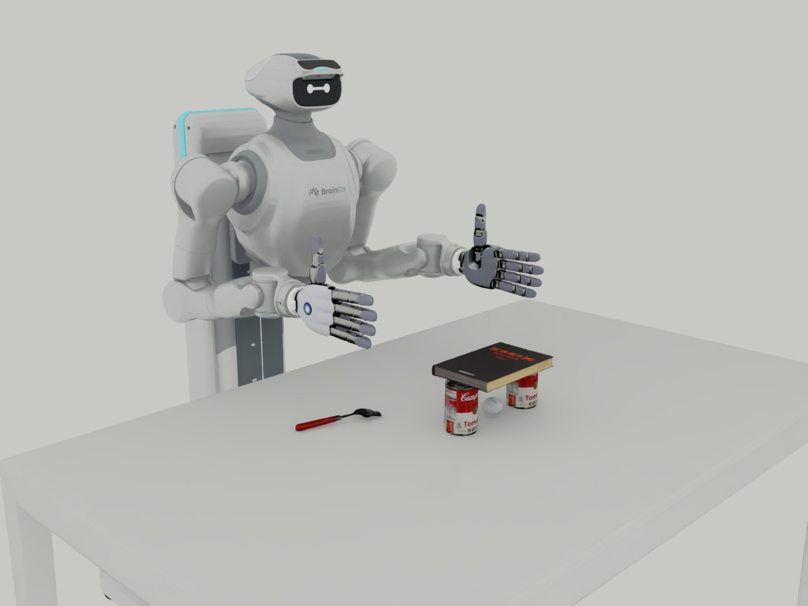

**区别：** 工具在受限高度内接近目标，不是开阔空间舀球。

**初态：** 书本横搭两罐形成桥，球在桥下，勺子在右前方。

### 使用的资产

| 道具 | 数量 | 注册 ID | 预览 |
|---|---:|---|---|
| 汤罐 | 2 | `obj.tabletop100.soupcan@scene_v1` | [实物网格](assets/soupcan.jpg) |
| 书 | 1 | `obj.tabletop50.book@scene_v1` | [实物网格](assets/book.jpg) |
| 高尔夫球 | 1 | `obj.tabletop50.golf@scene_v1` | [实物网格](assets/golf.jpg) |
| 金属勺 | 1 | `obj.tabletop50.spoon@scene_v1` | [实物网格](assets/spoon.jpg) |

准备后的运行路径（相对 checkout）：

```text
assets/library/prepared/obj.tabletop100.soupcan/scene_v1/model.usdc
assets/library/prepared/obj.tabletop50.book/scene_v1/model.usdc
assets/library/prepared/obj.tabletop50.golf/scene_v1/model.usdc
assets/library/prepared/obj.tabletop50.spoon/scene_v1/model.usdc
```

原始路径（相对原始资产根目录）：

```text
library/external/bench2dex/bf65215f844d/Objects/005_tomato_soup_can/textured.obj
library/external/bench2dex/bf65215f844d/Objects/155_book/base1.glb
library/external/bench2dex/bf65215f844d/Objects/058_golf_ball/textured.obj
library/external/bench2dex/bf65215f844d/Objects/031_spoon/textured.obj
```

### 怎么做

1. 从桥下前方伸入勺面。
2. 沿桌面把球带出桥下。
3. 球到空旷区后用勺托起再放下。

### 验收标准

1. 球从桥下移出至少 12 cm，主要接触来自勺子。
2. 书和罐头位移均小于 1 cm，不能先拆桥。
3. 球有一次离桌至少 2 cm 的勺托阶段。

### 开发前检查

1. 使用实际网格核对抓取空间、支撑面与机器人可达性；转成动态资产后再测试。

<a id="proposal_93_book_domino_chain"></a>
## 93 · 排好包装盒后触发顺序倒下

`proposal_93_book_domino_chain` · 未开始 · 0 条轨迹

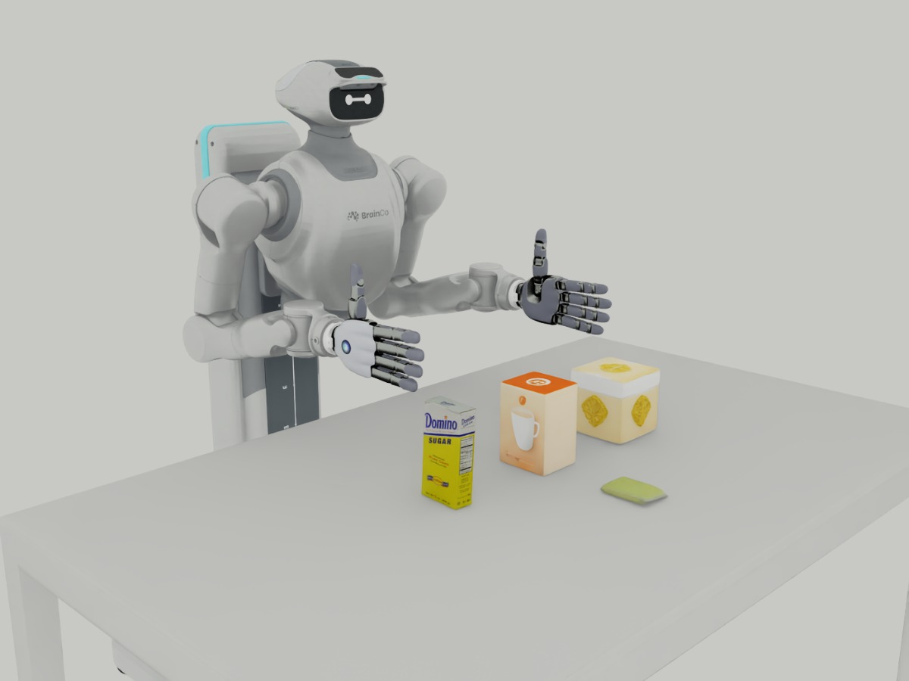

**区别：** 先布置接触链再单次触发，区别于用球直接撞一个瓶。

**初态：** 三只直立包装盒分开放，海绵在旁。

### 使用的资产

| 道具 | 数量 | 注册 ID | 预览 |
|---|---:|---|---|
| 茶叶盒 | 1 | `obj.tabletop50.tea@scene_v1` | [实物网格](assets/tea.jpg) |
| 咖啡盒 | 1 | `obj.tabletop50.coffee@scene_v1` | [实物网格](assets/coffee.jpg) |
| 糖盒 | 1 | `obj.tabletop100.sugar@scene_v1` | [实物网格](assets/sugar.jpg) |
| 海绵 | 1 | `obj.tabletop50.sponge@scene_v1` | [实物网格](assets/sponge.jpg) |

准备后的运行路径（相对 checkout）：

```text
assets/library/prepared/obj.tabletop50.tea/scene_v1/model.usdc
assets/library/prepared/obj.tabletop50.coffee/scene_v1/model.usdc
assets/library/prepared/obj.tabletop100.sugar/scene_v1/model.usdc
assets/library/prepared/obj.tabletop50.sponge/scene_v1/model.usdc
```

原始路径（相对原始资产根目录）：

```text
library/external/bench2dex/bf65215f844d/Objects/214_tea-box/base5.glb
library/external/bench2dex/bf65215f844d/Objects/215_coffee-box/base6.glb
library/external/bench2dex/bf65215f844d/Objects/004_sugar_box/textured.obj
library/external/bench2dex/bf65215f844d/Objects/026_sponge/textured.obj
```

### 怎么做

1. 将包装盒排成能依次触碰的队列。
2. 只推动第一只，使其触发后续两只倒下。
3. 等待全部静止。

### 验收标准

1. 后两只开始倾倒的时刻严格晚于前一只，且由物体接触触发。
2. 手只触碰第一只；不能直接推倒其他盒。
3. 三只都最终侧躺在桌面，无掉桌。

### 开发前检查

1. 根据各包装盒高度、重心及间距计算可触及关系，动态摩擦需单独测试。

<a id="proposal_94_bookend_upright"></a>
## 94 · 用两只罐头支住竖放的书

`proposal_94_bookend_upright` · 未开始 · 0 条轨迹

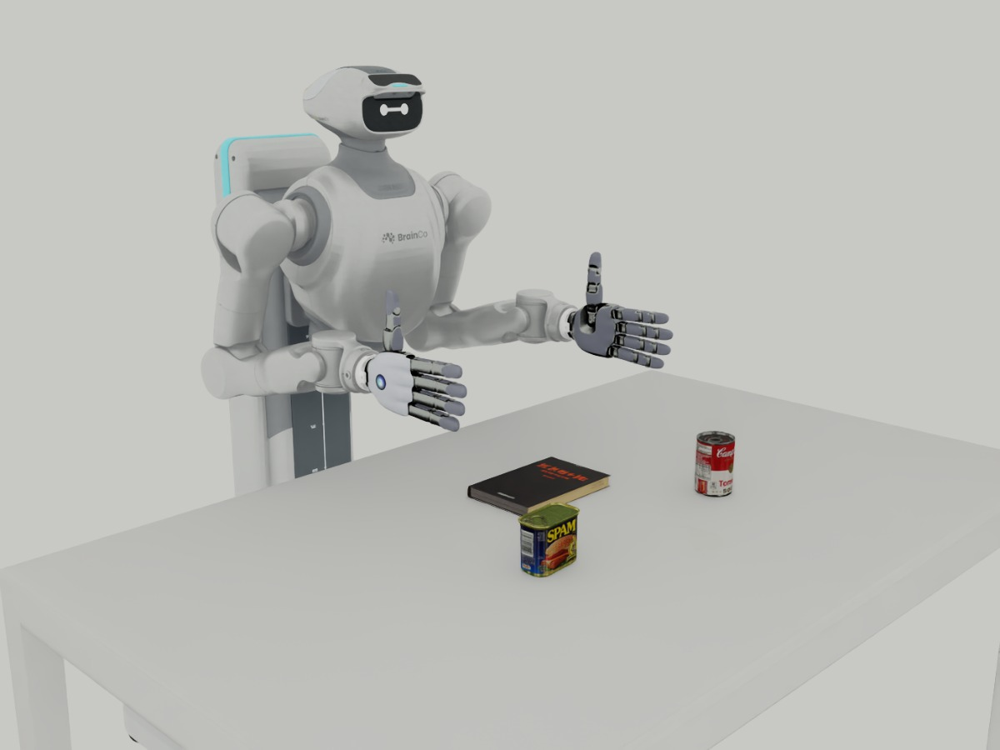

**区别：** 边立薄物体并建立外部支撑，区别于平放书或堆叠物体。

**初态：** 书本平放，两罐分开放置。

### 使用的资产

| 道具 | 数量 | 注册 ID | 预览 |
|---|---:|---|---|
| 书 | 1 | `obj.tabletop50.book@scene_v1` | [实物网格](assets/book.jpg) |
| 汤罐 | 1 | `obj.tabletop100.soupcan@scene_v1` | [实物网格](assets/soupcan.jpg) |
| 午餐肉罐 | 1 | `obj.tabletop100.meatcan@scene_v1` | [实物网格](assets/meatcan.jpg) |

准备后的运行路径（相对 checkout）：

```text
assets/library/prepared/obj.tabletop50.book/scene_v1/model.usdc
assets/library/prepared/obj.tabletop100.soupcan/scene_v1/model.usdc
assets/library/prepared/obj.tabletop100.meatcan/scene_v1/model.usdc
```

原始路径（相对原始资产根目录）：

```text
library/external/bench2dex/bf65215f844d/Objects/155_book/base1.glb
library/external/bench2dex/bf65215f844d/Objects/005_tomato_soup_can/textured.obj
library/external/bench2dex/bf65215f844d/Objects/010_potted_meat_can/textured.obj
```

### 怎么做

1. 把书立在窄边上并用一手扶住。
2. 另一手把两罐分别放到书的两侧抵住。
3. 缓慢松开扶书的手。

### 验收标准

1. 书本主平面与桌面夹角 85°–95°。
2. 两罐分别在书两侧提供真实支撑，不能使用固定关节。
3. 所有手撤离后书保持 3 s。

### 开发前检查

1. 根据网格确定书脊窄边与两侧罐头接触高度。

<a id="proposal_95_can_roll_rails"></a>
## 95 · 让横放罐头沿两本书之间滚动

`proposal_95_can_roll_rails` · 未开始 · 0 条轨迹

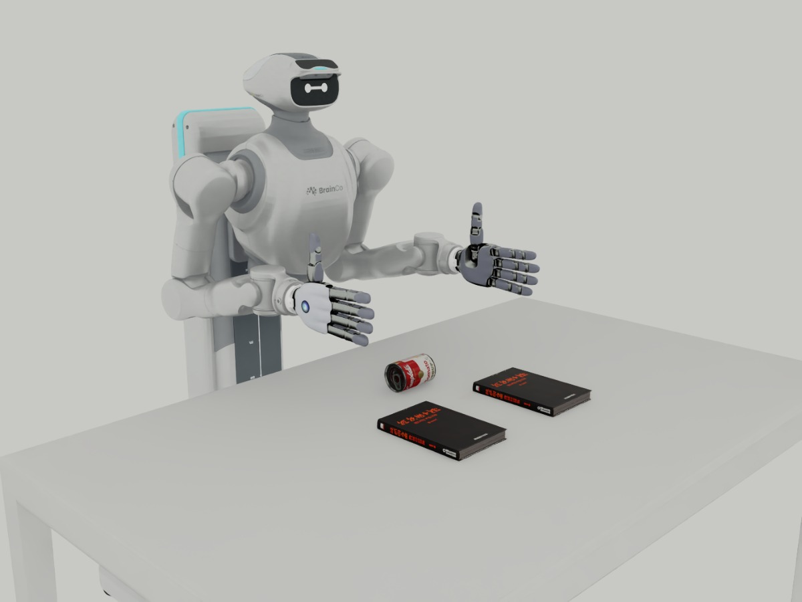

**区别：** 受通道约束的圆柱滚动和阻停，区别于球的双手接传。

**初态：** 两本书分开平放形成长通道，汤罐横放在入口。

### 使用的资产

| 道具 | 数量 | 注册 ID | 预览 |
|---|---:|---|---|
| 书 | 2 | `obj.tabletop50.book@scene_v1` | [实物网格](assets/book.jpg) |
| 汤罐 | 1 | `obj.tabletop100.soupcan@scene_v1` | [实物网格](assets/soupcan.jpg) |

准备后的运行路径（相对 checkout）：

```text
assets/library/prepared/obj.tabletop50.book/scene_v1/model.usdc
assets/library/prepared/obj.tabletop100.soupcan/scene_v1/model.usdc
```

原始路径（相对原始资产根目录）：

```text
library/external/bench2dex/bf65215f844d/Objects/155_book/base1.glb
library/external/bench2dex/bf65215f844d/Objects/005_tomato_soup_can/textured.obj
```

### 怎么做

1. 把罐轴调整到与通道前进方向垂直。
2. 手掌轻推使罐头沿通道滚动。
3. 在出口阻停，避免继续滚出桌面。

### 验收标准

1. 罐头前进至少 15 cm，并绕自身轴转动至少 90°。
2. 罐体未越过书本上方，不能提起代替滚动。
3. 书本位移小于 1 cm，罐头最终静止 2 s。

### 开发前检查

1. 使用实际网格核对抓取空间、支撑面与机器人可达性；转成动态资产后再测试。

<a id="proposal_96_marker_two_handles"></a>
## 96 · 让毛笔同时穿过两个杯把

`proposal_96_marker_two_handles` · 未开始 · 0 条轨迹

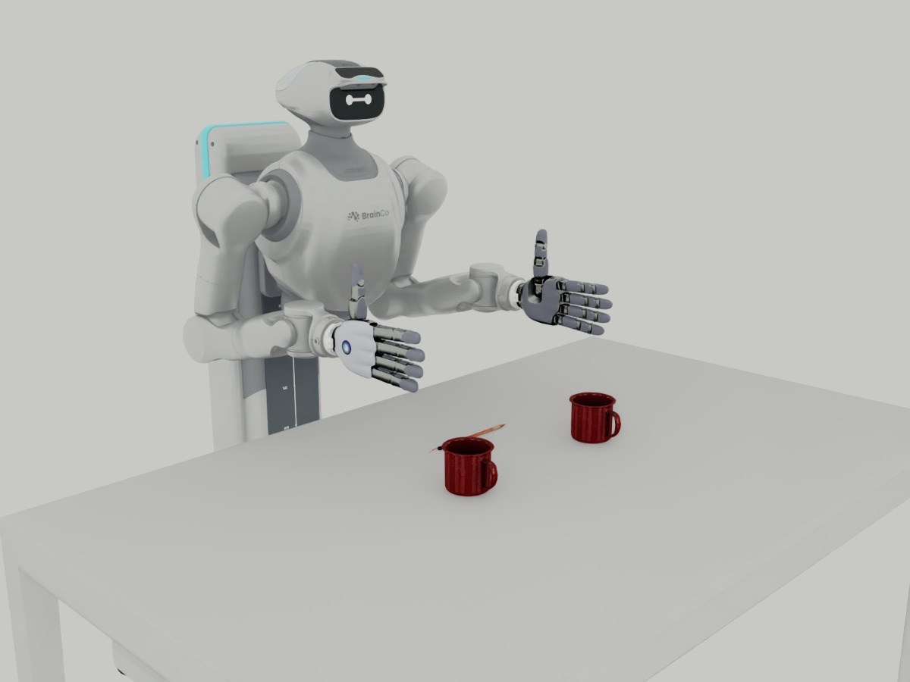

**区别：** 先装配目标孔轴，再完成多孔约束插入；区别于单孔插杆。

**初态：** 两只杯子分开直立，杯把方向一致，毛笔在前方。

### 使用的资产

| 道具 | 数量 | 注册 ID | 预览 |
|---|---:|---|---|
| 带柄马克杯 | 2 | `obj.tabletop100.mug@scene_v1` | [实物网格](assets/mug.jpg) |
| 毛笔 | 1 | `obj.tabletop50.brushpen@scene_v1` | [实物网格](assets/brushpen.jpg) |

准备后的运行路径（相对 checkout）：

```text
assets/library/prepared/obj.tabletop100.mug/scene_v1/model.usdc
assets/library/prepared/obj.tabletop50.brushpen/scene_v1/model.usdc
```

原始路径（相对原始资产根目录）：

```text
library/external/bench2dex/bf65215f844d/Objects/025_mug/textured.obj
library/external/bench2dex/bf65215f844d/Objects/197_brush-pen/base5.glb
```

### 怎么做

1. 调整两杯的位置，使杯把孔轴近似共线。
2. 一手稳定杯子，另一手把笔依次穿过两个孔。
3. 保持笔贯穿两孔后松手。

### 验收标准

1. 同一支笔连续穿过两个真实孔道。
2. 两杯均直立，笔最终仅由杯把支撑并保持 2 s。
3. 不能将杯体互相穿插来缩短孔距。

### 开发前检查

1. 先用真实笔长与杯把位置验证可形成同轴双孔；必要时转动杯把相向摆放，不能改变资产尺寸。

<a id="proposal_97_tray_bottle_gate"></a>
## 97 · 把托盘侧转后送过两只高瓶

`proposal_97_tray_bottle_gate` · 未开始 · 0 条轨迹

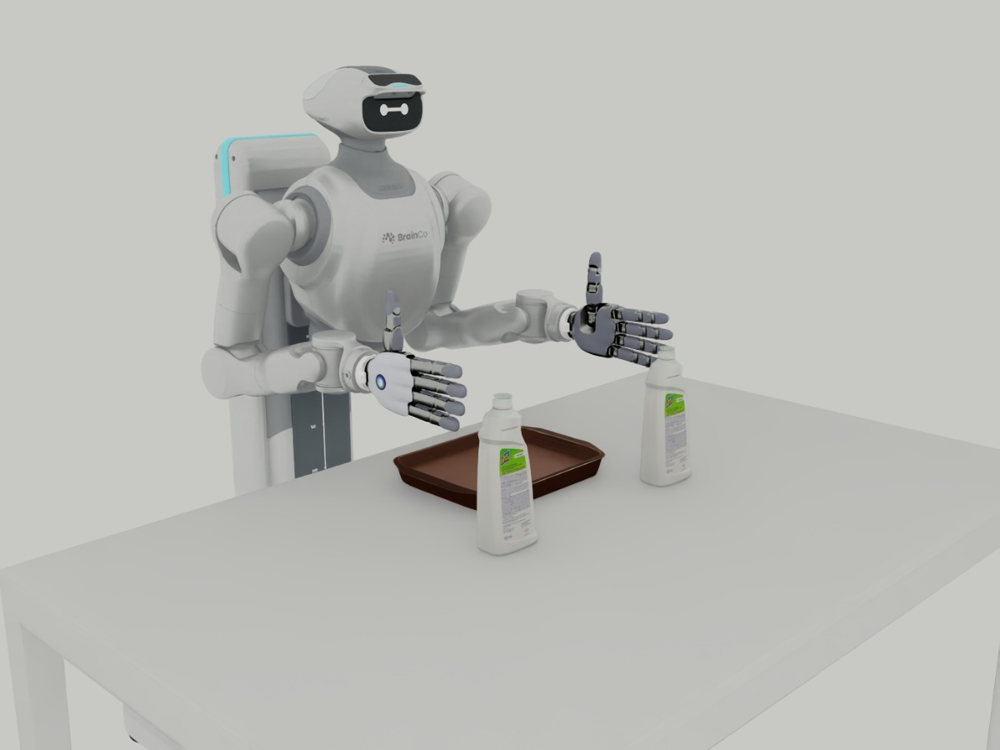

**区别：** 大面积扁平物体需要改变平面朝向才能通过，比长杆穿缝增加双手同步约束。

**初态：** 两只高瓶形成通道，托盘长边横向摆在通道前。

### 使用的资产

| 道具 | 数量 | 注册 ID | 预览 |
|---|---:|---|---|
| 清洁剂瓶 | 2 | `obj.tabletop100.cleanser@scene_v1` | [实物网格](assets/cleanser.jpg) |
| 长方托盘 | 1 | `obj.tabletop100.tray@scene_v1` | [实物网格](assets/tray.jpg) |

准备后的运行路径（相对 checkout）：

```text
assets/library/prepared/obj.tabletop100.cleanser/scene_v1/model.usdc
assets/library/prepared/obj.tabletop100.tray/scene_v1/model.usdc
```

原始路径（相对原始资产根目录）：

```text
library/external/bench2dex/bf65215f844d/Objects/021_bleach_cleanser/textured.obj
library/external/bench2dex/bf65215f844d/Objects/130_tray/base3.glb
```

### 怎么做

1. 双手端起托盘，在水平面内旋转 90°。
2. 让窄边朝向通道，低位送过两瓶。
3. 在通道后方平放。

### 验收标准

1. 托盘完整从两瓶之间经过，底面高度小于瓶高的一半。
2. 托盘与瓶子最小间隙至少 5 mm，瓶位移小于 1 cm。
3. 最终托盘长轴朝前后，释放后稳定 2 s。

### 开发前检查

1. 以固定模型实际尺寸核对：托盘窄边约 27.4 cm，通道约 31.8 cm，长边 36 cm 不能直接横向通过。

<a id="proposal_98_fork_sponge_detour"></a>
## 98 · 用叉柄推海绵绕开瓶子

`proposal_98_fork_sponge_detour` · 未开始 · 0 条轨迹

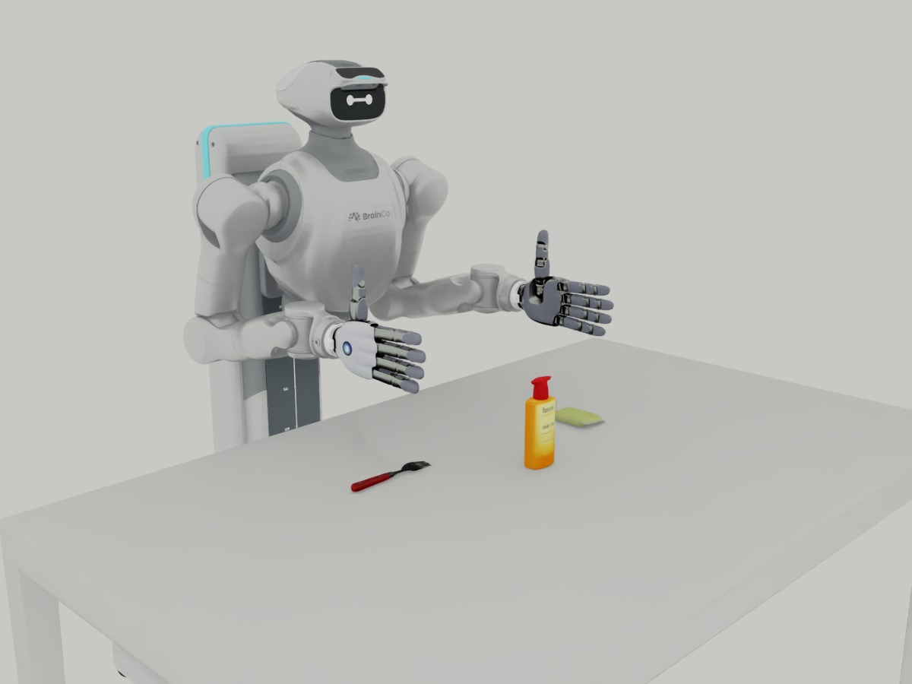

**区别：** 通过切换工具接触面规划非抓取绕障，不是抓控小车移动。

**初态：** 海绵在左前方，乳液瓶在中央，叉子在右侧。

### 使用的资产

| 道具 | 数量 | 注册 ID | 预览 |
|---|---:|---|---|
| 海绵 | 1 | `obj.tabletop50.sponge@scene_v1` | [实物网格](assets/sponge.jpg) |
| 护肤油瓶 | 1 | `obj.tabletop50.lotion@scene_v1` | [实物网格](assets/lotion.jpg) |
| 餐叉 | 1 | `obj.tabletop50.fork@scene_v1` | [实物网格](assets/fork.jpg) |

准备后的运行路径（相对 checkout）：

```text
assets/library/prepared/obj.tabletop50.sponge/scene_v1/model.usdc
assets/library/prepared/obj.tabletop50.lotion/scene_v1/model.usdc
assets/library/prepared/obj.tabletop50.fork/scene_v1/model.usdc
```

原始路径（相对原始资产根目录）：

```text
library/external/bench2dex/bf65215f844d/Objects/026_sponge/textured.obj
library/external/bench2dex/bf65215f844d/Objects/211_hydrating-oil/base5.glb
library/external/bench2dex/bf65215f844d/Objects/030_fork/textured.obj
```

### 怎么做

1. 握叉并用钝柄端接触海绵侧面。
2. 分段改变接触边，把海绵推到瓶子另一侧。
3. 撤回工具。

### 验收标准

1. 海绵从 x<-0.15 m 移到 x>0.15 m，路线绕过瓶身。
2. 手不直接抓海绵，工具不能扎入海绵。
3. 瓶子位移小于 1 cm，始终直立。

### 开发前检查

1. 使用实际网格核对抓取空间、支撑面与机器人可达性；转成动态资产后再测试。

<a id="proposal_99_handbell_oscillation"></a>
## 99 · 握住手摇铃完成三次往复摆动

`proposal_99_handbell_oscillation` · 未开始 · 0 条轨迹

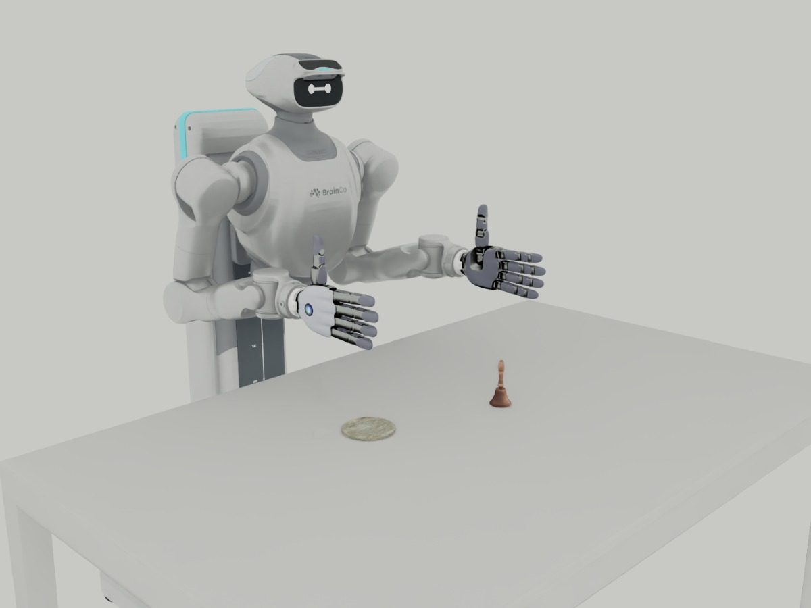

**区别：** 有周期、振幅和停止姿态要求的连续摆动，不是抓起后直接移位。

**初态：** 手摇铃直立，杯垫在右侧作为回放位置。

### 使用的资产

| 道具 | 数量 | 注册 ID | 预览 |
|---|---:|---|---|
| 手摇铃 | 1 | `obj.tabletop100.callbell@scene_v1` | [实物网格](assets/callbell.jpg) |
| 杯垫 | 1 | `obj.tabletop50.coaster@scene_v1` | [实物网格](assets/coaster.jpg) |

准备后的运行路径（相对 checkout）：

```text
assets/library/prepared/obj.tabletop100.callbell/scene_v1/model.usdc
assets/library/prepared/obj.tabletop50.coaster/scene_v1/model.usdc
```

原始路径（相对原始资产根目录）：

```text
library/external/bench2dex/bf65215f844d/Objects/213_callbell/base5.glb
library/external/bench2dex/bf65215f844d/Objects/137_coaster/base0.glb
```

### 怎么做

1. 握住铃柄并抬离桌面。
2. 让铃体连续完成三次左右往复摆动。
3. 停止摆动后把铃底放到杯垫中央。

### 验收标准

1. 铃体绕指定横轴完成三次往复，每侧幅度 20°–35°。
2. 握持只在铃柄，铃体无撞桌或脱手，转向时角速度连续。
3. 铃底落在杯垫内且稳定 2 s，不要求声音或内部铃舌运动。

### 开发前检查

1. 源模型为手摇铃外形，按整体刚体评估，未接入声学及内部铃舌。

<a id="proposal_100_balanced_tray_exchange"></a>
## 100 · 扶稳托盘同时交换两侧载荷

`proposal_100_balanced_tray_exchange` · 未开始 · 0 条轨迹

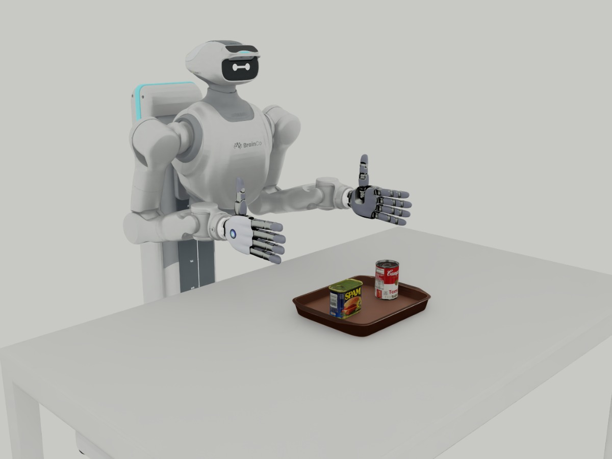

**区别：** 移动支撑面与载荷重新分布同时发生，区别于桌面双手交换盒子。

**初态：** 两种罐头分放托盘两端，托盘平放桌面。

### 使用的资产

| 道具 | 数量 | 注册 ID | 预览 |
|---|---:|---|---|
| 长方托盘 | 1 | `obj.tabletop100.tray@scene_v1` | [实物网格](assets/tray.jpg) |
| 汤罐 | 1 | `obj.tabletop100.soupcan@scene_v1` | [实物网格](assets/soupcan.jpg) |
| 午餐肉罐 | 1 | `obj.tabletop100.meatcan@scene_v1` | [实物网格](assets/meatcan.jpg) |

准备后的运行路径（相对 checkout）：

```text
assets/library/prepared/obj.tabletop100.tray/scene_v1/model.usdc
assets/library/prepared/obj.tabletop100.soupcan/scene_v1/model.usdc
assets/library/prepared/obj.tabletop100.meatcan/scene_v1/model.usdc
```

原始路径（相对原始资产根目录）：

```text
library/external/bench2dex/bf65215f844d/Objects/130_tray/base3.glb
library/external/bench2dex/bf65215f844d/Objects/005_tomato_soup_can/textured.obj
library/external/bench2dex/bf65215f844d/Objects/010_potted_meat_can/textured.obj
```

### 怎么做

1. 一手端起托盘一侧并保持可控姿态。
2. 另一手依次把两罐交换到对侧，中间允许临时落桌。
3. 托盘放平，确认载荷已交换。

### 验收标准

1. 至少一只手在交换期间持续稳住离桌的托盘，盘面倾角小于 10°。
2. 两罐最终分别到达对侧初始区域，误差小于 2 cm。
3. 非操作中的载荷相对滑移不超过 2 cm，无掉落。

### 开发前检查

1. 使用实际网格核对抓取空间、支撑面与机器人可达性；转成动态资产后再测试。
