# RevoBench：50 个桌面任务提案

这份图册包含 50 个待开发任务、87 个现有资产的预览，以及每项任务的摆放说明、操作步骤和验收标准。所有道具复用已有网格；没有新建方块、圆柱、球或其他替代道具。

在线图册：[待开发任务（50）](https://davidlxu.github.io/RevoBench/pending/)。本地图册：[`index.html`](index.html)。机器可读清单：[`tasks.json`](tasks.json)。原有任务快照：[`baseline_tasks.json`](baseline_tasks.json)。路径与渲染检查：[`validation_report.json`](validation_report.json)。

## 交付范围

已完成任务提案、真实资产静态渲染和桌面道具陈列。没有运行物理仿真、生成机器人轨迹或把它们登记为已完成任务。原有主分支仍是 36 个任务；本清单的 50 项均为 `proposal_only`。

为看清每件道具，桌面图将物体分开展示。叠放、遮挡、套入、支撑等实际初态由每项“初始摆放”定义，不能把道具陈列坐标直接当成已验证的接触初态。桌面背景与目标标注不作为物理道具。

与旧任务的比较以主分支 `cea0620fb67293e408c66120f6dfe212a19967dd` 的 36 个任务为基线。每项都说明区别；接近旧任务的装箱、试管换孔等，明确标为“新约束”或“组合流程”，没有宣称 50 种全新操作机制。

## 资产在哪里

本次逐一检查的是这台 Mac 的资产目录：

```text
/Users/xulixin/RevoBench-refactor/assets
```

JSON 中 `source` 相对于该资产根目录；`source_absolute` 是本次检查的完整路径。每项任务下列出了可直接复制的完整路径。服务器上的素材是否齐全尚未在本次工作中核实，不能把这些 Mac 路径当成服务器路径。换机器时设置 `REVOBENCH_ASSET_ROOT` 并保留相对目录结构。

所选素材均来自已下载的 Bench2Dex/Assets 固定版本 `bf65215f844d1fca30750e4cc70d7266650abf0a`。引用原素材及其许可约束；本交付不重新分发 3D 素材本体，也不改变其许可。

优先列出原始 OBJ / GLB / URDF 作为可核对来源；有现成 USD 时在 JSON 的 `runtime_candidate` 中列出。部分旧 USD 含 Windows 相对路径，接入前需要恢复引用、检查纹理、单位、关节和碰撞。`runtime_candidate` 不是“已可直接运行”的承诺。

预览只改变实例尺度和朝向，不改源网格。`geometry_audit.json` 保存源包围盒、实际使用的统一缩放与中心偏移。拼图、俄罗斯方块、紧固件和套杯各组保持共同缩放，避免分别归一化破坏配合关系。提案尺寸不是实测物理尺寸。

## 统一验收

1. 全部为待开发任务提案：静态道具摆放和图册已生成，尚未实现 planner、执行轨迹或物理验收。
2. 每条演示从机器人默认姿态开始，操作结束后通过真实运动回到默认姿态；建议回位最大关节误差≤0.05 rad、最大关节速度≤0.05 rad/s，连续保持1 s。阈值在试验前冻结。
3. 各阶段连续衔接；记录位置、速度、加速度及 jerk，并用正常速度视频复核跳变、突然加减速、反复修正和无意义停顿。任务要求的接触驻留和稳定等待不视为无意义停顿。
4. 肩、肘、腕和手掌的整体姿态需人工复核，避免异常抬肘、腕部反折、无意义翻掌和绕远接近；动作学限位通过不等于仿人通过。
5. 用指腹、手指内侧和合理工具工作面形成接触，尤其不能依赖拇指背部抓握。不得明显穿透、撞击、过度挤压、抓持滑脱、瞬移或隐藏附件。
6. 需要松手的终态均在完全解除手部支撑后连续稳定2 s。保持持物的阶段按各任务规定的保持时间评测。
7. 物理任务通过、运动质量通过分别记录。保存正常速度完整视频、物体位姿、接触与关节日志以及逐项结果；禁止只因脚本退出零就标为通过。
8. 本文位置、角度、时间、比例阈值均为建议的首版验收配置，不是实测结论。接入前验证可达性、尺寸与接触，修改后生成新配置版本。
9. 除虚拟目标区和可视化背景外，所有操作道具均使用清单中的现有源网格；禁止新增程序化方块、圆柱、球等替代原物件。

## 网站发布与维护

公开地址是 https://davidlxu.github.io/RevoBench/pending/ 。公开页面提供任务说明与静态图册包，无需登录；BrainCoTech/RevoBench 是私有仓库，完整构建代码需要仓库权限。首页提供独立的待开发入口，50 项提案不并入已有 36 项任务的验收统计。主仓库保存全部源码和文档；网站仓库 `DavidLXu/DavidLXu.github.io` 的 `RevoBench/pending/` 保存静态发布副本，不轮询 GitHub。

更新 JSON 或模板后运行 `python write_documents.py`，再运行 `python export_site.py --site-root /网站仓库路径` 复制发布文件。检查网站改动后分别提交两个仓库；GitHub Pages 从网站仓库 main 发布。任务包可用 `python package_catalog.py` 重建。

## 开发者使用方法

1. 打开 `index.html`，按类别或道具搜索，选一个任务；点“复制任务说明”可获得包含绝对路径、步骤、前置检查和统一验收要求的完整交接文本。
2. 核对资产根目录。先处理该任务列出的尺寸、配合、碰撞或关节问题，再按“初始摆放”建立接触初态；不要把源素材“能显示”当成物理可用。
3. 接入现有任务框架后先验证静态支撑、可达性和接触，再开发 planner。所有动作质量要求与物理成功标准分别保留证据。
4. 真正开始实现时再新增正式任务注册与进度记录。本提案不修改现有 36 项的验收结果。

仅查看图册不需要 Python、Isaac 或访问资产库，直接打开 HTML 即可。重新渲染需要 Python 3.12、NumPy 2.2、trimesh、Pillow、SciPy 和 numba：

```bash
python -m venv .venv
.venv/bin/pip install -r requirements.txt
export REVOBENCH_ASSET_ROOT=/实际机器上的/assets
.venv/bin/python build_catalog.py
.venv/bin/python validate_catalog.py
.venv/bin/python write_documents.py
```

字体默认使用 macOS STHeiti；其他系统可通过 `REVOBENCH_CJK_FONT` 指向支持中文的字体。`define_tasks.py` 是提案源文件，修改它后先重新生成 `tasks.json`，再运行上面的构建命令。所有命令在本图册目录运行。

## 任务索引

| 编号 | 任务 | 类别 | 相对旧任务 |
|---|---|---|---|
| 01 | [用锅铲铲起面包片](#proposal_01_spatula_bread) | 工具操作 | 新交互 |
| 02 | [用勺子从碗中舀出高尔夫球](#proposal_02_spoon_ball) | 工具操作 | 新交互 |
| 03 | [用钳子夹取螺母](#proposal_03_pliers_nut) | 工具操作 | 新交互 |
| 04 | [刷子配合小铲收集滚动物](#proposal_04_brush_dustpan) | 工具操作 | 新交互 |
| 05 | [擦拭小黑板指定区域](#proposal_05_erase_board) | 工具操作 | 新交互 |
| 06 | [用螺丝刀撬起书的一侧](#proposal_06_lever_book) | 工具操作 | 新交互 |
| 07 | [用叉和铲配合翻面](#proposal_07_turn_bread) | 工具操作 | 新交互 |
| 08 | [托着草莓平稳移动勺子](#proposal_08_balance_spoon) | 工具操作 | 新交互 |
| 09 | [扶住饮料瓶擦拭瓶身](#proposal_09_wipe_bottle) | 工具操作 | 新交互 |
| 10 | [沿键盘行列刷扫](#proposal_10_brush_keyboard) | 工具操作 | 新交互 |
| 11 | [将手机斜放到支架](#proposal_11_dock_phone) | 设备操作 | 新交互 |
| 12 | [拿起相机对准奖杯](#proposal_12_aim_camera) | 设备操作 | 新交互 |
| 13 | [调整台灯照向笔记本](#proposal_13_aim_lamp) | 设备操作 | 新交互 |
| 14 | [抬起键盘取出被挡住的鼠标](#proposal_14_lift_keyboard_retrieve) | 受约束取物 | 新交互 |
| 15 | [遥控器在手中换向](#proposal_15_remote_regrasp) | 手内调整 | 新交互 |
| 16 | [抽出书下的毛笔](#proposal_16_extract_brushpen) | 受约束取物 | 新交互 |
| 17 | [翻转沙漏并稳放](#proposal_17_invert_hourglass) | 手内调整 | 新交互 |
| 18 | [把骰子的指定点数转到上面](#proposal_18_orient_die) | 手内调整 | 新交互 |
| 19 | [把侧倒的两只鞋扶正并排齐](#proposal_19_align_shoes) | 手内调整 | 新交互 |
| 20 | [用倒置安全帽接住球](#proposal_20_helmet_catch) | 动态接物 | 新交互 |
| 21 | [分离嵌套的两只杯子](#proposal_21_separate_nested_cups) | 套叠与拼装 | 新交互 |
| 22 | [从三只盘子中取出中间一只](#proposal_22_middle_plate) | 受约束取物 | 新约束 |
| 23 | [旋转拼图片并接合](#proposal_23_join_jigsaw) | 套叠与拼装 | 新交互 |
| 24 | [把四种异形拼块放入框架](#proposal_24_pack_tetris) | 套叠与拼装 | 新交互 |
| 25 | [双手把螺母旋到螺栓上](#proposal_25_thread_nut) | 套叠与拼装 | 新约束 |
| 26 | [按结构分拣混合紧固件](#proposal_26_sort_fasteners) | 识别与整理 | 新约束 |
| 27 | [在试管架上交换试管位置](#proposal_27_reindex_tubes) | 套叠与拼装 | 新约束 |
| 28 | [转动 L 形拼块穿过窄缝](#proposal_28_extract_l_piece) | 受约束取物 | 新交互 |
| 29 | [移开遮挡找到指定球](#proposal_29_reveal_ball) | 识别与整理 | 新交互 |
| 30 | [开盒取药，再把盒盖关回](#proposal_30_medicine_box) | 组合流程 | 组合流程 |
| 31 | [扶住上层物品抽出底部书本](#proposal_31_bottom_book) | 受约束取物 | 新交互 |
| 32 | [移走高脚杯底下的杯垫](#proposal_32_remove_coaster) | 受约束取物 | 新交互 |
| 33 | [捏取狭缝中的电池](#proposal_33_battery_gap) | 受约束取物 | 新交互 |
| 34 | [转动法棍通过瓶罐间隙](#proposal_34_baguette_passage) | 受约束取物 | 新交互 |
| 35 | [把三种食品盒紧凑装入木盒](#proposal_35_compact_food_pack) | 识别与整理 | 新约束 |
| 36 | [清出遮挡后取出指定零食](#proposal_36_occluded_snack) | 识别与整理 | 新约束 |
| 37 | [双手同时交换茶叶盒和咖啡盒](#proposal_37_bimanual_swap) | 双手协调 | 新交互 |
| 38 | [一只手同时握住两只小瓶](#proposal_38_two_bottles_one_grasp) | 多物体抓握 | 新交互 |
| 39 | [双手交接哑铃](#proposal_39_handoff_dumbbell) | 双手协调 | 新交互 |
| 40 | [从帽檐换握到帽体并翻正](#proposal_40_hat_brim) | 手内调整 | 新交互 |
| 41 | [用网球撞倒指定瓶子](#proposal_41_table_bowling) | 动态接物 | 新交互 |
| 42 | [抓控小车穿过桌面障碍](#proposal_42_toycar_slalom) | 受约束取物 | 新交互 |
| 43 | [双手配合滚出并接住棒球](#proposal_43_roll_and_catch) | 动态接物 | 新交互 |
| 44 | [倒扣塑料盒罩住香皂](#proposal_44_cover_soap) | 套叠与拼装 | 新交互 |
| 45 | [让毛笔横搭在两只包装盒上](#proposal_45_bridge_brushpen) | 精细支撑 | 新交互 |
| 46 | [把纸卷套到细瓶外面](#proposal_46_sleeve_paper_roll) | 套叠与拼装 | 新交互 |
| 47 | [稳住篮筐抽出长法棍](#proposal_47_extract_baguette) | 双手协调 | 新约束 |
| 48 | [握住杯梗把高脚杯倒扣](#proposal_48_invert_stemglass) | 精细支撑 | 新约束 |
| 49 | [持麦克风沿音箱三侧巡检](#proposal_49_microphone_scan) | 设备操作 | 新交互 |
| 50 | [在笔记本指定位置盖印](#proposal_50_stamp_notebook) | 工具操作 | 新交互 |

<a id="proposal_01_spatula_bread"></a>
## 01 · 用锅铲铲起面包片

**任务 ID：** `proposal_01_spatula_bread` · **状态：** 待开发提案 · **类别：** 工具操作

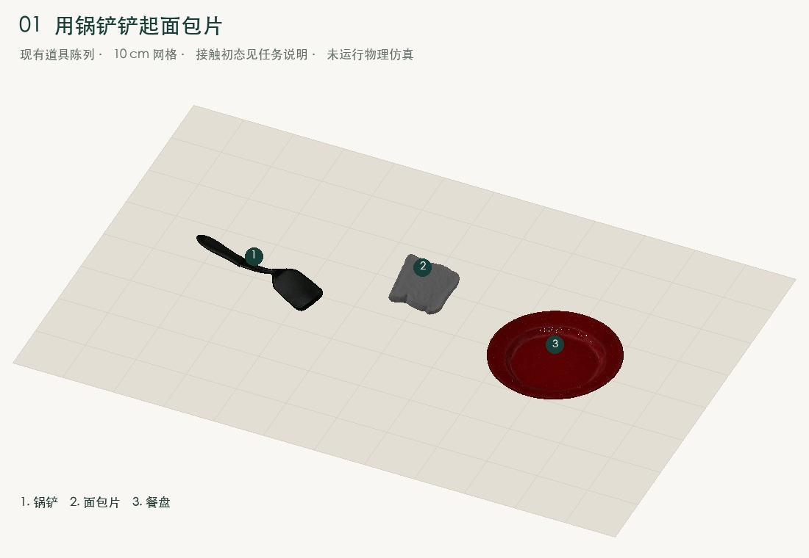

**与旧任务的区别：** 新增薄工具楔入与承托，区别于 kitchen 的直接抓取食材。

### 道具、路径与预览

| 道具 | 数量 | 资产 ID | 可视化 |
|---|---:|---|---|
| 锅铲 | 1 | `spatula` | [查看原模型渲染](assets/spatula.jpg) |
| 面包片 | 1 | `bread` | [查看原模型渲染](assets/bread.jpg) |
| 餐盘 | 1 | `plate` | [查看原模型渲染](assets/plate.jpg) |

完整资产路径：

```text
/Users/xulixin/RevoBench-refactor/assets/library/external/bench2dex/bf65215f844d/Objects/033_spatula/textured.obj
/Users/xulixin/RevoBench-refactor/assets/library/external/bench2dex/bf65215f844d/Objects/222_bread_slice/uploads_files_2384335_pan.obj
/Users/xulixin/RevoBench-refactor/assets/library/external/bench2dex/bf65215f844d/Objects/029_plate/textured.obj
```

### 初始摆放

面包片平放桌面中央；锅铲在右前方；餐盘在左后方，离面包约 25 cm。

### 操作步骤

1. 握住锅铲柄，铲面近乎平行桌面接近面包。
2. 将铲面伸到面包下方，抬起后连续转移到餐盘上方。
3. 降低铲面、退出锅铲，让面包留在盘中。

### 验收标准

以下标准与前面的统一验收要求同时适用。

- 面包至少离桌 3 cm，运输阶段由锅铲支撑，手不能直接抓面包。
- 面包释放后位于餐盘内缘以内，并稳定 2 s。
- 锅铲退出后不压住面包；餐盘位移不超过 2 cm。

### 接入前检查

- 面包源网格没有配套纹理；不得把灰色预览当成缺失资产。
- 确认锅铲薄边碰撞与面包底部间隙，不能靠初始穿透铲起。

<a id="proposal_02_spoon_ball"></a>
## 02 · 用勺子从碗中舀出高尔夫球

**任务 ID：** `proposal_02_spoon_ball` · **状态：** 待开发提案 · **类别：** 工具操作

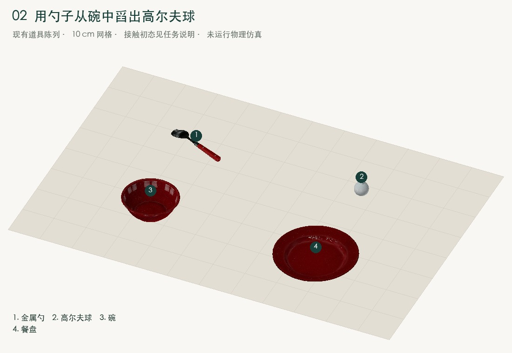

**与旧任务的区别：** 新增凹面工具承托与滚动物体控制，不是 pour_can 的容器倾倒。

### 道具、路径与预览

| 道具 | 数量 | 资产 ID | 可视化 |
|---|---:|---|---|
| 金属勺 | 1 | `spoon` | [查看原模型渲染](assets/spoon.jpg) |
| 高尔夫球 | 1 | `golf` | [查看原模型渲染](assets/golf.jpg) |
| 碗 | 1 | `bowl` | [查看原模型渲染](assets/bowl.jpg) |
| 餐盘 | 1 | `plate` | [查看原模型渲染](assets/plate.jpg) |

完整资产路径：

```text
/Users/xulixin/RevoBench-refactor/assets/library/external/bench2dex/bf65215f844d/Objects/031_spoon/textured.obj
/Users/xulixin/RevoBench-refactor/assets/library/external/bench2dex/bf65215f844d/Objects/058_golf_ball/textured.obj
/Users/xulixin/RevoBench-refactor/assets/library/external/bench2dex/bf65215f844d/Objects/024_bowl/textured.obj
/Users/xulixin/RevoBench-refactor/assets/library/external/bench2dex/bf65215f844d/Objects/029_plate/textured.obj
```

### 初始摆放

高尔夫球放在碗底；勺子放右侧；餐盘在碗左侧 25 cm。

### 操作步骤

1. 持勺沿碗壁接近球底。
2. 用勺承托球并越过碗沿，缓慢移向餐盘。
3. 倾斜勺面，让球落在餐盘中心附近。

### 验收标准

以下标准与前面的统一验收要求同时适用。

- 球离开碗的过程中始终由勺接触承托，不允许直接手抓。
- 搬运期间球不得提前掉回碗或掉到桌面。
- 球最终留在餐盘内并静止 2 s；碗位移不超过 2 cm。

### 接入前检查

- 使用单独的真实高尔夫球网格，不使用 063-a_marbles 的整团连体扫描模型。
- 量取勺面与球径，先验证能形成稳定承托；不改变球形状硬塞。

<a id="proposal_03_pliers_nut"></a>
## 03 · 用钳子夹取螺母

**任务 ID：** `proposal_03_pliers_nut` · **状态：** 待开发提案 · **类别：** 工具操作

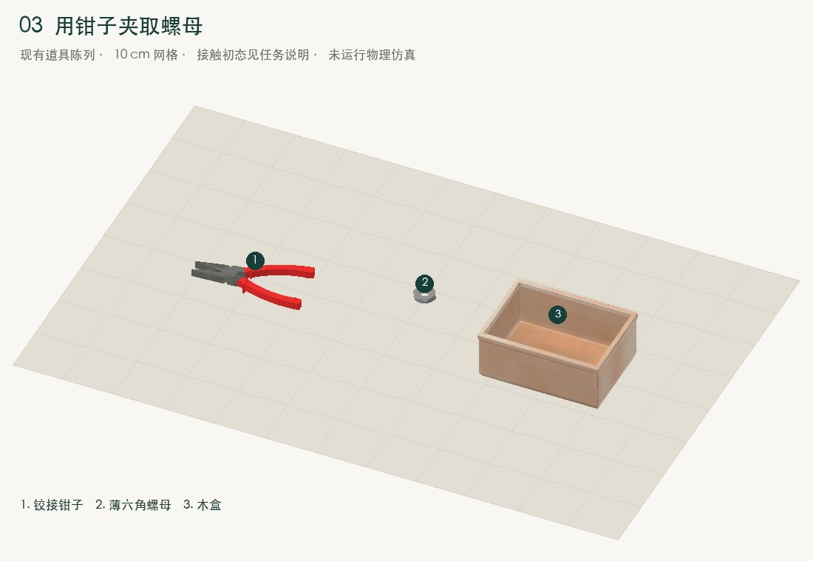

**与旧任务的区别：** 把铰接工具作为中间执行器，而不是只演示工具本身开合。

### 道具、路径与预览

| 道具 | 数量 | 资产 ID | 可视化 |
|---|---:|---|---|
| 铰接钳子 | 1 | `pliers` | [查看原模型渲染](assets/pliers.jpg) |
| 薄六角螺母 | 1 | `fastener_9` | [查看原模型渲染](assets/fastener_9.jpg) |
| 木盒 | 1 | `woodbox` | [查看原模型渲染](assets/woodbox.jpg) |

完整资产路径：

```text
/Users/xulixin/RevoBench-refactor/assets/library/external/bench2dex/bf65215f844d/Objects/109_pliers/01_pliers/01/mobility.urdf
/Users/xulixin/RevoBench-refactor/assets/library/external/bench2dex/bf65215f844d/Objects/327_bolt_nuts/01_bolt_nuts/01/nuts_and_bolts_Object_9.glb
/Users/xulixin/RevoBench-refactor/assets/library/external/bench2dex/bf65215f844d/Objects/154_wooden_box/base0.glb
```

### 初始摆放

薄六角螺母平放桌面；钳子张开；木盒位于另一侧。

### 操作步骤

1. 抓住钳柄并调整钳口朝向。
2. 用钳口两侧夹住螺母外缘，抬起并搬运。
3. 在木盒内松开钳口，再放回工具。

### 验收标准

以下标准与前面的统一验收要求同时适用。

- 螺母离桌至少 3 cm，搬运阶段仅通过钳口夹持。
- 钳子开合在原 URDF joint_0 的 0–30° 范围内。
- 螺母释放后留在木盒内，且没有黏附、穿透或持续滑脱。

### 接入前检查

- 保留钳子铰链，验证手部能够实际驱动钳柄。
- 木盒必须保留内腔碰撞，不能使用封闭凸包充当容器。

<a id="proposal_04_brush_dustpan"></a>
## 04 · 刷子配合小铲收集滚动物

**任务 ID：** `proposal_04_brush_dustpan` · **状态：** 待开发提案 · **类别：** 工具操作

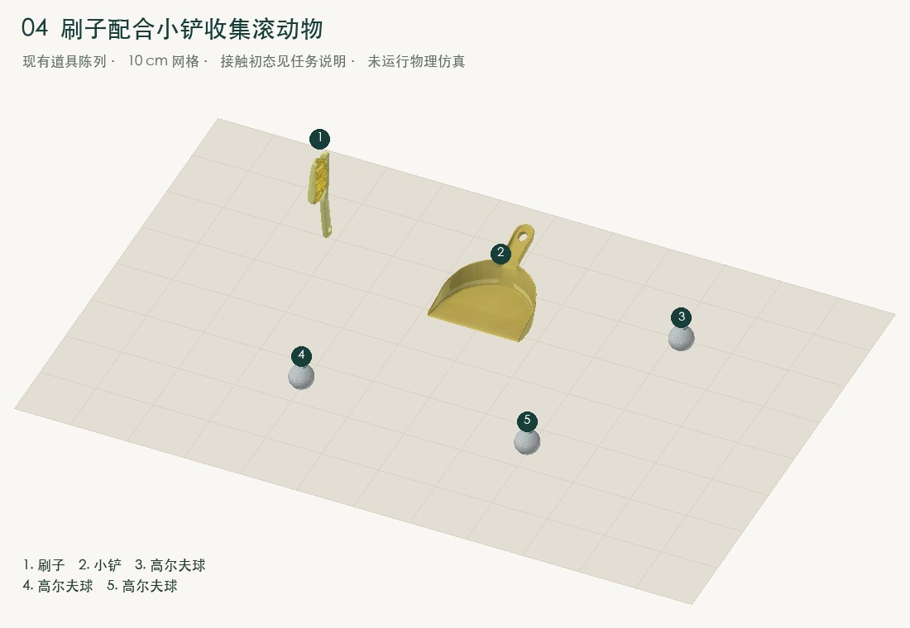

**与旧任务的区别：** 新增双工具协同和滚动物体聚拢，与 tray_carry 的整体搬运不同。

### 道具、路径与预览

| 道具 | 数量 | 资产 ID | 可视化 |
|---|---:|---|---|
| 刷子 | 1 | `brush` | [查看原模型渲染](assets/brush.jpg) |
| 小铲 | 1 | `shovel` | [查看原模型渲染](assets/shovel.jpg) |
| 高尔夫球 | 3 | `golf` | [查看原模型渲染](assets/golf.jpg) |

完整资产路径：

```text
/Users/xulixin/RevoBench-refactor/assets/library/external/bench2dex/bf65215f844d/Objects/189_brush/base3.glb
/Users/xulixin/RevoBench-refactor/assets/library/external/bench2dex/bf65215f844d/Objects/188_smallshovel/base3.glb
/Users/xulixin/RevoBench-refactor/assets/library/external/bench2dex/bf65215f844d/Objects/058_golf_ball/textured.obj
```

### 初始摆放

三个高尔夫球在桌中央散开 6–10 cm；小铲位于它们后方，刷子在右侧。

### 操作步骤

1. 一只手稳住小铲，使铲口贴近桌面。
2. 另一只手持刷子，从外向内把球扫到铲内。
3. 保持铲面平稳，将装有球的小铲抬离桌面。

### 验收标准

以下标准与前面的统一验收要求同时适用。

- 三个球全部进入铲内，不能用手直接捡球。
- 装载后小铲离桌至少 3 cm 并保持 2 s，无球掉出。
- 刷子通过刷头接触推动，不能用隐藏约束吸住球。

### 接入前检查

- 图中刷子是现有短刷；先检查刷头与铲口实际尺寸。
- 可以先使用原刷头刚性碰撞，不宣称已经模拟真实刷毛形变。

<a id="proposal_05_erase_board"></a>
## 05 · 擦拭小黑板指定区域

**任务 ID：** `proposal_05_erase_board` · **状态：** 待开发提案 · **类别：** 工具操作

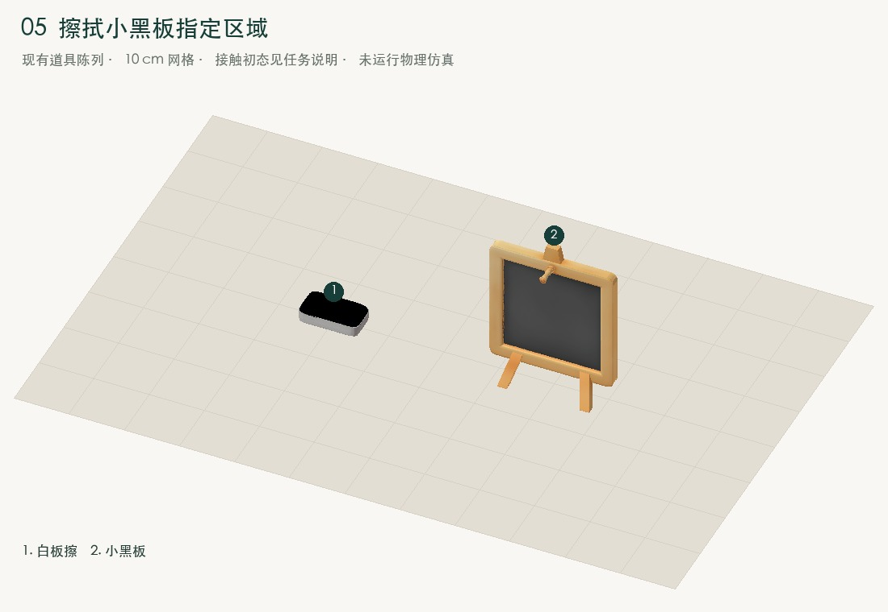

**与旧任务的区别：** 评测持续面接触和覆盖轨迹；没有旧任务的同类操作。

### 道具、路径与预览

| 道具 | 数量 | 资产 ID | 可视化 |
|---|---:|---|---|
| 白板擦 | 1 | `eraser` | [查看原模型渲染](assets/eraser.jpg) |
| 小黑板 | 1 | `chalkboard` | [查看原模型渲染](assets/chalkboard.jpg) |

完整资产路径：

```text
/Users/xulixin/RevoBench-refactor/assets/library/external/bench2dex/bf65215f844d/Objects/217_whiteboard-eraser/base0.glb
/Users/xulixin/RevoBench-refactor/assets/library/external/bench2dex/bf65215f844d/Objects/219_mini-chalkboard/base0.glb
```

### 初始摆放

小黑板竖立在桌后侧；在其板面坐标系中定义 12×8 cm 的虚拟目标区域；板擦在前方。

### 操作步骤

1. 握住板擦，使擦拭面贴近平面。
2. 沿连续往复轨迹覆盖目标区域，另一只手可稳住黑板支架。
3. 移开板擦并放回桌面。

### 验收标准

以下标准与前面的统一验收要求同时适用。

- 基于实际接触足迹，目标区域覆盖率至少 90%。
- 擦拭阶段板擦面与板面夹角不超过 15°，有效接触时间占比至少 90%。
- 板面位移不超过 2 cm，板擦不得穿入板面。

### 接入前检查

- 区域只是评测标注，不新增实体道具。
- 需实现接触覆盖记录；不把几何覆盖等同于已经模拟粉笔去除。

<a id="proposal_06_lever_book"></a>
## 06 · 用螺丝刀撬起书的一侧

**任务 ID：** `proposal_06_lever_book` · **状态：** 待开发提案 · **类别：** 工具操作

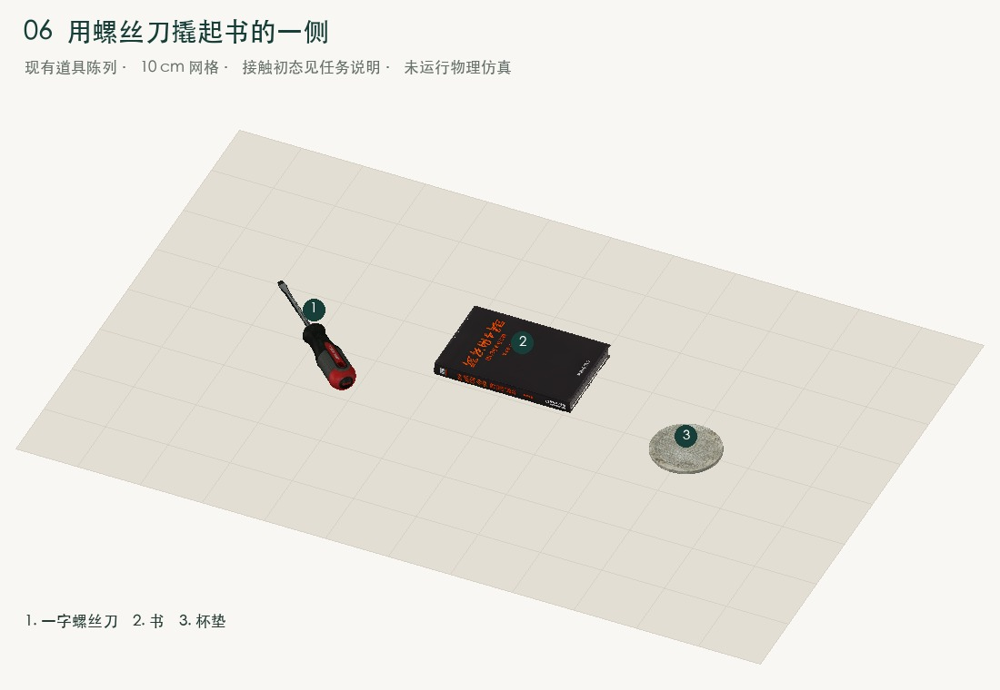

**与旧任务的区别：** 新增利用支点的工具传力与双手接续。

### 道具、路径与预览

| 道具 | 数量 | 资产 ID | 可视化 |
|---|---:|---|---|
| 一字螺丝刀 | 1 | `driver` | [查看原模型渲染](assets/driver.jpg) |
| 书 | 1 | `book` | [查看原模型渲染](assets/book.jpg) |
| 杯垫 | 1 | `coaster` | [查看原模型渲染](assets/coaster.jpg) |

完整资产路径：

```text
/Users/xulixin/RevoBench-refactor/assets/library/external/bench2dex/bf65215f844d/Objects/044_flat_screwdriver/textured.obj
/Users/xulixin/RevoBench-refactor/assets/library/external/bench2dex/bf65215f844d/Objects/155_book/base1.glb
/Users/xulixin/RevoBench-refactor/assets/library/external/bench2dex/bf65215f844d/Objects/137_coaster/base0.glb
```

### 初始摆放

杯垫垫在书的一侧，使书边留下可插入刀头的真实间隙；螺丝刀在旁边。

### 操作步骤

1. 把一字刀头插入书边下方。
2. 以杯垫附近的支撑边为支点，压低手柄，抬起书边。
3. 另一只手接住书，再退出螺丝刀并平放书本。

### 验收标准

以下标准与前面的统一验收要求同时适用。

- 书边通过工具杠杆动作上升至少 2 cm，接手前不得直接抓书抬起。
- 撬动时刀头保持在书下，无穿透。
- 接手和工具退出连续衔接；书最终平放并稳定 2 s。

### 接入前检查

- 只复用书、螺丝刀和杯垫，不能新造楔块或支点。
- 需要检查刀头厚度、初始缝隙以及杯垫支撑是否稳定。

<a id="proposal_07_turn_bread"></a>
## 07 · 用叉和铲配合翻面

**任务 ID：** `proposal_07_turn_bread` · **状态：** 待开发提案 · **类别：** 工具操作

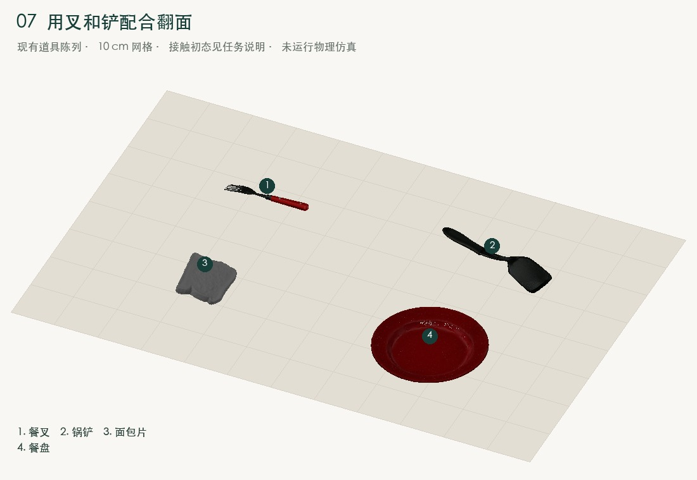

**与旧任务的区别：** 在任务 01 的工具承托之外增加双工具翻转，最终目标是姿态翻面。

### 道具、路径与预览

| 道具 | 数量 | 资产 ID | 可视化 |
|---|---:|---|---|
| 餐叉 | 1 | `fork` | [查看原模型渲染](assets/fork.jpg) |
| 锅铲 | 1 | `spatula` | [查看原模型渲染](assets/spatula.jpg) |
| 面包片 | 1 | `bread` | [查看原模型渲染](assets/bread.jpg) |
| 餐盘 | 1 | `plate` | [查看原模型渲染](assets/plate.jpg) |

完整资产路径：

```text
/Users/xulixin/RevoBench-refactor/assets/library/external/bench2dex/bf65215f844d/Objects/030_fork/textured.obj
/Users/xulixin/RevoBench-refactor/assets/library/external/bench2dex/bf65215f844d/Objects/033_spatula/textured.obj
/Users/xulixin/RevoBench-refactor/assets/library/external/bench2dex/bf65215f844d/Objects/222_bread_slice/uploads_files_2384335_pan.obj
/Users/xulixin/RevoBench-refactor/assets/library/external/bench2dex/bf65215f844d/Objects/029_plate/textured.obj
```

### 初始摆放

面包片放在餐盘中央，给其中一面定义可追踪的局部法向；餐叉和锅铲分置左右。

### 操作步骤

1. 一只手用餐叉轻扶面包侧边，不刺入食物。
2. 另一只手把锅铲伸到面包下方。
3. 两工具协调，将面包翻转并放回盘内。

### 验收标准

以下标准与前面的统一验收要求同时适用。

- 面包目标法向翻转 180°±15°。
- 面包全过程未离开两工具及餐盘构成的支撑范围，最终落在盘内。
- 手不能直接抓面包，也不能把刺穿或黏附当成夹持。

### 接入前检查

- 保持面包刚体模型；不引入未建模的穿刺或软体效果。

<a id="proposal_08_balance_spoon"></a>
## 08 · 托着草莓平稳移动勺子

**任务 ID：** `proposal_08_balance_spoon` · **状态：** 待开发提案 · **类别：** 工具操作

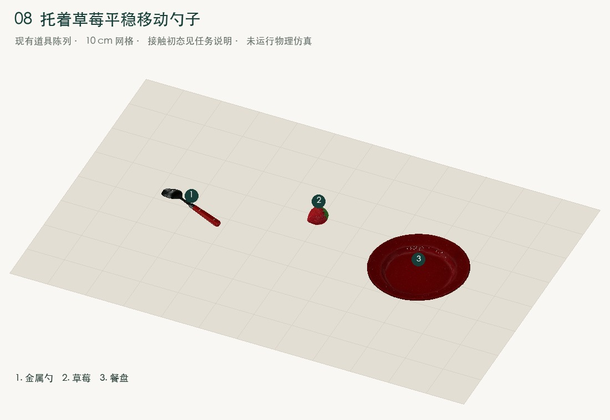

**与旧任务的区别：** 关注移动支撑面上的平衡；区别于任务 02 的从容器中舀出。

### 道具、路径与预览

| 道具 | 数量 | 资产 ID | 可视化 |
|---|---:|---|---|
| 金属勺 | 1 | `spoon` | [查看原模型渲染](assets/spoon.jpg) |
| 草莓 | 1 | `strawberry` | [查看原模型渲染](assets/strawberry.jpg) |
| 餐盘 | 1 | `plate` | [查看原模型渲染](assets/plate.jpg) |

完整资产路径：

```text
/Users/xulixin/RevoBench-refactor/assets/library/external/bench2dex/bf65215f844d/Objects/031_spoon/textured.obj
/Users/xulixin/RevoBench-refactor/assets/library/external/bench2dex/bf65215f844d/Objects/012_strawberry/textured.obj
/Users/xulixin/RevoBench-refactor/assets/library/external/bench2dex/bf65215f844d/Objects/029_plate/textured.obj
```

### 初始摆放

草莓放在盘中；勺子在旁边；桌面两处虚拟路标间距 25 cm。

### 操作步骤

1. 将草莓放到勺面可承托的位置。
2. 持勺依次经过两个路标，再回到餐盘上方。
3. 轻倾勺面，把草莓放回盘中。

### 验收标准

以下标准与前面的统一验收要求同时适用。

- 承托阶段勺与草莓离桌至少 4 cm，累计水平移动不少于 50 cm。
- 草莓全程没有离开勺面掉落，另一只手不能扶住草莓。
- 最终草莓回到盘内，勺子安全退出。

### 接入前检查

- 先检查草莓与勺面相对大小及摩擦；若不能自然承托，应更换已存在的勺型号，而非加吸附。

<a id="proposal_09_wipe_bottle"></a>
## 09 · 扶住饮料瓶擦拭瓶身

**任务 ID：** `proposal_09_wipe_bottle` · **状态：** 待开发提案 · **类别：** 工具操作

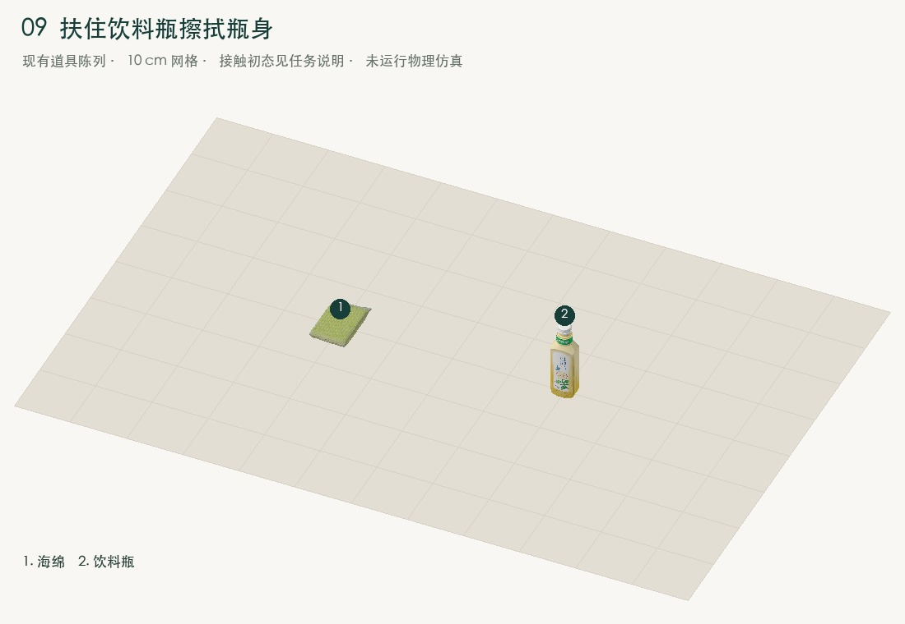

**与旧任务的区别：** 新增曲面擦拭和双手一稳一动的配合。

### 道具、路径与预览

| 道具 | 数量 | 资产 ID | 可视化 |
|---|---:|---|---|
| 海绵 | 1 | `sponge` | [查看原模型渲染](assets/sponge.jpg) |
| 饮料瓶 | 1 | `drink` | [查看原模型渲染](assets/drink.jpg) |

完整资产路径：

```text
/Users/xulixin/RevoBench-refactor/assets/library/external/bench2dex/bf65215f844d/Objects/026_sponge/textured.obj
/Users/xulixin/RevoBench-refactor/assets/library/external/bench2dex/bf65215f844d/Objects/175_boxdrink/base3.glb
```

### 初始摆放

饮料瓶直立在桌中央，海绵在右侧；在瓶身定义三块连续的擦拭区域。

### 操作步骤

1. 一只手稳定瓶身上部，另一只手拿海绵。
2. 沿瓶身中部擦拭三个区域，必要时小幅转动瓶子。
3. 放下海绵后释放瓶子。

### 验收标准

以下标准与前面的统一验收要求同时适用。

- 三个区域各有至少 80% 面积被有效接触覆盖。
- 擦拭时瓶底保持桌面支撑，不得倾倒或滑出 3 cm。
- 海绵不能穿透瓶体，结束时两只手都离开瓶子。

### 接入前检查

- 饮料瓶素材实际是瓶装饮料，已按预览更正名称。
- 先按刚性海绵接触评测，不宣称软海绵压缩仿真。

<a id="proposal_10_brush_keyboard"></a>
## 10 · 沿键盘行列刷扫

**任务 ID：** `proposal_10_brush_keyboard` · **状态：** 待开发提案 · **类别：** 工具操作

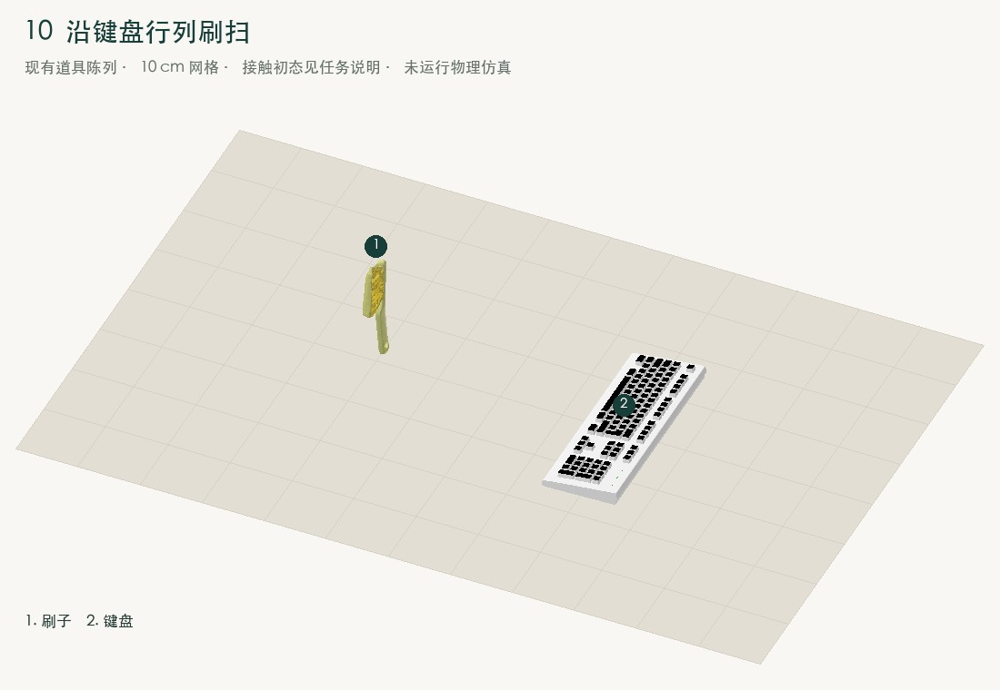

**与旧任务的区别：** 比平面擦拭增加离散键帽和沟槽约束，使用已有键盘结构。

### 道具、路径与预览

| 道具 | 数量 | 资产 ID | 可视化 |
|---|---:|---|---|
| 刷子 | 1 | `brush` | [查看原模型渲染](assets/brush.jpg) |
| 键盘 | 1 | `keyboard` | [查看原模型渲染](assets/keyboard.jpg) |

完整资产路径：

```text
/Users/xulixin/RevoBench-refactor/assets/library/external/bench2dex/bf65215f844d/Objects/189_brush/base3.glb
/Users/xulixin/RevoBench-refactor/assets/library/external/bench2dex/bf65215f844d/Objects/098_keyboard/01_keyboard/01/mobility.urdf
```

### 初始摆放

键盘平放桌后侧，刷子放在前方；目标是中间三排按键及两条排间隙。

### 操作步骤

1. 握住刷柄，使刷头沿键盘行方向进入。
2. 连续刷过三排按键，再沿两条排间隙清扫。
3. 抬起刷子，放回桌面。

### 验收标准

以下标准与前面的统一验收要求同时适用。

- 五条指定路径均完成，接触路径投影距各目标中心线不超过 8 mm。
- 刷头始终在键盘表面外侧，不得穿过键帽。
- 键盘位移不超过 2 cm，不能靠推动整块键盘完成路径。

### 接入前检查

- 确认键帽表面和行间隙实际可达；本任务不要求按键产生字符。

<a id="proposal_11_dock_phone"></a>
## 11 · 将手机斜放到支架

**任务 ID：** `proposal_11_dock_phone` · **状态：** 待开发提案 · **类别：** 设备操作

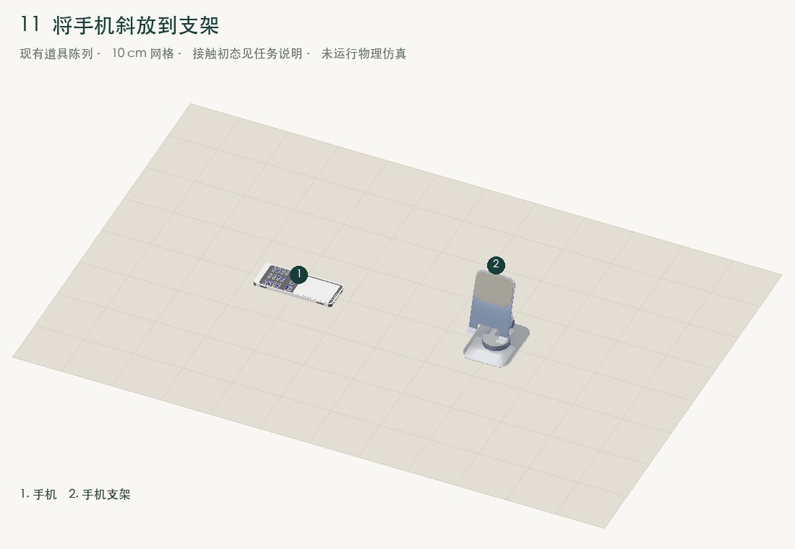

**与旧任务的区别：** 与 fold_phone 的折叠铰链操作不同，这里评测受支撑约束的放置。

### 道具、路径与预览

| 道具 | 数量 | 资产 ID | 可视化 |
|---|---:|---|---|
| 手机 | 1 | `phone` | [查看原模型渲染](assets/phone.jpg) |
| 手机支架 | 1 | `stand` | [查看原模型渲染](assets/stand.jpg) |

完整资产路径：

```text
/Users/xulixin/RevoBench-refactor/assets/library/external/bench2dex/bf65215f844d/Objects/108_phone/01_phone/01/mobility.urdf
/Users/xulixin/RevoBench-refactor/assets/library/external/bench2dex/bf65215f844d/Objects/184_phonestand/base6.glb
```

### 初始摆放

手机屏幕朝上平放；支架在后侧，托槽朝向机器人。

### 操作步骤

1. 抓住手机侧边并抬起。
2. 让手机底边先进入支架托槽，再缓慢靠向背板。
3. 释放手机，检查其保持支撑姿态。

### 验收标准

以下标准与前面的统一验收要求同时适用。

- 手机同时受托槽和背板支撑，释放后稳定 2 s。
- 屏幕朝向指定观察方向，方向误差不超过 10°。
- 支架位移不超过 2 cm，手机不能通过穿透背板固定。

### 接入前检查

- 确认手机宽度、厚度与支架托槽兼容；手机内部关节在本任务中保持固定。

<a id="proposal_12_aim_camera"></a>
## 12 · 拿起相机对准奖杯

**任务 ID：** `proposal_12_aim_camera` · **状态：** 待开发提案 · **类别：** 设备操作

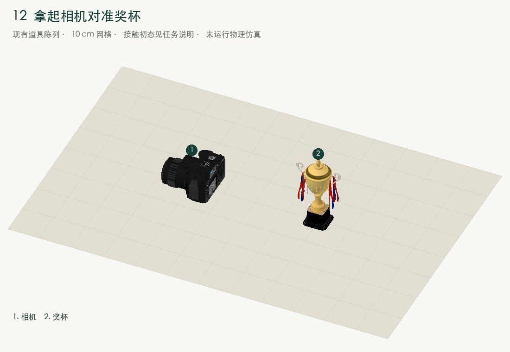

**与旧任务的区别：** 新增持物姿态与视轴约束，而不是单纯搬到指定位置。

### 道具、路径与预览

| 道具 | 数量 | 资产 ID | 可视化 |
|---|---:|---|---|
| 相机 | 1 | `camera` | [查看原模型渲染](assets/camera.jpg) |
| 奖杯 | 1 | `trophy` | [查看原模型渲染](assets/trophy.jpg) |

完整资产路径：

```text
/Users/xulixin/RevoBench-refactor/assets/library/external/bench2dex/bf65215f844d/Objects/083_camera/02_camera/01/mobility.urdf
/Users/xulixin/RevoBench-refactor/assets/library/external/bench2dex/bf65215f844d/Objects/195_trophy/base4.glb
```

### 初始摆放

奖杯立在桌后侧；相机在前侧，镜头初始偏离奖杯至少 60°。

### 操作步骤

1. 以合适姿态拿起相机，必要时双手托持。
2. 平移并转向，使镜头光轴指向奖杯上半部。
3. 保持取景姿态 2 s，再将相机放回。

### 验收标准

以下标准与前面的统一验收要求同时适用。

- 镜头光轴与目标方向夹角不超过 5°，距离保持在 20–40 cm。
- 保持阶段相机位移不超过 1 cm、角度变化不超过 3°。
- 手部不能完全遮挡镜头正前方的目标方向。

### 接入前检查

- 标注镜头坐标系；相机按真实关节或锁定关节加载，不把外观当成已接入摄像头。

<a id="proposal_13_aim_lamp"></a>
## 13 · 调整台灯照向笔记本

**任务 ID：** `proposal_13_aim_lamp` · **状态：** 待开发提案 · **类别：** 设备操作

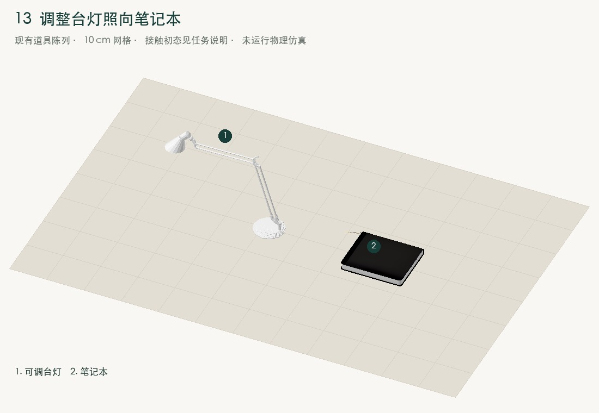

**与旧任务的区别：** 新增多关节连杆调姿；不同于 rotate_knob 的单旋钮旋转。

### 道具、路径与预览

| 道具 | 数量 | 资产 ID | 可视化 |
|---|---:|---|---|
| 可调台灯 | 1 | `lamp` | [查看原模型渲染](assets/lamp.jpg) |
| 笔记本 | 1 | `notebook` | [查看原模型渲染](assets/notebook.jpg) |

完整资产路径：

```text
/Users/xulixin/RevoBench-refactor/assets/library/external/bench2dex/bf65215f844d/Objects/101_lamp/01_lamp/01/mobility.urdf
/Users/xulixin/RevoBench-refactor/assets/library/external/bench2dex/bf65215f844d/Objects/196_notebook/base2.glb
```

### 初始摆放

台灯放在左后侧，笔记本平放右前侧；灯头初始朝向偏离笔记本中心。

### 操作步骤

1. 一只手稳住灯座。
2. 另一只手调整已有灯臂和灯头关节。
3. 使灯头方向指向笔记本中央，再释放双手。

### 验收标准

以下标准与前面的统一验收要求同时适用。

- 灯头局部照射轴与目标方向误差不超过 8°。
- 灯座位移不超过 2 cm，所有关节保持在源 URDF 限位内。
- 释放后保持目标方向 2 s，灯臂不得靠穿透支撑。

### 接入前检查

- 从原模型定义灯头局部轴；可先做几何指向验收，真实照明效果另行接入。

<a id="proposal_14_lift_keyboard_retrieve"></a>
## 14 · 抬起键盘取出被挡住的鼠标

**任务 ID：** `proposal_14_lift_keyboard_retrieve` · **状态：** 待开发提案 · **类别：** 受约束取物

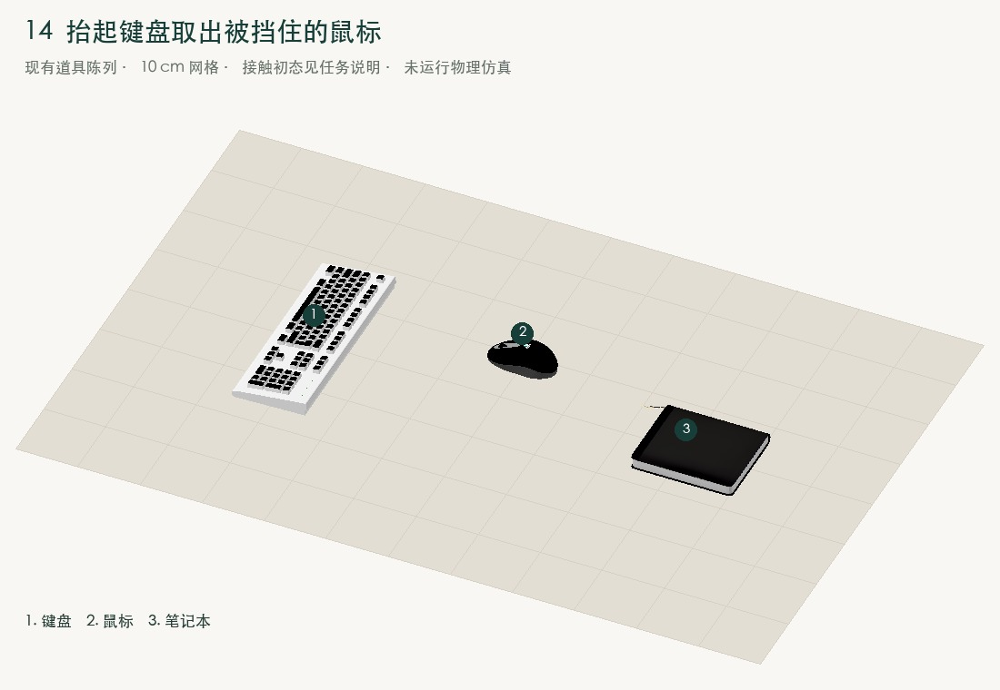

**与旧任务的区别：** 引入临时移动障碍物并恢复场景的协同操作。

### 道具、路径与预览

| 道具 | 数量 | 资产 ID | 可视化 |
|---|---:|---|---|
| 键盘 | 1 | `keyboard` | [查看原模型渲染](assets/keyboard.jpg) |
| 鼠标 | 1 | `mouse` | [查看原模型渲染](assets/mouse.jpg) |
| 笔记本 | 1 | `notebook` | [查看原模型渲染](assets/notebook.jpg) |

完整资产路径：

```text
/Users/xulixin/RevoBench-refactor/assets/library/external/bench2dex/bf65215f844d/Objects/098_keyboard/01_keyboard/01/mobility.urdf
/Users/xulixin/RevoBench-refactor/assets/library/external/bench2dex/bf65215f844d/Objects/105_mouse/01_mouse/01/mobility.urdf
/Users/xulixin/RevoBench-refactor/assets/library/external/bench2dex/bf65215f844d/Objects/196_notebook/base2.glb
```

### 初始摆放

键盘一端由笔记本支撑，鼠标位于其悬空部分下方；开口允许手进入但不能直接垂直抓走鼠标。

### 操作步骤

1. 一只手抬起键盘近端并保持支撑。
2. 另一只手从侧面抓住鼠标，取到桌面空位。
3. 缓慢把键盘放回原支撑位置。

### 验收标准

以下标准与前面的统一验收要求同时适用。

- 鼠标经开口取出，不能穿过键盘或笔记本。
- 键盘在鼠标经过时与其保持至少 5 mm 净空。
- 鼠标位于目标区域中心 2 cm 内；键盘恢复到初始位置 2 cm 内。

### 接入前检查

- 验证键盘的真实支撑点，初态不能用悬空锁定替代支撑。

<a id="proposal_15_remote_regrasp"></a>
## 15 · 遥控器在手中换向

**任务 ID：** `proposal_15_remote_regrasp` · **状态：** 待开发提案 · **类别：** 手内调整

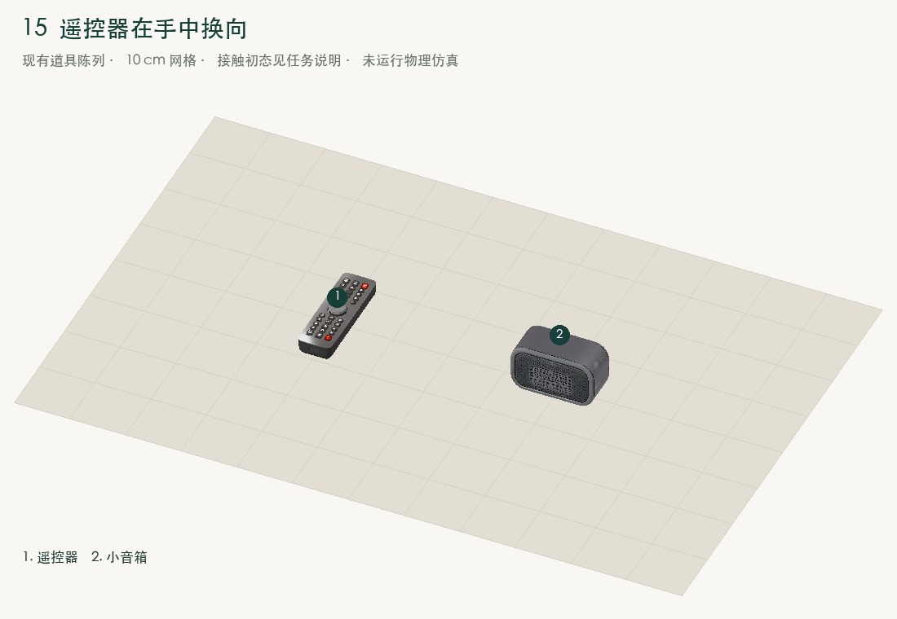

**与旧任务的区别：** 新增手内或双手辅助换握；原任务多在抓稳后保持固定握姿。

### 道具、路径与预览

| 道具 | 数量 | 资产 ID | 可视化 |
|---|---:|---|---|
| 遥控器 | 1 | `remote` | [查看原模型渲染](assets/remote.jpg) |
| 小音箱 | 1 | `speaker` | [查看原模型渲染](assets/speaker.jpg) |

完整资产路径：

```text
/Users/xulixin/RevoBench-refactor/assets/library/external/bench2dex/bf65215f844d/Objects/185_remotecontrol/base6.glb
/Users/xulixin/RevoBench-refactor/assets/library/external/bench2dex/bf65215f844d/Objects/164_small-speaker/base3.glb
```

### 初始摆放

遥控器按键朝下放置，小音箱作为目标朝向参照。

### 操作步骤

1. 拿起遥控器。
2. 在不放回桌面的前提下重新抓握，使按键朝上、发射端朝向音箱。
3. 保持目标握姿，再平放遥控器。

### 验收标准

以下标准与前面的统一验收要求同时适用。

- 换向期间遥控器距桌面至少 3 cm，不允许借桌面翻转。
- 按键面法向朝上误差不超过 15°，发射端朝向音箱误差不超过 10°。
- 过程中不能用未接触物体的关节指令直接改变物体姿态。

### 接入前检查

- 标注按键面、发射端；允许另一只手辅助，但需记录交接时刻。

<a id="proposal_16_extract_brushpen"></a>
## 16 · 抽出书下的毛笔

**任务 ID：** `proposal_16_extract_brushpen` · **状态：** 待开发提案 · **类别：** 受约束取物

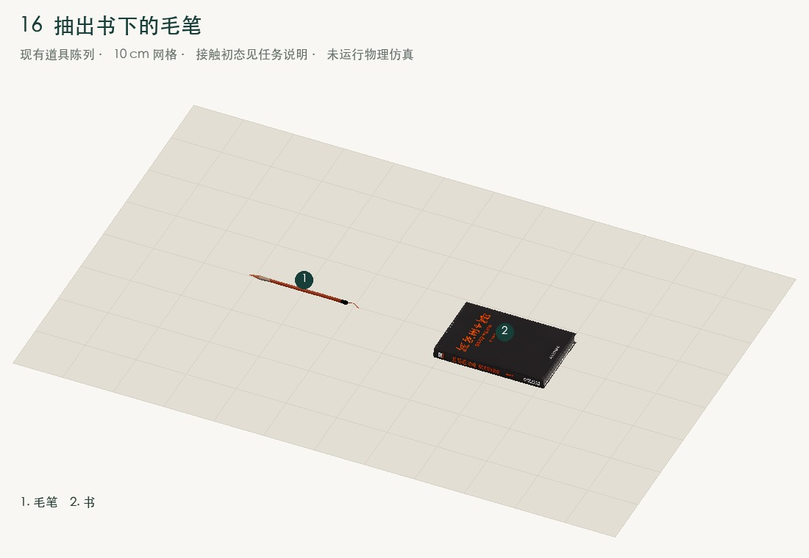

**与旧任务的区别：** 不是 insert_pen 的放入笔筒；目标是带遮挡、受压物体的侧向抽取。

### 道具、路径与预览

| 道具 | 数量 | 资产 ID | 可视化 |
|---|---:|---|---|
| 毛笔 | 1 | `brushpen` | [查看原模型渲染](assets/brushpen.jpg) |
| 书 | 1 | `book` | [查看原模型渲染](assets/book.jpg) |

完整资产路径：

```text
/Users/xulixin/RevoBench-refactor/assets/library/external/bench2dex/bf65215f844d/Objects/197_brush-pen/base5.glb
/Users/xulixin/RevoBench-refactor/assets/library/external/bench2dex/bf65215f844d/Objects/155_book/base1.glb
```

### 初始摆放

毛笔笔杆的一小段压在书边下方，笔尾露出约 8 cm，笔尖不承受书重。

### 操作步骤

1. 一只手轻扶书本，必要时抬起书边少量。
2. 另一只手抓住外露笔杆，沿长轴抽出毛笔。
3. 将毛笔平放在书旁，放稳书本。

### 验收标准

以下标准与前面的统一验收要求同时适用。

- 毛笔沿可用缝隙完整抽出，不穿过书。
- 书水平位移不超过 2 cm，抬起高度不超过 3 cm。
- 毛笔最终与书分离至少 2 cm，笔尖未被手或书压住。

### 接入前检查

- 毛笔按原有刚体处理，不宣称笔毛形变；用真实接触形成初态。

<a id="proposal_17_invert_hourglass"></a>
## 17 · 翻转沙漏并稳放

**任务 ID：** `proposal_17_invert_hourglass` · **状态：** 待开发提案 · **类别：** 手内调整

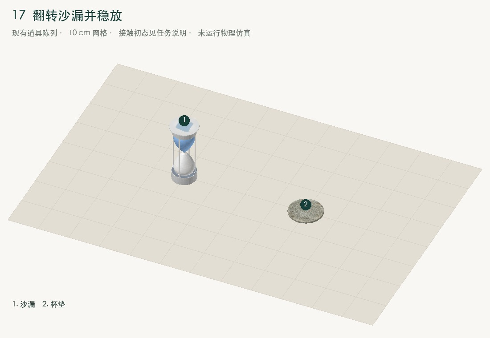

**与旧任务的区别：** 新增绕横轴的大角度重定向和细底座放置。

### 道具、路径与预览

| 道具 | 数量 | 资产 ID | 可视化 |
|---|---:|---|---|
| 沙漏 | 1 | `hourglass` | [查看原模型渲染](assets/hourglass.jpg) |
| 杯垫 | 1 | `coaster` | [查看原模型渲染](assets/coaster.jpg) |

完整资产路径：

```text
/Users/xulixin/RevoBench-refactor/assets/library/external/bench2dex/bf65215f844d/Objects/156_sand-clock/base3.glb
/Users/xulixin/RevoBench-refactor/assets/library/external/bench2dex/bf65215f844d/Objects/137_coaster/base0.glb
```

### 初始摆放

沙漏直立，杯垫在旁边作为目标放置区；给两端分别标 A 和 B。

### 操作步骤

1. 抓住沙漏中部或端部支架。
2. 连续翻转，使初始上端 A 转到下方。
3. 将 A 端放到杯垫中央并松手。

### 验收标准

以下标准与前面的统一验收要求同时适用。

- A 端最终朝下，姿态翻转 180°±10°。
- 底部中心距杯垫中心不超过 1.5 cm。
- 释放后保持直立 2 s，无撞击弹跳或倾倒。

### 接入前检查

- 只评测沙漏整体姿态，不假设内部沙粒已经建立颗粒仿真。

<a id="proposal_18_orient_die"></a>
## 18 · 把骰子的指定点数转到上面

**任务 ID：** `proposal_18_orient_die` · **状态：** 待开发提案 · **类别：** 手内调整

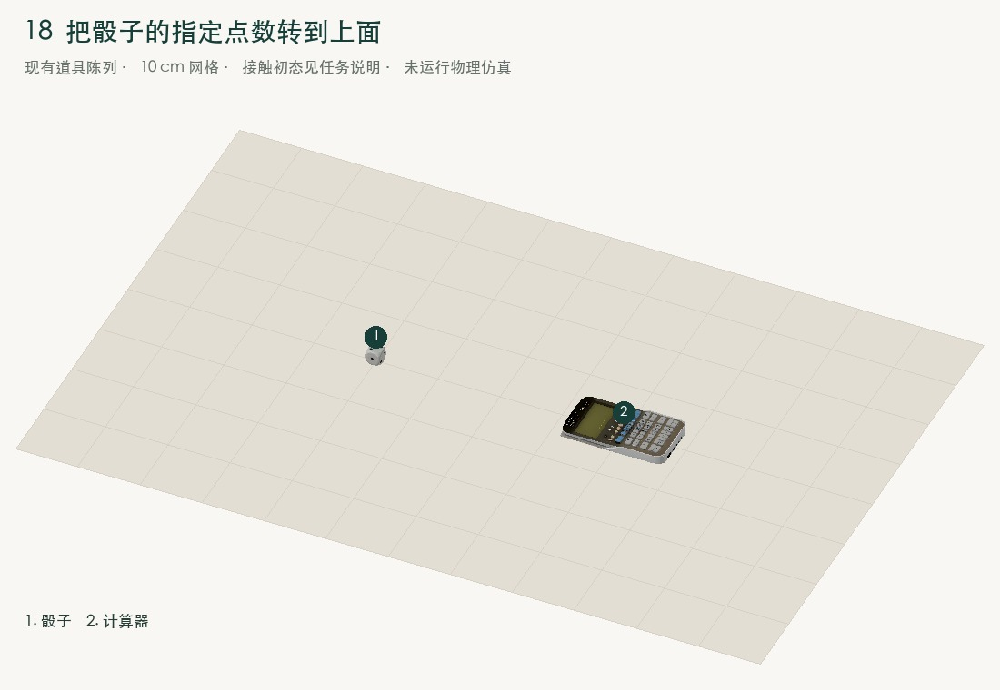

**与旧任务的区别：** 新增外观语义与物体朝向联合目标，不是几何块叠放。

### 道具、路径与预览

| 道具 | 数量 | 资产 ID | 可视化 |
|---|---:|---|---|
| 骰子 | 1 | `dice` | [查看原模型渲染](assets/dice.jpg) |
| 计算器 | 1 | `calculator` | [查看原模型渲染](assets/calculator.jpg) |

完整资产路径：

```text
/Users/xulixin/RevoBench-refactor/assets/library/external/bench2dex/bf65215f844d/Objects/062_dice/textured.obj
/Users/xulixin/RevoBench-refactor/assets/library/external/bench2dex/bf65215f844d/Objects/135_calculator/base5.glb
```

### 初始摆放

骰子随机朝向放在桌上；任务指定“六点朝上”，计算器仅作为固定位置参照。

### 操作步骤

1. 识别骰子各面的点数和当前姿态。
2. 捏起骰子，调整至六点面朝上。
3. 放到计算器右侧的目标位置。

### 验收标准

以下标准与前面的统一验收要求同时适用。

- 六点面法向与竖直方向误差不超过 8°。
- 骰子中心距离目标点不超过 1 cm。
- 释放后保持指定面朝上 2 s，不能修改骰子贴图实现目标。

### 接入前检查

- 依据原贴图建立六个面的局部方向标签，先人工核对点数对应关系。

<a id="proposal_19_align_shoes"></a>
## 19 · 把侧倒的两只鞋扶正并排齐

**任务 ID：** `proposal_19_align_shoes` · **状态：** 待开发提案 · **类别：** 手内调整

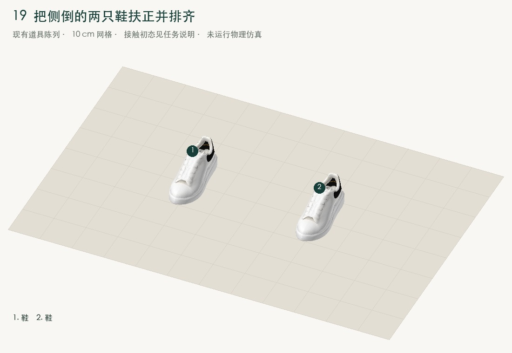

**与旧任务的区别：** 通过不规则鞋形和多实例关系评测重定向，不需要新造左右鞋。

### 道具、路径与预览

| 道具 | 数量 | 资产 ID | 可视化 |
|---|---:|---|---|
| 鞋 | 2 | `shoe` | [查看原模型渲染](assets/shoe.jpg) |

完整资产路径：

```text
/Users/xulixin/RevoBench-refactor/assets/library/external/bench2dex/bf65215f844d/Objects/153_shoe/base9.glb
```

### 初始摆放

复用同一鞋模型两个实例，分别侧倒且朝向不同；不把两个同款实例称为真实左右脚配对。

### 操作步骤

1. 分别抓取鞋帮或鞋后跟，将鞋底转到下方。
2. 调整两只鞋的前后方向。
3. 平行摆放，鞋跟对齐。

### 验收标准

以下标准与前面的统一验收要求同时适用。

- 两只鞋均由鞋底支撑，鞋底法向误差不超过 10°。
- 两鞋长轴夹角不超过 5°，鞋跟前后差不超过 1 cm。
- 鞋之间保持 2–4 cm 间距，释放后稳定 2 s。

### 接入前检查

- 本任务按现有刚性鞋模型工作，不涉及系鞋带、折鞋或柔性变形。

<a id="proposal_20_helmet_catch"></a>
## 20 · 用倒置安全帽接住球

**任务 ID：** `proposal_20_helmet_catch` · **状态：** 待开发提案 · **类别：** 动态接物

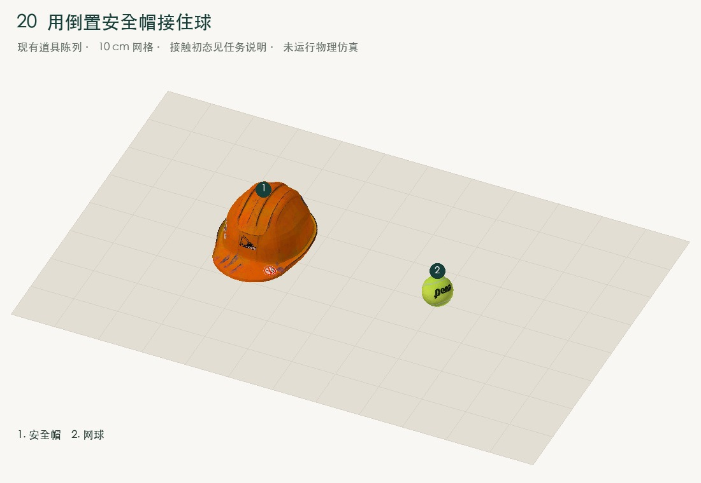

**与旧任务的区别：** 新增移动容器接物与碰撞后的稳定控制。

### 道具、路径与预览

| 道具 | 数量 | 资产 ID | 可视化 |
|---|---:|---|---|
| 安全帽 | 1 | `hardhat` | [查看原模型渲染](assets/hardhat.jpg) |
| 网球 | 1 | `tennis` | [查看原模型渲染](assets/tennis.jpg) |

完整资产路径：

```text
/Users/xulixin/RevoBench-refactor/assets/library/external/bench2dex/bf65215f844d/Objects/362_hard_hat/01_hard_hat/01/hard_hat.glb
/Users/xulixin/RevoBench-refactor/assets/library/external/bench2dex/bf65215f844d/Objects/056_tennis_ball/textured.obj
```

### 初始摆放

安全帽倒置、帽口朝上；网球在另一只手可抓取的桌面位置。

### 操作步骤

1. 一只手握住安全帽边缘并抬离桌面。
2. 另一只手拿球，在帽口上方 8–12 cm 处真实松手。
3. 调整持帽姿态，接住球后将帽子平稳放下。

### 验收标准

以下标准与前面的统一验收要求同时适用。

- 球必须经过实际自由落体进入帽内，不能直接放到帽底或重置。
- 球接住后持续留在帽内，帽子放桌后稳定 2 s。
- 接球全过程安全帽由手控制，没有隐藏固定或穿透内壁。

### 接入前检查

- 确认安全帽源模型内腔和开口碰撞可用；不进行帽壳软体变形。

<a id="proposal_21_separate_nested_cups"></a>
## 21 · 分离嵌套的两只杯子

**任务 ID：** `proposal_21_separate_nested_cups` · **状态：** 待开发提案 · **类别：** 套叠与拼装

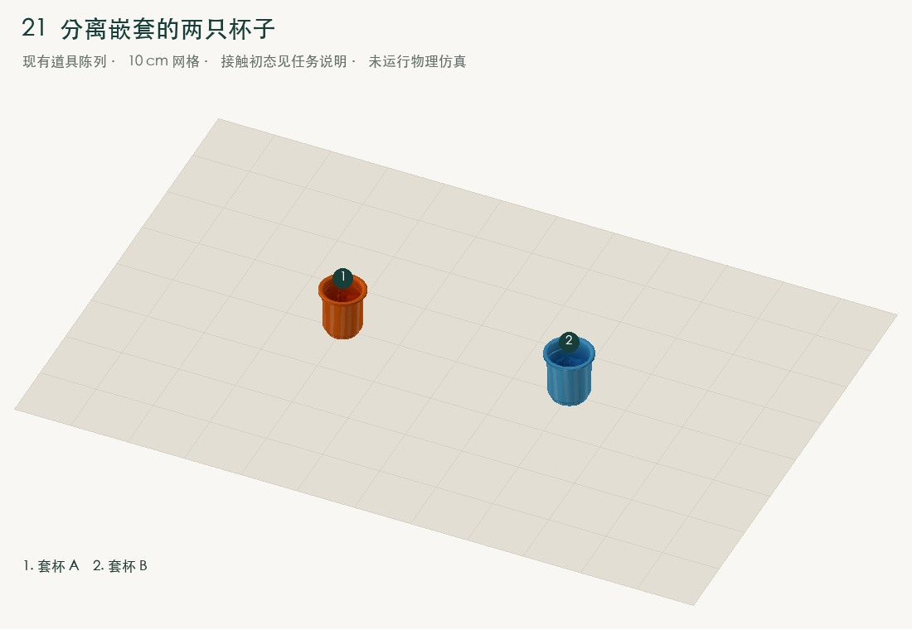

**与旧任务的区别：** 新增接触嵌套分离；不是 stack_blocks 的简单堆叠。

### 道具、路径与预览

| 道具 | 数量 | 资产 ID | 可视化 |
|---|---:|---|---|
| 套杯 A | 1 | `cup_a` | [查看原模型渲染](assets/cup_a.jpg) |
| 套杯 B | 1 | `cup_b` | [查看原模型渲染](assets/cup_b.jpg) |

完整资产路径：

```text
/Users/xulixin/RevoBench-refactor/assets/library/external/bench2dex/bf65215f844d/Objects/065-a_cups/google_16k/textured.obj
/Users/xulixin/RevoBench-refactor/assets/library/external/bench2dex/bf65215f844d/Objects/065-b_cups/google_16k/textured.obj
```

### 初始摆放

小杯以同轴方式嵌入大杯，只到自然可容纳深度，不带预紧或穿透。

### 操作步骤

1. 一只手稳定外杯。
2. 另一只手抓住内杯露出的杯沿，沿轴向抽出。
3. 将两只杯子分开放在桌上。

### 验收标准

以下标准与前面的统一验收要求同时适用。

- 内杯通过杯口完整取出，杯壁无穿透。
- 外杯提起高度不超过 2 cm，水平位移不超过 2 cm。
- 两杯最终分离至少 5 cm，开口朝上并各自稳定 2 s。

### 接入前检查

- 两杯使用同一比例保留相对尺寸；验证杯沿间隙、内腔及自然嵌套深度。

<a id="proposal_22_middle_plate"></a>
## 22 · 从三只盘子中取出中间一只

**任务 ID：** `proposal_22_middle_plate` · **状态：** 待开发提案 · **类别：** 受约束取物

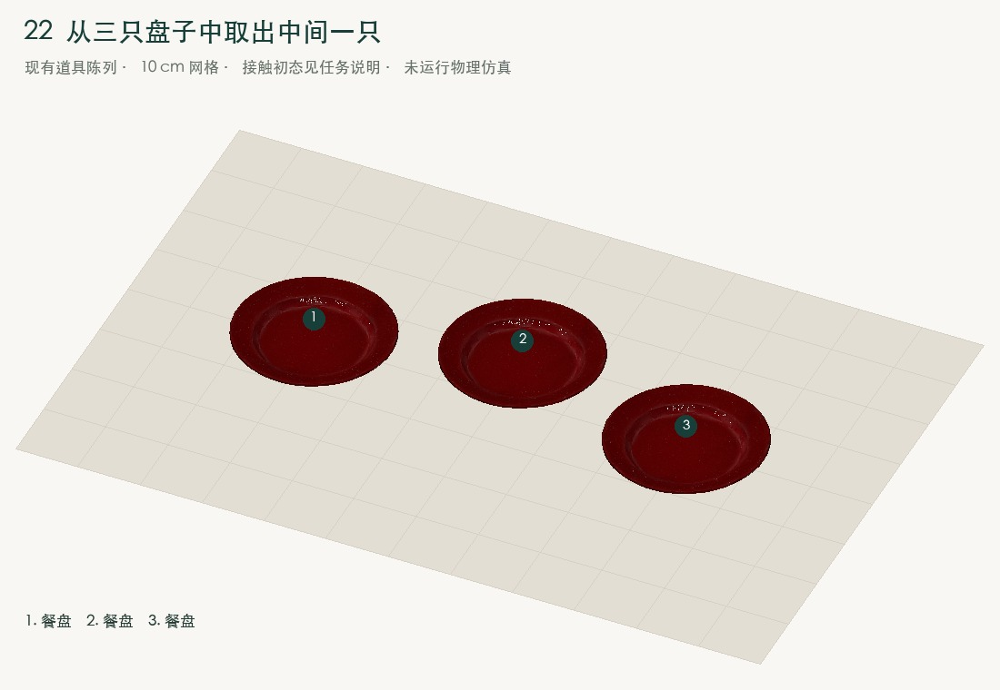

**与旧任务的区别：** 新增带次序约束的拆垛与恢复；与原叠块的单向堆叠不同。

### 道具、路径与预览

| 道具 | 数量 | 资产 ID | 可视化 |
|---|---:|---|---|
| 餐盘 | 3 | `plate` | [查看原模型渲染](assets/plate.jpg) |

完整资产路径：

```text
/Users/xulixin/RevoBench-refactor/assets/library/external/bench2dex/bf65215f844d/Objects/029_plate/textured.obj
```

### 初始摆放

三只同款餐盘自然叠放，目标是中间的第二只；通过实例 ID 跟踪，不更改外观。

### 操作步骤

1. 抬起顶部盘子并移到旁边。
2. 取出中间目标盘，放在指定位置。
3. 把原顶部盘放回底盘上。

### 验收标准

以下标准与前面的统一验收要求同时适用。

- 最终单独取出的实例必须是初始中间盘。
- 顶部盘和底盘恢复两盘叠放，中心偏差不超过 1.5 cm。
- 所有盘释放后稳定 2 s，不能穿过相邻盘取物。

### 接入前检查

- 保留盘底凸起及内腔碰撞，初始叠放必须重力稳定。

<a id="proposal_23_join_jigsaw"></a>
## 23 · 旋转拼图片并接合

**任务 ID：** `proposal_23_join_jigsaw` · **状态：** 待开发提案 · **类别：** 套叠与拼装

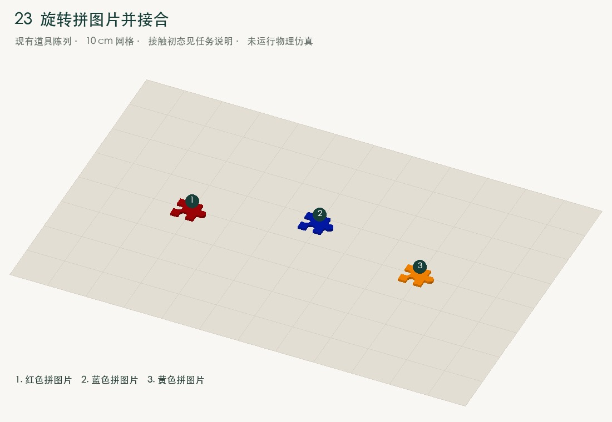

**与旧任务的区别：** 新增非凸轮廓匹配与旋转规划，区别于规则杆件插入。

### 道具、路径与预览

| 道具 | 数量 | 资产 ID | 可视化 |
|---|---:|---|---|
| 红色拼图片 | 1 | `jigsaw_red` | [查看原模型渲染](assets/jigsaw_red.jpg) |
| 蓝色拼图片 | 1 | `jigsaw_blue` | [查看原模型渲染](assets/jigsaw_blue.jpg) |
| 黄色拼图片 | 1 | `jigsaw_yellow` | [查看原模型渲染](assets/jigsaw_yellow.jpg) |

完整资产路径：

```text
/Users/xulixin/RevoBench-refactor/assets/library/external/bench2dex/bf65215f844d/Objects/326_jigsaw_puzzle/01_jigsaw_puzzle/01/low_poly_jigsaw_puzzle_pieces_Puzzle_Piece_3_D31E29_0.glb
/Users/xulixin/RevoBench-refactor/assets/library/external/bench2dex/bf65215f844d/Objects/326_jigsaw_puzzle/01_jigsaw_puzzle/01/low_poly_jigsaw_puzzle_pieces_Puzzle_Piece_4_1E5AD8_0.glb
/Users/xulixin/RevoBench-refactor/assets/library/external/bench2dex/bf65215f844d/Objects/326_jigsaw_puzzle/01_jigsaw_puzzle/01/low_poly_jigsaw_puzzle_pieces_Puzzle_Piece_5_FFC107_0.glb
```

### 初始摆放

三个拼图片平放且朝向打乱；选取经几何核对可以接合的一凸一凹两条边。

### 操作步骤

1. 识别两块之间的凸凹边配合关系。
2. 稳定一块，旋转另一块对准连接边。
3. 以平面内滑入或轻微抬起放入的方式接合，再放下第三块到指定相邻位置。

### 验收标准

以下标准与前面的统一验收要求同时适用。

- 指定配合边的对应点平均距离不超过 3 mm。
- 拼图片表面共面误差不超过 3 mm，不能靠互相穿透实现边界重合。
- 松手后接合布局保持 2 s；没有实际卡扣时不要求悬空拉住。

### 接入前检查

- 使用同一缩放比例保留源拼图片关系；先检查凸凹形状确实兼容。
- 若源造型不支持实体接合，必须报告阻塞，不能改成简单靠近后算通过。

<a id="proposal_24_pack_tetris"></a>
## 24 · 把四种异形拼块放入框架

**任务 ID：** `proposal_24_pack_tetris` · **状态：** 待开发提案 · **类别：** 套叠与拼装

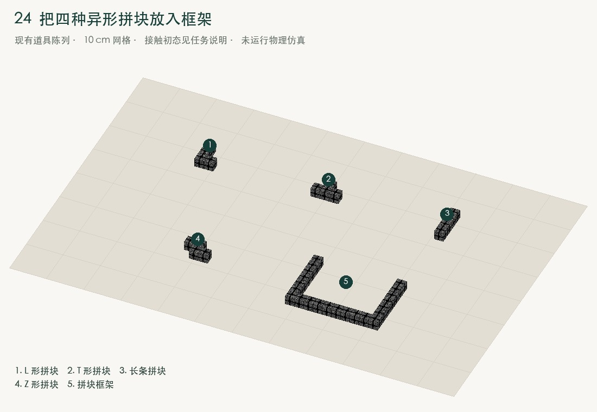

**与旧任务的区别：** 新增平面非凸装填与顺序规划，区别于 stack_blocks。

### 道具、路径与预览

| 道具 | 数量 | 资产 ID | 可视化 |
|---|---:|---|---|
| L 形拼块 | 1 | `tetris_l` | [查看原模型渲染](assets/tetris_l.jpg) |
| T 形拼块 | 1 | `tetris_t` | [查看原模型渲染](assets/tetris_t.jpg) |
| 长条拼块 | 1 | `tetris_i` | [查看原模型渲染](assets/tetris_i.jpg) |
| Z 形拼块 | 1 | `tetris_z` | [查看原模型渲染](assets/tetris_z.jpg) |
| 拼块框架 | 1 | `tetris_frame` | [查看原模型渲染](assets/tetris_frame.jpg) |

完整资产路径：

```text
/Users/xulixin/RevoBench-refactor/assets/library/external/bench2dex/bf65215f844d/Objects/338_tetris_animation/01_tetris_animation/01/tetris_pCube1_L_0.glb
/Users/xulixin/RevoBench-refactor/assets/library/external/bench2dex/bf65215f844d/Objects/338_tetris_animation/01_tetris_animation/01/tetris_pCube2_T_0.glb
/Users/xulixin/RevoBench-refactor/assets/library/external/bench2dex/bf65215f844d/Objects/338_tetris_animation/01_tetris_animation/01/tetris_pCube6_Straight_0.glb
/Users/xulixin/RevoBench-refactor/assets/library/external/bench2dex/bf65215f844d/Objects/338_tetris_animation/01_tetris_animation/01/tetris_pCube9_Z_0.glb
/Users/xulixin/RevoBench-refactor/assets/library/external/bench2dex/bf65215f844d/Objects/338_tetris_animation/01_tetris_animation/01/tetris_pCube4_Frame_0.glb
```

### 初始摆放

框架平放桌面；四种源拼块在框外分散摆放；给定一个事先验证无重叠的目标格位布局。

### 操作步骤

1. 观察各拼块轮廓和目标方向。
2. 逐块旋转并放入框架，避免与已经放入的拼块相撞。
3. 全部放好后退出双手。

### 验收标准

以下标准与前面的统一验收要求同时适用。

- 四块均位于框架有效内边界中，且各实例对应目标格位。
- 每块平移误差不超过 3 mm、平面内角度误差不超过 5°。
- 没有拼块互相穿透或叠在另一块上，松手后稳定 2 s。

### 接入前检查

- 框架和拼块采用共同缩放比例。
- 目标布局只要求四块正确装入，不虚称填满整个框；布局需先做几何可行性检查。

<a id="proposal_25_thread_nut"></a>
## 25 · 双手把螺母旋到螺栓上

**任务 ID：** `proposal_25_thread_nut` · **状态：** 待开发提案 · **类别：** 套叠与拼装

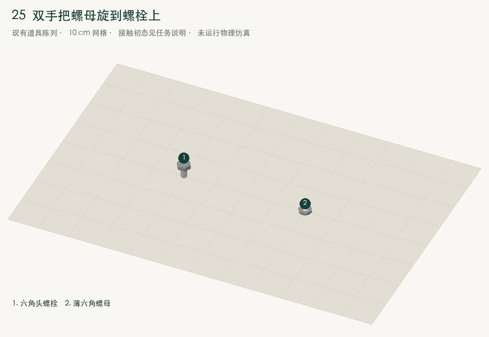

**与旧任务的区别：** 虽与 rotate_tube_cap 都含螺纹旋转，但此任务从两个完全分离的金属件开始找正并啮合。

### 道具、路径与预览

| 道具 | 数量 | 资产 ID | 可视化 |
|---|---:|---|---|
| 六角头螺栓 | 1 | `fastener_0` | [查看原模型渲染](assets/fastener_0.jpg) |
| 薄六角螺母 | 1 | `fastener_9` | [查看原模型渲染](assets/fastener_9.jpg) |

完整资产路径：

```text
/Users/xulixin/RevoBench-refactor/assets/library/external/bench2dex/bf65215f844d/Objects/327_bolt_nuts/01_bolt_nuts/01/nuts_and_bolts_Object_0.glb
/Users/xulixin/RevoBench-refactor/assets/library/external/bench2dex/bf65215f844d/Objects/327_bolt_nuts/01_bolt_nuts/01/nuts_and_bolts_Object_9.glb
```

### 初始摆放

六角头螺栓与薄六角螺母分开放置；保持同一来源的共同缩放。

### 操作步骤

1. 一只手稳定螺栓，另一只手抓螺母。
2. 对准螺纹轴，找到正确啮合起点。
3. 连续旋入至少一圈，并保持螺栓不跟转。

### 验收标准

以下标准与前面的统一验收要求同时适用。

- 螺母相对螺栓转过至少 360°。
- 轴向前进量与源螺距一致，误差不超过 20%。
- 放开螺母后保持真实螺纹接触，不允许焊接、吸附或直接修改相对位姿。

### 接入前检查

- 图中确有螺纹几何，但兼容直径、旋向和螺距尚需核对。
- 必须使用保留螺纹的接触表示；普通凸包无法验证该任务。

<a id="proposal_26_sort_fasteners"></a>
## 26 · 按结构分拣混合紧固件

**任务 ID：** `proposal_26_sort_fasteners` · **状态：** 待开发提案 · **类别：** 识别与整理

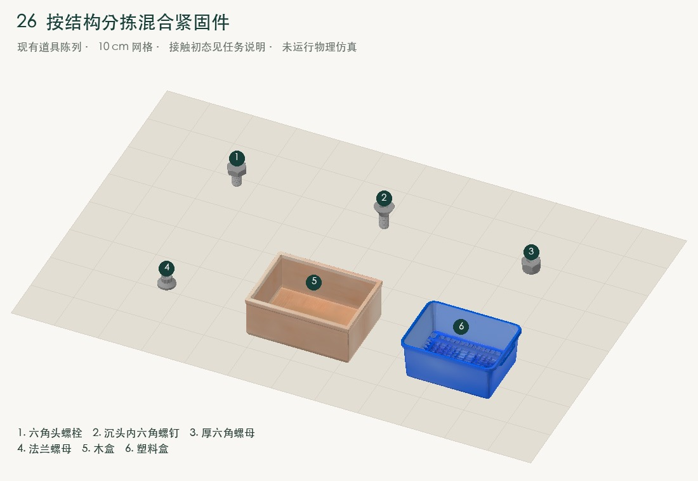

**与旧任务的区别：** 在装篮基础上增加细小零件的结构分类、遮挡观察和单件捏取。

### 道具、路径与预览

| 道具 | 数量 | 资产 ID | 可视化 |
|---|---:|---|---|
| 六角头螺栓 | 1 | `fastener_0` | [查看原模型渲染](assets/fastener_0.jpg) |
| 沉头内六角螺钉 | 1 | `fastener_2` | [查看原模型渲染](assets/fastener_2.jpg) |
| 厚六角螺母 | 1 | `fastener_7` | [查看原模型渲染](assets/fastener_7.jpg) |
| 法兰螺母 | 1 | `fastener_8` | [查看原模型渲染](assets/fastener_8.jpg) |
| 木盒 | 1 | `woodbox` | [查看原模型渲染](assets/woodbox.jpg) |
| 塑料盒 | 1 | `plasticbox` | [查看原模型渲染](assets/plasticbox.jpg) |

完整资产路径：

```text
/Users/xulixin/RevoBench-refactor/assets/library/external/bench2dex/bf65215f844d/Objects/327_bolt_nuts/01_bolt_nuts/01/nuts_and_bolts_Object_0.glb
/Users/xulixin/RevoBench-refactor/assets/library/external/bench2dex/bf65215f844d/Objects/327_bolt_nuts/01_bolt_nuts/01/nuts_and_bolts_Object_2.glb
/Users/xulixin/RevoBench-refactor/assets/library/external/bench2dex/bf65215f844d/Objects/327_bolt_nuts/01_bolt_nuts/01/nuts_and_bolts_Object_7.glb
/Users/xulixin/RevoBench-refactor/assets/library/external/bench2dex/bf65215f844d/Objects/327_bolt_nuts/01_bolt_nuts/01/nuts_and_bolts_Object_8.glb
/Users/xulixin/RevoBench-refactor/assets/library/external/bench2dex/bf65215f844d/Objects/154_wooden_box/base0.glb
/Users/xulixin/RevoBench-refactor/assets/library/external/bench2dex/bf65215f844d/Objects/169_plasticbox/base10.glb
```

### 初始摆放

六角头螺栓、沉头螺钉、厚螺母和法兰螺母混放；木盒与塑料盒分别接收带杆件和带孔件。

### 操作步骤

1. 根据可见形状判断有螺杆还是有中心螺孔。
2. 逐件抓取，必要时先转动以观察结构。
3. 放入对应盒内，避免把邻近零件一并带走。

### 验收标准

以下标准与前面的统一验收要求同时适用。

- 四个实例全部分类正确：两种带杆件入木盒，两种螺母入塑料盒。
- 每次只搬运一个目标，其他未操作件位移不超过 2 cm。
- 所有零件释放后留在对应容器内并稳定 2 s。

### 接入前检查

- 按图册显示的真实紧固件类型标注，不把未知 Object 编号猜成垫圈。

<a id="proposal_27_reindex_tubes"></a>
## 27 · 在试管架上交换试管位置

**任务 ID：** `proposal_27_reindex_tubes` · **状态：** 待开发提案 · **类别：** 套叠与拼装

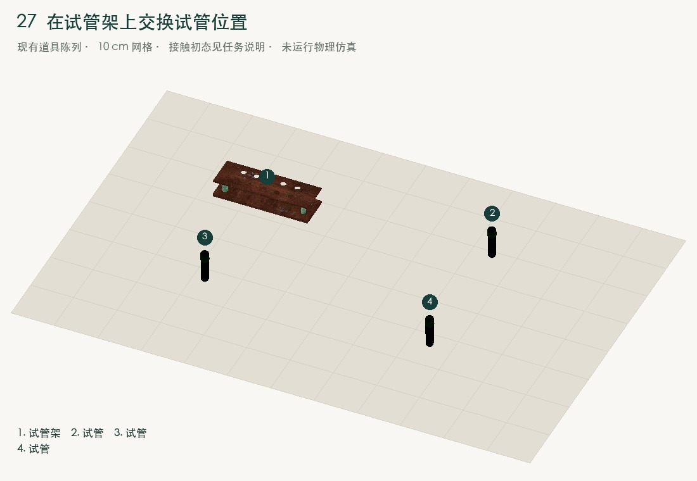

**与旧任务的区别：** 与 insert_pipette 接近，但增加多孔置换、暂存顺序和邻管避碰，明确列为约束扩展。

### 道具、路径与预览

| 道具 | 数量 | 资产 ID | 可视化 |
|---|---:|---|---|
| 试管架 | 1 | `tube_rack` | [查看原模型渲染](assets/tube_rack.jpg) |
| 试管 | 3 | `tube` | [查看原模型渲染](assets/tube.jpg) |

完整资产路径：

```text
/Users/xulixin/RevoBench-refactor/assets/library/external/bench2dex/bf65215f844d/Objects/367_test_tube/test_tube_holder.glb
/Users/xulixin/RevoBench-refactor/assets/library/external/bench2dex/bf65215f844d/Objects/367_test_tube/test_tube1.glb
```

### 初始摆放

三根试管占据架上三个孔，预留一个空孔；指定交换第一根与第三根，保留中间一根不动。

### 操作步骤

1. 把第一根试管暂存到空孔。
2. 将第三根移入第一根原孔。
3. 将暂存试管移入第三根原孔，退出双手。

### 验收标准

以下标准与前面的统一验收要求同时适用。

- 两根指定实例完成孔位交换，第三根留在原孔。
- 每根试管必须先完全离开原孔，再横向移动。
- 最终试管由架孔正确支撑，倾角不超过 10°；架子位移不超过 2 cm。

### 接入前检查

- 试管与试管架来自同一目录但不代表尺寸已配对，必须量取孔径并选兼容的源型号。
- 不能非均匀拉细试管来凑孔径。

<a id="proposal_28_extract_l_piece"></a>
## 28 · 转动 L 形拼块穿过窄缝

**任务 ID：** `proposal_28_extract_l_piece` · **状态：** 待开发提案 · **类别：** 受约束取物

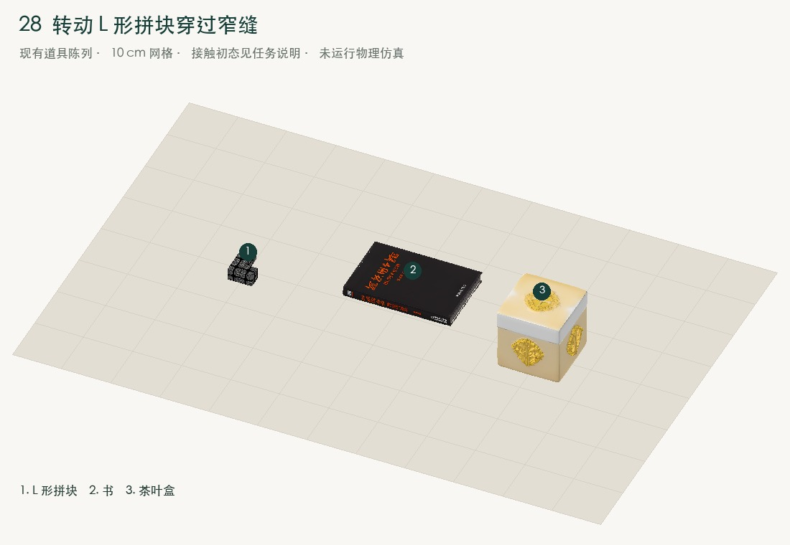

**与旧任务的区别：** 新增非凸物体受限通过路径，重点在整物体姿态而非末端点到位。

### 道具、路径与预览

| 道具 | 数量 | 资产 ID | 可视化 |
|---|---:|---|---|
| L 形拼块 | 1 | `tetris_l` | [查看原模型渲染](assets/tetris_l.jpg) |
| 书 | 1 | `book` | [查看原模型渲染](assets/book.jpg) |
| 茶叶盒 | 1 | `tea` | [查看原模型渲染](assets/tea.jpg) |

完整资产路径：

```text
/Users/xulixin/RevoBench-refactor/assets/library/external/bench2dex/bf65215f844d/Objects/338_tetris_animation/01_tetris_animation/01/tetris_pCube1_L_0.glb
/Users/xulixin/RevoBench-refactor/assets/library/external/bench2dex/bf65215f844d/Objects/155_book/base1.glb
/Users/xulixin/RevoBench-refactor/assets/library/external/bench2dex/bf65215f844d/Objects/214_tea-box/base5.glb
```

### 初始摆放

书本与茶叶盒形成窄通道；通道宽度介于 L 形拼块短边和包围盒长边之间；拼块位于后方。

### 操作步骤

1. 抓起 L 形拼块并确定可通过的方向。
2. 在保持低高度的情况下转动、侧移，让两段依次通过通道。
3. 将拼块放到通道前方。

### 验收标准

以下标准与前面的统一验收要求同时适用。

- 拼块完整通过通道，且移动阶段最低点离桌不超过 3 cm，不能直接越过障碍物。
- 书和茶叶盒位移均不超过 1 cm。
- 拼块与障碍无明显穿透，最终放在前方目标区内。

### 接入前检查

- 仅用现有书本和包装盒形成通道；宽度根据真实网格计算，不造新墙体。

<a id="proposal_29_reveal_ball"></a>
## 29 · 移开遮挡找到指定球

**任务 ID：** `proposal_29_reveal_ball` · **状态：** 待开发提案 · **类别：** 识别与整理

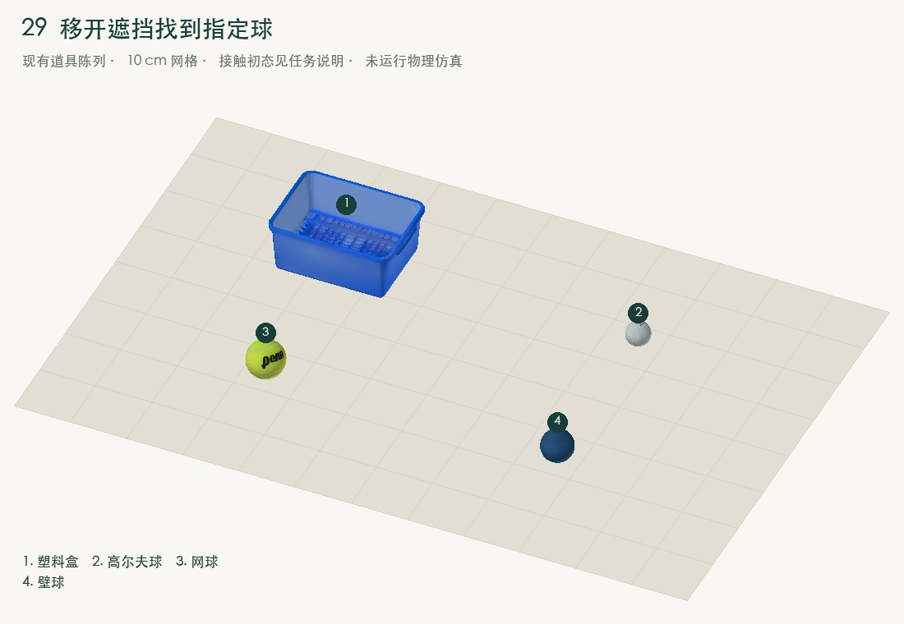

**与旧任务的区别：** 新增主动揭露遮挡、辨别相似物与操作顺序约束。

### 道具、路径与预览

| 道具 | 数量 | 资产 ID | 可视化 |
|---|---:|---|---|
| 塑料盒 | 1 | `plasticbox` | [查看原模型渲染](assets/plasticbox.jpg) |
| 高尔夫球 | 1 | `golf` | [查看原模型渲染](assets/golf.jpg) |
| 网球 | 1 | `tennis` | [查看原模型渲染](assets/tennis.jpg) |
| 壁球 | 1 | `racquetball` | [查看原模型渲染](assets/racquetball.jpg) |

完整资产路径：

```text
/Users/xulixin/RevoBench-refactor/assets/library/external/bench2dex/bf65215f844d/Objects/169_plasticbox/base10.glb
/Users/xulixin/RevoBench-refactor/assets/library/external/bench2dex/bf65215f844d/Objects/058_golf_ball/textured.obj
/Users/xulixin/RevoBench-refactor/assets/library/external/bench2dex/bf65215f844d/Objects/056_tennis_ball/textured.obj
/Users/xulixin/RevoBench-refactor/assets/library/external/bench2dex/bf65215f844d/Objects/057_racquetball/textured.obj
```

### 初始摆放

塑料盒倒扣罩住高尔夫球；网球与壁球在盒外，作为可见干扰项。

### 操作步骤

1. 先抬起塑料盒并放到旁边，露出被遮挡的物体。
2. 识别并抓取有凹坑表面的高尔夫球。
3. 把它放到前方目标位置，再将空盒恢复原方向。

### 验收标准

以下标准与前面的统一验收要求同时适用。

- 选择的必须是高尔夫球实例，不能拿另外两种球替代。
- 抓球前确实通过移动遮挡物暴露目标；不借助物体 ID 直接绕过观察过程作为 policy 输入。
- 目标球位置误差不超过 2 cm，另外两球位移不超过 2 cm。

### 接入前检查

- 评测策略只能使用约定观测；创建场景时使用的真值 ID 不暴露给待评测策略。

<a id="proposal_30_medicine_box"></a>
## 30 · 开盒取药，再把盒盖关回

**任务 ID：** `proposal_30_medicine_box` · **状态：** 待开发提案 · **类别：** 组合流程

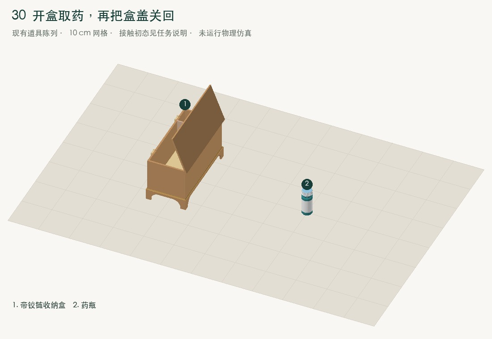

**与旧任务的区别：** 不同于单纯开订书机或提锅盖；增加开盖、内部取物和恢复的依赖关系。

### 道具、路径与预览

| 道具 | 数量 | 资产 ID | 可视化 |
|---|---:|---|---|
| 带铰链收纳盒 | 1 | `hinged_box` | [查看原模型渲染](assets/hinged_box.jpg) |
| 药瓶 | 1 | `pill` | [查看原模型渲染](assets/pill.jpg) |

完整资产路径：

```text
/Users/xulixin/RevoBench-refactor/assets/library/external/bench2dex/bf65215f844d/Objects/081_box/01_box/01/mobility.urdf
/Users/xulixin/RevoBench-refactor/assets/library/external/bench2dex/bf65215f844d/Objects/186_pillbottle/base5.glb
```

### 初始摆放

药瓶放在有铰链的收纳盒内，盖子关闭；图册将道具分开展示，实际初态需自然支撑。

### 操作步骤

1. 稳定盒体，将原有盒盖打开。
2. 抓取药瓶放到盒外目标区域。
3. 关回盒盖并释放双手。

### 验收标准

以下标准与前面的统一验收要求同时适用。

- 开盖时保留原 URDF 铰链，关节不越限。
- 药瓶取出过程中不穿过盖子或侧壁，最终位于盒外。
- 盒盖回到关闭参考角 ±5°，盒体位移不超过 2 cm。

### 接入前检查

- 源“box”模型在预览中为翻盖木质收纳结构，需确认它的真实内腔能容纳药瓶。

<a id="proposal_31_bottom_book"></a>
## 31 · 扶住上层物品抽出底部书本

**任务 ID：** `proposal_31_bottom_book` · **状态：** 待开发提案 · **类别：** 受约束取物

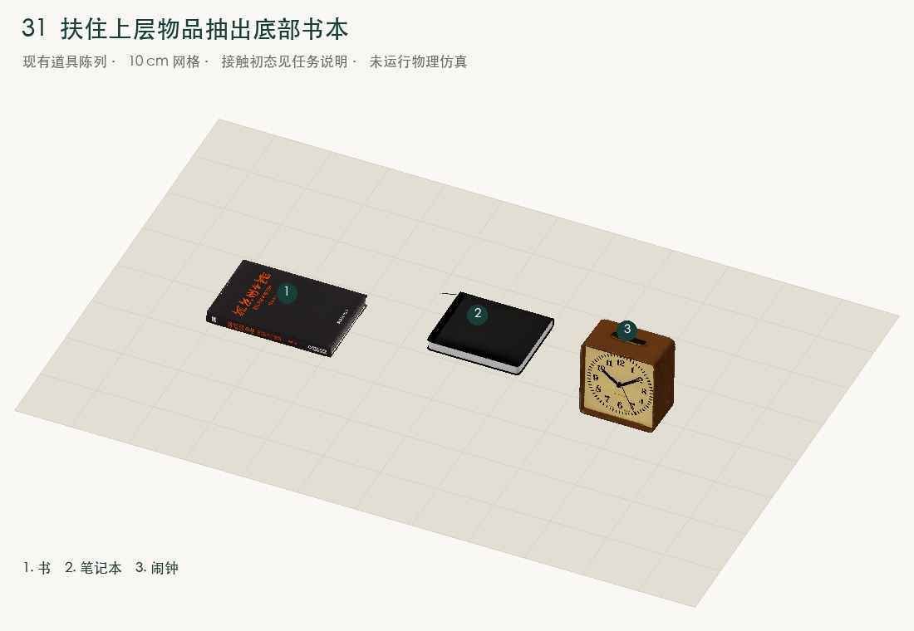

**与旧任务的区别：** 新增带载抽取和支撑转移，不是普通搬书或堆叠。

### 道具、路径与预览

| 道具 | 数量 | 资产 ID | 可视化 |
|---|---:|---|---|
| 书 | 1 | `book` | [查看原模型渲染](assets/book.jpg) |
| 笔记本 | 1 | `notebook` | [查看原模型渲染](assets/notebook.jpg) |
| 闹钟 | 1 | `clock` | [查看原模型渲染](assets/clock.jpg) |

完整资产路径：

```text
/Users/xulixin/RevoBench-refactor/assets/library/external/bench2dex/bf65215f844d/Objects/155_book/base1.glb
/Users/xulixin/RevoBench-refactor/assets/library/external/bench2dex/bf65215f844d/Objects/196_notebook/base2.glb
/Users/xulixin/RevoBench-refactor/assets/library/external/bench2dex/bf65215f844d/Objects/157_alarm-clock/base5.glb
```

### 初始摆放

笔记本叠在书上，闹钟放在笔记本中央；底部书本向前露出约 5 cm。

### 操作步骤

1. 一只手托住或稳定上层笔记本与闹钟。
2. 另一只手沿桌面方向抽出底部书。
3. 将上层物品缓慢放回桌面，再单独放好书。

### 验收标准

以下标准与前面的统一验收要求同时适用。

- 底书完整抽出，闹钟未倾倒或滑出笔记本。
- 闹钟在操作中相对笔记本平移不超过 2 cm、倾角不超过 15°。
- 最终三件物品均由真实支撑承载，并稳定 2 s。

### 接入前检查

- 先检查上层组合在源资产尺度下能够稳定；不添加隐藏托板或焊接。

<a id="proposal_32_remove_coaster"></a>
## 32 · 移走高脚杯底下的杯垫

**任务 ID：** `proposal_32_remove_coaster` · **状态：** 待开发提案 · **类别：** 受约束取物

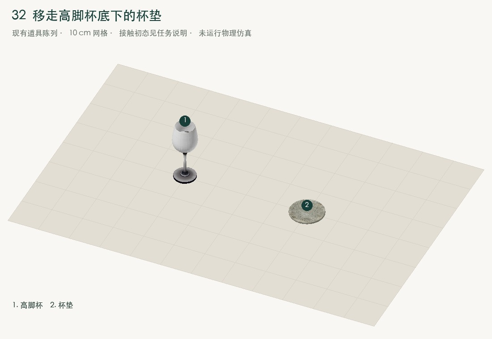

**与旧任务的区别：** 与 set_table 的摆放不同，评测抽走支撑件时的同步稳持。

### 道具、路径与预览

| 道具 | 数量 | 资产 ID | 可视化 |
|---|---:|---|---|
| 高脚杯 | 1 | `wineglass` | [查看原模型渲染](assets/wineglass.jpg) |
| 杯垫 | 1 | `coaster` | [查看原模型渲染](assets/coaster.jpg) |

完整资产路径：

```text
/Users/xulixin/RevoBench-refactor/assets/library/external/bench2dex/bf65215f844d/Objects/194_wineglass/base4.glb
/Users/xulixin/RevoBench-refactor/assets/library/external/bench2dex/bf65215f844d/Objects/137_coaster/base0.glb
```

### 初始摆放

高脚杯直立在杯垫中心，杯垫外缘可被抓住。

### 操作步骤

1. 一只手轻扶杯身或杯梗并微抬杯底。
2. 另一只手从侧面抽走杯垫。
3. 把杯子放回原中心附近，再放好杯垫。

### 验收标准

以下标准与前面的统一验收要求同时适用。

- 杯垫与杯底完全分离。
- 杯子倾角不超过 10°，杯底上升不超过 3 cm，水平位移不超过 2 cm。
- 杯子在桌面上释放并稳定 2 s，无倾倒。

### 接入前检查

- 杯梗和杯底需要足够精细的碰撞，不能用大凸包代替。

<a id="proposal_33_battery_gap"></a>
## 33 · 捏取狭缝中的电池

**任务 ID：** `proposal_33_battery_gap` · **状态：** 待开发提案 · **类别：** 受约束取物

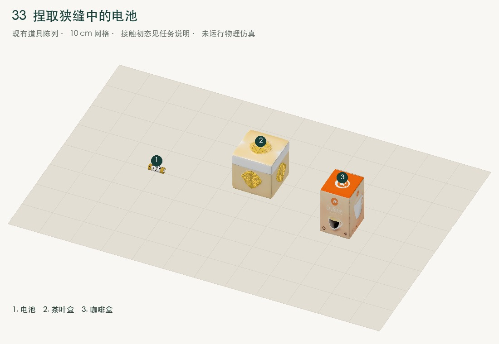

**与旧任务的区别：** 新增狭缝端部捏取与长轴抽取，尺寸和接触方式不同于粗杆插入。

### 道具、路径与预览

| 道具 | 数量 | 资产 ID | 可视化 |
|---|---:|---|---|
| 电池 | 1 | `battery` | [查看原模型渲染](assets/battery.jpg) |
| 茶叶盒 | 1 | `tea` | [查看原模型渲染](assets/tea.jpg) |
| 咖啡盒 | 1 | `coffee` | [查看原模型渲染](assets/coffee.jpg) |

完整资产路径：

```text
/Users/xulixin/RevoBench-refactor/assets/library/external/bench2dex/bf65215f844d/Objects/168_battery/base5.glb
/Users/xulixin/RevoBench-refactor/assets/library/external/bench2dex/bf65215f844d/Objects/214_tea-box/base5.glb
/Users/xulixin/RevoBench-refactor/assets/library/external/bench2dex/bf65215f844d/Objects/215_coffee-box/base6.glb
```

### 初始摆放

茶叶盒与咖啡盒之间留出略大于电池直径的缝隙；电池横放其中，两端可见。

### 操作步骤

1. 从允许的开口接近电池外露端。
2. 用指腹形成有效捏持，沿电池长轴抽出。
3. 将电池横放到前方目标区域。

### 验收标准

以下标准与前面的统一验收要求同时适用。

- 电池完整取出并离开缝隙，不能先把两个盒子推开。
- 两盒位移均不超过 1 cm。
- 电池最终中心距目标点不超过 1 cm，使用指腹而非指背夹持。

### 接入前检查

- 缝隙应允许当前手指接近电池外露部分；任务创建时做可达性检查。

<a id="proposal_34_baguette_passage"></a>
## 34 · 转动法棍通过瓶罐间隙

**任务 ID：** `proposal_34_baguette_passage` · **状态：** 待开发提案 · **类别：** 受约束取物

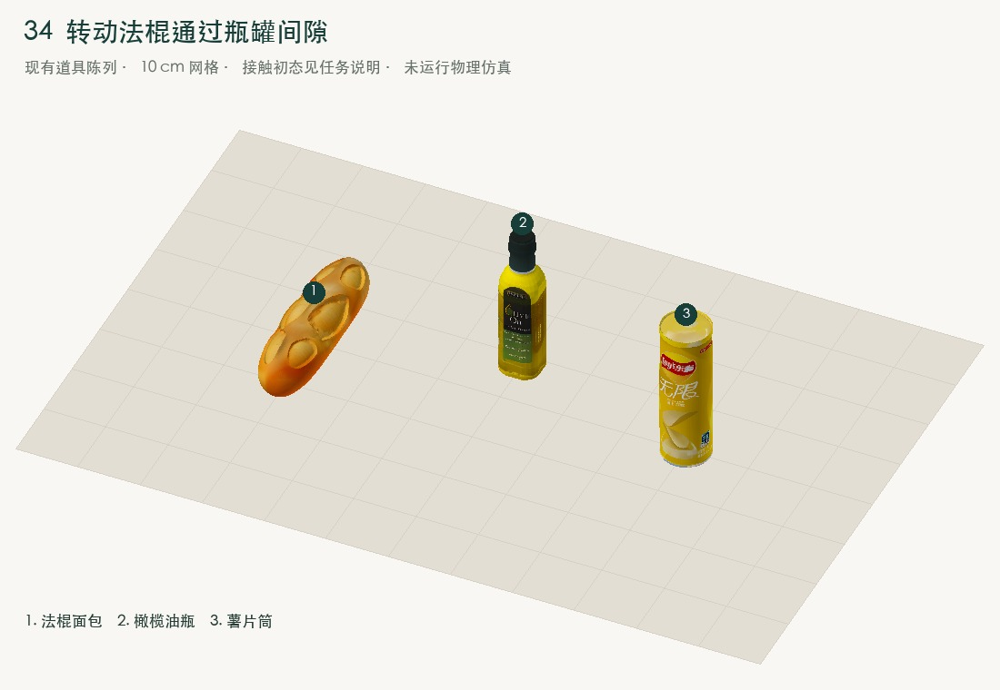

**与旧任务的区别：** 新增长物体姿态规划与整段避碰，不能只检查机器人末端轨迹。

### 道具、路径与预览

| 道具 | 数量 | 资产 ID | 可视化 |
|---|---:|---|---|
| 法棍面包 | 1 | `baguette` | [查看原模型渲染](assets/baguette.jpg) |
| 橄榄油瓶 | 1 | `oil` | [查看原模型渲染](assets/oil.jpg) |
| 薯片筒 | 1 | `chips` | [查看原模型渲染](assets/chips.jpg) |

完整资产路径：

```text
/Users/xulixin/RevoBench-refactor/assets/library/external/bench2dex/bf65215f844d/Objects/163_baguette/base3.glb
/Users/xulixin/RevoBench-refactor/assets/library/external/bench2dex/bf65215f844d/Objects/146_olive-oil/base4.glb
/Users/xulixin/RevoBench-refactor/assets/library/external/bench2dex/bf65215f844d/Objects/142_chips-tub/base3.glb
```

### 初始摆放

油瓶和薯片筒形成 12–16 cm 宽通道；约 30 cm 长的法棍横放在通道后方。

### 操作步骤

1. 抓取法棍中部或两端。
2. 旋转长轴使其对准通道，平稳穿过。
3. 通过后再恢复横向，放在桌前。

### 验收标准

以下标准与前面的统一验收要求同时适用。

- 法棍完整从两障碍物之间通过，运输时最低点离桌不超过 5 cm。
- 油瓶和薯片筒不能倾倒，平移均不超过 1 cm。
- 法棍最终长轴与目标方向误差不超过 10°。

### 接入前检查

- 用原有瓶罐形成通道；根据尺寸设置可行但非平移直穿的间隙。

<a id="proposal_35_compact_food_pack"></a>
## 35 · 把三种食品盒紧凑装入木盒

**任务 ID：** `proposal_35_compact_food_pack` · **状态：** 待开发提案 · **类别：** 识别与整理

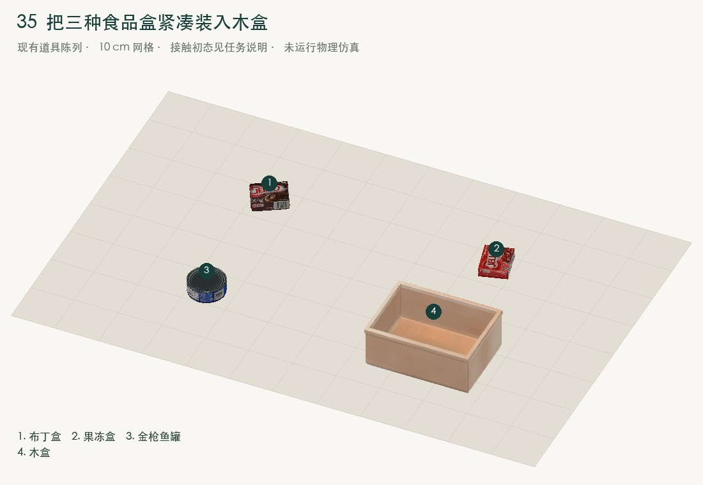

**与旧任务的区别：** 与 pack_groceries 同属装载，但增加紧凑布局、姿态与顺序约束，列为扩展而非全新机制。

### 道具、路径与预览

| 道具 | 数量 | 资产 ID | 可视化 |
|---|---:|---|---|
| 布丁盒 | 1 | `pudding` | [查看原模型渲染](assets/pudding.jpg) |
| 果冻盒 | 1 | `gelatin` | [查看原模型渲染](assets/gelatin.jpg) |
| 金枪鱼罐 | 1 | `tuna` | [查看原模型渲染](assets/tuna.jpg) |
| 木盒 | 1 | `woodbox` | [查看原模型渲染](assets/woodbox.jpg) |

完整资产路径：

```text
/Users/xulixin/RevoBench-refactor/assets/library/external/bench2dex/bf65215f844d/Objects/008_pudding_box/textured.obj
/Users/xulixin/RevoBench-refactor/assets/library/external/bench2dex/bf65215f844d/Objects/009_gelatin_box/textured.obj
/Users/xulixin/RevoBench-refactor/assets/library/external/bench2dex/bf65215f844d/Objects/007_tuna_fish_can/textured.obj
/Users/xulixin/RevoBench-refactor/assets/library/external/bench2dex/bf65215f844d/Objects/154_wooden_box/base0.glb
```

### 初始摆放

布丁盒、果冻盒、金枪鱼罐在木盒外；木盒内有事先确认可行的三个目标占位。

### 操作步骤

1. 观察三种包装形状，决定顺序和摆放方向。
2. 逐件放入木盒，必要时把长方体包装转向。
3. 放完后退出双手。

### 验收标准

以下标准与前面的统一验收要求同时适用。

- 三物体均完整位于木盒内腔，不得高于预设盒口限制。
- 物体间无重叠穿透；各中心距目标占位不超过 1.5 cm。
- 所有包装正面朝向符合给定方向，角度误差不超过 15°。

### 接入前检查

- 先用实际网格求一个能装下的参考布局；不能为了成功临时缩小单件包装。

<a id="proposal_36_occluded_snack"></a>
## 36 · 清出遮挡后取出指定零食

**任务 ID：** `proposal_36_occluded_snack` · **状态：** 待开发提案 · **类别：** 识别与整理

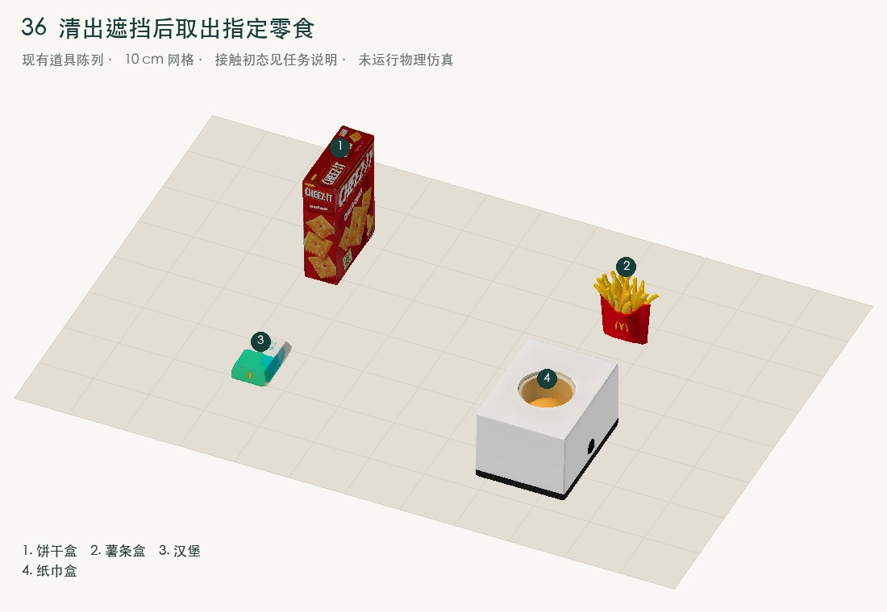

**与旧任务的区别：** 增加主动移障、语义选择和场景恢复，不能仅依赖目标真值坐标。

### 道具、路径与预览

| 道具 | 数量 | 资产 ID | 可视化 |
|---|---:|---|---|
| 饼干盒 | 1 | `cracker` | [查看原模型渲染](assets/cracker.jpg) |
| 薯条盒 | 1 | `fries` | [查看原模型渲染](assets/fries.jpg) |
| 汉堡 | 1 | `burger` | [查看原模型渲染](assets/burger.jpg) |
| 纸巾盒 | 1 | `tissue` | [查看原模型渲染](assets/tissue.jpg) |

完整资产路径：

```text
/Users/xulixin/RevoBench-refactor/assets/library/external/bench2dex/bf65215f844d/Objects/003_cracker_box/textured.obj
/Users/xulixin/RevoBench-refactor/assets/library/external/bench2dex/bf65215f844d/Objects/127_french-fries/base3.glb
/Users/xulixin/RevoBench-refactor/assets/library/external/bench2dex/bf65215f844d/Objects/128_hamburg/base5.glb
/Users/xulixin/RevoBench-refactor/assets/library/external/bench2dex/bf65215f844d/Objects/140_tissue-box/base6.glb
```

### 初始摆放

纸巾盒挡在薯条盒前方，饼干盒和汉堡位于两侧；目标指令为“取出红盒薯条”。

### 操作步骤

1. 移动纸巾盒，获得目标的可见区域和抓取空间。
2. 识别并拿出完整薯条盒模型，放到前方目标区。
3. 将纸巾盒恢复原位。

### 验收标准

以下标准与前面的统一验收要求同时适用。

- 取出的实例是薯条盒，不能用汉堡或饼干盒代替。
- 纸巾盒最终位置误差不超过 2 cm、朝向误差不超过 10°。
- 饼干盒和汉堡保持原位，位移不超过 2 cm。

### 接入前检查

- 薯条与盒子在当前素材中作为整体；不把其中薯条当作可独立取出的零件。

<a id="proposal_37_bimanual_swap"></a>
## 37 · 双手同时交换茶叶盒和咖啡盒

**任务 ID：** `proposal_37_bimanual_swap` · **状态：** 待开发提案 · **类别：** 双手协调

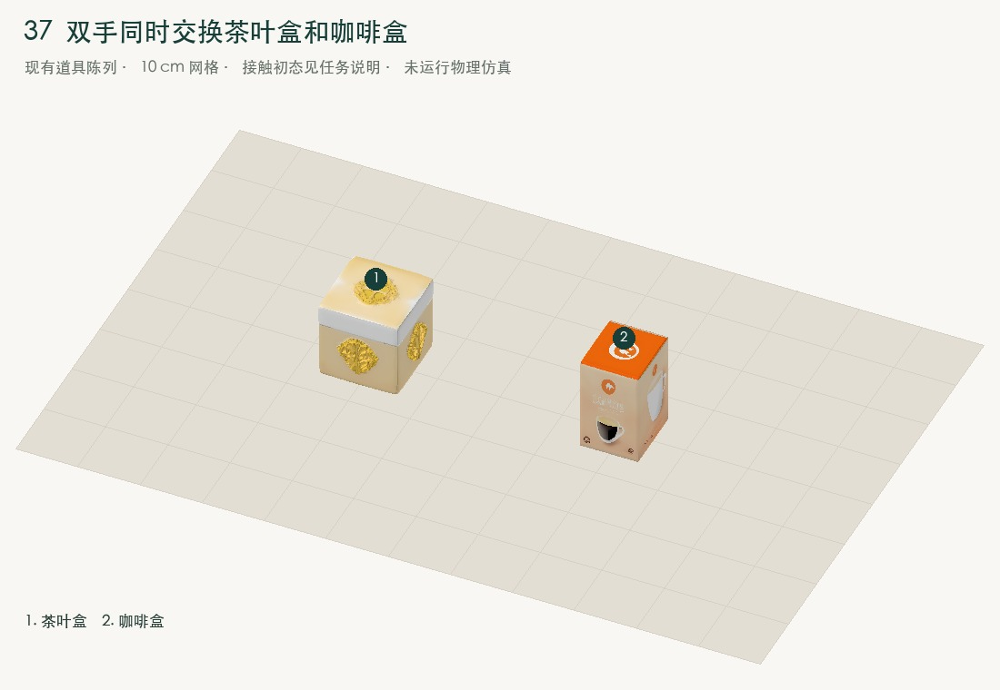

**与旧任务的区别：** 新增两条同时执行、相互避碰的搬运轨迹，区别于顺序归位。

### 道具、路径与预览

| 道具 | 数量 | 资产 ID | 可视化 |
|---|---:|---|---|
| 茶叶盒 | 1 | `tea` | [查看原模型渲染](assets/tea.jpg) |
| 咖啡盒 | 1 | `coffee` | [查看原模型渲染](assets/coffee.jpg) |

完整资产路径：

```text
/Users/xulixin/RevoBench-refactor/assets/library/external/bench2dex/bf65215f844d/Objects/214_tea-box/base5.glb
/Users/xulixin/RevoBench-refactor/assets/library/external/bench2dex/bf65215f844d/Objects/215_coffee-box/base6.glb
```

### 初始摆放

茶叶盒在左、咖啡盒在右，间隔约 30 cm；交换后分别占据对方初始区域。

### 操作步骤

1. 左右手分别抓住一只盒子。
2. 同时抬起，规划互不相撞的上下或前后错位路径。
3. 将两盒放到交换后的目标位置。

### 验收标准

以下标准与前面的统一验收要求同时适用。

- 两盒交换位置，中心误差各不超过 2 cm。
- 从首次同时离桌到进入目标区域期间，两盒均不能中途放桌。
- 两手和两物体没有互撞，包装最终均直立稳定。

### 接入前检查

- 只能在机器人双手实际可达范围内设置初末位置。

<a id="proposal_38_two_bottles_one_grasp"></a>
## 38 · 一只手同时握住两只小瓶

**任务 ID：** `proposal_38_two_bottles_one_grasp` · **状态：** 待开发提案 · **类别：** 多物体抓握

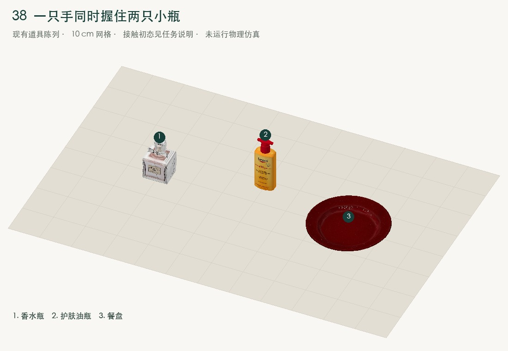

**与旧任务的区别：** 新增单手多物体抓握，抓取接触分配与现有单物体任务不同。

### 道具、路径与预览

| 道具 | 数量 | 资产 ID | 可视化 |
|---|---:|---|---|
| 香水瓶 | 1 | `perfume` | [查看原模型渲染](assets/perfume.jpg) |
| 护肤油瓶 | 1 | `lotion` | [查看原模型渲染](assets/lotion.jpg) |
| 餐盘 | 1 | `plate` | [查看原模型渲染](assets/plate.jpg) |

完整资产路径：

```text
/Users/xulixin/RevoBench-refactor/assets/library/external/bench2dex/bf65215f844d/Objects/216_perfume/base3.glb
/Users/xulixin/RevoBench-refactor/assets/library/external/bench2dex/bf65215f844d/Objects/211_hydrating-oil/base5.glb
/Users/xulixin/RevoBench-refactor/assets/library/external/bench2dex/bf65215f844d/Objects/029_plate/textured.obj
```

### 初始摆放

香水瓶与护肤油瓶并排，间距约 5 mm；餐盘在另一侧。

### 操作步骤

1. 用同一只手调整手指包覆两只瓶子。
2. 一次抓握同时抬起并移动到餐盘。
3. 逐渐松指，让两瓶直立落稳。

### 验收标准

以下标准与前面的统一验收要求同时适用。

- 同一只手同时搬运两个独立刚体，离桌至少 3 cm，水平移动至少 20 cm。
- 搬运阶段另一只手不能托底，也不能把两瓶绑定成一个物体。
- 两瓶最终直立在盘内，各自稳定 2 s。

### 接入前检查

- 检查两瓶总宽度适合当前手掌开度；仅允许声明的统一实例尺度。

<a id="proposal_39_handoff_dumbbell"></a>
## 39 · 双手交接哑铃

**任务 ID：** `proposal_39_handoff_dumbbell` · **状态：** 待开发提案 · **类别：** 双手协调

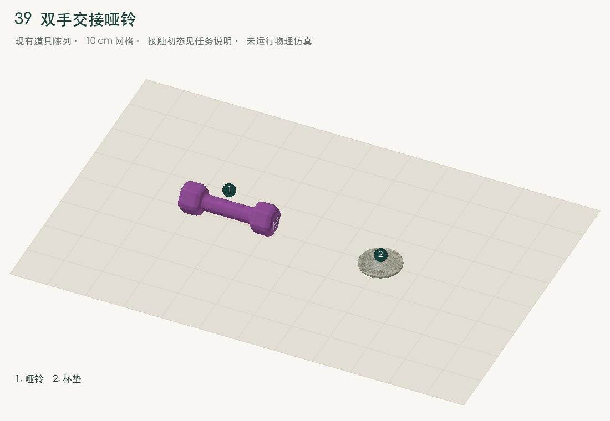

**与旧任务的区别：** 新增真实接触交接和载荷转移，而不是两手共同搬同一物体。

### 道具、路径与预览

| 道具 | 数量 | 资产 ID | 可视化 |
|---|---:|---|---|
| 哑铃 | 1 | `dumbbell` | [查看原模型渲染](assets/dumbbell.jpg) |
| 杯垫 | 1 | `coaster` | [查看原模型渲染](assets/coaster.jpg) |

完整资产路径：

```text
/Users/xulixin/RevoBench-refactor/assets/library/external/bench2dex/bf65215f844d/Objects/161_dumbbell/base6.glb
/Users/xulixin/RevoBench-refactor/assets/library/external/bench2dex/bf65215f844d/Objects/137_coaster/base0.glb
```

### 初始摆放

哑铃横放桌面；杯垫标示交接后放置位置附近的参照点，不作为额外夹具。

### 操作步骤

1. 右手抓住哑铃握柄并抬起。
2. 左手从另一侧建立稳定握持后，右手再松开。
3. 左手调整姿态，把哑铃横放到目标位置。

### 验收标准

以下标准与前面的统一验收要求同时适用。

- 明确发生右手持有→双手接触→左手持有的顺序。
- 交接期间哑铃离桌至少 5 cm，不能落桌后换手。
- 右手释放后的下落不超过 1 cm，最终水平放稳。

### 接入前检查

- 质量必须来自独立核实或明确的新配置，不从“哑铃”名称推断重量。

<a id="proposal_40_hat_brim"></a>
## 40 · 从帽檐换握到帽体并翻正

**任务 ID：** `proposal_40_hat_brim` · **状态：** 待开发提案 · **类别：** 手内调整

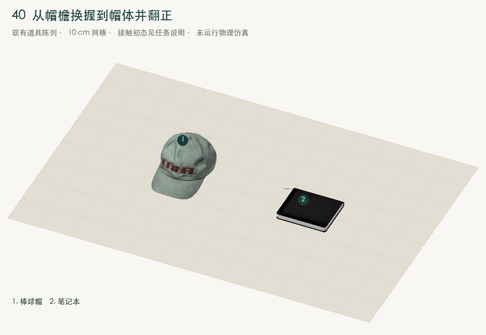

**与旧任务的区别：** 新增薄边抓取到大曲面支撑的换握，不是直接抓中心搬运。

### 道具、路径与预览

| 道具 | 数量 | 资产 ID | 可视化 |
|---|---:|---|---|
| 棒球帽 | 1 | `hat` | [查看原模型渲染](assets/hat.jpg) |
| 笔记本 | 1 | `notebook` | [查看原模型渲染](assets/notebook.jpg) |

完整资产路径：

```text
/Users/xulixin/RevoBench-refactor/assets/library/external/bench2dex/bf65215f844d/Objects/334_baseball_cap/01_baseball_cap/01/baseball_cap.glb
/Users/xulixin/RevoBench-refactor/assets/library/external/bench2dex/bf65215f844d/Objects/196_notebook/base2.glb
```

### 初始摆放

棒球帽侧放，帽檐指向机器人，笔记本作为最终放置区参照。

### 操作步骤

1. 先从可达帽檐位置抓起帽子。
2. 用另一只手接住帽体外侧，再释放帽檐。
3. 把帽口转向下方，帽檐朝前放到笔记本旁。

### 验收标准

以下标准与前面的统一验收要求同时适用。

- 发生帽檐抓取到帽体支撑的换握，过程帽子不落桌。
- 最终帽口朝下、帽檐朝前，角度误差各不超过 15°。
- 帽子放稳后与笔记本不重叠。

### 接入前检查

- 源帽子是静态网格，本任务只要求刚体姿态变化，不涉及折叠、拉伸或布料效果。

<a id="proposal_41_table_bowling"></a>
## 41 · 用网球撞倒指定瓶子

**任务 ID：** `proposal_41_table_bowling` · **状态：** 待开发提案 · **类别：** 动态接物

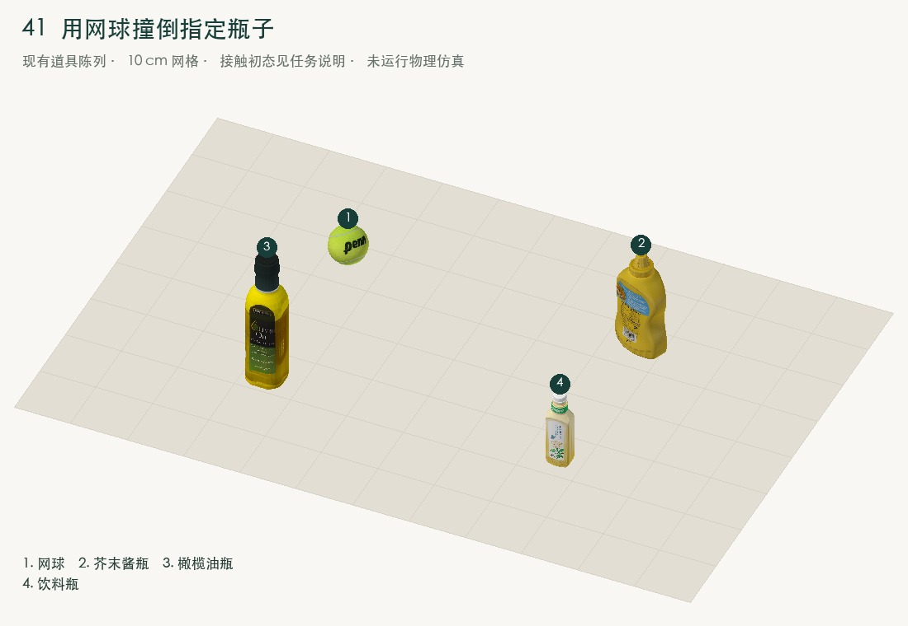

**与旧任务的区别：** 新增释放后的动力学预测与选择性碰撞。

### 道具、路径与预览

| 道具 | 数量 | 资产 ID | 可视化 |
|---|---:|---|---|
| 网球 | 1 | `tennis` | [查看原模型渲染](assets/tennis.jpg) |
| 芥末酱瓶 | 1 | `mustard` | [查看原模型渲染](assets/mustard.jpg) |
| 橄榄油瓶 | 1 | `oil` | [查看原模型渲染](assets/oil.jpg) |
| 饮料瓶 | 1 | `drink` | [查看原模型渲染](assets/drink.jpg) |

完整资产路径：

```text
/Users/xulixin/RevoBench-refactor/assets/library/external/bench2dex/bf65215f844d/Objects/056_tennis_ball/textured.obj
/Users/xulixin/RevoBench-refactor/assets/library/external/bench2dex/bf65215f844d/Objects/006_mustard_bottle/textured.obj
/Users/xulixin/RevoBench-refactor/assets/library/external/bench2dex/bf65215f844d/Objects/146_olive-oil/base4.glb
/Users/xulixin/RevoBench-refactor/assets/library/external/bench2dex/bf65215f844d/Objects/175_boxdrink/base3.glb
```

### 初始摆放

三只瓶子在桌后侧呈三角形摆放；网球在前侧，距目标 30–40 cm；指定前排一只为目标。

### 操作步骤

1. 抓起并把网球放到合适的起滚球点。
2. 用手沿桌面送出球，使它滚向目标瓶。
3. 球释放后让真实碰撞完成后续运动。

### 验收标准

以下标准与前面的统一验收要求同时适用。

- 网球滚动至少 20 cm 后才接触目标瓶，不能手拿球直接敲瓶。
- 指定瓶倾角达到 60°以上；后排两瓶倾角不超过 15°。
- 球与所有道具留在桌面边界内，不通过改动质量或初态重置制造结果。

### 接入前检查

- 需确认球与瓶子的真实质量、摩擦和目标布局，防止本身不可实现。

<a id="proposal_42_toycar_slalom"></a>
## 42 · 抓控小车穿过桌面障碍

**任务 ID：** `proposal_42_toycar_slalom` · **状态：** 待开发提案 · **类别：** 受约束取物

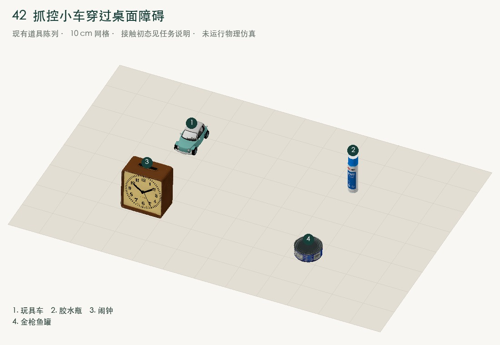

**与旧任务的区别：** 新增沿桌运动的非点状车身避碰与朝向控制。

### 道具、路径与预览

| 道具 | 数量 | 资产 ID | 可视化 |
|---|---:|---|---|
| 玩具车 | 1 | `toycar` | [查看原模型渲染](assets/toycar.jpg) |
| 胶水瓶 | 1 | `glue` | [查看原模型渲染](assets/glue.jpg) |
| 闹钟 | 1 | `clock` | [查看原模型渲染](assets/clock.jpg) |
| 金枪鱼罐 | 1 | `tuna` | [查看原模型渲染](assets/tuna.jpg) |

完整资产路径：

```text
/Users/xulixin/RevoBench-refactor/assets/library/external/bench2dex/bf65215f844d/Objects/165_toycar/base5.glb
/Users/xulixin/RevoBench-refactor/assets/library/external/bench2dex/bf65215f844d/Objects/199_glue/base6.glb
/Users/xulixin/RevoBench-refactor/assets/library/external/bench2dex/bf65215f844d/Objects/157_alarm-clock/base5.glb
/Users/xulixin/RevoBench-refactor/assets/library/external/bench2dex/bf65215f844d/Objects/007_tuna_fish_can/textured.obj
```

### 初始摆放

胶水瓶、闹钟和罐头形成两个交错通道；小车放在起点。

### 操作步骤

1. 抓住小车车身，保持轮底接近桌面。
2. 沿 S 形路线依次穿过两个通道，连续改变车头方向。
3. 在目标区域停车并松手。

### 验收标准

以下标准与前面的统一验收要求同时适用。

- 小车整体依次通过两个通道，不能抬高越过障碍。
- 车辆最低点离桌不超过 5 mm，三个障碍位移均不超过 1 cm。
- 最终中心距停车点不超过 2 cm，车头朝向误差不超过 10°。

### 接入前检查

- 源玩具车可能是完整静态网格；此任务允许车底滑动，不虚称车轮关节已经可滚动。

<a id="proposal_43_roll_and_catch"></a>
## 43 · 双手配合滚出并接住棒球

**任务 ID：** `proposal_43_roll_and_catch` · **状态：** 待开发提案 · **类别：** 动态接物

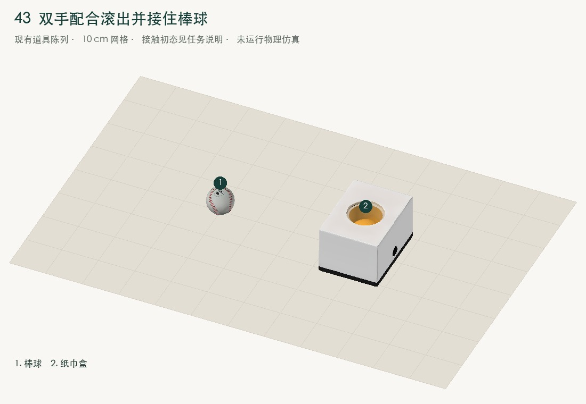

**与旧任务的区别：** 新增释放后动态接球和接触时机，区别于静态物体抓取。

### 道具、路径与预览

| 道具 | 数量 | 资产 ID | 可视化 |
|---|---:|---|---|
| 棒球 | 1 | `baseball` | [查看原模型渲染](assets/baseball.jpg) |
| 纸巾盒 | 1 | `tissue` | [查看原模型渲染](assets/tissue.jpg) |

完整资产路径：

```text
/Users/xulixin/RevoBench-refactor/assets/library/external/bench2dex/bf65215f844d/Objects/055_baseball/textured.obj
/Users/xulixin/RevoBench-refactor/assets/library/external/bench2dex/bf65215f844d/Objects/140_tissue-box/base6.glb
```

### 初始摆放

棒球在右手侧；纸巾盒放在后方作位置参照，留出 25–35 cm 的开放滚动路径。

### 操作步骤

1. 右手沿桌面滚出棒球。
2. 左手在目标区域准备，以掌心和指腹减速接住球。
3. 待球停稳后抓起，再放回桌面。

### 验收标准

以下标准与前面的统一验收要求同时适用。

- 球脱离右手后独立滚动至少 15 cm。
- 左手在球到达目标区域时接触减速，球不能越过接球区 5 cm 以上。
- 接球不能通过瞬移、固定球或提前用另一道具阻挡实现。

### 接入前检查

- 需记录球速和接触时刻；速度范围在试验前固定，不在失败后降低阈值冒充同一配置。

<a id="proposal_44_cover_soap"></a>
## 44 · 倒扣塑料盒罩住香皂

**任务 ID：** `proposal_44_cover_soap` · **状态：** 待开发提案 · **类别：** 套叠与拼装

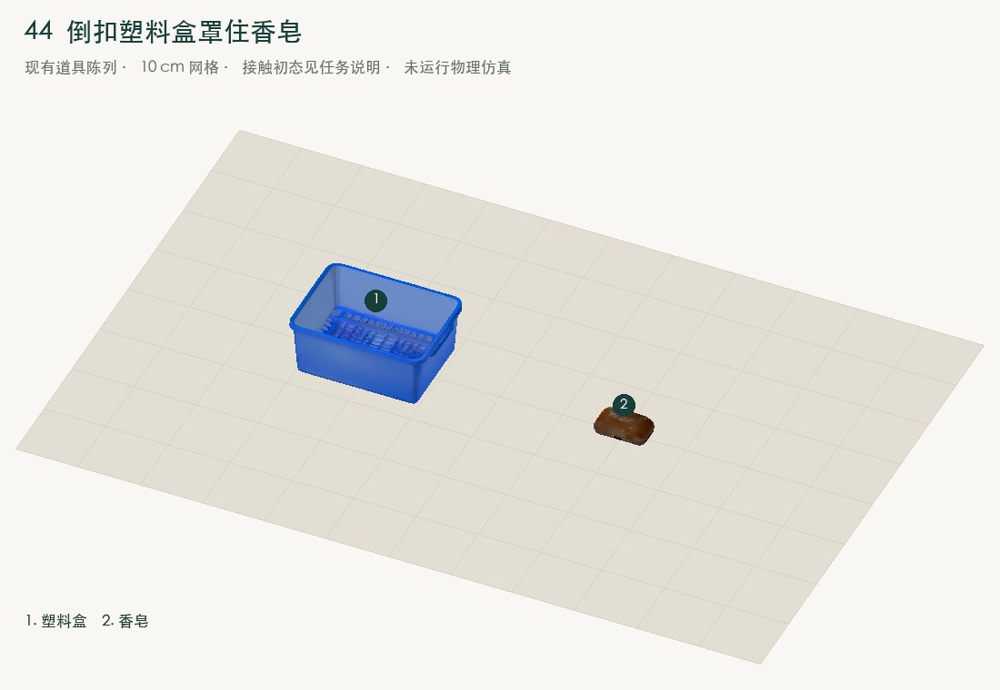

**与旧任务的区别：** 新增移动外容器覆盖静止目标，接近方向与装篮相反。

### 道具、路径与预览

| 道具 | 数量 | 资产 ID | 可视化 |
|---|---:|---|---|
| 塑料盒 | 1 | `plasticbox` | [查看原模型渲染](assets/plasticbox.jpg) |
| 香皂 | 1 | `soap` | [查看原模型渲染](assets/soap.jpg) |

完整资产路径：

```text
/Users/xulixin/RevoBench-refactor/assets/library/external/bench2dex/bf65215f844d/Objects/169_plasticbox/base10.glb
/Users/xulixin/RevoBench-refactor/assets/library/external/bench2dex/bf65215f844d/Objects/209_soap/base3.glb
```

### 初始摆放

香皂放桌中央，塑料盒开口朝上放在一侧。

### 操作步骤

1. 拿起塑料盒并翻转到开口朝下。
2. 对准香皂，垂直降低，使香皂进入盒内空腔。
3. 将盒口边缘放稳在桌面，释放双手。

### 验收标准

以下标准与前面的统一验收要求同时适用。

- 香皂完整位于盒的内腔范围，盒口平面落在桌面。
- 香皂位移不超过 1 cm，不能被盒壁推走。
- 盒子释放后稳定 2 s，香皂与盒体无穿透。

### 接入前检查

- 确认塑料盒真有可容纳香皂的内腔；不能用实体封闭碰撞盒替代。

<a id="proposal_45_bridge_brushpen"></a>
## 45 · 让毛笔横搭在两只包装盒上

**任务 ID：** `proposal_45_bridge_brushpen` · **状态：** 待开发提案 · **类别：** 精细支撑

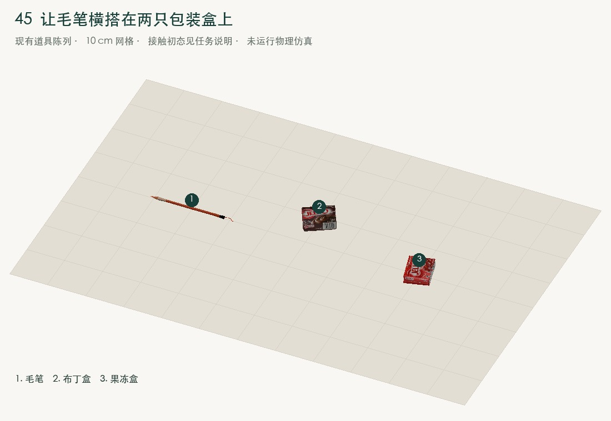

**与旧任务的区别：** 新增多支点细长物体平衡，区别于把物体放进容器。

### 道具、路径与预览

| 道具 | 数量 | 资产 ID | 可视化 |
|---|---:|---|---|
| 毛笔 | 1 | `brushpen` | [查看原模型渲染](assets/brushpen.jpg) |
| 布丁盒 | 1 | `pudding` | [查看原模型渲染](assets/pudding.jpg) |
| 果冻盒 | 1 | `gelatin` | [查看原模型渲染](assets/gelatin.jpg) |

完整资产路径：

```text
/Users/xulixin/RevoBench-refactor/assets/library/external/bench2dex/bf65215f844d/Objects/197_brush-pen/base5.glb
/Users/xulixin/RevoBench-refactor/assets/library/external/bench2dex/bf65215f844d/Objects/008_pudding_box/textured.obj
/Users/xulixin/RevoBench-refactor/assets/library/external/bench2dex/bf65215f844d/Objects/009_gelatin_box/textured.obj
```

### 初始摆放

布丁盒和果冻盒平放，使顶部高度接近，内侧间隙小于笔杆可用支撑长度。

### 操作步骤

1. 拿起毛笔，调整长轴方向。
2. 将笔杆两端分别放到两只盒子的上表面。
3. 缓慢退出手指，保持中段悬空。

### 验收标准

以下标准与前面的统一验收要求同时适用。

- 毛笔同时与两个包装盒形成支撑，中段不接触桌面。
- 两个支撑点均落在笔杆而非柔软笔尖区域。
- 松手后保持 2 s，不滑落；两盒位移不超过 1 cm。

### 接入前检查

- 利用原包装盒不同放置方向获得近似等高，不创建新的垫块。

<a id="proposal_46_sleeve_paper_roll"></a>
## 46 · 把纸卷套到细瓶外面

**任务 ID：** `proposal_46_sleeve_paper_roll` · **状态：** 待开发提案 · **类别：** 套叠与拼装

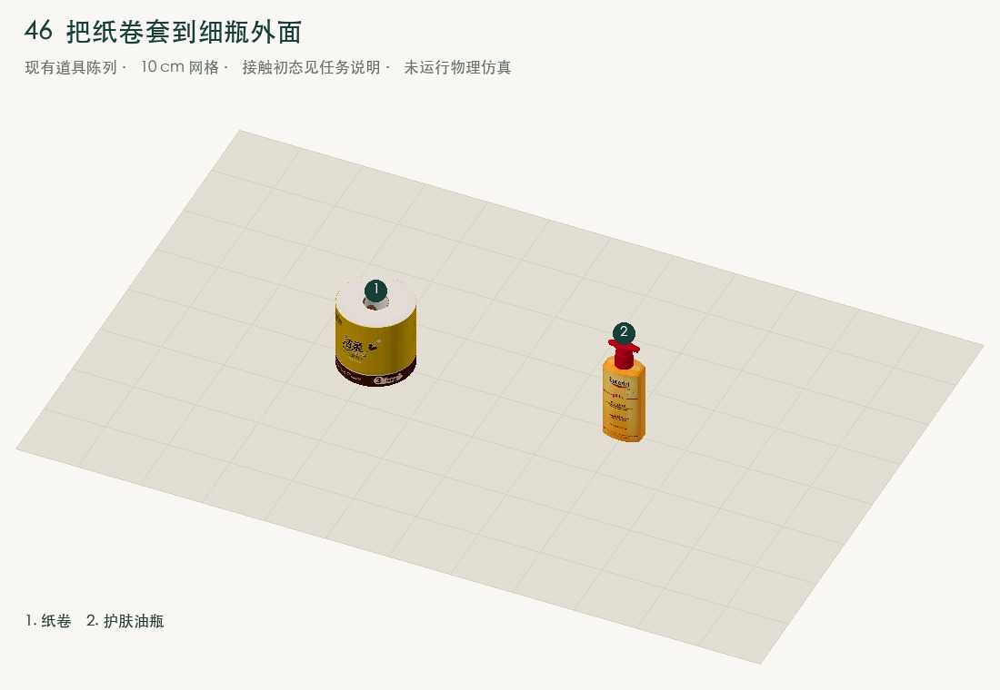

**与旧任务的区别：** 新增环状物围绕外部目标套入；不新建圆环或圆柱道具。

### 道具、路径与预览

| 道具 | 数量 | 资产 ID | 可视化 |
|---|---:|---|---|
| 纸卷 | 1 | `paper_roll` | [查看原模型渲染](assets/paper_roll.jpg) |
| 护肤油瓶 | 1 | `lotion` | [查看原模型渲染](assets/lotion.jpg) |

完整资产路径：

```text
/Users/xulixin/RevoBench-refactor/assets/library/external/bench2dex/bf65215f844d/Objects/145_roll-paper/base3.glb
/Users/xulixin/RevoBench-refactor/assets/library/external/bench2dex/bf65215f844d/Objects/211_hydrating-oil/base5.glb
```

### 初始摆放

细护肤油瓶直立，纸卷放在旁边；只选择纸卷内径大于瓶体最大通过直径的组合。

### 操作步骤

1. 拿起纸卷，使中心孔轴线竖直。
2. 对准瓶子上方，沿瓶体下降。
3. 让纸卷落到桌面并松手，瓶子留在孔中。

### 验收标准

以下标准与前面的统一验收要求同时适用。

- 瓶子从纸卷中心孔穿过，而不是从纸卷外侧擦过。
- 纸卷下表面落桌，瓶体保持直立，位移不超过 1 cm。
- 内孔与瓶子无穿透，松手后两者稳定 2 s。

### 接入前检查

- 纸卷预览确有中心孔，仍需验证孔的碰撞没有被凸包封住。
- 当前瓶/孔尺寸需量测配对，不能非均匀扩大孔径。

<a id="proposal_47_extract_baguette"></a>
## 47 · 稳住篮筐抽出长法棍

**任务 ID：** `proposal_47_extract_baguette` · **状态：** 待开发提案 · **类别：** 双手协调

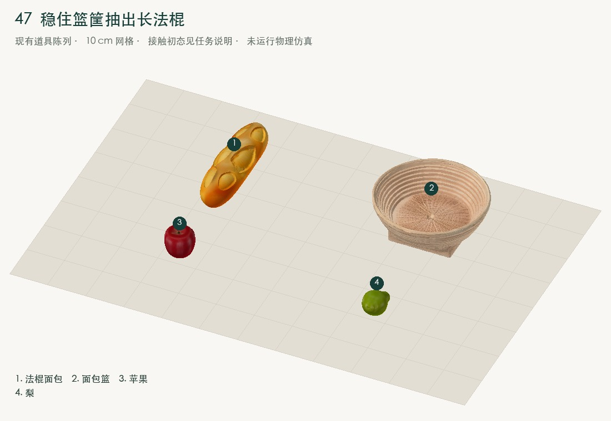

**与旧任务的区别：** 与 pack_groceries 相反，增加长物侧向取出和装载物保持。

### 道具、路径与预览

| 道具 | 数量 | 资产 ID | 可视化 |
|---|---:|---|---|
| 法棍面包 | 1 | `baguette` | [查看原模型渲染](assets/baguette.jpg) |
| 面包篮 | 1 | `basket` | [查看原模型渲染](assets/basket.jpg) |
| 苹果 | 1 | `apple` | [查看原模型渲染](assets/apple.jpg) |
| 梨 | 1 | `pear` | [查看原模型渲染](assets/pear.jpg) |

完整资产路径：

```text
/Users/xulixin/RevoBench-refactor/assets/library/external/bench2dex/bf65215f844d/Objects/163_baguette/base3.glb
/Users/xulixin/RevoBench-refactor/assets/library/external/bench2dex/bf65215f844d/Objects/183_breadbasket/base4.glb
/Users/xulixin/RevoBench-refactor/assets/library/external/bench2dex/bf65215f844d/Objects/013_apple/textured.obj
/Users/xulixin/RevoBench-refactor/assets/library/external/bench2dex/bf65215f844d/Objects/016_pear/textured.obj
```

### 初始摆放

法棍斜放在面包篮中，一端露出；苹果和梨放在篮内另一侧。

### 操作步骤

1. 一只手稳住篮筐边缘。
2. 另一只手抓住外露法棍，沿合适角度抽出。
3. 把法棍放到桌前，再松开篮筐。

### 验收标准

以下标准与前面的统一验收要求同时适用。

- 法棍完整取出，不穿过篮边或其他食品。
- 篮筐位移不超过 2 cm，苹果和梨保持在篮内。
- 法棍最终放稳，未操作的水果相对篮筐位移均不超过 3 cm。

### 接入前检查

- 面包篮原模型内腔必须保留；先检查法棍与水果的初始摆放无穿透。

<a id="proposal_48_invert_stemglass"></a>
## 48 · 握住杯梗把高脚杯倒扣

**任务 ID：** `proposal_48_invert_stemglass` · **状态：** 待开发提案 · **类别：** 精细支撑

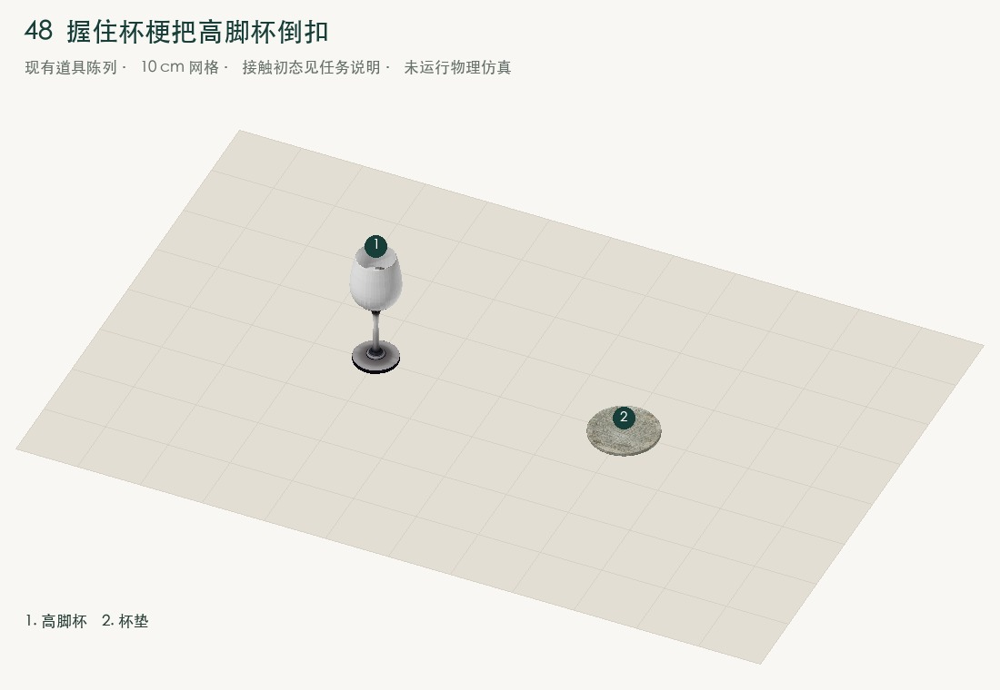

**与旧任务的区别：** 比 set_table 增加细杯梗抓握、大角度换向和杯沿落点约束。

### 道具、路径与预览

| 道具 | 数量 | 资产 ID | 可视化 |
|---|---:|---|---|
| 高脚杯 | 1 | `wineglass` | [查看原模型渲染](assets/wineglass.jpg) |
| 杯垫 | 1 | `coaster` | [查看原模型渲染](assets/coaster.jpg) |

完整资产路径：

```text
/Users/xulixin/RevoBench-refactor/assets/library/external/bench2dex/bf65215f844d/Objects/194_wineglass/base4.glb
/Users/xulixin/RevoBench-refactor/assets/library/external/bench2dex/bf65215f844d/Objects/137_coaster/base0.glb
```

### 初始摆放

高脚杯直立，杯垫在旁边；目标是杯口朝下落在杯垫上。

### 操作步骤

1. 用指腹握住杯梗，另一只手可辅助支撑杯身。
2. 平滑翻转，不让手腕异常反折。
3. 杯口对准杯垫，降低并释放。

### 验收标准

以下标准与前面的统一验收要求同时适用。

- 最终杯口朝下，轴线与竖直夹角不超过 8°。
- 杯口中心距杯垫中心不超过 1 cm，环形杯口真实支撑在杯垫上。
- 释放后稳定 2 s，不能通过杯沿穿透杯垫得到稳定。

### 接入前检查

- 确认杯口碰撞为开口环形，而不是填满杯内的凸包。

<a id="proposal_49_microphone_scan"></a>
## 49 · 持麦克风沿音箱三侧巡检

**任务 ID：** `proposal_49_microphone_scan` · **状态：** 待开发提案 · **类别：** 设备操作

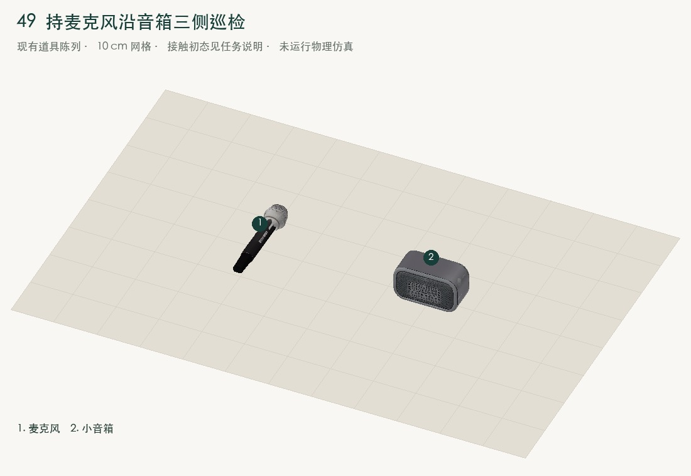

**与旧任务的区别：** 新增沿曲线移动时持续保持朝向与距离的轨迹约束。

### 道具、路径与预览

| 道具 | 数量 | 资产 ID | 可视化 |
|---|---:|---|---|
| 麦克风 | 1 | `microphone` | [查看原模型渲染](assets/microphone.jpg) |
| 小音箱 | 1 | `speaker` | [查看原模型渲染](assets/speaker.jpg) |

完整资产路径：

```text
/Users/xulixin/RevoBench-refactor/assets/library/external/bench2dex/bf65215f844d/Objects/136_microphone/base5.glb
/Users/xulixin/RevoBench-refactor/assets/library/external/bench2dex/bf65215f844d/Objects/164_small-speaker/base3.glb
```

### 初始摆放

音箱立在桌中央，麦克风在前方；定义正前、左前和右前三个观察方向。

### 操作步骤

1. 拿起麦克风，收音端朝向音箱。
2. 沿连续弧线经过三个方向，保持收音端与音箱的距离。
3. 返回正前方，再放回麦克风。

### 验收标准

以下标准与前面的统一验收要求同时适用。

- 三个方向的目标位姿均到达，位置误差不超过 2 cm。
- 移动阶段收音端指向音箱的角度误差不超过 10°，距离保持在 12–18 cm。
- 除必要端点外不出现超过 0.5 s 的无意义停顿；音箱位移不超过 1 cm。

### 接入前检查

- 只验收几何轨迹，不声称已经模拟声学或录制真实音频。

<a id="proposal_50_stamp_notebook"></a>
## 50 · 在笔记本指定位置盖印

**任务 ID：** `proposal_50_stamp_notebook` · **状态：** 待开发提案 · **类别：** 工具操作

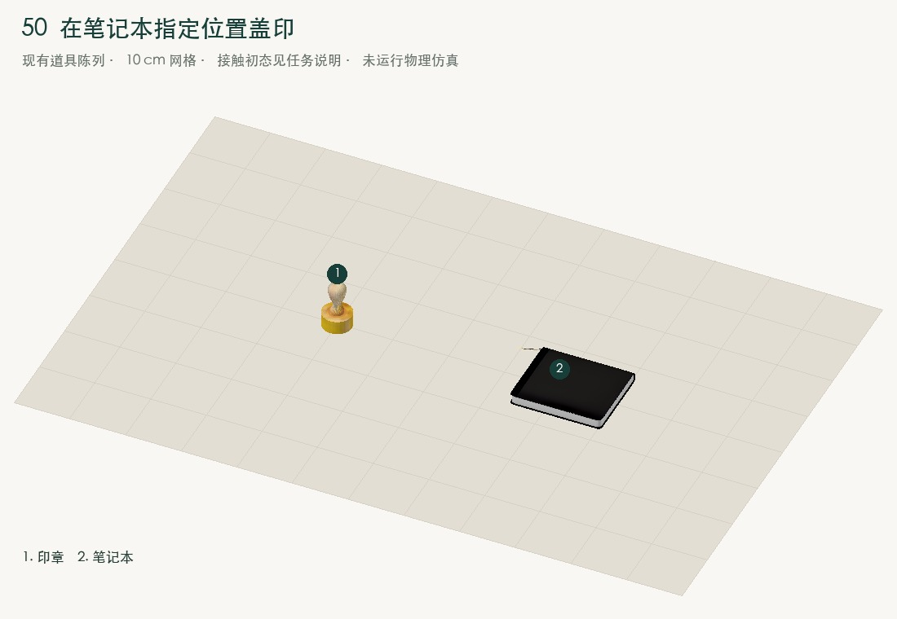

**与旧任务的区别：** 新增手持工具的定点面接触与防滑移，不是直接按一个固定按钮。

### 道具、路径与预览

| 道具 | 数量 | 资产 ID | 可视化 |
|---|---:|---|---|
| 印章 | 1 | `stamp` | [查看原模型渲染](assets/stamp.jpg) |
| 笔记本 | 1 | `notebook` | [查看原模型渲染](assets/notebook.jpg) |

完整资产路径：

```text
/Users/xulixin/RevoBench-refactor/assets/library/external/bench2dex/bf65215f844d/Objects/203_seal/base6.glb
/Users/xulixin/RevoBench-refactor/assets/library/external/bench2dex/bf65215f844d/Objects/196_notebook/base2.glb
```

### 初始摆放

笔记本平放；在封面定义两个相距 8 cm 的虚拟印章目标位；印章放右侧。

### 操作步骤

1. 抓住印章柄，使印面朝下。
2. 依次对准两个目标，垂直接触、短暂停留后抬起。
3. 将印章放回桌面。

### 验收标准

以下标准与前面的统一验收要求同时适用。

- 两次印面中心距目标不超过 5 mm，平面内朝向误差不超过 10°。
- 每次有效接触持续 0.3–0.8 s，接触期间横向滑移不超过 2 mm。
- 笔记本位移不超过 1 cm；两次接触之间印面完全离开封面。

### 接入前检查

- 印章底面需要正确标定；印迹先作为接触事件记录，不伪造已经实现墨水转印。
