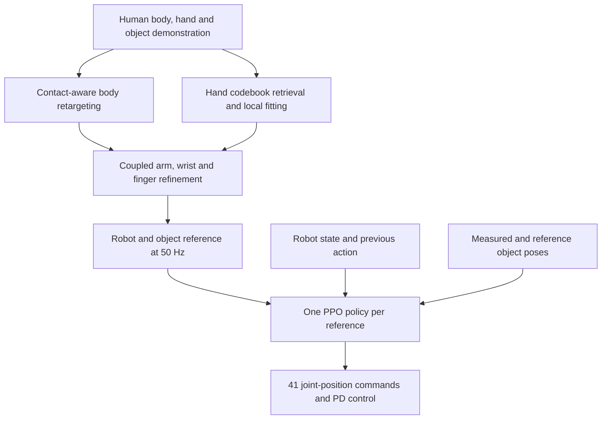
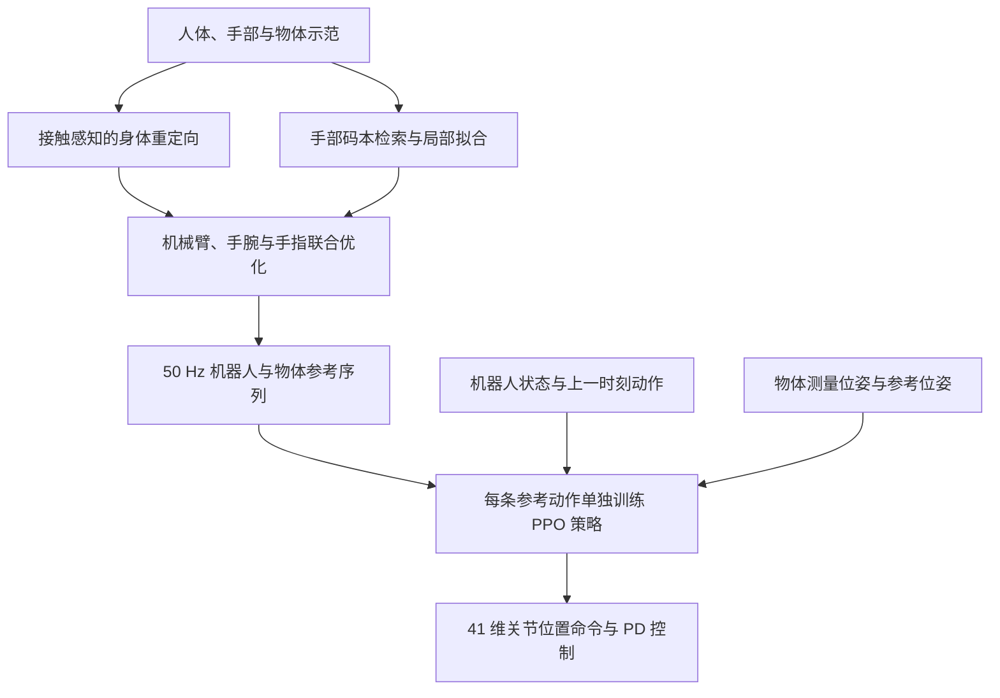

This post supports **English / 中文** switching via the site language toggle in the top navigation.

## TL;DR

A human wrist can be retargeted accurately while the robot's fingers miss the object. DexWeave addresses this coupling twice: it jointly refines arms, wrists, and fingers when constructing robot references, then uses anatomical tokens and directed attention to coordinate their execution. The lower-body support trajectory stays fixed during geometric refinement; during policy learning, the legs receive body context through a pathway without direct object conditioning.

On five loco-manipulation references, DexWeave reports **97.5% episode completion in MuJoCo**, compared with **85.0%** for an object-conditioned MLP. It trains **one policy per reference**. Physical G1 demonstrations provide qualitative transfer evidence; the 97.5% figure is a simulation result with a reference-tracking completion criterion.

## Paper and source version

*DexWeave: Learning Dexterous Humanoid Loco-Manipulation from Human Demonstrations* is by **Naichuan Sun, Haotian Shen, Yizhang Zhang, Luying Feng, Haoze Wang, Yuanbo Xiangli, Yaochu Jin, and Peidong Liu**, from Westlake University and Shanghai Jiao Tong University. Sun and Shen contributed equally.

These notes follow the September 28, 2026 preprint [arXiv:2609.34724v1](https://arxiv.org/abs/2609.34724v1), including its [26-page PDF and appendices](https://arxiv.org/pdf/2609.34724v1). The [project website](https://dexweave.github.io/) links videos and an [official repository](https://github.com/WU-CVGL/DexWeave). Experimental numbers below are author-reported; I have not reproduced the training runs.

## 1. Preserve the interaction while changing the embodiment

DexWeave starts with body motion, articulated hand observations where available, and object geometry and pose trajectories. GRAB and HUMOTO supply detailed hand–object interaction; OMOMO supplies body–object motion without observed fingertip targets; LAFAN1 supplies body-only motion. This is a pipeline for structured demonstrations with scene information. Recovering all of that information from arbitrary video remains a separate problem.

The robot is a Unitree G1 with Inspire RH56DFQ hands: **29 body joints and 12 independent hand drivers**. Fixed mimic relations expand the hand commands to 24 articulated finger joints. A reference contains robot configuration $q_t^*$ and object pose $X_t^O$ at 50 Hz. Object trajectories stay fixed during retargeting, after common coordinate alignment and any necessary scene scaling.

### Wrist targets transition from body proportions to scene alignment

A robot-scaled human pose may put the wrist beyond a handle or inside an object. DexWeave blends a morphology-adapted wrist target with the wrist position in the preprocessed scene:

$$
\hat p_{t,s}=(1-\alpha_{t,s})p^{\mathrm{morph}}_{t,s}
+\alpha_{t,s}p^{\mathrm{scene}}_{t,s},\qquad s\in\{L,R\}.
$$

The interaction weight $\alpha$ increases with persistent hand–object proximity. The appendix uses a 5 cm proximity threshold and a nominal transition interval of $4/30$ seconds, discretized to seven frames at 50 Hz; GRAB and HUMOTO also use source finger-contact labels. Far from an object, morphology adaptation dominates. Near sustained contact, the wrist follows the scene target. Wrist orientation retains its mapped target.

Body fitting combines landmark tracking, collision handling, temporal regularization, and joint constraints. Source foot motion identifies support intervals, during which horizontal robot toe positions enter the solve as hard equality constraints. This establishes a support trajectory before fine hand alignment begins.

### Hand retrieval provides a feasible starting configuration

Each hand has a small geometric codebook: three samples along each of six independent driver ranges produce $3^6=729$ entries. Forward kinematics describes finger directions, bending, reach, and inter-finger distances in wrist-local coordinates. The solver retrieves the 12 nearest entries and blends their driver values using weights proportional to $\exp(-D/0.06)$, where $D$ is the masked descriptor distance.

Continuous fitting then adjusts these drivers under joint bounds and mimic relations, with geometric, posture, and temporal terms. The codebook supplies a warm start and a soft posture anchor. Fingers start neutral when articulated hand observations are absent; OMOMO's later refinement uses robot-surface contact targets because its source joints are not fingertip measurements.

## 2. Let the arm and fingers share the correction

The second retargeting stage optimizes **14 arm/wrist joints plus 12 hand drivers**. The floating base, legs, and waist retain their initialized trajectories. Restricting the active coordinates keeps hand corrections from disturbing established support.

For articulated-hand inputs, the fingertip objective in Appendix A is

$$
\mathcal L_{\mathrm{tip}}
=\sum_{s,f}\frac{\omega_f}{\ell_{t,s}^2}
\left[
\alpha_{t,s}^2\|p_{t,sf}-y_{t,sf}\|_2^2
+(1-\alpha_{t,s})^2\|u_{t,sf}-v_{t,sf}\|_2^2
\right].
$$

Here $p,y$ are robot and target fingertip positions in the world frame; $u,v$ are their wrist-local counterparts; $\ell$ normalizes hand scale. The same interaction weight that controls wrist targets shifts finger fitting toward world-frame placement during interaction and toward local hand shape away from it. Thumb and index weights are **2.0 each**, versus **0.20** for each remaining finger.

The full objective also tracks palm normal and other hand axes, penalizes insufficient clearance, and regularizes posture and temporal corrections. Wrist and palm position anchors weaken as interaction activates. That freedom allows the arm to move a few centimeters when finger articulation alone cannot repair the grasp geometry. Joint limits, mimic relations, and active self/ground collision boundaries constrain the solve; hand–object clearance and contact recovery enter as soft objectives.

One detail worth retaining in an implementation is the temporal term for the arms: it smooths the change in the correction $\delta_t^U=q_t^U-\bar q_t^U$. The target motion itself can keep moving while the correction remains stable. Hand drivers receive direct temporal smoothing.

The ablation exposes the cost of this freedom. On GRAB, refinement reduces thumb/index error from **36.033 to 4.342 mm**, while palm-normal error rises from **0.189° to 3.652°**. On HUMOTO, the corresponding errors change from **32.703 to 7.198 mm** and **0.159° to 4.439°**. The optimization prioritizes fingertip placement and fewer collision violations, accepting some orientation deviation.

## 3. Encode which body regions can read which information

The actor receives 238 scalar inputs: 211 robot features and 27 object features. Robot inputs include reference joint positions, non-finger velocities, current joint state, torso-anchor information, and the previous applied action. Eight regional encoders create 128-dimensional tokens for the base, left/right legs, waist, left/right arms, and left/right hands:

$$
h_i=E_i(x_i)+p_i,\qquad Z=F_{\mathrm{robot}}(H;M_R).
$$

The learned embedding $p_i$ identifies the body region. Two Transformer blocks use a directed mask $M_R$. The base, legs, waist, and arms communicate with one another but cannot attend to hand tokens. Each hand attends to the waist, both arms, and itself. This supplies the fingers with upstream body context while excluding hand-token features from the body representation.

Object information arrives through a separate token. In the torso frame, let $\phi(T)$ concatenate a 3D position and a 6D rotation representation. The object input is

$$
x_o=\left[\phi(T_o);\phi(T_o^{\mathrm{ref}});
\phi(T_o)-\phi(T_o^{\mathrm{ref}})\right]\in\mathbb R^{27}.
$$

The last term is a coordinate difference between pose representations; it is not an $SE(3)$ relative transform. A one-block fusion Transformer lets each waist, arm, or hand token attend only to itself and the object token. The object token attends only to itself. Base and leg tokens bypass this fusion.

**The leg decoders also retain the waist token from before object fusion.** Without that bypass, an object-conditioned waist feature would provide an indirect route from the object token to leg actions. Each leg head reads the base, its own leg, and the original waist; upper-body heads use the object-conditioned features. Seven heads jointly output 41 normalized position commands:

$$
q_t^{\mathrm{cmd}}=q^{\mathrm{default}}+s\odot a_t.
$$

Joint-level PD control executes those targets. The structural independence concerns direct object observations at a policy step. Object forces can still change robot state, and the legs can respond to those changes. It does not establish that lower-body behavior is physically independent of manipulation.

## 4. Single-stage RL still depends on a detailed training recipe

All actor components train jointly with PPO and a privileged 463-input critic. No tracking-policy pretraining, teacher–student distillation, or later residual-policy training is used. Reference construction remains an earlier optimization stage, and each reference gets a separate learned controller.

Training uses **4,096 environments**, 24 steps per environment per update, 200 Hz physics, and 50 Hz control. Body-only policies train for 8,000 PPO iterations; manipulation policies train for 12,000. The robot Transformer has two blocks, object fusion has one, and each block uses four attention heads. The comparison MLP has three hidden layers of width 621 and a comparable parameter count.

Rewards supervise body motion, hand drivers, wrist-relative hand poses, wrist–object relations, and object pose. Tracking terms use $r_k=\exp(-E_k/\sigma_k^2)$, supplemented by action smoothness, joint-limit, and undesired-contact penalties. Dynamics randomization covers friction, mass, motor strength, gains, delay, and external pushes. Actor object measurements are sampled at 30 Hz with 20–60 ms latency, ±1 cm position noise, and ±0.035 rad rotation perturbations; the critic receives uncorrupted simulation observations.

Half of default episode starts use the first reference frame, and half use sampled phases. Sampled-phase selection mixes uniform and failure-adaptive sampling. This makes later portions of a motion trainable even when early failures would otherwise prevent reaching them.

## 5. Read the results with their completion rule

Table 3 reports MuJoCo transfer after IsaacLab training. The manipulation results average equally across five references:

| Actor | Episode success | Body position error | Object position error | Object rotation error |
|---|---:|---:|---:|---:|
| InterMimic | 57.74% | 6.51 cm | 3.58 cm | 7.71° |
| Object MLP | 85.00% | 5.69 cm | 3.84 cm | **6.16°** |
| DexWeave | **97.50%** | **4.93 cm** | **3.43 cm** | 6.83° |

The closest controlled comparison is Object MLP versus DexWeave on the same G1–Inspire embodiment. InterMimic uses its official SMPL-X human skeleton setup, so its row is a cross-embodiment reference. DexWeave gains **12.5 percentage points** over Object MLP, while the MLP retains lower object-orientation error. Figure 5 suggests approximately twice as fast convergence for manipulation; it does not provide a matched wall-clock throughput benchmark.

For each reference, checkpoints from the final 1,000 training iterations are saved every 100 iterations and evaluated with five evaluation seeds each. Metrics are averaged across runs, checkpoints, and then references. These seeds vary evaluation; this protocol does not establish replication across independently trained seeds.

“Success” means reaching the reference end or the applicable time limit without early termination. A sampled-phase episode may therefore complete only an evaluated segment. Manipulation terminates, among other conditions, when object position error exceeds 0.30 m or orientation error exceeds 2.0 rad. **97.5% should be read as completion under this protocol**, with the reported tracking errors providing additional information about execution quality. It is not a hardware success rate or evidence of a shared policy generalizing to unseen tasks.

The geometric results support the reference-construction mechanism. Against OmniRetarget + SBR + arm–wrist IK, DexWeave lowers thumb/index error from **14.925 to 4.342 mm** on GRAB and from **29.999 to 7.198 mm** on HUMOTO. Penetration-duration fractions fall from **0.190 to 0.001** and **0.511 to 0.007**. Those fractions count violations above the evaluation thresholds: 1 cm for ground/self penetration and 2 cm for object penetration. A near-zero fraction permits smaller penetrations.

Mask ablations cover only two reference motions. Full directed masking achieves 100% completion, versus 91.30% with dense robot-region attention and 99.71% with bidirectional object fusion. Dense robot attention yields slightly better object pose errors despite lower completion. The evidence favors the masks for completion and body tracking in this setting; it does not show a uniform gain across all metrics.

## 6. What I would carry into a new system

My strongest takeaway is to couple wrist placement and finger fitting before asking RL to track the result. The retargeting ablation gives that choice a concrete justification. I would preserve the original support trajectory, measure primary-fingertip error and collision frequency separately, and inspect the palm-orientation tradeoff instead of compressing them into one quality score.

The policy mask is a useful starting hypothesis when detailed finger features interfere with body tracking. Its value should be tested again if the task needs anticipatory balance under changing payloads: this architecture keeps direct object information out of the leg pathway, and the paper's two-motion mask ablation leaves that broader question open.

The physical G1 demonstrations show that some learned skills transfer, but the paper supplies no aggregate hardware trial count or success-rate table. A practical follow-up would measure hardware completion over repeated resets, document the object-pose estimation system, and test a shared policy on held-out references. Those experiments would determine how far the current per-reference skill pipeline can scale.

本文支持通过顶部导航栏的语言切换按钮在 **English / 中文** 之间切换。

## TL;DR

人的手腕轨迹即使重定向得很准确，机器人手指仍可能够不到物体。DexWeave 在两个环节处理这种耦合：构造机器人参考动作时，联合优化机械臂、手腕和手指；执行时，用解剖区域 token 与有向注意力组织全身协调。几何优化保留下肢支撑轨迹，策略学习则让腿部通过不直接接收物体观测的身体通路获得控制上下文。

在 5 条移动操作参考动作上，DexWeave 报告了 **97.5% 的 MuJoCo 回合完成率**，物体条件 MLP 为 **85.0%**。方法为**每条参考动作单独训练一个策略**。G1 实机演示提供了定性迁移证据；97.5% 来自仿真，采用的是参考跟踪回合的完成判据。

## 论文与来源版本

论文 *DexWeave: Learning Dexterous Humanoid Loco-Manipulation from Human Demonstrations* 的作者为 **Naichuan Sun、Haotian Shen、Yizhang Zhang、Luying Feng、Haoze Wang、Yuanbo Xiangli、Yaochu Jin 和 Peidong Liu**，来自西湖大学与上海交通大学。Sun 和 Shen 为共同第一作者。

本文依据 2026 年 9 月 28 日发布的预印本 [arXiv:2609.34724v1](https://arxiv.org/abs/2609.34724v1)，包括其 [26 页 PDF 与附录](https://arxiv.org/pdf/2609.34724v1)。[项目网站](https://dexweave.github.io/) 提供视频及[官方仓库链接](https://github.com/WU-CVGL/DexWeave)。下文数值均来自作者报告，我没有复现训练实验。

## 1. 改变身体形态时，保留交互关系

DexWeave 的输入包括身体动作、可用的手部关节观测，以及物体几何和位姿轨迹。GRAB 与 HUMOTO 提供细致的手物交互；OMOMO 提供身体与物体动作，但没有观测到的指尖目标；LAFAN1 只有身体动作。因此，它处理的是带有场景信息的结构化示范。从任意视频恢复这些信息，仍是另一项工作。

机器人平台是搭载 Inspire RH56DFQ 灵巧手的 Unitree G1，具有 **29 个身体关节与 12 个独立手部驱动量**。固定 mimic 关系将手部命令展开为 24 个手指关节。参考序列以 50 Hz 提供机器人构型 $q_t^*$ 和物体位姿 $X_t^O$。统一坐标对齐及必要的场景缩放完成后，物体轨迹在重定向过程中保持固定。

### 手腕目标从适应身体比例逐渐转向场景对齐

按照机器人比例缩放人体动作，可能把手腕放到把手外侧，甚至物体内部。DexWeave 混合形态适配后的手腕位置与预处理场景中的手腕位置：

$$
\hat p_{t,s}=(1-\alpha_{t,s})p^{\mathrm{morph}}_{t,s}
+\alpha_{t,s}p^{\mathrm{scene}}_{t,s},\qquad s\in\{L,R\}.
$$

交互权重 $\alpha$ 随持续的手物接近而增大。附录采用 5 cm 距离阈值，名义过渡时间为 $4/30$ 秒，在 50 Hz 下离散为 7 帧；GRAB 和 HUMOTO 还使用源数据的手指接触标签。远离物体时，目标主要适应机器人身体比例；持续接触附近，手腕转向跟随场景目标。手腕朝向继续使用映射后的目标。

身体拟合同时处理关键点跟踪、碰撞、时间正则与关节约束。源动作的脚部运动用于识别支撑区间；在这些区间内，机器人脚趾的水平位置作为硬等式约束进入求解。这样，细致的手部对齐开始前，系统已经建立了支撑轨迹。

### 手部检索提供满足运动学约束的初值

每只手使用一个小型几何码本：在 6 个独立驱动量的范围内各取 3 个样本，得到 $3^6=729$ 个构型。正向运动学在手腕局部坐标系中描述手指方向、弯曲、伸展程度和指间距离。求解器检索最近的 12 个条目，再按与 $\exp(-D/0.06)$ 成正比的权重混合驱动量，其中 $D$ 是带有效性掩码的描述符距离。

随后，连续优化在关节范围和 mimic 关系下调整驱动量，结合几何、姿态与时间项。码本提供优化初值和软姿态参考。缺少手部关节观测时，手指从中性构型开始；OMOMO 后续使用机器人表面接触目标，因为源数据中的关节位置不能直接当作指尖测量。

## 2. 让机械臂和手指共同承担修正

第二阶段优化 **14 个机械臂/手腕关节和 12 个手部驱动量**，浮动基座、双腿与腰部保留初始化后的轨迹。限制优化变量的范围，可以避免手部修正扰动已经建立的支撑。

对于具有手部关节观测的输入，附录 A 的指尖目标为：

$$
\mathcal L_{\mathrm{tip}}
=\sum_{s,f}\frac{\omega_f}{\ell_{t,s}^2}
\left[
\alpha_{t,s}^2\|p_{t,sf}-y_{t,sf}\|_2^2
+(1-\alpha_{t,s})^2\|u_{t,sf}-v_{t,sf}\|_2^2
\right].
$$

其中，$p,y$ 分别是世界坐标系中的机器人指尖与目标位置，$u,v$ 是对应的手腕局部坐标，$\ell$ 用于归一化手部尺度。控制手腕目标的同一个交互权重，也使手指拟合在交互时侧重世界坐标对齐、远离物体时侧重局部手型。拇指和食指的权重**各为 2.0**，其余每根手指为 **0.20**。

完整目标还包含掌面法向及其他手部方向、间隙惩罚、姿态正则与时间修正。交互激活后，手腕和手掌的位置锚定减弱。如果手指关节变化不足以恢复抓取几何，机械臂便可以共同调整位置。关节限位、mimic 关系及启用的自身/地面碰撞边界约束求解；手物间隙与接触恢复则采用软目标。

实现时值得保留的细节是机械臂时间项：它平滑的是修正量 $\delta_t^U=q_t^U-\bar q_t^U$ 的变化。参考动作可以继续运动，叠加在它上面的修正仍保持稳定。手部驱动量则直接进行时间平滑。

消融揭示了这种自由度的代价。在 GRAB 上，优化将拇指/食指误差从 **36.033 降至 4.342 mm**，掌面法向误差却从 **0.189° 增至 3.652°**。HUMOTO 上，两组数值分别从 **32.703 降至 7.198 mm**、从 **0.159° 增至 4.439°**。优化优先改善指尖位置并减少碰撞违规，同时接受一定的朝向偏差。

## 3. 明确每个身体区域可以读取哪些信息

Actor 接收 238 维标量输入：211 维机器人特征和 27 维物体特征。机器人输入包含参考关节位置、非手指关节速度、当前关节状态、躯干锚点信息与上一时刻实际应用的动作。8 个区域编码器分别为基座、左右腿、腰部、左右臂和左右手生成 128 维 token：

$$
h_i=E_i(x_i)+p_i,\qquad Z=F_{\mathrm{robot}}(H;M_R).
$$

可学习的 $p_i$ 标识身体区域。两层 Transformer 使用有向掩码 $M_R$：基座、双腿、腰部和双臂可以相互通信，但不能读取手部 token；每只手可以读取腰部、双臂和自身。手指由此获得上游身体信息，身体表示则不接收手部 token 特征。

物体通过独立 token 输入。设 $\phi(T)$ 在躯干坐标系中拼接 3 维位置与 6 维旋转表示，则：

$$
x_o=\left[\phi(T_o);\phi(T_o^{\mathrm{ref}});
\phi(T_o)-\phi(T_o^{\mathrm{ref}})\right]\in\mathbb R^{27}.
$$

最后一项是位姿表示的逐坐标差值，与 $SE(3)$ 相对变换不同。一层融合 Transformer 让腰部、每条机械臂和每只手的 token 只读取自身与物体 token；物体 token 只读取自身。基座与腿部绕过这一融合层。

**腿部解码器还保留物体融合前的腰部 token。** 如果腿部读取已经融合物体信息的腰部特征，物体观测仍会间接进入腿部动作。每条腿的动作头读取基座、对应腿部与原始腰部特征，上半身动作头使用融合后的特征。7 个动作头共同输出 41 维归一化位置命令：

$$
q_t^{\mathrm{cmd}}=q^{\mathrm{default}}+s\odot a_t.
$$

关节级 PD 控制器执行这些目标。这里的结构独立性指单次策略计算中对直接物体观测的依赖。物体作用力仍会改变机器人状态，双腿也可以响应这些变化，因此不能据此推断下肢行为在物理上独立于操作任务。

## 4. 单阶段 RL 仍依赖完整的训练配方

全部 actor 组件与一个使用 463 维特权输入的 critic 共同接受 PPO 训练。它不需要跟踪策略预训练、师生蒸馏或后续残差策略训练。参考轨迹构建仍是前置优化阶段，每条参考动作仍对应独立控制器。

训练使用 **4,096 个环境**，每次更新从每个环境采集 24 步，物理频率为 200 Hz，控制频率为 50 Hz。纯身体跟踪训练 8,000 次 PPO 迭代，移动操作训练 12,000 次。机器人 Transformer 为两层，物体融合为一层，每层使用 4 个注意力头。比较用的 MLP 有 3 个宽度为 621 的隐藏层，参数量与之相近。

奖励监督身体动作、手部驱动量、手腕坐标系下的手部位姿、腕物关系和物体位姿。跟踪项采用 $r_k=\exp(-E_k/\sigma_k^2)$，并加入动作平滑、关节限位与非期望接触惩罚。动力学随机化覆盖摩擦、质量、电机强度、控制增益、延迟与外部推力。Actor 的物体测量以 30 Hz 采样，延迟为 20–60 ms，位置噪声为 ±1 cm，旋转扰动为 ±0.035 rad；critic 使用不受这些观测扰动影响的仿真状态。

默认情况下，一半回合从参考首帧开始，另一半从采样相位开始。相位选择混合均匀采样和基于失败率的自适应采样，使动作后段也能得到训练，避免早期失败反复阻断对后续阶段的探索。

## 5. 结合完成判据理解实验结果

表 3 报告 IsaacLab 训练后在 MuJoCo 中的迁移结果。移动操作指标对 5 条参考动作等权平均：

| Actor | 回合成功率 | 身体位置误差 | 物体位置误差 | 物体旋转误差 |
|---|---:|---:|---:|---:|
| InterMimic | 57.74% | 6.51 cm | 3.58 cm | 7.71° |
| Object MLP | 85.00% | 5.69 cm | 3.84 cm | **6.16°** |
| DexWeave | **97.50%** | **4.93 cm** | **3.43 cm** | 6.83° |

最接近受控对照的是使用相同 G1–Inspire 形态的 Object MLP 与 DexWeave。InterMimic 沿用官方 SMPL-X 人体骨架设置，其结果属于跨形态参照。DexWeave 比 Object MLP 高 **12.5 个百分点**，但 MLP 的物体朝向误差更低。图 5 显示移动操作的收敛约快两倍；这没有直接给出相同硬件下的实际耗时或吞吐对比。

每条参考动作在最后 1,000 次训练迭代中，每隔 100 次保存检查点；每个检查点使用 5 个评估随机种子测试。指标依次跨评估运行、检查点和参考序列取平均。这些种子改变的是评估过程，该协议并不能证明结果在多个独立训练种子下重复成立。

“成功”指没有提前触发失败终止，并到达参考末尾或规定时限。因此，从采样相位开始的回合可能只完成被评估的片段。移动操作的终止条件包括物体位置误差超过 0.30 m，或朝向误差超过 2.0 rad。**97.5% 应理解为该协议下的完成率**，执行质量还需要结合跟踪误差判断。它不代表实机成功率，也不证明一个共享策略能够泛化到未见任务。

几何结果支持参考构建机制。相比 OmniRetarget + SBR + 机械臂/手腕 IK，DexWeave 将 GRAB 的拇指/食指误差从 **14.925 降至 4.342 mm**，HUMOTO 从 **29.999 降至 7.198 mm**；穿透持续比例分别从 **0.190 降至 0.001**、从 **0.511 降至 0.007**。这里统计的是超过评估阈值的违规帧：地面/自身穿透阈值为 1 cm，物体穿透为 2 cm。接近零的比例仍允许更浅的穿透存在。

掩码消融只覆盖两条参考动作。完整有向掩码的完成率为 100%，身体区域全连接注意力为 91.30%，双向物体融合为 99.71%。身体全连接注意力虽然完成率更低，物体位姿误差却略好。证据支持有向掩码在当前设置下改善回合完成与身体跟踪，不能扩展为对全部指标的一致提升。

## 6. 我会带到新系统中的设计

我最想保留的是：先让手腕位置和手指拟合共同调整，再让 RL 学习跟踪。重定向消融为这个选择提供了具体依据。实现时，我会保留原始支撑轨迹，分别测量主要指尖误差与碰撞频率，并检查掌面朝向的代价，避免把这些性质压缩成一个质量分数。

当细粒度手指特征干扰身体跟踪时，策略掩码值得作为起点。如果任务要求根据变化的负载提前调整平衡，就需要重新检验这种信息限制：当前架构让直接物体观测绕开腿部通路，而论文的两动作掩码消融还不足以回答更广泛的负载适应问题。

G1 实机演示说明部分技能可以迁移，但论文没有提供汇总的实机试验次数或成功率表。下一步可以在重复复位条件下测量硬件完成率，明确物体位姿估计系统，再用未见参考动作测试共享策略。这些实验才能判断当前逐参考训练的技能流程能扩展到什么程度。

