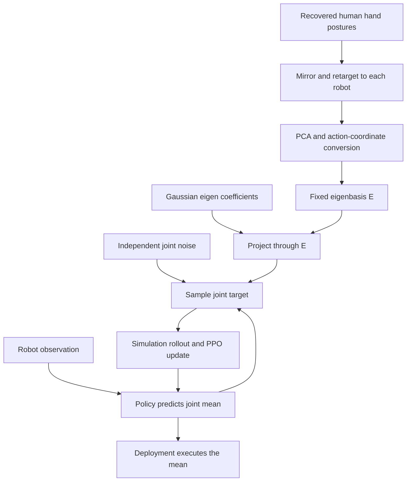
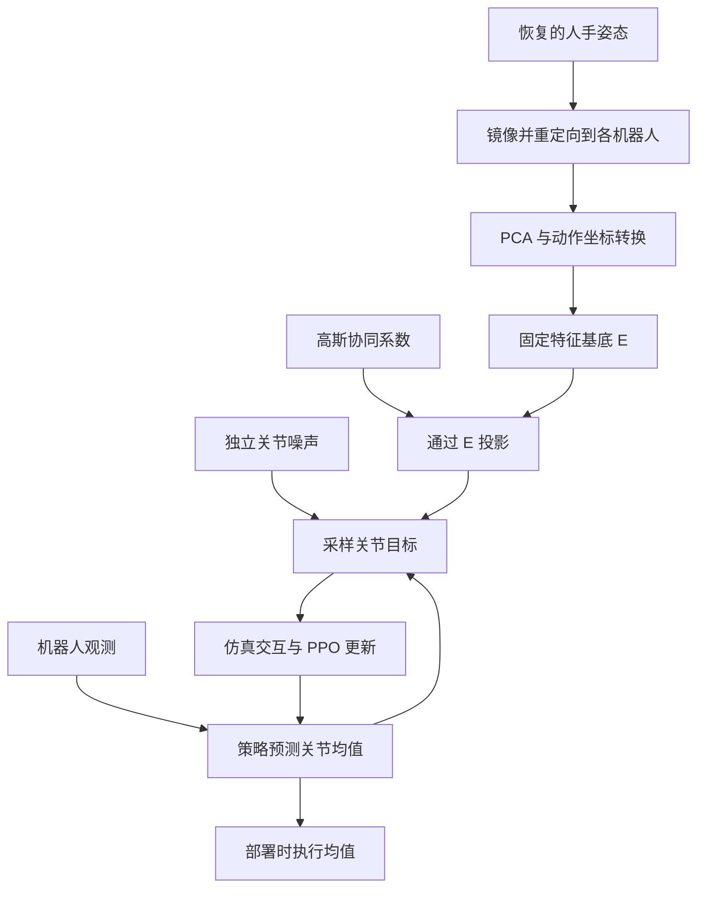

This post supports **English / 中文** switching via the site language toggle in the top navigation.

## TL;DR

A hand policy can output every joint angle and still spend most of training failing to discover a useful grasp. Independent Gaussian noise rarely moves several fingers together in a productive way. **EigenDEXplore** uses principal components of retargeted human hand postures to correlate those perturbations. The policy continues to command every robot joint; the human prior shapes which nearby actions training tries.

The central design is a Gaussian with **diagonal plus low-rank covariance**. Independent noise preserves exploration outside the human subspace, while projected PCA noise makes coordinated movements more likely. Experiments span reinforcement learning, trajectory optimization, six hand embodiments, and two real-robot setups. The gains are strongest when the hand has many degrees of freedom and the training system supplies less contact guidance.

## Paper and sources

**EigenDEXplore: Structured Exploration for Dexterous Manipulation with Human Priors**, by **Harsh Gupta, Tyler Ga Wei Lum, Changhao Wang, Chuer Pan, C. Karen Liu, Jeannette Bohg, and Shuran Song**, Stanford University. Gupta and Lum contributed equally. These notes follow the October 6, 2026 preprint, [arXiv:2610.07681v1](https://arxiv.org/abs/2610.07681v1), including its appendices. See the [PDF](https://arxiv.org/pdf/2610.07681v1), [project page](https://eigendexplore.github.io/), and [official code](https://github.com/hgupt3/eigendexplore). All experimental results below are author-reported; the algebraic explanations and practical judgments are my reading of the method.

## 1. Separate the action mean from the exploration distribution

A low-dimensional action space bundles joint movements into reusable synergies. This helps a hand find grasps, but the same restriction can obstruct the unusual finger configurations needed to turn a large cube or adjust a tool. Adding joint commands alongside synergy commands restores expressivity at the cost of redundant coordinates.

The paper separates these effects using four formulations. Let $d$ be the number of hand joints and $k$ the number of retained principal components. The rows of $E\in\mathbb R^{k\times d}$ contain the human-derived directions expressed in normalized robot action coordinates. Define independent perturbations

$$
\epsilon_q=\sigma_q\odot\eta_q,\qquad
\epsilon_e=\sigma_e\odot\eta_e,\qquad
\eta_q\sim\mathcal N(0,I_d),\quad\eta_e\sim\mathcal N(0,I_k).
$$

The sampled command $q^\star$ is an absolute joint-position target in normalized coordinates:

| Formulation | Sampled target $q^\star$ | Command dimensions | Consequence |
|---|---|---:|---|
| Joint-Space | $a_q+\epsilon_q$ | $d$ | Full joint control; independent exploration |
| Eigen-Space | $E^\top(a_e+\epsilon_e)$ | $k$ | Commands confined to the retained subspace |
| Eigen-Residual | $a_q+\epsilon_q+E^\top(a_e+\epsilon_e)$ | $d+k$ | Full control with redundant mean coordinates |
| EigenDEXplore | $a_q+\epsilon_q+E^\top\epsilon_e$ | $d$ | Full control with correlated exploration |

For Sharpa, $d=22$ and the default prior retains $k=9$ components. EigenDEXplore still predicts 22 joint targets. Eigen-Residual predicts 31 command coordinates.

The redundancy has a concrete algebraic form: changing $a_e$ by any vector $v$ and changing $a_q$ by $-E^\top v$ leaves the combined mean unchanged. EigenDEXplore removes this ambiguity from the mean parameterization while retaining the two noise sources. The paper's comparisons are consistent with a cost to redundancy, although they do not establish that this ambiguity alone causes the performance difference.

## 2. Build the prior in the robot's coordinates

Human hand postures are pooled across left and right hands by mirroring one side into a shared coordinate frame. Kinematic retargeting then maps them to each robot using embodiment-specific alignment, scaling, and finger correspondences. PCA is fitted to the retargeted joint angles, so each robot receives its own basis.

The authors retain enough components to explain **90% of the posture variance**. This gives nine components for Sharpa's 22 joints, ten for Allegro's 16 joints, and six for XHand's 12 joints. The resulting directions are converted into the policy's action coordinates, where joint limits define the interval $[-1,1]$.

The main prior uses EgoSuite. The paper describes that source as 100k hours of egocentric video covering more than 15k tasks; these are dataset-scale figures, not a reported count of postures actually fitted by PCA. The mechanism needs recovered hand motion and robot retargeting. It does not consume raw RGB videos directly during policy training.

An eigenvalue $\lambda_i$ measures the posture variance along component $i$. Initial eigen-noise scales satisfy $\sigma_{e,i}\propto\sqrt{\lambda_i}$. The authors then rescale both noise branches so that their initial total variance, summed over robot joints, matches the Joint-Space baseline, with half assigned to each branch. This control matters: the comparison changes the shape of exploration without simply increasing its total initial variance.

## 3. PPO must use the correlated density

For observation $o$, the actor predicts $\mu_q=\pi_\theta(o)$. Adding the independent Gaussian terms gives the distribution in the paper's Eq. (2):

$$
q^\star\sim\mathcal N(\mu_q,\Sigma),\qquad
\boxed{\Sigma=\operatorname{diag}(\sigma_q^2)
+E^\top\operatorname{diag}(\sigma_e^2)E.}
$$

The second term has rank at most $k$ and can introduce off-diagonal covariance between joints. For two different joints $i,j$, its contribution is $\sum_{\ell=1}^k\sigma_{e,\ell}^2 E_{\ell i}E_{\ell j}$. A shared PCA direction can therefore encourage fingers to move together or in opposite directions. With strictly positive joint-noise scales, the first term makes the total covariance positive definite, preserving support throughout the joint action space before clipping.

PPO learns the actor and both sets of standard deviations; $E$ stays fixed. The likelihood ratio and entropy must use this same multivariate distribution. From the stated Gaussian, the log density is

$$
\log\pi_\theta(q^\star\mid o)
=-\frac12\left[
(q^\star-\mu_q)^\top\Sigma^{-1}(q^\star-\mu_q)
+\log\det\Sigma+d\log(2\pi)\right].
$$

This is a useful implementation boundary. Sampling correlated actions and then computing PPO probabilities with the old diagonal Gaussian gives a mismatched likelihood ratio. The official repository likewise instructs users to use the new distribution for log probabilities, entropy, and KL, and to store raw, unclamped samples in the rollout buffer. Joint ordering and coordinate scaling also have to match the fitted basis. See the [integration instructions](https://github.com/hgupt3/eigendexplore#use-it-in-your-own-environment).

After RL training, deployment executes $\mu_q$ deterministically. The eigenbasis and noise parameters can be removed from that policy's deployment path. Their effect survives in the policy learned from the different training rollouts.

## 4. The same perturbations work in trajectory optimization

In SPIDER, a candidate is a sequence of joint targets. EigenDEXplore perturbs the current sequence with the same joint-plus-eigen noise, evaluates candidates in simulation, and retains the lowest-cost 10%. Each target is updated by their weighted perturbation:

$$
q_t\leftarrow q_t+\sum_{j\in\mathcal S}w_j
\left[\sigma_q\odot\eta_{q,t}^{(j)}
+E^\top(\sigma_e\odot\eta_{e,t}^{(j)})\right],
\qquad \sum_{j\in\mathcal S}w_j=1.
$$

Lower-cost candidates receive larger weights. SPIDER's noise schedule scales the perturbations, while the base $\sigma_q,\sigma_e$ remain fixed. This experiment tests the sampling distribution without learned noise scales. The basis remains necessary while the optimizer samples trajectories; the earlier deployment simplification applies to a trained deterministic RL actor.

## 5. Results depend on what the training system already supplies

The following table preserves the different metrics and budgets. Consecutive successes count successive pose goals within a run; they are not percentages of successful episodes. The comparisons are from Sections 4.1–4.5 of the [paper](https://arxiv.org/pdf/2610.07681v1).

| Setting | Protocol and metric | Joint-Space → EigenDEXplore |
|---|---|---|
| SimToolReal, simulation | Sharpa; 9B frames; five seeds; consecutive successes | 7.9 → 10.6, about +34% |
| SimToolReal, extended | 60B total frames; one selected run per method; consecutive successes | 4.9 → 14.1 |
| DeXtreme, simulation | Allegro; 2B frames; five seeds; evaluation at shared DR level −0.5 | 8.8 → 12.3 consecutive successes |
| DexMachina, Allegro box | Task reward only; about 2B frames; five seeds | 0.46 → 0.80 object-tracking ADD-AUC |
| SPIDER | Six hands; ten tasks; ten seeds per task; final retargeting cost | About 16% lower on average across hands |
| SimToolReal, hardware | Four tool tasks; ten trials per object–trajectory combination | 33% → 82% mean task progress |
| DeXtreme, hardware | One 2B-frame policy per method; 40 trials each | 8.45 → 11.90 consecutive successes |

The extended SimToolReal experiment tightens goal tolerance from 6 cm / 50° toward 1 cm / 8°. Each method continues its median run from the 9B-frame comparison; each extension takes roughly a week. Eigen-Residual reaches 12.0 consecutive successes, below EigenDEXplore's 14.1. Eigen-Space loses its early advantage as finer manipulation becomes necessary. The large final gap is encouraging, but its one-run-per-method protocol gives less evidence about training variability than the five-seed early comparison.

DexMachina provides a useful boundary on the claim. With its full contact and motion rewards plus a virtual-controller curriculum, the methods perform similarly in most settings. Removing that assistance and keeping object-tracking reward exposes larger gains on Allegro and XHand. The demonstration still specifies the reference object motion. “Task reward only” here does not mean learning without a reference trajectory.

SPIDER shows a related pattern: cost reductions are 25.4% for Sharpa, 31.2% for Wuji, 21.5% for Allegro, 14.3% for XHand, 3.5% for Schunk, and 0.4% for Inspire. Benefits are concentrated on the higher-DoF embodiments, without a strictly monotonic relationship to joint count.

On hardware, SimToolReal measures the fraction of demonstrated tool-pose waypoints reached in hammering, wiping, scooping, and brushing. Thus **82% task progress is a partial-trajectory metric**. The authors observe a more stable fingertip grasp and smoother in-hand reorientation with EigenDEXplore. The DeXtreme evaluation ends when the cube drops or remains stuck for more than 80 seconds; its longest run rises from 32 to 41 goals.

## 6. The ablations constrain the explanation

All three tested human priors improve 9B-frame SimToolReal performance: GRAB gives 9.4 consecutive successes, ARCTIC 9.8, and EgoSuite 10.6, against 7.9 for Joint-Space. This favors EgoSuite in the reported setting. Dataset scale, task coverage, and acquisition method vary together, so the result does not isolate scale as the cause.

The retained-variance sweep on Sharpa is more directly diagnostic. With eigen noise alone, retaining 50% of posture variance gives a SPIDER cost of 0.126, worse than Joint-Space's 0.089. Combining joint noise with eigen noise reaches 0.066 at 90% retention. Independent exploration supplies directions that a narrow human subspace omits. The selected 90% threshold is supported by these experiments; it is not a universal optimum for every robot and task.

Appendix B.2 replaces the human directions with random orthonormal directions while preserving the eigenvalue spectrum. Those variants perform worse than Joint-Space, both with and without the added joint-noise branch. Arbitrary correlation is therefore insufficient in this test: the orientation of the noise relative to useful hand coordination matters.

## 7. What I would carry into an existing dexterous RL system

I would try this intervention when an expressive joint-space actor struggles to discover contact, especially on a high-DoF hand with limited reward shaping. It changes a relatively small part of the learning system and leaves a conventional deterministic actor for deployment. If a strong contact curriculum already solves exploration, the DexMachina comparison suggests a smaller return.

The main limits follow from the prior. It is fixed, linear, and dependent on retargeting quality. Missing coordination patterns and nonlinear synergies have to be found through the independent noise branch. The reported training still uses billions of simulation frames, and the hardware studies cover specific tool and cube tasks.

The paper also draws fresh noise at every timestep, so its prior captures coordination across joints without learning temporal structure. As checked on October 12, 2026, the [official README](https://github.com/hgupt3/eigendexplore#correlated-eigen-noise) describes an optional temporally correlated extension and explicitly labels it outside the paper; the benchmark setting uses `correlation=0`. A careful reproduction should establish that setting first, then test whether persistent synergy noise helps the contact transitions of interest.

本文支持通过顶部导航栏的语言按钮进行 **English / 中文** 切换。

## 核心概括

一个策略即使能输出灵巧手的全部关节角，也可能在训练中长时间找不到有效抓取。逐关节独立的高斯扰动，很难恰好让多个手指形成有用的配合。**EigenDEXplore** 对重定向后的人手姿态做 PCA，用主成分方向构造相关探索噪声。策略仍然直接控制每个机器人关节，人类先验则改变训练时更容易尝试哪些邻近动作。

方法的核心是一个具有**对角项加低秩项协方差**的高斯分布。独立关节噪声保留对人手子空间之外的探索，PCA 投影噪声提高采样到协同动作的概率。实验涵盖强化学习、轨迹优化、六种灵巧手和两套真实机器人系统；在自由度较高、接触奖励与课程辅助较少时，收益更明显。

## 论文与来源

**EigenDEXplore: Structured Exploration for Dexterous Manipulation with Human Priors**，作者为斯坦福大学的 **Harsh Gupta、Tyler Ga Wei Lum、Changhao Wang、Chuer Pan、C. Karen Liu、Jeannette Bohg 和 Shuran Song**，前两位为共同第一作者。本文依据 2026 年 10 月 6 日发布的预印本 [arXiv:2610.07681v1](https://arxiv.org/abs/2610.07681v1) 及其附录。相关资料包括 [论文 PDF](https://arxiv.org/pdf/2610.07681v1)、[项目主页](https://eigendexplore.github.io/) 和 [官方代码](https://github.com/hgupt3/eigendexplore)。下文实验数据均为作者报告；代数解释和实践判断是我对方法的理解。

## 1. 把动作均值与探索分布分开

低维动作空间把多个关节的运动组合成可复用的协同模式，有助于发现抓取动作。但转动大方块、精细调整工具时，机器人可能需要偏离常见人手姿态的关节组合。同时输出关节命令与协同系数可以恢复表达能力，也会引入冗余坐标。

论文用四种形式拆解这些因素。设灵巧手有 $d$ 个关节，保留 $k$ 个主成分；$E\in\mathbb R^{k\times d}$ 的每一行对应一个转换到归一化机器人动作坐标中的人手协同方向。定义两组独立扰动：

$$
\epsilon_q=\sigma_q\odot\eta_q,\qquad
\epsilon_e=\sigma_e\odot\eta_e,\qquad
\eta_q\sim\mathcal N(0,I_d),\quad\eta_e\sim\mathcal N(0,I_k).
$$

采样得到的 $q^\star$ 表示归一化坐标下的绝对关节位置目标：

| 形式 | 采样目标 $q^\star$ | 命令维度 | 特点 |
|---|---|---:|---|
| Joint-Space | $a_q+\epsilon_q$ | $d$ | 完整关节控制，独立探索 |
| Eigen-Space | $E^\top(a_e+\epsilon_e)$ | $k$ | 命令受限于保留的子空间 |
| Eigen-Residual | $a_q+\epsilon_q+E^\top(a_e+\epsilon_e)$ | $d+k$ | 表达完整，但均值坐标存在冗余 |
| EigenDEXplore | $a_q+\epsilon_q+E^\top\epsilon_e$ | $d$ | 完整关节控制，相关探索 |

以 Sharpa 为例，$d=22$，默认先验保留 $k=9$ 个主成分。EigenDEXplore 仍然预测 22 个关节目标，Eigen-Residual 则预测 31 个命令坐标。

冗余可以直接从公式看出来：给 $a_e$ 加上任意向量 $v$，同时给 $a_q$ 减去 $E^\top v$，合成后的均值完全相同。EigenDEXplore 从均值参数化中移除了这种歧义，同时保留两种噪声。论文结果与“冗余增加学习困难”的解释一致，但还不能把性能差距完全归因于这一代数性质。

## 2. 在机器人坐标中建立人手先验

首先将一侧人手镜像到另一侧的坐标系，合并左右手姿态。随后通过运动学重定向，结合每种手的对齐方式、尺度与手指对应关系，得到机器人关节角，再对这些关节角做 PCA。因此，每种机器人都有自己的基底。

作者默认保留能够解释 **90% 姿态方差**的主成分：Sharpa 的 22 个关节对应 9 个主成分，Allegro 的 16 个关节对应 10 个，XHand 的 12 个关节对应 6 个。这些方向随后被转换到策略使用的动作坐标；每个关节按限位归一化到 $[-1,1]$。

主实验使用 EgoSuite 先验。论文将该数据源描述为覆盖超过 15k 个任务、包含 100k 小时第一视角视频；这些数字表示数据集规模，不能直接当作实际用于拟合 PCA 的姿态样本数量。方法需要先恢复人手运动并重定向到机器人，策略训练期间不直接处理这些原始 RGB 视频。

特征值 $\lambda_i$ 表示第 $i$ 个方向上的姿态方差，初始噪声标准差满足 $\sigma_{e,i}\propto\sqrt{\lambda_i}$。随后对两类噪声重新缩放，使初始噪声在所有机器人关节上的总方差与 Joint-Space 相同，两个分支各占一半。这样比较的是探索分布的形状，避免把更大的初始噪声幅度混入解释。

## 3. PPO 必须使用相关高斯的概率密度

给定观测 $o$，actor 输出 $\mu_q=\pi_\theta(o)$。两组独立高斯扰动相加后，得到论文公式 (2)：

$$
q^\star\sim\mathcal N(\mu_q,\Sigma),\qquad
\boxed{\Sigma=\operatorname{diag}(\sigma_q^2)
+E^\top\operatorname{diag}(\sigma_e^2)E.}
$$

第二项的秩至多为 $k$，能够在不同关节之间引入非对角协方差。对关节 $i,j$，其贡献为 $\sum_{\ell=1}^k\sigma_{e,\ell}^2E_{\ell i}E_{\ell j}$，因此同一个主成分可以鼓励多个手指同向或反向运动。只要各关节噪声标准差严格为正，第一项就能保证总协方差正定，在动作裁剪前覆盖整个关节动作空间。

PPO 同时学习 actor 参数与两组噪声标准差，$E$ 保持固定。概率比和熵也必须使用这个多元分布。由上述高斯分布可得：

$$
\log\pi_\theta(q^\star\mid o)
=-\frac12\left[
(q^\star-\mu_q)^\top\Sigma^{-1}(q^\star-\mu_q)
+\log\det\Sigma+d\log(2\pi)\right].
$$

这是实现时容易出错的地方：如果采样用了相关噪声，PPO 却继续用原来的对角高斯计算概率，就会产生不匹配的概率比。官方仓库也要求对数概率、熵和 KL 使用新的分布，并在 rollout buffer 中保存未经裁剪的原始采样动作。关节顺序和坐标缩放也必须与基底一致，参见 [接入说明](https://github.com/hgupt3/eigendexplore#use-it-in-your-own-environment)。

RL 训练完成后，部署时确定性执行 $\mu_q$，可以从策略部署路径中移除特征基底和探索参数。它们的作用已经通过训练期间不同的交互轨迹进入了最终策略。

## 4. 同样的扰动也可用于轨迹优化

在 SPIDER 中，每个候选解是一段关节目标序列。EigenDEXplore 用相同的关节噪声与特征方向噪声扰动当前序列，在仿真中评估候选轨迹，并保留代价最低的 10%。各时刻目标按这些候选的加权扰动更新：

$$
q_t\leftarrow q_t+\sum_{j\in\mathcal S}w_j
\left[\sigma_q\odot\eta_{q,t}^{(j)}
+E^\top(\sigma_e\odot\eta_{e,t}^{(j)})\right],
\qquad \sum_{j\in\mathcal S}w_j=1.
$$

代价较低的候选获得更高权重。扰动沿用 SPIDER 的噪声调度，基础尺度 $\sigma_q,\sigma_e$ 固定，因此这个实验可以检验采样分布本身的收益，排除噪声尺度学习的影响。只要优化器还在采样轨迹，就仍然需要基底；前文移除基底的部署方式适用于已经训练好的确定性 RL actor。

## 5. 收益取决于训练系统已经提供多少帮助

下面保留各实验的指标定义与预算。连续成功次数表示单次运行中依次完成的位姿目标数，与回合成功率不同。数据来自 [论文](https://arxiv.org/pdf/2610.07681v1) 第 4.1–4.5 节。

| 场景 | 条件与指标 | Joint-Space → EigenDEXplore |
|---|---|---|
| SimToolReal 仿真 | Sharpa；9B 帧；五个种子；连续成功次数 | 7.9 → 10.6，约提升 34% |
| SimToolReal 延长训练 | 总计 60B 帧；每种方法延续一个选定运行；连续成功次数 | 4.9 → 14.1 |
| DeXtreme 仿真 | Allegro；2B 帧；五个种子；统一 DR level −0.5 评估 | 连续成功次数 8.8 → 12.3 |
| DexMachina，Allegro 盒子任务 | 仅任务奖励；约 2B 帧；五个种子 | 物体跟踪 ADD-AUC 0.46 → 0.80 |
| SPIDER | 六种手；十个任务；每任务十个种子；最终重定向代价 | 跨手型平均降低约 16% |
| SimToolReal 真机 | 四类工具任务；每种物体与轨迹组合十次试验 | 平均任务进度 33% → 82% |
| DeXtreme 真机 | 每种方法一个训练 2B 帧的策略；各 40 次试验 | 连续成功次数 8.45 → 11.90 |

SimToolReal 的延长训练将目标容差从 6 cm / 50° 逐步收紧至 1 cm / 8°。每种方法选择其 9B 帧实验中表现居中的一次运行继续训练，每次延长训练约需一周。Eigen-Residual 最终达到 12.0 次连续成功，EigenDEXplore 为 14.1 次；Eigen-Space 则随着操作精度要求提高而失去早期优势。最终差距很大，但每种方法只有一次延长运行，对训练波动的证据弱于早期五种子对比。

DexMachina 揭示了收益的边界。完整设置提供接触奖励、运动奖励和虚拟控制器课程，两种方法在大多数配置中表现接近。移除这些辅助、仅保留物体跟踪奖励后，Allegro 与 XHand 的收益明显增大。此时演示仍然提供参考物体运动，因此“仅任务奖励”仍然依赖参考轨迹。

SPIDER 中也有类似趋势：Sharpa、Wuji、Allegro、XHand、Schunk、Inspire 的代价分别降低 25.4%、31.2%、21.5%、14.3%、3.5% 和 0.4%。收益集中在高自由度手型，但并不随关节数量严格单调变化。

真机 SimToolReal 在敲击、擦拭、舀取和刷拭任务中，统计到达的工具位姿航点占演示全部航点的比例。因此 **82% 任务进度允许一条轨迹只完成一部分**。作者观察到 EigenDEXplore 学出了更稳定的指腹抓取与更平顺的手内重定向。DeXtreme 真机试验在方块掉落或卡住超过 80 秒时结束，最长一次运行完成的目标数从 32 增至 41。

## 6. 消融实验进一步限定了原因

在 9B 帧 SimToolReal 实验中，三种人手先验都优于 Joint-Space 的 7.9 次连续成功：GRAB 为 9.4，ARCTIC 为 9.8，EgoSuite 为 10.6。这支持在该设置中使用 EgoSuite。不过，各数据源的规模、任务覆盖和采集方式同时变化，无法据此把收益单独归因于数据规模。

Sharpa 上的保留方差扫描更直接。只使用特征方向噪声、仅保留 50% 姿态方差时，SPIDER 代价为 0.126，差于 Joint-Space 的 0.089；加入独立关节噪声并保留 90% 方差后，代价降至 0.066。独立探索补充了狭窄人手子空间遗漏的方向。90% 是这些实验支持的默认值，还不能视为所有机器人和任务的最优阈值。

附录 B.2 保持特征值谱不变，将人手方向替换为随机正交方向。无论是否同时加入关节噪声，随机方向版本都差于 Joint-Space。这说明在该实验中，仅引入相关性还不够，噪声方向与有效手指协同之间的对应关系才有帮助。

## 7. 我会怎样把它用于现有灵巧操作 RL 系统

如果一个具有完整关节表达能力的 actor 很难发现有效接触，尤其是高自由度手、奖励塑形较少的设置，我会优先尝试这个改动。它集中修改训练中的动作分布，部署仍使用常规的确定性 actor。若现有接触课程已经解决了探索困难，DexMachina 的结果提示收益可能较小。

主要限制来自先验本身：固定的线性基底依赖重定向质量，缺失的协同模式与非线性配合仍需独立噪声探索。论文训练预算依然达到数十亿仿真帧，真机验证也集中在特定工具与方块任务。

论文每个时刻都重新采样噪声，因此先验描述关节之间的协同，没有学习时间结构。截至 2026 年 10 月 12 日，[官方 README](https://github.com/hgupt3/eigendexplore#correlated-eigen-noise) 已提供可选的时间相关扩展，并明确注明其不属于论文方法；论文基准配置使用 `correlation=0`。复现时应先建立这个基线，再单独检验持续的协同噪声是否改善所关注的接触切换过程。

