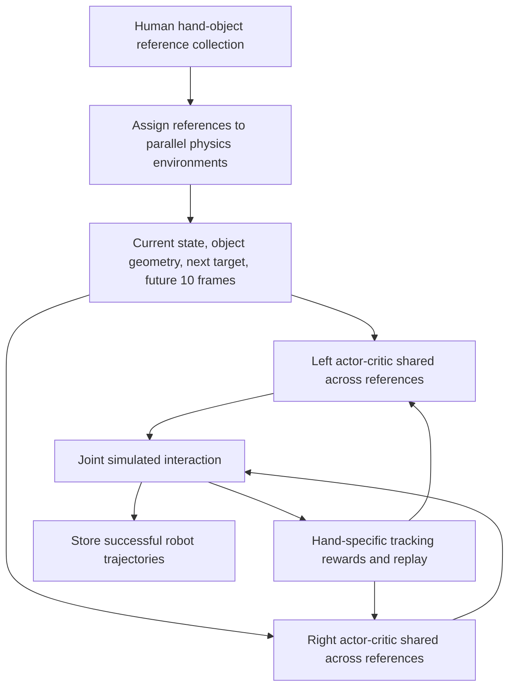
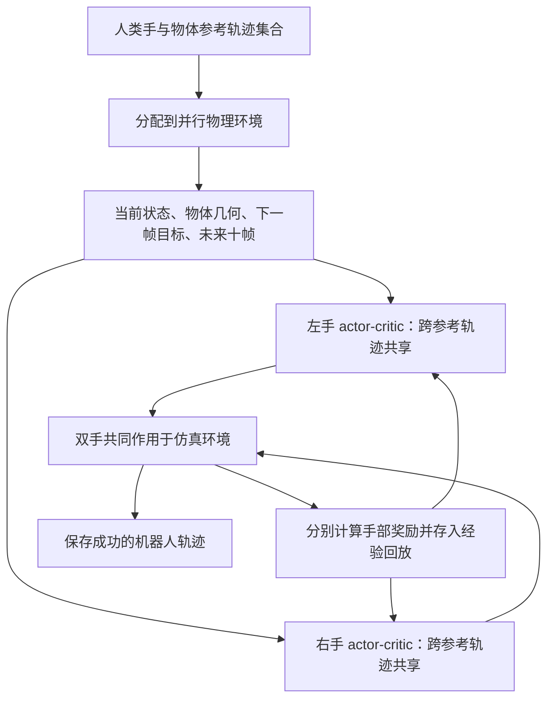

This post supports **English / 中文** switching via the site language toggle in the top navigation.

## TL;DR

Converting a human manipulation dataset into robot trajectories becomes expensive when every demonstration needs its own optimization run. **FlashDexRetarget trains across many reference motions at once**, sharing experience while conditioning on object geometry and upcoming motion. Its implementation uses separate left- and right-hand actor–critic pairs, with each pair shared across the reference collection.

On 50 motions with XHand, the paper reports **90% success under SR_SPIDER at 29 GPU-hours**, compared with CHORD's 46% at 2,847 GPU-hours. Under the stricter object-tracking metric SR_MT-Obj, the corresponding results are 86% and 2%. The practical contribution is the throughput of converting a known reference collection into usable trajectories. The experiments do not establish zero-shot retargeting of unseen demonstrations.

## Paper and source version

**Kyungmin Lee, Sibeen Kim, Dongyoon Hwang, Yoonsang Oh, Donghu Kim, Youngdo Lee, I Made Aswin Nahrendra, Jaegul Choo, and Hojoon Lee**, KAIST AI and Holiday Robotics. These notes follow [arXiv:2610.01849v2](https://arxiv.org/abs/2610.01849v2), revised October 4, 2026, especially Sections III–IV and Table I. See the [PDF](https://arxiv.org/pdf/2610.01849v2), [official project page](https://holiday-robot.github.io/FlashDexRetarget/), and [official implementation](https://github.com/Holiday-Robot/FlashDexRetarget). The paper is treated here as an arXiv preprint; results below are author-reported.

## 1. Share optimization across reference motions

Each demonstration contains human hand states and object poses over time. During training, different references are assigned to parallel physics environments. A reference-conditioned controller observes the simulated interaction, tracks the next reference state, and receives an encoding of the next ten reference frames. Successful rollouts are saved as robot data.

Using $i$ for the selected reference and $h$ for the hand, the controller can be summarized as

$$
a_t^h\sim\pi_{\theta_h}(\cdot\mid s_{i,t}),
\qquad a_t=[a_t^{\mathrm{left}};a_t^{\mathrm{right}}],
\qquad h\in\{\mathrm{left},\mathrm{right}\}.
$$

The parameters $\theta_h$ are reused across all reference motions. Both hands receive the full observation, including the other hand's state, but each actor emits its own hand's action and each actor–critic pair learns from its own reward. This preserves information needed for coordination while separating the learning signals for roles such as holding a container and manipulating a tool. “Single policy” in the paper therefore means a shared controller across demonstrations, implemented with two hand-specific agents.

## 2. Geometry and future motion make the reference identifiable

The observation combines robot and object states with **128 sampled object-surface points**, represented at both the current simulated pose and the next reference pose. Geometry features are expressed in the wrist frame. Signed distances from the five fingertips and wrist to the object, together with surface normals, describe the local interaction. Distances are queried from a precomputed **$128^3$ SDF grid covering a 60 cm cube**, avoiding a mesh-distance calculation at every simulation step.

The future-motion input is

$$
z_{i,t+1}^{\mathrm{ref}}
=\operatorname{Enc}_{\psi}\!\left(x_{i,t+1:t+K}^{\mathrm{ref}}\right),
\qquad K=10,\qquad z^{\mathrm{ref}}\in\mathbb R^{128}.
$$

These future hand and object states are relative to the wrist frame at time $t$. The temporal encoder trains jointly with the actor and critic, and its latent supplements the explicit next-frame target. A single pose may occur before a lift, a rotation, or a release; the future window helps distinguish those continuations. The ablation removes this encoding while retaining the next reference frame and finds slower accumulation of successful conversions.

## 3. Two geometric rewards carry the interaction

For each hand, the reward combines object tracking, hand–object interaction, hand tracking, and regularization:

$$
r_t^h=w_{\mathrm{obj}}r_t^{\mathrm{obj},h}
+w_{\mathrm{int}}r_t^{\mathrm{int},h}
+w_{\mathrm{track}}r_t^{\mathrm{track},h}
+w_{\mathrm{reg}}r_t^{\mathrm{reg},h}.
$$

The object term measures how corresponding surface points move under the simulated and reference poses. First, object-frame points are scaled by the maximum radius:

$$
\widetilde p_m=\rho\frac{p_m}{\max_n\|p_n\|_2},
\qquad \rho=0.058\ \mathrm m.
$$

This scales the whole point set while preserving its shape. After transforming the points into the world frame under the two poses, let $\mathcal I_t^{(3)}$ index the three largest pointwise discrepancies. Suppressing the hand index, the reward is

$$
e_t^{\mathrm{obj}}=\frac13\sum_{m\in\mathcal I_t^{(3)}}
\left\|\widetilde P_{t+1,m}^{\mathrm{cur}}
-\widetilde P_{i,t+1,m}^{\mathrm{ref}}\right\|_2,
\qquad
r_t^{\mathrm{obj}}=\exp\!\left(-\frac{e_t^{\mathrm{obj}}}{0.1\ \mathrm m}\right).
$$

Translation and rotation now contribute through the same displacement unit. At the chosen radius, a 30° rotation can produce roughly 3 cm of surface-point displacement. Averaging the worst three discrepancies makes large local misalignments matter. The comparison uses corresponding sampled points; it does not perform a new nearest-neighbor point-cloud registration at each step.

The interaction reward addresses errors in reconstructed human contact. A fingertip that should touch an object may appear a small distance away. A binary contact label can miss that interaction, while exact distance matching would preserve the gap. FlashDexRetarget uses the demonstrated distance as a one-sided proximity target:

$$
\epsilon_{h,t}^{(f)}
=\max\!\left(0,d_{h,t}^{(f)}-d_{h,t}^{\mathrm{ref},(f)}\right),
\qquad
r_t^{\mathrm{int},h}=\frac15\sum_{f=1}^{5}
\exp\!\left(-\frac{\epsilon_{h,t}^{(f)}}{0.01\ \mathrm m}\right).
$$

Here $d^{(f)}$ is the robot fingertip's signed SDF distance, while $d^{\mathrm{ref},(f)}$ is the reference fingertip's unsigned distance to the nearest object-mesh vertex. The wrist contributes to the observation but is excluded from this reward. A robot fingertip receives maximal reward whenever its signed distance is no greater than the demonstrated gap. It can therefore move closer and establish contact.

For example, with a 5 mm reference gap, robot distances of 2 mm and 5 mm both receive a per-fingertip reward of 1; a 15 mm distance receives $e^{-1}$. This is an illustration of Equation (7), not an experimental result. It also exposes the term's boundary: a negative signed distance satisfies the inequality too. Physical contact handling and the rest of the objective remain necessary; this term alone is not a nonpenetration constraint.

The hand-tracking term rewards wrist translation, wrist rotation, and fingertip alignment, with a behavior-cloning term pulling commanded joints toward kinematic retargets. Regularization penalizes large actions and tracking failures. Timeouts and successful clip completion do not incur the failure penalty.

## 4. Experience reuse needs enough buffer and critic capacity

FlashDexRetarget adapts the off-policy learner **FlashSAC** to the broader state distribution created by many references. It enlarges the replay buffer from **10 million to 50 million transitions** and widens the critic's hidden dimension from **256 to 1,024**. Sharing training introduces a capacity problem: the replay must retain varied interactions, and the critic must estimate their values well enough to improve the policy.

The XHand ablation uses 300 million environment steps and cumulative SR_MT-Obj conversions:

| Training configuration | Approximate conversion success |
|---|---:|
| PPO in the multi-reference setting | Near 0% |
| Default FlashSAC | 34% |
| FlashSAC with 50M replay capacity | 60% |
| Larger replay and wider critic | 86% |

These are the approximate values described in Section IV-C. Equal environment-step budgets do not imply equal GPU-hours. The experiment supports the complete learning configuration for this setting; it does not isolate a universal advantage of one RL algorithm across tasks.

The geometry ablations also change multiple ingredients together. Removing point-cloud matching removes point-cloud observations and replaces the object reward with DexMachina's formulation. Removing the interaction reward also removes the distance observations. Their degradation therefore measures the contribution of each observation–reward package. It cannot be attributed solely to the reward equation.

## 5. Read success rates together with their thresholds

The main benchmark contains **25 single-object and 25 two-object motions** from HOT3D, TACO, and OakInk2. Inactive clips are excluded. Experiments use Isaac Sim and NVIDIA RTX 3090 GPUs; FlashDexRetarget receives 300 million environment steps for XHand and 400 million for Sharpa Wave Hand.

Table I reports the following results:

| Embodiment | Method | SR_SPIDER | SR_MT-Obj | SR_MT | GPU-hours |
|---|---|---:|---:|---:|---:|
| XHand | Do as I Do | 36% | 4% | 0% | 66 |
| XHand | DexMachina | 48% | 32% | 12% | 447 |
| XHand | CHORD | 46% | 2% | 0% | 2,847 |
| XHand | FlashDexRetarget | **90%** | **86%** | **86%** | **29** |
| Sharpa Wave Hand | Do as I Do | 64% | 10% | 10% | 62 |
| Sharpa Wave Hand | CHORD | 50% | 22% | 0% | 3,314 |
| Sharpa Wave Hand | FlashDexRetarget | **86%** | **80%** | **80%** | **44** |

**SR_MT-Obj** uses object position and rotation thresholds of **3 cm and 30°**. **SR_MT** additionally checks fingertip and hand-joint position errors against 6 cm and 8 cm thresholds. These latter quantities are positional errors, not angular joint limits. **SR_SPIDER** uses 10 cm and 0.5 rad object thresholds and averages object errors over active hands. That averaging can hide one object's error when another barely moves, so the authors use SR_MT-Obj for their component studies.

The headline comparison is specific: $2847/29\approx98.2$, with a **44-percentage-point** SR_SPIDER gain on XHand. Sharpa's compute ratio is $3314/44\approx75.3$, and its success gain is 36 points. The baseline CHORD uses its released PPO implementation; DexMachina is modified to initialize from random reference states. Those implementation choices belong with the comparison.

The paper measures **cumulative conversion**: once a qualifying rollout is saved, that reference counts as converted. Section IV-A defines this stored-rollout accounting using SR_MT-Obj, while Table I separately reports all three success metrics. The 90% SR_SPIDER result should therefore retain its metric label. None of these numbers should be read as the final policy's repeated-execution reliability. Single-reference compute sums all attempted motions, including unsuccessful runs; the multi-reference method uses a fixed training budget.

Object errors in Table I are also conditional on SR_SPIDER success. For XHand, FlashDexRetarget's mean position error is 10.95 mm versus CHORD's 55.70 mm, but mean rotation error is 0.25 rad versus 0.16 rad. Each mean is computed over that method's successful subset. Higher coverage and lower positional error do not imply superiority on every reported error metric.

## 6. More converted data, with deployment still to validate

The scaling study trains on 200, 500, and 1,000 references, each with a 600-million-step budget. Figure 6 compares successful conversions during the first 60 GPU-hours. Larger collections yield more successful trajectories within that compute window. This demonstrates improved conversion throughput; the plot does not establish a constant success percentage as dataset size grows or generalization to held-out motions.

Real-world evidence consists of replaying successful trajectories for wiping a board, pouring into a pan, and closing a lid. The paper provides qualitative executions without a trial-count success table. Its conclusion identifies dependence on relatively clean human trajectories, accurate object geometry, and privileged simulator state. Deployment from real observations, transfer to unseen motions or embodiments, and task-aware evaluation remain open.

I would use this method first as a dataset-conversion stage when object meshes and reconstructed trajectories are available. The one-sided distance reward is especially useful when small reconstruction gaps make contact labels unreliable. For noisier video reconstructions or closed-loop real-world deployment, the next decisive test would be repeated task completion under state-estimation errors. The current evidence is strongest for producing reference-conditioned robot data in simulation, with selected trajectories demonstrated on hardware.

本文支持通过顶部导航栏进行 **English / 中文** 切换。

## TL;DR

把人类操作数据转换为机器人轨迹时，如果每条示范都要单独优化，计算成本会随数据量累积。**FlashDexRetarget 在多条参考运动上联合训练**，通过物体几何和未来运动区分示范，并在示范之间复用经验。具体实现中，左右手各有一组 actor–critic，每组网络的参数在全部参考轨迹之间共享。

在包含 50 条运动的 XHand 实验中，论文报告 **29 GPU-hours 达到 90% 的 SR_SPIDER 成功率**；CHORD 为 2,847 GPU-hours、46%。采用更严格的物体跟踪指标 SR_MT-Obj 时，两者分别为 86% 和 2%。这项工作的实用价值在于提高已知参考集合的轨迹转换吞吐量，实验尚未证明对未见示范的零样本重定向能力。

## 论文与阅读版本

作者为 **Kyungmin Lee、Sibeen Kim、Dongyoon Hwang、Yoonsang Oh、Donghu Kim、Youngdo Lee、I Made Aswin Nahrendra、Jaegul Choo 和 Hojoon Lee**，来自 KAIST AI 与 Holiday Robotics。本文依据 2026 年 10 月 4 日修订的 [arXiv:2610.01849v2](https://arxiv.org/abs/2610.01849v2)，重点核对第三、四节和表 I。另见[论文 PDF](https://arxiv.org/pdf/2610.01849v2)、[官方项目页](https://holiday-robot.github.io/FlashDexRetarget/)和[官方实现](https://github.com/Holiday-Robot/FlashDexRetarget)。这里将论文视为 arXiv 预印本，下文实验数字均由作者报告。

## 1. 在多条参考运动之间共享优化过程

每条示范记录人手状态和物体位姿随时间的变化。训练时，不同参考轨迹被分配到并行物理环境；控制器观察当前仿真交互，跟踪下一帧参考状态，同时读取未来十帧参考运动的编码。成功 rollout 随后保存为机器人数据。

用 $i$ 表示选中的参考轨迹、$h$ 表示左右手，控制器可概括为

$$
a_t^h\sim\pi_{\theta_h}(\cdot\mid s_{i,t}),
\qquad a_t=[a_t^{\mathrm{left}};a_t^{\mathrm{right}}],
\qquad h\in\{\mathrm{left},\mathrm{right}\}.
$$

参数 $\theta_h$ 在全部参考运动间复用。两只手都能读取完整观测，包括另一只手的状态；每个 actor 只输出本手动作，每组 actor–critic 使用本手奖励学习。这样既保留双手协调所需的信息，也能区分“扶住容器”和“操作工具”等角色的学习信号。因此，论文中的“单一策略”指跨示范共享的控制器，其内部包含两个手部 agent。

## 2. 用几何和未来运动区分参考示范

观测包含机器人与物体状态，以及在当前仿真位姿和下一帧参考位姿下表示的 **128 个物体表面采样点**。几何特征在手腕坐标系下表达。五个指尖与手腕到物体的有符号距离，以及对应表面法向量，描述局部交互关系。距离通过预计算的 **$128^3$ SDF 网格查询，网格覆盖边长 60 cm 的立方体**，避免每个仿真步都直接计算网格表面距离。

未来运动输入为

$$
z_{i,t+1}^{\mathrm{ref}}
=\operatorname{Enc}_{\psi}\!\left(x_{i,t+1:t+K}^{\mathrm{ref}}\right),
\qquad K=10,\qquad z^{\mathrm{ref}}\in\mathbb R^{128}.
$$

未来的人手与物体状态都相对时刻 $t$ 的手腕坐标系表示。时间编码器与 actor、critic 联合训练，输出的 latent 补充显式的下一帧目标。同一个姿态可能出现在提起、旋转或松手之前，未来窗口帮助策略判断接下来的变化。消融保留下一帧参考、去掉未来编码后，成功转换轨迹的积累速度下降。

## 3. 用两个几何奖励约束交互

每只手的奖励由物体跟踪、手物交互、手部跟踪和正则项组成：

$$
r_t^h=w_{\mathrm{obj}}r_t^{\mathrm{obj},h}
+w_{\mathrm{int}}r_t^{\mathrm{int},h}
+w_{\mathrm{track}}r_t^{\mathrm{track},h}
+w_{\mathrm{reg}}r_t^{\mathrm{reg},h}.
$$

物体奖励比较同一组表面点在仿真位姿与参考位姿下的位置。先按最大半径缩放物体坐标系下的点集：

$$
\widetilde p_m=\rho\frac{p_m}{\max_n\|p_n\|_2},
\qquad \rho=0.058\ \mathrm m.
$$

这一步对点集整体缩放，保留形状。再用两种物体位姿将点变换到世界坐标系，令 $\mathcal I_t^{(3)}$ 表示误差最大的三个对应点索引。省略手部下标后，奖励为

$$
e_t^{\mathrm{obj}}=\frac13\sum_{m\in\mathcal I_t^{(3)}}
\left\|\widetilde P_{t+1,m}^{\mathrm{cur}}
-\widetilde P_{i,t+1,m}^{\mathrm{ref}}\right\|_2,
\qquad
r_t^{\mathrm{obj}}=\exp\!\left(-\frac{e_t^{\mathrm{obj}}}{0.1\ \mathrm m}\right).
$$

平移与旋转都通过表面点位移反映，误差具有统一的长度单位。在所选半径下，30° 旋转可以产生约 3 cm 的表面点位移。取最大三个误差的均值，会让局部较大的错位更明显。这里比较的是固定采样点的对应关系，不需要每步重新执行最近邻点云配准。

交互奖励处理人类接触重建中的间隙。实际接触的指尖可能被重建在物体表面之外，二值接触标签容易漏掉这类交互，而严格匹配距离会把间隙保留下来。FlashDexRetarget 将示范距离作为单侧接近目标：

$$
\epsilon_{h,t}^{(f)}
=\max\!\left(0,d_{h,t}^{(f)}-d_{h,t}^{\mathrm{ref},(f)}\right),
\qquad
r_t^{\mathrm{int},h}=\frac15\sum_{f=1}^{5}
\exp\!\left(-\frac{\epsilon_{h,t}^{(f)}}{0.01\ \mathrm m}\right).
$$

$d^{(f)}$ 是机器人指尖的有符号 SDF 距离，$d^{\mathrm{ref},(f)}$ 是参考指尖到物体网格最近顶点的无符号距离。手腕距离参与观测，但不参与这项奖励。只要机器人指尖的有符号距离不大于参考间隙，该指尖就获得最大奖励，因此机器人可以继续靠近并建立接触。

例如参考间隙为 5 mm 时，机器人距离为 2 mm 或 5 mm 都得到单指奖励 1；距离为 15 mm 时，奖励为 $e^{-1}$。这是对公式（7）的数值说明，并非实验结果。它也暴露了这项奖励的边界：负的有符号距离同样满足不等式。物理接触处理和其余目标仍然必要，这一项本身不构成防穿透约束。

手部跟踪项奖励手腕平移、旋转和指尖对齐，并通过行为克隆项让关节指令接近运动学重定向结果。正则项惩罚过大的动作和跟踪失败；超时或成功完成片段不会受到失败惩罚。

## 4. 经验复用需要足够的回放与 critic 容量

FlashDexRetarget 使用 off-policy 算法 **FlashSAC**，并针对多参考轨迹带来的更广状态分布扩展容量：回放缓冲区从 **1,000 万增至 5,000 万条 transition**，critic 隐藏层宽度从 **256 增至 1,024**。共享训练也带来了容量需求：回放要保留不同交互，critic 则需要准确估计这些经验的价值，才能持续改善策略。

XHand 消融使用 3 亿环境步，以累计 SR_MT-Obj 转换衡量效果：

| 训练配置 | 近似转换成功率 |
|---|---:|
| 多参考轨迹设定下的 PPO | 接近 0% |
| 默认 FlashSAC | 34% |
| FlashSAC，回放容量增至 5,000 万 | 60% |
| 更大回放容量与更宽 critic | 86% |

这些近似数字来自第四节 C 部分的文字说明。环境步数相同不代表 GPU-hours 相同。结果支持这套学习配置在当前设定中的作用，无法单独推出某个 RL 算法在所有任务上普遍占优。

几何消融也同时修改了多项输入。去掉点云匹配时，作者删除点云观测，并用 DexMachina 的物体奖励替换原奖励；去掉交互奖励时，也删除距离观测。因此，这些退化反映的是各组“观测加奖励”的贡献，无法完全归因于某个奖励公式。

## 5. 将成功率与阈值一起读

主基准从 HOT3D、TACO 和 OakInk2 中选出 **25 条单物体、25 条双物体运动**，排除了没有实际操作的静止片段。实验使用 Isaac Sim 和 NVIDIA RTX 3090 GPU；FlashDexRetarget 在 XHand 上训练 3 亿环境步，在 Sharpa Wave Hand 上训练 4 亿环境步。

论文表 I 的结果如下：

| 机器人手 | 方法 | SR_SPIDER | SR_MT-Obj | SR_MT | GPU-hours |
|---|---|---:|---:|---:|---:|
| XHand | Do as I Do | 36% | 4% | 0% | 66 |
| XHand | DexMachina | 48% | 32% | 12% | 447 |
| XHand | CHORD | 46% | 2% | 0% | 2,847 |
| XHand | FlashDexRetarget | **90%** | **86%** | **86%** | **29** |
| Sharpa Wave Hand | Do as I Do | 64% | 10% | 10% | 62 |
| Sharpa Wave Hand | CHORD | 50% | 22% | 0% | 3,314 |
| Sharpa Wave Hand | FlashDexRetarget | **86%** | **80%** | **80%** | **44** |

**SR_MT-Obj** 使用 **3 cm 和 30°** 的物体位置、旋转误差阈值。**SR_MT** 额外要求指尖与手部关节点位置误差分别满足 6 cm、8 cm 阈值；后两项是空间位置误差，不是关节角限制。**SR_SPIDER** 使用 10 cm 和 0.5 rad 的物体阈值，并在活跃手之间平均物体误差。如果一个物体几乎静止，这种平均可能掩盖另一个物体的误差，因此作者在组件消融中使用 SR_MT-Obj。

论文的核心计算对比对应 $2847/29\approx98.2$，以及 XHand 上 **44 个百分点**的 SR_SPIDER 提升。Sharpa 的计算比例为 $3314/44\approx75.3$，成功率提升 36 个百分点。基线 CHORD 使用公开的 PPO 实现，DexMachina 则被修改为从参考轨迹中的随机状态初始化；比较时也应保留这些实现条件。

论文关注**累计转换**：只要保存过一次符合条件的 rollout，该参考轨迹就计入已转换集合。第四节 A 部分用 SR_MT-Obj 定义保存成功轨迹的累计口径，表 I 则另外报告三种成功率，因此 90% 必须保留 SR_SPIDER 标签。这些数字不能直接理解为最终策略重复执行的可靠性。单参考方法的计算成本累加所有尝试，包括失败运行；多参考方法采用固定训练预算。

表 I 的物体误差也有条件：只在满足 SR_SPIDER 的成功轨迹上计算。XHand 上，FlashDexRetarget 的平均位置误差为 10.95 mm，CHORD 为 55.70 mm；平均旋转误差却分别为 0.25 rad 和 0.16 rad。每种方法的均值来自各自成功的子集。更高的覆盖率和更低的位置误差，并不意味着所有误差指标都更好。

## 6. 转换更多数据之后，还要验证部署

扩展实验分别使用 200、500、1,000 条参考轨迹，每组训练 6 亿环境步。图 6 比较前 60 GPU-hours 内成功转换的数量，更大的参考集合在同等计算窗口内产出更多成功轨迹。这支持转换吞吐量的改善；该图没有证明数据规模增加时成功百分比保持不变，也没有评估留出运动的泛化能力。

真实机器人验证回放了擦板、向锅中倾倒和合盖等成功轨迹。论文给出定性执行展示，没有包含试验次数的成功率表。结论明确指出，方法依赖相对干净的人类轨迹、准确物体几何和仿真特权状态。仅依赖真实观测的部署、未见运动或形态的迁移，以及任务层面的评估仍待研究。

我的判断是：在已有物体网格和重建轨迹时，可以优先把它作为数据集转换环节。单侧距离奖励尤其适合接触标签被小幅重建间隙破坏的情况。如果目标是处理更嘈杂的视频重建，或部署真实闭环策略，下一项有说服力的验证应是：加入状态估计误差后，机器人能否反复完成任务。目前证据最充分的范围，是在仿真中生成参考条件下的机器人数据，并将其中选出的轨迹展示于真实硬件。

