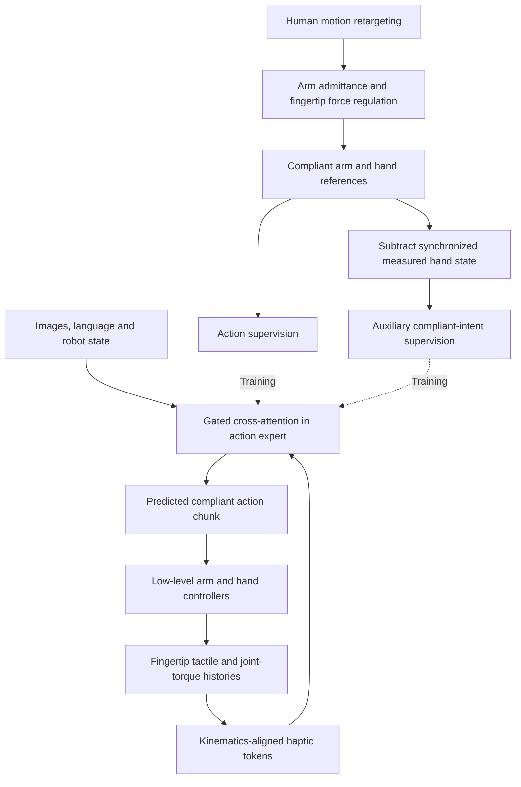
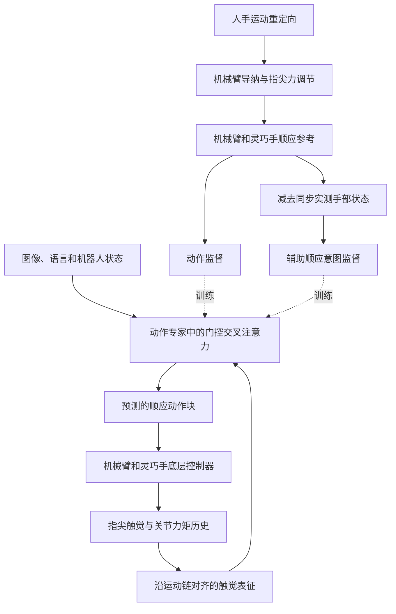

This post supports **English / 中文** switching via the site language toggle in the top navigation.

## TL;DR

A finger can stop against an object while its position command keeps moving. The measured joint configuration records the stopped finger; the command also carries the offset that produces contact force. This difference makes action labels a central problem in learning dexterous compliance.

**HACo** learns motion references produced by compliance-regulated teleoperation. It combines fingertip tactile sensing with joint-torque feedback, then lets the action model query those signals through gated cross-attention. An auxiliary target preserves the difference between the compliant command and the measured hand state. On five real bimanual tasks, the authors report **83% mean success versus 35% for T-Rex**, with 20 trials per task. The most useful contribution for reproduction is the explicit definition of what the policy should imitate under contact.

## Paper and source version

**HACo: Learning Haptic Active Compliance for Force-Aware Dexterous Manipulation** is by **Naisheng Ye, Yinzhe Zhou, Junkai Zhao, Yuhang Lu, Checheng Yu, Zhenjie Yang, Pengwei Wang, and Hongyang Li**, from the University of Hong Kong, Beijing Academy of Artificial Intelligence, and Johns Hopkins University. These notes follow the nine-page [arXiv:2609.36596v1 PDF](https://arxiv.org/pdf/2609.36596v1), submitted September 29, 2026. The [arXiv record](https://arxiv.org/abs/2609.36596v1) identifies it as a preprint; the [project page](https://opendrivelab.github.io/Haco-Page/) provides demonstrations. Experimental numbers below are author-reported.

## 1. Three hand configurations, three meanings

Consider sliding a second playing card into a hand that already holds one. Excessive normal force raises friction and blocks insertion; insufficient force loses the existing grasp. Visually similar finger poses can correspond to very different loads.

Section III distinguishes the following quantities:

| Quantity | Meaning | Role in learning |
|---|---|---|
| $q_t^{\mathrm{nom}}$ | Nominal command from human-motion retargeting | Preserves motion intent, but can encode excessive loading |
| $q_t^{\mathrm{obs}}$ | Measured hand configuration | Records realized motion, including motion blocked by contact |
| $q_t^{\mathrm{cmp}}$ | Reference after compliance regulation | Executable hand-action target |

Learning the next observed configuration alone omits the command offset that can maintain a grasp. Learning the nominal command can reproduce the operator's excessive pressure. HACo records the regulated reference and learns it directly. Its action is $a_t^{\mathrm{cmp}}=[x_t^{\mathrm{cmp}},q_t^{\mathrm{cmp}}]$, combining the arm end-effector reference and hand joint reference. The outputs go to the existing low-level controllers.

This gives “active compliance” a concrete meaning here: physical feedback changes the generated motion reference as contact evolves. The policy does not output a prescribed force trajectory or learned stiffness matrix.

## 2. Constructing compliant demonstrations

The demonstration system has a low-level position/impedance controller and an outer regulator that adjusts the operator's nominal references before execution. The arm and hand use different corrections ([PDF, Section III-A](https://arxiv.org/pdf/2609.36596v1)).

For the arm, only the part of the estimated end-effector wrench outside an admissible range drives the Cartesian admittance response:

$$
M_a\delta\ddot{x}_t=-D_a\delta\dot{x}_t-K_a\delta x_t-r_w(\hat w_t),
\qquad x_t^{\mathrm{cmp}}=x_t^{\mathrm{nom}}+\delta x_t.
$$

Here $r_w$ extracts the excess wrench; $M_a,D_a,K_a$ specify virtual mass, damping, and stiffness. When the wrench returns inside the admissible range, the forcing term vanishes and the displacement relaxes under those dynamics.

For each active fingertip, the measured force $f_{i,t}$ is clipped in magnitude, preserving its direction, to obtain $\bar f_{i,t}$. A virtual gain converts the requested unloading into a fingertip displacement:

$$
d_{i,t}=K_i^{-1}(\bar f_{i,t}-f_{i,t}).
$$

The hand then solves for a small, smooth joint correction:

$$
\begin{aligned}
\delta q_t^\star=\arg\min_{\delta q}\;&
\sum_i w_{i,t}\|J_{i,t}\delta q-d_{i,t}\|_2^2\\
&+\lambda_r\|\delta q\|_2^2
+\lambda_s\|\delta q-\delta q_{t-1}^\star\|_2^2,\\
q_t^{\mathrm{cmp}}&=q_t^{\mathrm{nom}}+\delta q_t^\star.
\end{aligned}
$$

$J_{i,t}$ maps joint displacement to fingertip displacement, and $w_{i,t}$ smoothly activates a contact's objective. Joint-position and update limits also constrain the optimization. The two regularizers discourage large corrections and abrupt changes between time steps. Because fingers are kinematically coupled, satisfying one contact can move other fingertips.

The paper explicitly treats $K_i$ as a **virtual gain**, without identifying the object's physical stiffness. This regulator supplies the training targets. Its thresholds and gains therefore shape the behavior available for imitation; recording extra tactile channels alone would not reconstruct that supervision.

## 3. Compliant intent is an auxiliary training target

HACo defines the time-aligned difference

$$
\Delta q_t^{\mathrm{ci}}=q_t^{\mathrm{cmp}}-q_t^{\mathrm{obs}}.
$$

This is distinct from the teleoperation correction $\delta q_t^\star=q_t^{\mathrm{cmp}}-q_t^{\mathrm{nom}}$. The correction measures how regulation changed the human command; compliant intent measures where the executable command lies relative to the actual hand.

Under sustained contact, the authors interpret $\Delta q_t^{\mathrm{ci}}$ as carrying force-regulating information. That interpretation has a condition: tracking lag, friction, and actuator dynamics can also contribute to command-state error. It should not be treated as a calibrated force measurement.

Training concatenates compliant-action and intent trajectories, normalized with separate dataset statistics:

$$
Y_1=[A^{\mathrm{cmp}};\Delta q^{\mathrm{ci}}],\qquad
Y_0\sim\mathcal N(0,I),
$$

$$
Y_s=(1-s)Y_0+sY_1,\qquad v^\star=Y_1-Y_0,
\qquad s\sim\mathcal U[0,1].
$$

Conditional flow matching trains a velocity predictor $v_\theta(Y_s,s,O_t)$ with action and intent losses:

$$
\mathcal L=
\mathbb E\|P_{\mathrm{act}}(v_\theta-v^\star)\|_2^2
+0.5\,\mathbb E\|P_{\mathrm{ci}}(v_\theta-v^\star)\|_2^2.
$$

The projections select the two channel groups; losses are averaged over valid time steps and channels. **Only the predicted compliant action is executed.** Adding the auxiliary intent to that action would alter the reference that the model was trained to produce.

HACo predicts 40-step chunks. Real-Time Chunking uses a sampled clean prefix of at most 12 steps during training, with losses on the remaining postfix. At inference, a 10-step prefix committed from the preceding chunk conditions the next chunk, whose continuation uses the latest observation. These are step counts; the paper does not establish a control frequency from which to convert them into milliseconds.

*Reading diagram of the paper's training and execution paths. The auxiliary intent branch supplies supervision; the executed output is the compliant action.*

## 4. Linking touch to the joints that carry its load

The platform provides ten fingertip tactile streams and 44 hand-joint torque measurements. Each finger's tactile encoder receives nine steps of wrench history plus the current $240\times240$ deformation map. Its torque encoder processes the nine-step history of joints on that finger's kinematic chain.

The two features are fused **within each finger first**. Hand and digit identity embeddings are added, then a Transformer exchanges information across the ten finger tokens. Validity masks handle unavailable measurements. This preserves the correspondence between a localized fingertip contact and the loading of its own joints before modeling coordinated grasping.

Joint torque broadens the available evidence, including loads from palm or phalange contacts outside fingertip coverage. It does not uniquely locate those contacts. The tactile stream supplies local contact structure; torque supplies a spatially ambiguous signature of transmitted load.

The Compliance Grounding Module (CGM) lets each adapted action layer query the resulting haptic memory $P_t$:

$$
C_t^l=\operatorname{Attn}\bigl(\operatorname{AdaLN}(Z^l,s),P_t,P_t;m_t\bigr),
\qquad \widetilde Z^l=Z^l+\tanh(\alpha_l)C_t^l.
$$

The residual gate $\alpha_l$ starts at zero, so this added branch initially preserves the pretrained computation. Fine-tuning learns how much haptic information to inject. Here $s$ is the flow time and $m_t$ masks unavailable haptic tokens ([PDF, Sections III-C–D](https://arxiv.org/pdf/2609.36596v1)).

## 5. What the experiments establish

Experiments use two UR5 arms with Sharpa hands, one ZED Mini egocentric camera, and two wrist-mounted RealSense D405 cameras. MANUS Metagloves Pro and VIVE Trackers capture the demonstrations. The authors collect **100 demonstrations per task** and train for 30,000 steps on four H100 GPUs, with global batch size 48 and seed 42. HACo starts from GR00T N1.7; its AdamW learning rate is $2\times10^{-5}$, with weight decay $10^{-5}$ and 5% warmup.

The following condenses [Table I](https://arxiv.org/pdf/2609.36596v1). Each task-method pair has 20 physical trials.

| Task | Main interaction demand | T-Rex | HACo |
|---|---|---:|---:|
| Insert poker cards | Friction across several contacts | 4/20 | 18/20 |
| Open book | Tangential force to separate pages | 6/20 | 17/20 |
| Draw on balloon | Contact on a fragile curved surface | 2/20 | 14/20 |
| Unscrew cap | Coordinated rotational torque | 12/20 | 19/20 |
| Squeeze toothpaste | Compression and dispensing | 11/20 | 15/20 |
| **Macro mean** | | **35%** | **83%** |

GR00T, GR00T + Tactile, and ViTacFormer average 15%, 22%, and 4%, respectively. The 83% versus 35% comparison is a **48-percentage-point** gain. These are complete policy comparisons: pretraining, architecture, and action supervision differ across methods, so the total gain cannot be assigned to one module.

The ablations are more informative about the mechanism:

| HACo variant | Mean success |
|---|---:|
| No haptic feedback | 27% |
| Torque feedback only | 45% |
| Fingertip tactile feedback only | 68% |
| Both modalities, without coupled encoding | 70% |
| Nominal action, without intent supervision | 59% |
| Compliant action, without intent supervision | 73% |
| CGM without its gate | 66% |
| **Full HACo** | **83%** |

Changing the action target raises success from 59% to 73% in the no-intent setting; adding intent supervision then reaches 83%. These are sequential comparisons, not independent additive effects. The authors also report **19% lower mean fingertip force over contact-active samples** for full HACo relative to the nominal-action variant. That aggregate supports reduced loading, but does not give peak-force bounds.

Direct visual-haptic fusion reaches 41%, and appending haptic features to the action sequence reaches 47%. Simply making haptic data available therefore falls short of the full design in this experiment. Removing wrist cameras gives 76%; tactile feedback helps with occluded contact while visual placement still matters.

## 6. Limits and a reproduction priority

The evidence covers five tasks on one bimanual platform. Each task's success rate moves by five percentage points when one of its 20 outcomes changes. Training uses one reported seed, and the tables provide no confidence intervals. The PDF does not establish transfer across hands, a stability guarantee under arbitrary contacts, or a maximum safe contact force.

The [project's failure examples](https://opendrivelab.github.io/Haco-Page/) help locate the remaining problems: poor thumb placement fails to separate pages; missed marker contact destabilizes a balloon; excessive pickup pressure lifts two cards together; nozzle misalignment dispenses toothpaste beside the brush. Success requires contact timing and visual alignment as well as load regulation.

The authors identify force-feedback teleoperation, learning beyond retargetable demonstrations, and dense whole-hand tactile coverage as open directions. Their current operator interface captures motion while the regulator adjusts loads, which limits the demonstration of deliberate human force strategies.

For a reproduction, I would first audit synchronized logs of $q^{\mathrm{nom}}$, $q^{\mathrm{cmp}}$, and $q^{\mathrm{obs}}$, then compare nominal and compliant labels with the same policy. That priority follows the 59% to 73% ablation. If those labels are already reliable, the next check is whether each fingertip's tactile features are paired with the correct joint chain. For deployment, I would add peak-force and contact-transition measurements: a successful rollout can still contain a brief load spike that the reported mean force hides.

本文支持 **English / 中文** 切换，可使用页面顶部导航栏的语言按钮。

## 一句话概括

手指接触物体后可能已经停止，位置指令却仍在向前。实测关节位置记录了停下来的手指，指令中还包含产生接触力的偏移。这让“接触时究竟应该模仿哪个动作”成为灵巧手顺应学习的核心问题。

**HACo** 学习经过顺应调节的遥操作指令，将指尖触觉与关节力矩结合，并通过带门控的交叉注意力接入动作模型。训练时，它额外监督顺应指令与实测手部状态的差值。在五项真实双手任务中，作者报告平均成功率为 **83%**，T-Rex 为 **35%**，每项任务各测试 20 次。对复现最有价值的部分，是论文明确规定了接触状态下动作标签的含义。

## 论文与阅读版本

**HACo: Learning Haptic Active Compliance for Force-Aware Dexterous Manipulation**，作者为 **Naisheng Ye、Yinzhe Zhou、Junkai Zhao、Yuhang Lu、Checheng Yu、Zhenjie Yang、Pengwei Wang 和 Hongyang Li**，来自香港大学、北京智源人工智能研究院和约翰斯·霍普金斯大学。本文依据 2026 年 9 月 29 日提交的九页 [arXiv:2609.36596v1 PDF](https://arxiv.org/pdf/2609.36596v1)。[arXiv 页面](https://arxiv.org/abs/2609.36596v1)提供版本信息，[项目主页](https://opendrivelab.github.io/Haco-Page/)包含演示视频。该版本为预印本，下文实验数据均由作者报告。

## 1. 三种手部构型，对应三种动作含义

以向已有握持中插入第二张扑克牌为例：法向压力太大，摩擦会阻碍插入；压力太小，原有握持又可能失稳。视觉上相近的手指姿态，可以对应很不一样的接触载荷。

论文第 III 节区分了三个量：

| 变量 | 含义 | 在学习中的作用 |
|---|---|---|
| $q_t^{\mathrm{nom}}$ | 人手运动重定向得到的名义指令 | 保留运动意图，但可能包含过大的加载 |
| $q_t^{\mathrm{obs}}$ | 手部实测关节构型 | 记录实际实现的运动，也反映接触造成的运动受阻 |
| $q_t^{\mathrm{cmp}}$ | 经过顺应调节的参考指令 | 作为可执行的手部动作标签 |

只学习下一时刻的实测构型，会遗漏维持握持所需的指令偏移；直接学习名义指令，则可能复现操作者施加的过大压力。HACo 记录并直接学习调节后的参考指令。完整动作为 $a_t^{\mathrm{cmp}}=[x_t^{\mathrm{cmp}},q_t^{\mathrm{cmp}}]$，分别包含机械臂末端参考与手部关节参考，输出后交给现有底层控制器。

因此，这里的“主动顺应”有明确落点：接触变化时，物理反馈会改变模型生成的运动参考。策略不输出预设的目标力轨迹，也不预测刚度矩阵。

## 2. 顺应示范如何生成

采集系统在底层位置／阻抗控制器之外增加调节环节，在执行前修正操作者的名义参考。机械臂和灵巧手采用不同的修正方式（[PDF 第 III-A 节](https://arxiv.org/pdf/2609.36596v1)）。

机械臂采用笛卡尔空间导纳响应，只有估计末端力旋量超出允许范围的部分参与驱动：

$$
M_a\delta\ddot{x}_t=-D_a\delta\dot{x}_t-K_a\delta x_t-r_w(\hat w_t),
\qquad x_t^{\mathrm{cmp}}=x_t^{\mathrm{nom}}+\delta x_t.
$$

$r_w$ 提取超限部分，$M_a,D_a,K_a$ 分别定义虚拟质量、阻尼与刚度。载荷回到允许范围后，外部驱动项消失，位移修正在虚拟动力学下逐渐回落。

对于每个处于接触状态的指尖，系统保持实测力 $f_{i,t}$ 的方向，只裁剪其大小，得到 $\bar f_{i,t}$。接着通过虚拟增益，把所需卸载量转换成指尖位移：

$$
d_{i,t}=K_i^{-1}(\bar f_{i,t}-f_{i,t}).
$$

灵巧手通过优化求出幅度较小、时间上平滑的关节修正：

$$
\begin{aligned}
\delta q_t^\star=\arg\min_{\delta q}\;&
\sum_i w_{i,t}\|J_{i,t}\delta q-d_{i,t}\|_2^2\\
&+\lambda_r\|\delta q\|_2^2
+\lambda_s\|\delta q-\delta q_{t-1}^\star\|_2^2,\\
q_t^{\mathrm{cmp}}&=q_t^{\mathrm{nom}}+\delta q_t^\star.
\end{aligned}
$$

$J_{i,t}$ 将关节位移映射为指尖位移，$w_{i,t}$ 随接触状态平滑激活对应目标。优化还受到关节位置和更新幅度的约束。两个正则项分别抑制过大的修正与相邻时刻的突变。运动学耦合意味着，满足一个接触点的卸载要求，也可能移动其他指尖。

论文明确指出，$K_i$ 是**虚拟增益**，没有对物体真实刚度进行辨识。训练标签由这套调节器生成，因此阈值和增益会影响策略能够模仿到的接触行为。仅仅增加触觉记录，并不能补齐这部分监督。

## 3. 顺应意图只用于辅助训练

HACo 定义时间对齐后的差值：

$$
\Delta q_t^{\mathrm{ci}}=q_t^{\mathrm{cmp}}-q_t^{\mathrm{obs}}.
$$

它与遥操作修正量 $\delta q_t^\star=q_t^{\mathrm{cmp}}-q_t^{\mathrm{nom}}$ 含义不同。修正量描述调节器如何改变人手指令；顺应意图描述可执行指令相对实际手部状态仍保留多少偏移。

作者认为，在持续接触下，$\Delta q_t^{\mathrm{ci}}$ 携带了力调节信息。这个解释有适用条件：跟踪滞后、摩擦和执行器动力学也可能贡献指令与状态之间的误差，因此不能把它当成标定过的力测量。

训练时，顺应动作轨迹和意图轨迹分别使用各自的数据集统计量归一化，然后拼接：

$$
Y_1=[A^{\mathrm{cmp}};\Delta q^{\mathrm{ci}}],\qquad
Y_0\sim\mathcal N(0,I),
$$

$$
Y_s=(1-s)Y_0+sY_1,\qquad v^\star=Y_1-Y_0,
\qquad s\sim\mathcal U[0,1].
$$

条件流匹配训练速度预测器 $v_\theta(Y_s,s,O_t)$，分别计算动作和意图通道的损失：

$$
\mathcal L=
\mathbb E\|P_{\mathrm{act}}(v_\theta-v^\star)\|_2^2
+0.5\,\mathbb E\|P_{\mathrm{ci}}(v_\theta-v^\star)\|_2^2.
$$

投影算子选择对应的通道组，损失在有效时间步与通道上取平均。**部署时只执行预测的顺应动作。** 如果再把辅助预测的意图加到动作上，就会改变模型学习的参考指令。

HACo 每次预测 40 步动作块。Real-Time Chunking 在训练时采样最长 12 步的干净前缀，只对剩余后缀计算损失；推理时使用上一动作块已经承诺执行的 10 步前缀，结合最新观测生成后续动作。这些数字是步数，论文没有给出足以将其换算成毫秒的控制频率。

*根据论文整理的训练与执行流程。辅助意图分支提供监督，实际执行的输出为顺应动作。*

## 4. 先把触觉与承载它的关节对应起来

平台提供十路指尖触觉和 44 个手部关节的力矩测量。每根手指的触觉编码器接收九步力旋量历史与当前 $240\times240$ 形变图；力矩编码器处理该手指运动链上关节的九步历史。

两种特征**先在同一根手指内部融合**，加入左右手与手指身份嵌入后，再通过 Transformer 在十个手指 token 之间交换信息。有效性掩码处理不可用的测量。这样，在建模多指协同握持之前，局部指尖接触已经与自身关节链的载荷响应建立对应。

关节力矩扩大了可感知范围，也可能反映掌部、指节等指尖传感器覆盖之外的接触，但它不能唯一确定这些接触的位置。触觉提供局部接触结构，关节力矩提供位置上存在歧义的载荷传递信息。

Compliance Grounding Module（CGM）让动作网络中的适配层查询触觉记忆 $P_t$：

$$
C_t^l=\operatorname{Attn}\bigl(\operatorname{AdaLN}(Z^l,s),P_t,P_t;m_t\bigr),
\qquad \widetilde Z^l=Z^l+\tanh(\alpha_l)C_t^l.
$$

残差门控 $\alpha_l$ 初始化为零，使新增分支在训练起点保留预训练模型原有的计算。微调过程中，模型逐渐学习触觉信息的注入程度。这里 $s$ 表示流时间，$m_t$ 用于屏蔽不可用的触觉 token（[PDF 第 III-C–D 节](https://arxiv.org/pdf/2609.36596v1)）。

## 5. 实验支持了哪些判断

实验使用两台 UR5 和两只 Sharpa 灵巧手，配备一台 ZED Mini 第一视角相机与两台腕部 RealSense D405。示范由 MANUS Metagloves Pro 和 VIVE Trackers 采集，**每项任务 100 条**。训练在四张 H100 上进行 30,000 步，全局 batch size 为 48，随机种子为 42。HACo 从 GR00T N1.7 初始化，AdamW 学习率为 $2\times10^{-5}$，weight decay 为 $10^{-5}$，warmup 占 5%。

下表摘录自 [Table I](https://arxiv.org/pdf/2609.36596v1)，每个“任务—方法”组合均进行 20 次真实测试。

| 任务 | 主要交互要求 | T-Rex | HACo |
|---|---|---:|---:|
| 插入扑克牌 | 多接触点之间的摩擦 | 4/20 | 18/20 |
| 翻开书本 | 分离书页所需的切向力 | 6/20 | 17/20 |
| 在气球上画画 | 易损曲面上的接触 | 2/20 | 14/20 |
| 拧开瓶盖 | 双手协同施加旋转力矩 | 12/20 | 19/20 |
| 挤牙膏 | 可变形容器的压缩与出料 | 11/20 | 15/20 |
| **宏平均** | | **35%** | **83%** |

GR00T、GR00T + Tactile、ViTacFormer 的均值分别为 15%、22% 和 4%。83% 对 35% 对应的是提高 **48 个百分点**。这些比较涵盖完整策略，预训练、架构和动作监督均存在差异，因此不能把全部收益归因于某一个模块。

消融实验更有助于判断具体机制：

| HACo 变体 | 平均成功率 |
|---|---:|
| 移除全部触觉与力矩反馈 | 27% |
| 仅保留关节力矩反馈 | 45% |
| 仅保留指尖触觉反馈 | 68% |
| 两种模态都保留，但去掉耦合编码 | 70% |
| 名义动作，无意图监督 | 59% |
| 顺应动作，无意图监督 | 73% |
| CGM 去掉门控 | 66% |
| **完整 HACo** | **83%** |

在没有意图监督时，更换动作标签使成功率从 59% 升至 73%；加入意图监督后达到 83%。这些是顺序比较，不能当成彼此独立、可以任意相加的贡献。作者还报告，相比名义动作变体，完整 HACo 在接触有效样本上的**平均指尖力降低 19%**。这个统计量支持平均载荷有所下降，但没有给出峰值力上界。

直接进行视觉—触觉融合得到 41%，把触觉特征追加到动作序列得到 47%。在这组实验里，仅让模型接收到触觉数据，还不足以达到完整设计的效果。去掉腕部相机后仍有 76%：触觉有助于处理被遮挡的接触，视觉定位仍然有用。

## 6. 局限与复现优先级

目前证据覆盖单一双臂平台上的五项任务。每项任务只有 20 次测试，一次结果变化就对应五个百分点。训练只报告了一个随机种子，表格没有置信区间。PDF 尚未建立跨灵巧手迁移、任意接触条件下的稳定性保证，也没有给出最大安全接触力。

[项目主页的失败案例](https://opendrivelab.github.io/Haco-Page/)进一步说明了问题所在：拇指插入位置不佳，无法分开书页；未及时识别笔尖接触，导致气球失稳；取牌压力过大，一次带起两张牌；牙膏出口对位不准，把牙膏挤到牙刷旁边。任务完成同时依赖接触时机、视觉对位和载荷调节。

作者将带力反馈的遥操作、超越运动重定向示范的数据来源，以及全手密集触觉覆盖列为后续方向。当前接口采集操作者的运动，再由调节器修正载荷，因此对人类主动用力策略的示范仍有限制。

如果复现这项工作，我会先检查 $q^{\mathrm{nom}}$、$q^{\mathrm{cmp}}$ 和 $q^{\mathrm{obs}}$ 是否同步记录，再固定策略比较两种动作标签。59% 到 73% 的消融结果支持这个优先级。标签可靠后，再检查每根手指的触觉特征是否与正确的关节链配对。进入部署阶段，还需要补测峰值力和接触切换瞬间的响应：一次成功完成的任务中，仍可能出现被平均力掩盖的短暂载荷尖峰。

