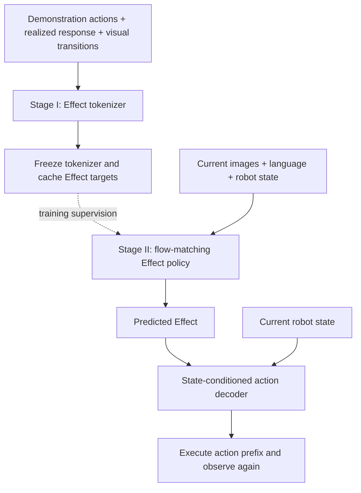
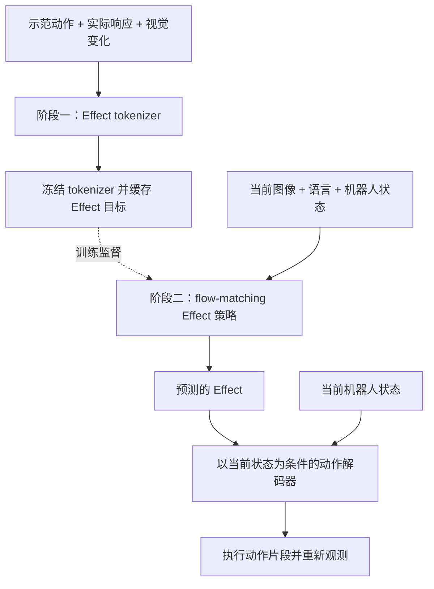

## TL;DR

AFCE trains a VLA to predict a temporal **Effect** that encodes demonstrated commands together with their observed physical consequences. A decoder then converts that Effect into executable actions. Future robot states and images provide training supervision; deployment uses current images, language, and robot state.

The result is strongest on coordinated manipulation. On DexJoCo, overall success reaches **50.97%**, compared with **39.15%** for the evaluated π₀.₅ checkpoint. The single-arm average falls slightly, and Pinch Tongs drops sharply. The useful question is therefore how this intermediate target helps coordination while preserving enough detail for precise control.

## Paper and reading version

These notes follow [arXiv:2610.13212v2](https://arxiv.org/abs/2610.13212v2), revised October 12, 2026; the initial submission was October 9. **Beyond Actions: Learning Future Operation Targets for Vision-Language-Action Models** is by Min Lin, Bokai Zhou, Jianqi Lin, Kaiyuan Yang, Yicheng Chang, Junjie Yu, Xiaofan Liu, Jianhua Han, Rui Li, Shen Zhao, and Xiaodan Liang, from Sun Yat-sen University and Yinwang Intelligent Technology Co., Ltd. It is an arXiv preprint. Sources: [PDF](https://arxiv.org/pdf/2610.13212v2) and [project page](https://afceproject.github.io/AFCE-Web/). Method details below correspond to §3 and Appendix A; results to §4 and Appendices B–C.

## What exactly is the policy predicting?

A motor command and the motion it produces are different signals. Contact can prevent a finger from reaching its commanded position; an object can move differently depending on the grasp. AFCE puts both commanded and realized motion into the target used to train the policy.

For a demonstration window starting at time $t$, the tokenizer constructs

$$
E_t^*=T_\phi(A_t,\Delta S_t,V_t)\in\mathbb{R}^{H\times D_E},
\qquad H=30,\quad D_E=256.
$$

$A_t$ is the demonstrated action chunk, $\Delta S_t$ the realized robot response, and $V_t$ sparse visual-transition evidence. There is one temporally ordered Effect token per action step. The asterisk marks a target extracted from a demonstration. Despite the word “tokenizer,” this is a continuous representation consumed by flow matching; it should not be read as a set of discrete semantic labels or a single desired object pose.

At deployment, with $o_t=(I_t,\ell,s_t)$, the computation is

$$
\hat Z_t\sim p_\theta(Z\mid o_t),\qquad
\hat A_t=D_\psi\bigl(N^{-1}(\hat Z_t),s_t\bigr).
$$

Here $N$ is a fixed normalization of the Effect space. The policy predicts the normalized Effect, and the decoder combines its denormalized value with the current robot state. It executes a prefix of the resulting chunk, observes again, and replans.

## Stage I: fuse the evidence, then preserve executable detail

The action branch encodes position, rotation, and finger commands with separate group projections. The response branch encodes palm translation, relative orientation, fingertip displacement, and finger-joint changes using observed states and forward kinematics. It retains both arms for bimanual demonstrations.

The visual branch uses frozen DINOv3 features sampled at sparse times. Its localized transition tokens describe feature change, image-plane displacement, location, and temporal extent. They can include robot motion as well as object motion. A visual change spanning several control steps is associated with that interval, so the tokenizer does not treat it as a new independent observation at every step.

A learned query for each action step fuses the relevant evidence through cross-attention. A temporal Transformer then mixes information across the window. This encoder can use noncausal attention because it only constructs offline training targets.

The representation must support reconstruction:

$$
\mathcal L_I=\mathcal L_A+\lambda_S(u)\mathcal L_S
+\lambda_V(u)\mathcal L_V+\lambda_R\mathcal L_{\mathrm{rot}},
\qquad
\mathcal L_A=\frac{2\mathcal H_p+\mathcal H_r+\mathcal H_f}{3}.
$$

The action decoder receives $E_t^*$ and $s_t$; auxiliary heads reconstruct robot responses and visual transitions. Each $\mathcal H$ is a normalized, group-averaged Huber error. Position has weight two, while the denominator remains three. An additional SO(3) chordal loss constrains decoded orientation. The auxiliary visual head receives spatial and temporal query metadata, without receiving the feature change it must reconstruct.

After training, the tokenizer is frozen. Channel-wise mean and standard deviation are estimated on the training demonstrations, shared across temporal positions, and fixed for Stage II:

$$
Z_t^*=N(E_t^*)=\frac{E_t^*-\mu_E}{\max(\sigma_E,\sigma_{\min})}.
$$

This freezes the target definition while the policy learns to predict it. The future-evidence encoders and auxiliary reconstruction heads are absent from deployment.

## Stage II: Effect accuracy must survive action decoding

AFCE adapts π₀.₅ by replacing its action input/output projections with Effect-width projections. Images, instruction, and robot state still condition the flow-matching backbone. With Gaussian noise $\epsilon$ and flow time $\tau$, training uses

$$
Z_{t,\tau}=(1-\tau)Z_t^*+\tau\epsilon,\qquad
v^*=\epsilon-Z_t^*,
$$

$$
\mathcal L_{\mathrm{FM}}=
\mathbb E\left[\frac{\|v_\theta(Z_{t,\tau},\tau;o_t)-v^*\|_F^2}{HD_E}\right].
$$

Flow time $\tau$ is separate from environment time $t$. Sampling integrates from noise toward $\tau=0$.

A small latent error can still produce a large action error. The authors therefore estimate the clean endpoint directly,

$$
\hat Z_{t,0}^{(\tau)}=Z_{t,\tau}-\tau v_\theta(Z_{t,\tau},\tau;o_t),
$$

and decode it to supervise actions without backpropagating through a full sampling trajectory. The combined objective is

$$
\mathcal L_{II}=\mathcal L_{\mathrm{FM}}+
 r(u)\mathbb E_\tau\!\left[g(\tau)
 \left(\lambda_{\mathrm{GT}}\mathcal L_{\mathrm{GT}}
 +\lambda_{\Delta f}\mathcal L_{\Delta f}\right)\right].
$$

$\mathcal L_{\mathrm{GT}}$ compares decoded and demonstrated actions using equally weighted position, rotation, and finger groups. It does not reuse Stage I's position multiplier or SO(3) term. $\mathcal L_{\Delta f}$ supervises changes in finger commands between adjacent steps, scaled by each joint's demonstrated difference magnitude. The ramp $r(u)$ warms up these action losses; $g(\tau)$ selects the flow-time interval for action supervision and accounts for its probability mass.

The Stage-I decoder is initialized into Stage II and updated jointly at one quarter of the policy learning rate. Both action losses also send gradients into the policy. Freezing the tokenizer therefore does **not** mean freezing the decoder.

Appendix D reports 30,000 tokenizer updates and 60,000 policy updates, both with global batch size 32. Inference uses ten flow denoising steps for a 30-step Effect chunk. Single- and dual-arm configurations have separate native-coordinate adapters and decoding interfaces, while sharing the Effect model. Shared parameters alone do not establish an embodiment-invariant representation.

## Where the improvement comes from

Training uses 100 demonstrations for each of 11 DexJoCo tasks: **1,100 episodes and 523,763 retained frames** at 30 FPS. The simulated Panda–Allegro setup has six single-arm and five bimanual tasks. Native actions have 22 dimensions per arm. Evaluation randomizes object placement and table height under `rand-obj`.

Each method uses one trained checkpoint evaluated on three environment seeds, with 50 episodes per task per seed: 1,650 rollouts per method. The deviations below measure variation across **evaluation seeds**, not independent training runs.

| Method | Single-arm success | Bimanual success | Overall success |
|---|---:|---:|---:|
| UVT | 53.44 ± 2.22% | 14.53 ± 3.06% | 35.76 ± 0.56% |
| π₀.₅ | 63.67 ± 1.86% | 9.73 ± 2.41% | 39.15 ± 2.11% |
| AFCE | 62.33 ± 1.45% | 37.33 ± 2.66% | 50.97 ± 1.65% |

AFCE leads on all five bimanual tasks. Microwave rises from 32.00% to 81.33%, and Photograph from 8.00% to 59.33%, relative to π₀.₅. The 27.60-point bimanual improvement contributes about 12.55 points to the overall average; the single-arm deficit offsets about 0.73 points. This accounts for the 11.82-point net improvement.

Pinch Tongs falls from **43.33% to 5.33%**. Unlock iPad and Assembly remain difficult even with improvements, at 7.33% and 9.33%. These results constrain any claim that predicting Effects generally solves dexterous control.

## The ablations complicate the explanation

Table 3 varies the evidence used to construct the target, always retaining demonstrated actions:

| Effect inputs | Single-arm | Bimanual |
|---|---:|---:|
| Actions only | 57.22% | 30.93% |
| Actions + visual transitions | 48.67% | 25.47% |
| Actions + robot response | 55.67% | 21.60% |
| Actions + response + visual transitions | **62.33%** | **37.33%** |

The complete combination has the best group means, yet adding either future-evidence source alone reduces performance relative to actions only. The action-only variant also already exceeds the direct-action baseline on bimanual tasks. My reading is that the complete target construction helps within this architecture, while the total gain over π₀.₅ cannot be assigned entirely to future supervision. Representation, prediction, and decoding all change the learning problem.

Reconstruction and execution need separate checks. In the dimensionality study, $D_E=256$ gives 25 successful GT-Effect replays out of 110 selected training demonstrations, versus 18/110 at $D_E=64$. This is a representation-and-decoder diagnostic without policy-side Effect prediction; it is not directly comparable to the main closed-loop score.

Appendix C further reports position readout error of **8.30 mm** for demonstration-derived Effects with the adapted decoder, versus **36.91 mm** for predicted Effects with the same decoder on matched demonstration windows. Those windows belong to the training data. A visually overlapping t-SNE projection cannot erase this gap or establish held-out generalization.

## What I would carry into a follow-up experiment

The design worth testing is the separation between offline target construction and online control: future evidence can shape what a policy learns without requiring future observations at deployment. Its costs are synchronized action/state/image data, offline feature construction, and a representation that must retain fine control detail while remaining predictable.

For a follow-up on dexterous hands, I would retain the action-only latent baseline and separately measure reconstruction, GT-Effect replay, and predicted-Effect rollout. I would also report precision-sensitive tasks individually and repeat training across seeds. If an Effect representation improves coordination but keeps losing finger-level accuracy, that tradeoff should guide changes to its temporal resolution, decoder, or auxiliary supervision. The Pinch Tongs regression is the concrete test any such change needs to pass.

## TL;DR

AFCE 让 VLA 预测一个按时间排列的 **Effect（物理效果）**，其中同时编码示范指令与实际观测到的物理变化，再通过解码器生成可执行动作。未来机器人状态和图像用于构造训练监督；部署只需要当前图像、语言和机器人状态。

收益主要出现在协同操作上：DexJoCo 总体成功率达到 **50.97%**，评测中的 π₀.₅ checkpoint 为 **39.15%**。单手平均成绩略有下降，Pinch Tongs 更出现明显退步。因此，值得追问的是：这种中间目标如何帮助协调动作，又能保留多少精细控制信息？

## 论文与阅读版本

本文依据 [arXiv:2610.13212v2](https://arxiv.org/abs/2610.13212v2)，更新于 2026 年 10 月 12 日，首次提交于 10 月 9 日。论文 **Beyond Actions: Learning Future Operation Targets for Vision-Language-Action Models** 的作者为 Min Lin、Bokai Zhou、Jianqi Lin、Kaiyuan Yang、Yicheng Chang、Junjie Yu、Xiaofan Liu、Jianhua Han、Rui Li、Shen Zhao 和 Xiaodan Liang，来自中山大学与引望智能技术有限公司。当前阅读版本为 arXiv 预印本。来源：[PDF 全文](https://arxiv.org/pdf/2610.13212v2)、[项目主页](https://afceproject.github.io/AFCE-Web/)。下文方法对应 §3 和附录 A，实验对应 §4 与附录 B–C。

## 策略究竟预测什么？

电机指令和实际运动是两种不同的信号。接触可能阻止手指到达目标位置，同样的动作也可能因为抓取状态不同而产生不同的物体运动。AFCE 把指令与实际响应共同放入策略的训练目标。

对于从时刻 $t$ 开始的示范窗口，tokenizer 构造

$$
E_t^*=T_\phi(A_t,\Delta S_t,V_t)\in\mathbb{R}^{H\times D_E},
\qquad H=30,\quad D_E=256.
$$

$A_t$ 是示范动作块，$\Delta S_t$ 是机器人实际响应，$V_t$ 是稀疏视觉变化证据。每个动作时间步对应一个有序 Effect token，星号表示从示范中提取的监督目标。虽然模块叫 tokenizer，这里得到的是供 flow matching 使用的连续表征，不能把它理解为离散语义标签或单一的物体目标位姿。

部署时，给定 $o_t=(I_t,\ell,s_t)$，计算过程为

$$
\hat Z_t\sim p_\theta(Z\mid o_t),\qquad
\hat A_t=D_\psi\bigl(N^{-1}(\hat Z_t),s_t\bigr).
$$

$N$ 是固定的 Effect 标准化变换。策略预测标准化后的 Effect，解码器结合反标准化结果与当前机器人状态生成动作块。系统执行其中一段，再获取观测、重新规划。

## 阶段一：融合证据，再约束可执行细节

动作分支分别投影位置、旋转和手指指令。响应分支使用观测状态与正向运动学，编码手掌平移、相对旋转、指尖位移和手指关节变化；双手示范保留两侧的信息。

视觉分支在稀疏时刻提取冻结的 DINOv3 特征。局部 transition token 描述特征变化、图像平面位移、空间位置及时间跨度，其中可以同时包含机器人和物体的运动。跨越多个控制步的视觉变化会关联到对应区间，避免将其当成每一步都独立发生的新观测。

每个动作时间步有一个可学习 query，通过 cross-attention 融合相关证据；随后 temporal Transformer 在整个窗口内交换信息。这个编码器只负责离线构造训练目标，因此可以使用非因果注意力。

表征通过重建任务接受约束：

$$
\mathcal L_I=\mathcal L_A+\lambda_S(u)\mathcal L_S
+\lambda_V(u)\mathcal L_V+\lambda_R\mathcal L_{\mathrm{rot}},
\qquad
\mathcal L_A=\frac{2\mathcal H_p+\mathcal H_r+\mathcal H_f}{3}.
$$

动作解码器接收 $E_t^*$ 与 $s_t$，辅助 head 重建机器人响应和视觉变化。各个 $\mathcal H$ 是经过标准化、在组内取平均的 Huber 误差。位置项权重为二，分母仍为三。额外的 SO(3) chordal loss 约束解码后的朝向。视觉重建 head 可以读取空间与时间 query 元信息，但无法读取它需要重建的目标特征变化。

训练结束后冻结 tokenizer，在训练示范上统计逐通道均值与标准差；这些统计量在时间位置之间共享，并在第二阶段保持固定：

$$
Z_t^*=N(E_t^*)=\frac{E_t^*-\mu_E}{\max(\sigma_E,\sigma_{\min})}.
$$

这样，策略学习期间的目标定义不会继续漂移。部署时不运行未来证据编码器，也不运行辅助重建 head。

## 阶段二：Effect 的准确性还要经得起动作解码

AFCE 将 π₀.₅ 的动作输入、输出投影替换为 Effect 维度的投影，保留以图像、指令和机器人状态为条件的 flow-matching 主干。给定高斯噪声 $\epsilon$ 与 flow time $\tau$，训练使用

$$
Z_{t,\tau}=(1-\tau)Z_t^*+\tau\epsilon,\qquad
v^*=\epsilon-Z_t^*,
$$

$$
\mathcal L_{\mathrm{FM}}=
\mathbb E\left[\frac{\|v_\theta(Z_{t,\tau},\tau;o_t)-v^*\|_F^2}{HD_E}\right].
$$

Flow time $\tau$ 与环境时刻 $t$ 不同。推理从噪声向 $\tau=0$ 积分，得到预测 Effect。

潜空间误差较小，解码后的动作误差仍可能很大。因此，作者直接估计干净端点：

$$
\hat Z_{t,0}^{(\tau)}=Z_{t,\tau}-\tau v_\theta(Z_{t,\tau},\tau;o_t),
$$

再解码并施加动作监督，避免对完整采样轨迹反向传播。总目标为

$$
\mathcal L_{II}=\mathcal L_{\mathrm{FM}}+
 r(u)\mathbb E_\tau\!\left[g(\tau)
 \left(\lambda_{\mathrm{GT}}\mathcal L_{\mathrm{GT}}
 +\lambda_{\Delta f}\mathcal L_{\Delta f}\right)\right].
$$

$\mathcal L_{\mathrm{GT}}$ 比较解码动作与示范动作，位置、旋转和手指组等权，不沿用第一阶段的位置倍数或 SO(3) 项。$\mathcal L_{\Delta f}$ 监督相邻时间步的手指指令变化，并根据各关节示范差分的幅度进行缩放。$r(u)$ 逐步引入动作损失；$g(\tau)$ 选择施加动作监督的 flow-time 区间，并计入该区间的采样概率质量。

第二阶段从第一阶段的解码器参数初始化，以策略学习率的四分之一联合更新。两个动作损失的梯度也会传入策略。**冻结 tokenizer，并不意味着冻结 decoder。**

附录 D 报告 tokenizer 训练 30,000 步、策略训练 60,000 步，全局 batch size 均为 32。推理使用十步 flow 去噪生成长度为 30 的 Effect 块。单手与双手配置分别使用原生坐标适配器和解码接口，共享 Effect 模型；仅凭参数共享，还无法证明学到了具身无关的表征。

## 总体收益来自哪里？

训练使用 DexJoCo 的 11 个任务，每个任务 100 条示范，共 **1,100 个 episode、523,763 帧**，帧率 30 FPS。仿真中的 Panda–Allegro 配置包含六个单手任务和五个双手任务，每侧原生动作有 22 维。评测采用 `rand-obj`，随机化物体位置与桌面高度。

每种方法只使用一个训练好的 checkpoint，在三个环境种子下评测，每任务每种子 50 个 episode，总计 1,650 次 rollout。下表标准差反映的是**评测环境种子**之间的波动，不是重复训练的波动。

| 方法 | 单手成功率 | 双手成功率 | 总体成功率 |
|---|---:|---:|---:|
| UVT | 53.44 ± 2.22% | 14.53 ± 3.06% | 35.76 ± 0.56% |
| π₀.₅ | 63.67 ± 1.86% | 9.73 ± 2.41% | 39.15 ± 2.11% |
| AFCE | 62.33 ± 1.45% | 37.33 ± 2.66% | 50.97 ± 1.65% |

AFCE 在全部五个双手任务上领先。相对 π₀.₅，Microwave 从 32.00% 提升到 81.33%，Photograph 从 8.00% 提升到 59.33%。双手平均提高 27.60 个百分点，对总体均值贡献约 12.55 个百分点；单手下降抵消约 0.73 个百分点，得到净增益 11.82 个百分点。

Pinch Tongs 则从 **43.33% 降至 5.33%**。Unlock iPad 和 Assembly 虽然有所改善，成功率仍只有 7.33% 与 9.33%。这些结果限定了 Effect 预测对灵巧控制的实际帮助范围。

## 消融让解释变得更具体

论文表 3 改变构造目标时使用的证据，所有变体都保留示范动作：

| Effect 输入 | 单手 | 双手 |
|---|---:|---:|
| 仅动作 | 57.22% | 30.93% |
| 动作 + 视觉变化 | 48.67% | 25.47% |
| 动作 + 机器人响应 | 55.67% | 21.60% |
| 动作 + 响应 + 视觉变化 | **62.33%** | **37.33%** |

完整组合的分组均值最好，但单独加入任一种未来证据，都低于仅动作的变体。仅动作的潜变量版本在双手任务上也已经超过直接预测动作的基线。我的理解是：完整目标构造在这套架构内有效，但相对 π₀.₅ 的全部提升不能都归因于未来监督。表征、预测和解码环节共同改变了学习问题。

重建与执行也需要分别检验。在维度实验中，$D_E=256$ 时，110 条选取自训练集的示范里有 25 条 GT-Effect replay 成功；$D_E=64$ 时为 18/110。该实验绕过策略对 Effect 的预测，诊断的是表征与解码器，不能与主表闭环成功率直接比较。

附录 C 在配对示范窗口上进一步报告：使用适配后的同一个解码器，示范提取的 Effect 对应 **8.30 mm** 的位置动作读出误差，预测 Effect 对应 **36.91 mm**。这些窗口仍来自训练数据。t-SNE 投影上的视觉重叠无法消除这段误差，也不能证明留出数据上的泛化能力。

## 后续实验里值得保留什么？

我认为最值得验证的是离线目标构造与在线控制的分工：未来证据可以改变策略所学的目标，而无需在部署时提供未来观测。代价是动作、状态和图像必须时间对齐，需要离线特征构造，而且表征必须同时满足精细控制与可预测性的要求。

如果把这条路线用于灵巧手，我会保留仅动作的潜变量基线，分别测量重建、GT-Effect replay 和 predicted-Effect rollout，并单独报告精度敏感任务、重复不同训练种子。如果 Effect 持续改善协调动作，却损失手指级精度，就应围绕时间分辨率、解码器或辅助监督修改设计。Pinch Tongs 的退步是这些修改必须面对的具体检验。

