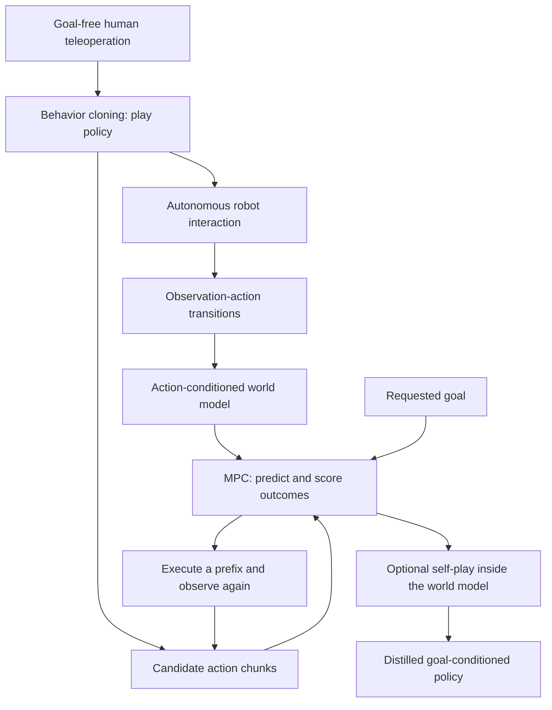
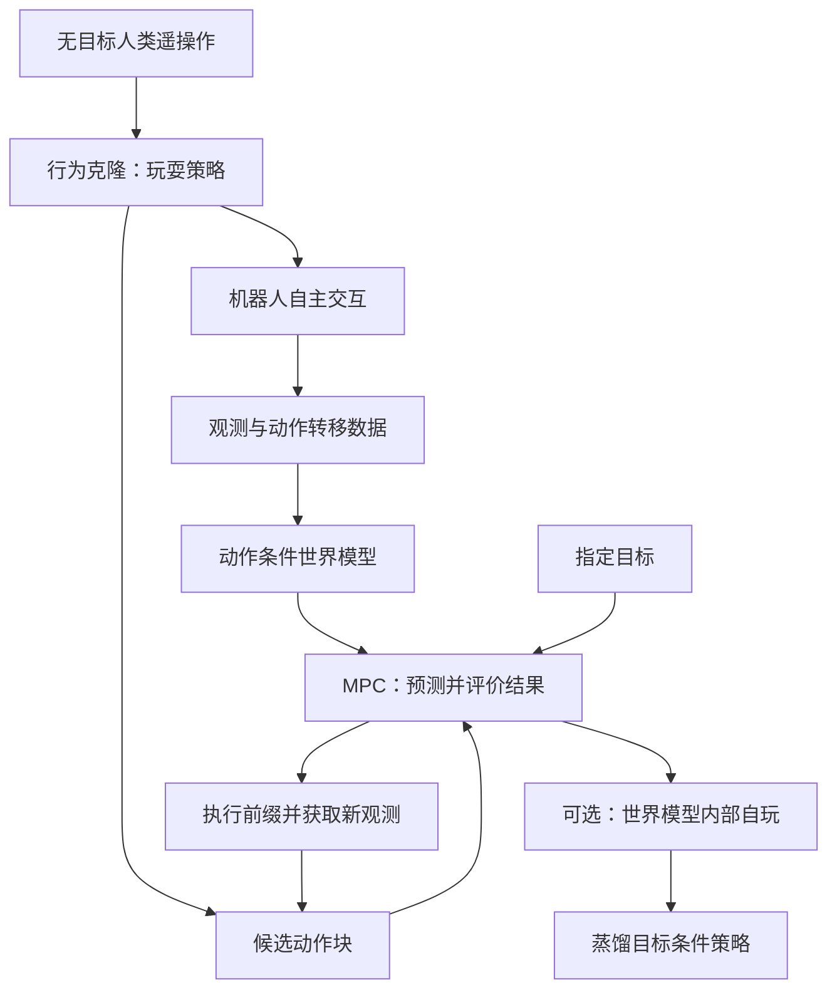

## TL;DR

DSP turns a short recording of human play into a policy that keeps interacting with an object, collects a larger dynamics dataset, and supplies candidate actions for goal-directed planning. A world model predicts what those actions will do; model-predictive control (MPC) chooses among them. An optional goal-conditioned policy learns from the planner inside the world model to reduce deployment cost. The useful connection is that **the same play policy defines both the experience used to learn dynamics and the actions searched at inference**.

The reported results are promising, but the October 15 v1 has conflicting experiment labels and an unfinished conclusion. In particular, the headline 490× interaction comparison belongs to the simulated reorientation protocol described in the body. The hardware experiment has a different baseline set. These notes keep those results separate.

## Paper and reading scope

**Dexterity from Supervised Play**, by Botao He, Yiming Dou, Yiannis Aloimonos, Jitendra Malik, Akash Sharma, and Ruoshi Liu, is an arXiv preprint from Amazon Frontier AI & Robotics and the University of Maryland, College Park. This post covers the eight-page [arXiv:2610.22340v1](https://arxiv.org/abs/2610.22340v1), submitted October 15, 2026. Sources: [PDF](https://arxiv.org/pdf/2610.22340v1), [HTML](https://arxiv.org/html/2610.22340v1), and the authors' [project link](https://play-policy.github.io/).

## Human supervision teaches continued interaction

A useful dexterous dataset needs repeated contact, regrasping, and object motion. Random joint commands rarely sustain those interactions. DSP starts with goal-free teleoperation: the operator plays with the object without solving a prescribed sequence of target poses. The reorientation setup describes a 15-minute human-play budget. A diffusion transformer learns to sample action chunks from observation history:

$$
\hat a_{t:t+H-1}\sim\pi_{\mathrm{play}}(\cdot\mid o_{\leq t}).
$$

Here, observations include robot and object information, and actions are joint commands. Behavior cloning learns a distribution over plausible continuations. Deploying this policy generates transitions $(o_t,a_t,o_{t+1})$ for the autonomous-play dataset. The claim about “minutes” concerns human supervision; robot interaction and model training still consume additional time.

This is also where the paper's most informative ablation sits. Deterministic and diffusion policies have similar held-out command errors, 0.192 and 0.181, yet transition coverage is 55.4% and 84.2%, respectively. Orientation coverage changes from 87.6% to 98.8%. The deterministic policy can visit many orientations through a narrow set of motions. For learning action consequences, the variety of transitions matters. These are the paper's coverage metrics, whose operational definitions would need to be pinned down for reproduction. [Table III and §IV-C](https://arxiv.org/html/2610.22340v1#S4.SS3)

## The world model predicts consequences; MPC supplies the goal

The model takes a context of $C$ observations and a proposed sequence of $K$ actions, then predicts future observations:

$$
\hat o_{t+1:t+K}=\mathcal M_{\mathrm{wm}}(o_{t-C+1:t},a_{t:t+K-1}).
$$

The paper writes a generic prediction objective,

$$
\mathcal L(\phi)=\mathbb E_{(o,a)\sim\mathcal D_{\mathrm{play}}}
\left[\sum_{k=1}^{K}\lambda_k\ell(\hat o_{t+k},o_{t+k})\right],
$$

and trains the model with Diffusion Forcing. Independent noise levels across time steps let it condition on clean history while denoising future observations causally. The displayed objective expresses the prediction task; it does not specify every diffusion-training detail. In the visual experiment, the play policy observes RGB and candidate evaluation uses a learned 64-dimensional latent representation. [§III-D and §IV-A](https://arxiv.org/html/2610.22340v1#S3.SS4)

At inference, the play policy samples $N$ action chunks. The world model rolls each one forward. For candidate $i$, the planner uses the **best reward anywhere in the prediction horizon**:

$$
r_i=\max_{1\leq k\leq K}r(\hat o^{(i)}_{t+k},o_g),
\qquad i^\star=\arg\max_i r_i.
$$

This distinction affects implementation: substituting terminal reward or cumulative reward changes the algorithm. The controller executes the first $E$ actions of the selected chunk, observes the robot again, and replans. The play policy and dynamics model remain goal-agnostic; the requested target enters through the scoring function. Goal-free data collection therefore still leads to a controller with an explicit goal-dependent reward. [§III-E](https://arxiv.org/html/2610.22340v1#S3.SS5)

For state-based simulated reorientation, the reported settings are 1,024 proposals, a 50-step prediction horizon, and a 25-step execution prefix. My reading is that the action prior helps in two related ways: it concentrates search on coordinated contact motions, and it keeps candidate actions closer to the behavior that generated the model's training data. That second benefit is a design interpretation, not a measured guarantee against model exploitation. The same prior also constrains search: MPC cannot choose a useful motion that its proposals never contain.

## Distillation moves the search cost into training

The optional distillation stage starts from recorded histories and sampled goals, runs MPC inside the learned world model, and stores its selected action prefixes. A goal-conditioned policy imitates those decisions:

$$
\mathcal L_{\mathrm{distill}}(\theta)=
-\mathbb E_{(h,o_g,\hat a^\star)\sim\mathcal D_{\mathrm{distill}}}
\log\pi_\theta(\hat a^\star\mid h,o_g).
$$

Deployment stays closed loop: after executing a prefix, the policy receives actual observations before predicting again. This “self-play” is model-generated training experience, with no adversarial second agent. The reported construction pairs 54K recorded states with 24 goals each, producing about 1.3M labels without new environment interaction. [§III-F and §IV-B](https://arxiv.org/html/2610.22340v1#S3.SS6)

Distillation loses precision. At angular thresholds of 0.4/0.6/0.8 rad, the distilled policy scores 40.6/72.7/86.7%, versus MPC's 72.7/91.4/96.1% in the simulated comparison. The policy takes 21.8 ms per run. Table IV gives an end-to-end hardware replan median of 133.6 ms on an RTX 5090, about 6.1× that latency; the text separately calls the speedup 7×. Those figures should be retained with their measurement context. The reported 15–18 Hz control rate relies on overlapping planning with action execution and does not mean a fresh MPC search finishes at that rate.

## Results with their evaluation conditions

The state-based simulation uses 128 shared seeded trials, each lasting 2,500 control frames. Initial and target orientations differ by more than 90°. Dropped cubes are respawned and the trial continues, so threshold-reaching success does not establish uninterrupted retention of the object. Hardware trials allow 120 seconds. The hardware uses a Sharpa hand with 22 commanded joints, a Manus glove for teleoperation, and a ZED 2i camera with cube-mounted pose tags. [§IV-A](https://arxiv.org/html/2610.22340v1#S4.SS1)

| Setting / controller | SR@0.4 rad | SR@0.6 rad | SR@0.8 rad |
|---|---:|---:|---:|
| Simulation: play policy | 15.6% | 36.7% | 54.7% |
| Simulation: hindsight BC | 25.8% | 53.9% | 71.9% |
| Simulation: DSP MPC | 72.7% | 91.4% | 96.1% |
| Simulation: distilled policy | 40.6% | 72.7% | 86.7% |
| Hardware: play policy | 20.9% | 38.3% | 54.1% |
| Hardware: DSP MPC | 68.6% | 90.0% | 97.1% |

These rows follow the experimental setup and results paragraphs, rather than Figure 5's conflicting “real-world” caption. At 0.6 rad, the simulated improvement over hindsight BC is **37.5 percentage points**, or about **69.6% relative improvement**. PPO with the same 701K counted-frame budget reaches 0% at this threshold; the performance-matched checkpoint reaches 86.7% after 344M frames. Dividing 344M by 701K yields roughly 490.7. This measures counted interaction frames, with no equivalent claim about compute, training time, or real-robot hours. PPO also reaches 86.7% at the tighter 0.4-rad threshold, above DSP's 72.7%. [§IV-A–B](https://arxiv.org/html/2610.22340v1#S4.SS2)

Push-T provides a separate check under a 10K-frame teleoperation budget: DSP reaches 98% and 74% success at overlap thresholds of 0.90 and 0.95, compared with hindsight BC's 74% and 36%. The visual experiment uses 64 trials and a longer 3,600-step horizon. Its prose reports an improvement from 53.1% to 78.1% at 0.6 rad after adding MPC, but Table II labels the rows as RGB-space and state-space DSP. That conflict prevents a clean RGB-versus-state conclusion from this version. [Tables I–II and §IV-B](https://arxiv.org/html/2610.22340v1#S4.SS2)

## What I would carry into a robot experiment

The reusable idea is to evaluate a play policy by the dynamics data and planning proposals it produces. Held-out action error alone misses both. With the model and evaluation fixed, increasing real-robot play from 0.54 to 5.11 hours reduces 50-step rotation MAE from 34.96° to 28.40°, an 18.8% reduction. The curve improves more slowly after the first two hours. This supports collecting additional autonomous experience, while the remaining error makes short execution prefixes and repeated observation consequential. [§IV-C and Figure 10](https://arxiv.org/html/2610.22340v1#S4.SS3)

For reproduction, I would first freeze the reset rules, success criterion, and frame accounting, then measure transition coverage and planning accuracy together. Learning safe-looking behavior from play is not a formal hardware-safety guarantee. Likewise, arbitrary target orientations for a cube do not establish transfer to arbitrary objects. The v1 conclusion itself calls the hardware summary provisional and says some quantitative results remain to be inserted, despite tables already appearing earlier. I would use DSP's method as a concrete experimental recipe and wait for a reconciled protocol before treating its headline numbers as a settled benchmark.

## TL;DR

DSP 先用少量人类玩耍记录训练一个能持续与物体交互的策略，让机器人自主积累更多动力学数据，再用同一个策略为目标导向的规划提供候选动作。世界模型预测每组动作的后果，模型预测控制（MPC）从中选择。还可以在世界模型内部生成规划数据，蒸馏出目标条件策略，降低部署时的计算开销。这里最有价值的联系是：**同一个 play policy 同时决定世界模型从什么经验中学习，以及推理时搜索哪些动作。**

论文结果值得关注，但 10 月 15 日发布的 v1 存在实验标注冲突，结论也保留了未完成的表述。尤其是摘要中的 490 倍交互量比较，对应正文描述的仿真重定向协议；硬件实验使用另一组基线。下文会分别说明。

## 论文信息与阅读范围

**Dexterity from Supervised Play** 的作者为 Botao He、Yiming Dou、Yiannis Aloimonos、Jitendra Malik、Akash Sharma 和 Ruoshi Liu，来自 Amazon Frontier AI & Robotics 与马里兰大学帕克分校。本文阅读的是 2026 年 10 月 15 日提交的八页预印本 [arXiv:2610.22340v1](https://arxiv.org/abs/2610.22340v1)。资料入口：[PDF](https://arxiv.org/pdf/2610.22340v1)、[HTML](https://arxiv.org/html/2610.22340v1)、作者提供的[项目链接](https://play-policy.github.io/)。

## 人类监督教会机器人持续交互

灵巧操作需要反复接触、换抓和转动物体。随机关节指令很难持续产生这些经验。DSP 从无目标遥操作开始：操作者自由摆弄物体，无须完成预先指定的一组目标姿态。重定向实验描述的人类玩耍数据预算是 15 分钟。扩散 Transformer 根据观测历史采样动作块：

$$
\hat a_{t:t+H-1}\sim\pi_{\mathrm{play}}(\cdot\mid o_{\leq t}).
$$

观测包含机器人与物体信息，动作是关节指令。行为克隆学习可能的交互延续方式，部署后记录 $(o_t,a_t,o_{t+1})$，形成自主玩耍数据集。“几分钟”指人类监督投入，后续机器人交互和模型训练仍需要额外时间。

论文中很有解释力的一组消融发生在这里。确定性策略和扩散策略的留出集动作误差接近，分别为 0.192 和 0.181，但转移覆盖率分别为 55.4% 和 84.2%，姿态覆盖率则为 87.6% 和 98.8%。确定性策略可能通过较少的动作模式访问许多姿态；学习动作后果还需要多样的状态转移。复现时也需要明确论文这些覆盖指标的具体计算定义。[表 III 与 §IV-C](https://arxiv.org/html/2610.22340v1#S4.SS3)

## 世界模型预测后果，MPC 引入目标

世界模型接收长度为 $C$ 的观测上下文和长度为 $K$ 的候选动作序列，预测未来观测：

$$
\hat o_{t+1:t+K}=\mathcal M_{\mathrm{wm}}(o_{t-C+1:t},a_{t:t+K-1}).
$$

论文将预测任务写为通用形式：

$$
\mathcal L(\phi)=\mathbb E_{(o,a)\sim\mathcal D_{\mathrm{play}}}
\left[\sum_{k=1}^{K}\lambda_k\ell(\hat o_{t+k},o_{t+k})\right].
$$

实际训练使用 Diffusion Forcing：给不同时间步分配独立噪声水平，让模型以干净的历史观测为条件，对未来观测进行因果去噪。上面的公式描述预测目标，没有展开全部扩散训练细节。在视觉实验中，玩耍策略接收 RGB，候选动作的评价使用学习得到的 64 维潜在表示。[§III-D 与 §IV-A](https://arxiv.org/html/2610.22340v1#S3.SS4)

推理时，玩耍策略采样 $N$ 组动作块，世界模型分别预测其结果。每个候选的得分取**预测窗口内最好的目标奖励**：

$$
r_i=\max_{1\leq k\leq K}r(\hat o^{(i)}_{t+k},o_g),
\qquad i^\star=\arg\max_i r_i.
$$

这个细节会影响实现：换成末步奖励或累积奖励，就改变了算法。控制器执行所选动作块的前 $E$ 步，获取真实新观测，再次规划。玩耍策略和动力学模型都不以目标为条件；目标通过评分函数进入。因此，无目标数据采集最终仍会产生一个使用明确目标奖励的控制器。[§III-E](https://arxiv.org/html/2610.22340v1#S3.SS5)

基于状态的仿真重定向采用 1,024 个候选、50 步预测窗口和 25 步执行前缀。我的理解是，动作先验有两方面作用：把搜索集中在协调的接触动作上，也让候选动作更接近产生训练数据的行为分布。后一点是对设计的解释，论文没有证明它能避免模型利用误差。先验同时限制搜索范围：没有被提出的有效动作，MPC 也无法选中。

## 蒸馏把搜索开销转移到训练阶段

可选的蒸馏阶段从已有观测历史和采样目标出发，在世界模型内部运行 MPC，保存规划器选中的动作前缀，再训练目标条件策略模仿这些决策：

$$
\mathcal L_{\mathrm{distill}}(\theta)=
-\mathbb E_{(h,o_g,\hat a^\star)\sim\mathcal D_{\mathrm{distill}}}
\log\pi_\theta(\hat a^\star\mid h,o_g).
$$

部署时仍然闭环运行：执行动作前缀后，策略根据真实新观测再次预测。这里的 self-play 指模型内部生成训练经验，不涉及对抗性的第二个智能体。论文将 54K 个记录状态分别与 24 个目标配对，产生约 130 万个标签，无须新增环境交互。[§III-F 与 §IV-B](https://arxiv.org/html/2610.22340v1#S3.SS6)

蒸馏会损失精度。在仿真比较中，0.4/0.6/0.8 rad 阈值下，蒸馏策略成功率为 40.6/72.7/86.7%，MPC 为 72.7/91.4/96.1%。蒸馏策略单次推理耗时 21.8 ms；表 IV 给出的 RTX 5090 上硬件端到端重规划中位耗时为 133.6 ms，两者相除约为 6.1 倍，正文另称 7 倍加速。引用时应保留测量口径。文中 15–18 Hz 的控制频率依靠规划与动作执行重叠，并不意味着每个控制周期都完成一次新的 MPC 搜索。

## 把实验结果放回对应协议

基于状态的仿真采用相同的 128 个固定随机种子试验，每次运行 2,500 个控制帧，初始与目标姿态相差超过 90°。方块掉落后会重新生成，试验继续，因此达到阈值的成功率不能直接代表全程无掉落。硬件试验允许 120 秒。硬件使用控制 22 个关节的 Sharpa 手、用于遥操作的 Manus 手套，以及通过方块标签跟踪位姿的 ZED 2i 相机。[§IV-A](https://arxiv.org/html/2610.22340v1#S4.SS1)

| 场景与控制器 | SR@0.4 rad | SR@0.6 rad | SR@0.8 rad |
|---|---:|---:|---:|
| 仿真：玩耍策略 | 15.6% | 36.7% | 54.7% |
| 仿真：hindsight BC | 25.8% | 53.9% | 71.9% |
| 仿真：DSP MPC | 72.7% | 91.4% | 96.1% |
| 仿真：蒸馏策略 | 40.6% | 72.7% | 86.7% |
| 硬件：玩耍策略 | 20.9% | 38.3% | 54.1% |
| 硬件：DSP MPC | 68.6% | 90.0% | 97.1% |

上表根据实验设置和结果段落归类；图 5 的“real-world”图注与这些描述冲突。在 0.6 rad 阈值下，仿真 DSP 相比 hindsight BC 提高 **37.5 个百分点**，即约 **69.6% 的相对提升**。PPO 在相同的 701K 计数帧预算下成功率为 0%，使用 344M 帧的性能匹配检查点达到 86.7%。344M 除以 701K 约为 490.7。这比较的是计数交互帧，不能等同为算力、训练时间或真机小时数的节省。在更严格的 0.4 rad 阈值下，该 PPO 检查点同样达到 86.7%，高于 DSP 的 72.7%。[§IV-A–B](https://arxiv.org/html/2610.22340v1#S4.SS2)

Push-T 在 10K 帧遥操作预算下提供另一项验证：在重叠阈值 0.90 和 0.95 下，DSP 成功率为 98% 和 74%，hindsight BC 为 74% 和 36%。视觉实验采用 64 次试验和更长的 3,600 步窗口。其正文称加入 MPC 后，0.6 rad 成功率从 53.1% 提升到 78.1%，但表 II 将对应行标成 RGB-space 与 state-space DSP。这一冲突使当前版本无法支持清晰的 RGB 与状态输入对比结论。[表 I–II 与 §IV-B](https://arxiv.org/html/2610.22340v1#S4.SS2)

## 我会如何借鉴到机器人实验中

值得复用的思路是通过产生的动力学数据和规划候选来评价玩耍策略。仅看留出集动作误差，会漏掉这两方面。在固定模型与评估条件下，真机自主玩耍数据从 0.54 小时增加到 5.11 小时，50 步旋转预测 MAE 从 34.96° 降到 28.40°，下降 18.8%；前两小时之后收益逐渐放缓。这支持继续采集自主经验，但剩余预测误差也说明，短动作前缀和反复获取真实观测仍然重要。[§IV-C 与图 10](https://arxiv.org/html/2610.22340v1#S4.SS3)

如果复现，我会先固定重置规则、成功判据和帧数统计方式，再一起测量转移覆盖率与规划精度。从人类玩耍中学到看起来安全的动作，不等于形式化的硬件安全保证；方块的任意目标姿态重定向，也没有证明对任意物体的迁移。v1 结论本身仍将硬件结果称为初步总结，并称部分定量结果待补充，尽管前文已有相应表格。我会把 DSP 的方法当作可执行的实验方案，同时等待协议与标注统一后，再把摘要数字作为确定的基准结论。

