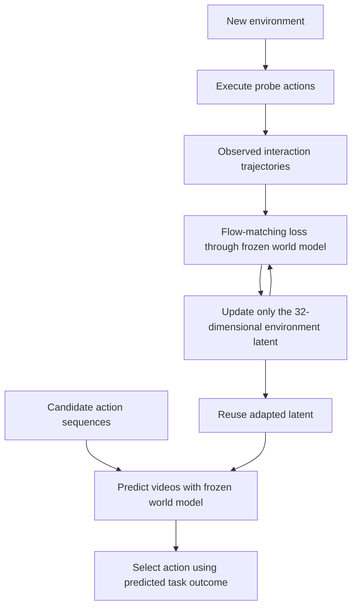
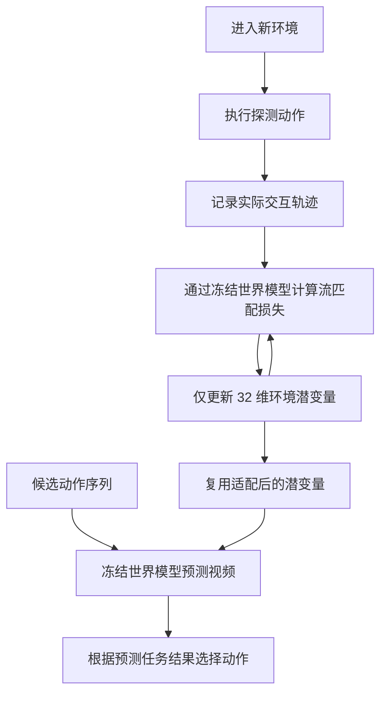

This post supports **English / 中文** switching via the site language toggle in the top navigation.

## TL;DR

Two visually similar objects can move different distances under the same push. A video world model needs evidence about the environment's dynamics to resolve that ambiguity. **T2-z** stores this evidence in a 32-dimensional environment latent. At deployment, it freezes the world model and optimizes the latent against one or two observed interaction trajectories, then reuses it to predict other actions. Training alternates between learning shared dynamics and fitting the environment latents, using the same flow-matching loss for both.

The mechanism is a form of learned system identification through prediction error. The most useful detail is how training prepares a small, optimizable conditioning space. Simply optimizing a full-width conditioning token performs poorly in the paper's ablation.

## Paper and sources

**T2-z: Test-Time Optimization of Environment Latents for Robotic World Models**, by **Chenyuan Zhou, Yining Hong, Huang Huang, Yunfan Jiang, Wenlong Huang, David Held, Vitor Campagnolo Guizilini, Yue Wang, Li Fei-Fei, Jiajun Wu, Leonidas Guibas, and Yejin Choi**. These notes follow the October 15, 2026 preprint, [arXiv:2610.22364v1](https://arxiv.org/abs/2610.22364v1), including its [PDF appendices](https://arxiv.org/pdf/2610.22364v1). The authors also provide a [project page](https://t2-z-latent-optimization.github.io/), [code repository](https://github.com/T2-z-latent-optimization/T2-z), and [dataset](https://huggingface.co/datasets/huagailuowen/T2-z-datasets). All experimental results below are author-reported; the implementation implications are my reading of the method.

## 1. What an environment latent represents

The prediction model is

$$
p_\theta(\mathbf y\mid\mathbf x,\mathbf a,\mathbf z_e),
$$

where $\mathbf x$ is the initial observation, $\mathbf a$ is an action sequence, and $\mathbf y$ is the future video. The shared parameters $\theta$ describe the predictive model; $\mathbf z_e\in\mathbb R^{32}$ carries information specific to environment $e$. Different episodes from the same environment share a latent while their observations and actions vary.

This last condition matters. Training does not need numerical labels for friction, mass, or spring stiffness, but it does maintain environment-indexed groups of interactions. The available grouping tells the learner which episodes should share an explanation. “No physical-parameter supervision” therefore still assumes that training data can be organized by environment ([Appendix A](https://arxiv.org/html/2610.22364v1#A1)).

The representation can also capture a discrete interaction rule. In Light Switch, the hidden variation determines which button interactions activate the lamp. The prediction objective can distinguish these rules without assigning each latent coordinate a predefined physical meaning.

## 2. Learn dynamics slowly, fit latents quickly

Both sets of variables use the flow-matching objective

$$
\mathcal L_{\mathrm{FM}}(\theta,\mathbf z_e)
=\mathbb E\left[
\left\|\mathbf v_\theta(\mathbf y_t,t\mid\mathbf x,\mathbf a,\mathbf z_e)
-\mathbf u_t\right\|_2^2\right].
$$

Here $\mathbf y_t$ is the noisy/interpolated future representation and $\mathbf u_t$ is its target flow velocity. The initial conditioning frame is excluded from the prediction loss. Thus “prediction error” refers to the model's training objective; it does not require a differentiable object tracker or a supplied friction estimate.

With latents fixed, model updates minimize this loss across environments. With the model fixed, each latent is updated using the interactions assigned to its environment. In compact gradient notation,

$$
\begin{aligned}
\theta &\leftarrow \theta-\eta_\theta\nabla_\theta
\mathbb E_{e,\mathcal D_e}\mathcal L_{\mathrm{FM}}(\theta,\mathbf z_e),
&&\text{latents fixed},\\
\mathbf z_e &\leftarrow\mathbf z_e-\eta_z\nabla_{\mathbf z_e}
\mathbb E_{\mathcal D_e}\mathcal L_{\mathrm{FM}}(\theta,\mathbf z_e),
&&\text{model fixed}.
\end{aligned}
$$

The implementation begins with **300 model updates**, then alternates **200 latent updates and 200 model updates**. The learning rates are $10^{-5}$ for the shared model and $0.03$ for latents. Training latents start from $\mathcal U(0,1)$ and are clipped to $[0,1]$ after updates. Model blocks update the DiT, action encoder, and latent projectors; the video VAE stays frozen ([Section 3 and Appendix A.2](https://arxiv.org/pdf/2610.22364v1)).

The distinction from joint optimization is measurable. On the Friction ablation, joint model–latent training gives mean physical error **7.03** and action success **68%**; the alternating method gives **3.85** and **72%**. This supports the training schedule in that setting, without establishing one universally optimal block length.

## 3. How 32 numbers condition a video model

The backbone is BWM built on **Wan2.2-TI2V-5B**, with DiT width 3072. It takes an initial RGB frame and aligned 14-dimensional robot actions. Text conditioning is disabled. Two separate MLPs project the environment latent from **32 → 128 → 3072**, with LayerNorm before the first linear layer and GELU between the two linear layers.

One projector creates an environment token appended to the action conditioning sequence. Every video patch can attend to that token through cross-attention. The other creates a modulation vector added to the timestep and action embeddings before the existing time projection. That path changes adaptive-normalization shifts, scales, and residual gates, and also conditions the output head ([Appendix A.1](https://arxiv.org/pdf/2610.22364v1)).

These learned projectors explain why the adaptation space deserves attention. At test time, gradients move 32 coordinates through a conditioning map learned across training environments. The Direct Token ablation instead optimizes a 3072-dimensional token and reports **94.50** mean physical error and **24%** action success on Friction. The low-dimensional parameterization and its training procedure are substantive parts of the method.

## 4. Test-time interaction becomes reusable context

For a new environment, collect actual outcomes of randomly sampled actions:

$$
\mathcal D_{\mathrm{test}}=\{(\mathbf x_i,\mathbf a_i,\mathbf y_i)\}_{i=1}^{N}.
$$

Freeze all shared weights, initialize a new latent, and optimize

$$
\mathbf z_{\mathrm{test}}^{(s+1)}=
\mathbf z_{\mathrm{test}}^{(s)}-
\eta_z^{(s)}\nabla_{\mathbf z}
\frac1N\sum_{i=1}^{N}
\mathcal L_{\mathrm{FM}}(\theta^*,\mathbf z;\mathbf x_i,\mathbf a_i,\mathbf y_i)
\bigg|_{\mathbf z=\mathbf z_{\mathrm{test}}^{(s)}}.
$$

The main evaluations use **40 updates**, with learning rates **3.0, 1.5, 0.5, and 0.15**, ten updates each. Query outcomes are excluded from adaptation. The resulting latent is reused for different candidate actions, whose predicted videos guide action selection ([Algorithm 1 and Appendix A.2](https://arxiv.org/pdf/2610.22364v1)).

“One trajectory” means a sequence of interaction observations. Its information content depends on the action. Appendix E.1 makes this visible: increasing the count from one to two raises Light Switch success from **50.0% to 87.5%** and Door Close success from **22.2% to 55.6%**. Soft Pull stays at **81.8%** for one, two, or four trajectories. More observations help when they resolve an ambiguity the first probe left open.

## 5. Results, with metric boundaries

Evaluation spans seven simulated settings and four real tasks. Simulation covers friction, gravity, collision mass, switch rules, mass balance, combined mass and friction, and friction across 30 visual backgrounds. Real tasks are Door Close, Ball Friction, Stick Balance, and Soft Pull. All adaptive baselines receive the same test-time interaction trajectories and use the same backbone ([Tables 1–2](https://arxiv.org/pdf/2610.22364v1)).

| Evaluation | Standard world model | T2-z |
|---|---:|---:|
| Simulation: mean physical error, mixed task units | 12.8575 | 4.7971 |
| Simulation: mean action success | 37.9% | 74.2% |
| Real world: mean tracked-state error, pixels | 19.30 | 10.85 |
| Real world: mean action success | 26.47% | 70.80% |

The simulation average mixes object-position errors in pixels, lamp-score error, and tilt-angle error in degrees. It is a benchmark summary with heterogeneous units. Per-task comparisons are easier to interpret physically. Real-world tracking errors use native-image pixels, whose resolutions also vary by task.

Action success and visual accuracy can disagree. On Gravity, DINOv2 Context has lower mean physical error than T2-z (**5.9300 vs 7.3408**), while T2-z has higher action success (**82.4% vs 76.5%**). On Soft Pull, T2-z improves action success while its LPIPS is worse than the standard model. A reproduction should evaluate the action decisions directly, alongside video and state errors.

The data scale is also specific: Appendix B lists **35 × 10 episodes** for simulated Friction and **84 × 9** for Mass × Friction. The four real tasks use **240, 438, 421, and 146 episodes** for Ball Friction, Door Close, Stick Balance, and Soft Pull. Those adaptation results sit on top of a pretrained video backbone and task training; the test-time trajectory counts alone do not describe the total data requirement.

## 6. What I would carry into a new system

I would start with T2-z when a competent action-conditioned world model already exists and repeated episodes differ through hidden environmental properties. It gives a concrete way to fit a small context vector from outcomes, and to reuse that context across candidate actions. The Friction dimension sweep favors 32 dimensions over 8, 16, 64, and 128 under the tested protocol; that is a useful starting point, with retuning needed for a different task.

There are two practical boundaries. First, latent optimization still requires backpropagation through the frozen video model. Updating only 32 numbers does not make the computation proportional to 32; Appendix E.4 profiles 40 adaptation updates plus video generation on an H200. Second, latent-space PCA shows organization correlated with hidden factors, but each task has its own PCA basis. These visualizations support structured representations within the experiments; they do not establish calibrated recovery of physical parameters or a universal coordinate system.

My next experiment would compare random probes with actions selected to distinguish plausible environment explanations. The paper already shows that a second interaction can matter much more in one task than another. Choosing which interaction to collect could be as consequential as increasing the number of latent updates.

本文支持通过顶部导航栏的语言按钮切换 **English / 中文**。

## TL;DR

两个外观相似的物体，受到同样的推力后可能移动不同距离。视频世界模型需要环境动力学的证据，才能消除这种歧义。**T2-z** 将这些信息存入一个 32 维环境潜变量：部署时冻结世界模型，用一到两条实际交互轨迹优化潜变量，再复用它预测其他动作的结果。训练阶段交替学习共享动力学与各环境的潜变量，两者使用同一个流匹配损失。

可以将这一机制理解为通过预测误差进行学习式系统辨识。其中最值得关注的是：训练如何构造一个适合优化的小型条件空间。论文消融显示，直接优化模型宽度的条件 token 效果很差。

## 论文与来源

**T2-z: Test-Time Optimization of Environment Latents for Robotic World Models**，作者为 **Chenyuan Zhou、Yining Hong、Huang Huang、Yunfan Jiang、Wenlong Huang、David Held、Vitor Campagnolo Guizilini、Yue Wang、Li Fei-Fei、Jiajun Wu、Leonidas Guibas 和 Yejin Choi**。本文依据 2026 年 10 月 15 日发布的预印本 [arXiv:2610.22364v1](https://arxiv.org/abs/2610.22364v1) 及其 [PDF 附录](https://arxiv.org/pdf/2610.22364v1)。作者还提供了[项目主页](https://t2-z-latent-optimization.github.io/)、[代码仓库](https://github.com/T2-z-latent-optimization/T2-z)和[数据集](https://huggingface.co/datasets/huagailuowen/T2-z-datasets)。下文实验数字均为论文报告结果；关于实现与应用的判断属于我的阅读理解。

## 1. 环境潜变量表示什么

预测模型写作

$$
p_\theta(\mathbf y\mid\mathbf x,\mathbf a,\mathbf z_e),
$$

其中 $\mathbf x$ 是初始观测，$\mathbf a$ 是动作序列，$\mathbf y$ 是未来视频。共享参数 $\theta$ 描述预测模型；$\mathbf z_e\in\mathbb R^{32}$ 保存环境 $e$ 的特定信息。同一环境中的不同 episode 共享一个潜变量，各自的初始观测和动作可以不同。

这一条件直接影响数据组织。训练无需摩擦、质量或弹簧刚度的数值标签，但仍维护按环境索引的交互分组。分组信息告诉模型哪些 episode 应该共享一种解释。因此，“无需物理参数监督”仍以能够按环境组织训练数据为前提（[附录 A](https://arxiv.org/html/2610.22364v1#A1)）。

潜变量也可以描述离散交互规则。Light Switch 任务中的隐藏差异决定了哪些按钮操作会点亮灯。预测目标能够区分这些规则，无需预先为每一维潜变量指定物理含义。

## 2. 慢速学习动力学，快速拟合潜变量

两类变量使用相同的流匹配目标：

$$
\mathcal L_{\mathrm{FM}}(\theta,\mathbf z_e)
=\mathbb E\left[
\left\|\mathbf v_\theta(\mathbf y_t,t\mid\mathbf x,\mathbf a,\mathbf z_e)
-\mathbf u_t\right\|_2^2\right].
$$

$\mathbf y_t$ 表示加噪或插值后的未来表征，$\mathbf u_t$ 是对应的目标流速度。初始条件帧不计入预测损失。因此，这里的“预测误差”具体对应模型的训练目标，无需额外提供可微物体跟踪器或摩擦估计值。

固定潜变量时，跨环境更新模型；固定模型时，用每个环境对应的交互更新其潜变量。用简化的梯度更新记号表示：

$$
\begin{aligned}
\theta &\leftarrow \theta-\eta_\theta\nabla_\theta
\mathbb E_{e,\mathcal D_e}\mathcal L_{\mathrm{FM}}(\theta,\mathbf z_e),
&&\text{固定潜变量},\\
\mathbf z_e &\leftarrow\mathbf z_e-\eta_z\nabla_{\mathbf z_e}
\mathbb E_{\mathcal D_e}\mathcal L_{\mathrm{FM}}(\theta,\mathbf z_e),
&&\text{固定模型}.
\end{aligned}
$$

实现上，先进行 **300 次模型更新**，随后交替执行 **200 次潜变量更新与 200 次模型更新**。共享模型的学习率为 $10^{-5}$，潜变量学习率为 $0.03$。训练潜变量从 $\mathcal U(0,1)$ 初始化，每次更新后裁剪到 $[0,1]$。模型更新阶段训练 DiT、动作编码器和潜变量投影器，视频 VAE 始终冻结（[第 3 节与附录 A.2](https://arxiv.org/pdf/2610.22364v1)）。

交替优化与联合优化的区别有消融支持。在 Friction 任务中，同时更新模型与潜变量的平均物理误差为 **7.03**、动作成功率为 **68%**；交替优化对应 **3.85** 和 **72%**。这支持了该设置下的训练安排，但无法据此确定适用于所有任务的最优交替周期。

## 3. 32 个数如何影响视频模型

骨干为基于 **Wan2.2-TI2V-5B** 的 BWM，DiT 宽度为 3072。输入包括初始 RGB 帧与对齐的 14 维机器人动作，文本条件被关闭。两个独立 MLP 将环境潜变量按 **32 → 128 → 3072** 投影，第一层线性变换前使用 LayerNorm，两层线性变换之间使用 GELU。

一个投影器生成环境 token，加入动作条件序列，使每个视频 patch 都能通过交叉注意力读取环境信息。另一个生成调制向量，与时间步嵌入、动作嵌入相加后进入已有的时间投影层。这条路径影响自适应归一化的偏移、缩放和残差门控，并为输出头提供条件（[附录 A.1](https://arxiv.org/pdf/2610.22364v1)）。

这两个学习得到的投影器解释了适配空间为何重要。测试时，梯度只移动 32 个坐标，它们通过跨训练环境学习的映射影响模型。Direct Token 消融直接优化 3072 维 token，在 Friction 上得到 **94.50** 的平均物理误差与 **24%** 的成功率。低维参数化及其训练过程都是方法的实质组成部分。

## 4. 把测试时交互变成可复用条件

进入新环境后，先执行随机采样的动作并记录实际结果：

$$
\mathcal D_{\mathrm{test}}=\{(\mathbf x_i,\mathbf a_i,\mathbf y_i)\}_{i=1}^{N}.
$$

冻结全部共享权重，初始化新潜变量，然后优化：

$$
\mathbf z_{\mathrm{test}}^{(s+1)}=
\mathbf z_{\mathrm{test}}^{(s)}-
\eta_z^{(s)}\nabla_{\mathbf z}
\frac1N\sum_{i=1}^{N}
\mathcal L_{\mathrm{FM}}(\theta^*,\mathbf z;\mathbf x_i,\mathbf a_i,\mathbf y_i)
\bigg|_{\mathbf z=\mathbf z_{\mathrm{test}}^{(s)}}.
$$

主实验使用 **40 次更新**，学习率依次为 **3.0、1.5、0.5、0.15**，每档执行十次。待评估动作的真实结果不参与适配。随后，不同候选动作共享优化后的潜变量，模型预测各自的视频结果，并据此选择动作（[算法 1 与附录 A.2](https://arxiv.org/pdf/2610.22364v1)）。

“一条轨迹”包含一段交互观测，其信息量取决于动作。附录 E.1 给出了具体例子：从一条增加到两条轨迹，Light Switch 成功率由 **50.0% 升至 87.5%**，Door Close 由 **22.2% 升至 55.6%**；Soft Pull 在一条、两条和四条轨迹下都为 **81.8%**。当第二次交互能够消除第一次遗留的歧义时，增加观测才有明显收益。

## 5. 如何理解实验数字

评估包括七种仿真设置和四项真实任务。仿真覆盖摩擦、重力、碰撞质量、开关规则、质量平衡、质量与摩擦组合，以及 30 种视觉背景下的摩擦变化。真实任务为 Door Close、Ball Friction、Stick Balance 和 Soft Pull。所有适配基线使用相同骨干，并获得相同的测试时交互轨迹（[表 1–2](https://arxiv.org/pdf/2610.22364v1)）。

| 评估指标 | 标准世界模型 | T2-z |
|---|---:|---:|
| 仿真平均物理误差，混合任务单位 | 12.8575 | 4.7971 |
| 仿真平均动作成功率 | 37.9% | 74.2% |
| 真实任务平均跟踪状态误差，像素 | 19.30 | 10.85 |
| 真实任务平均动作成功率 | 26.47% | 70.80% |

仿真误差均值混合了以像素计量的物体位置误差、灯状态评分误差和以度计量的倾斜角误差。这是一个单位不统一的基准汇总值，逐任务比较更容易解释其物理意义。真实任务使用原始图像像素计算跟踪误差，不同任务的原始分辨率也有差异。

动作成功率与视觉精度可能给出不同排序。Gravity 上，DINOv2 Context 的平均物理误差低于 T2-z（**5.9300 对 7.3408**），但 T2-z 的动作成功率更高（**82.4% 对 76.5%**）。Soft Pull 上，T2-z 的成功率提高，但 LPIPS 比标准模型更差。复现时应同时评估动作决策、视频质量和状态预测误差。

训练数据规模也需要单独看待。附录 B 中，仿真 Friction 使用 **35 × 10 条 episode**，Mass × Friction 使用 **84 × 9 条**。真实任务 Ball Friction、Door Close、Stick Balance 和 Soft Pull 分别使用 **240、438、421 和 146 条 episode**。少量交互适配建立在预训练视频骨干和任务训练之上，测试时轨迹数量无法单独代表总数据需求。

## 6. 我会怎样把它用于新系统

如果已经有一个预测能力较好的动作条件世界模型，而不同 episode 主要受隐藏环境属性影响，我会优先尝试 T2-z。它提供了一个从实际结果拟合小型条件向量、再跨候选动作复用的具体方案。Friction 的维度消融中，32 维优于 8、16、64 和 128 维；这可以作为起点，新任务仍需重新验证。

实践中有两个边界。首先，潜变量优化仍需通过冻结的视频模型反向传播。只更新 32 个数，不意味着计算量与 32 成正比；附录 E.4 在 H200 上测量了 40 次适配更新及视频生成的开销。其次，潜空间 PCA 呈现了与隐藏因素相关的结构，但每个任务单独拟合 PCA 基底。这些图支持实验范围内存在有组织的表征，尚不能据此认定模型恢复了可校准的物理参数，或形成了跨任务统一坐标系。

我的下一步实验会比较随机探测与主动选择探测动作：选择那些能区分不同环境解释的动作。论文已经显示，第二条交互在不同任务中的价值相差很大。决定采集哪一条交互，可能与增加潜变量更新次数同样值得研究。

