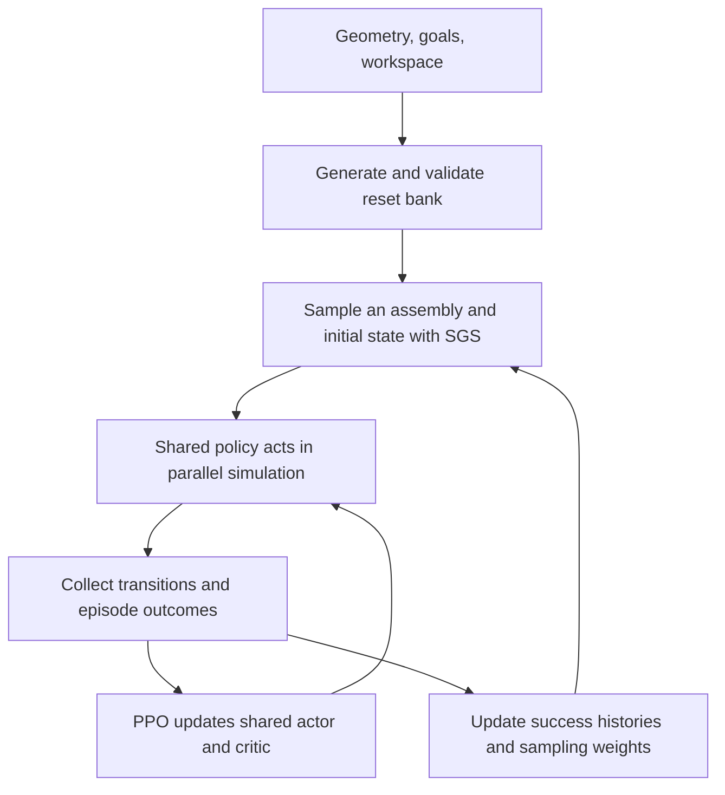
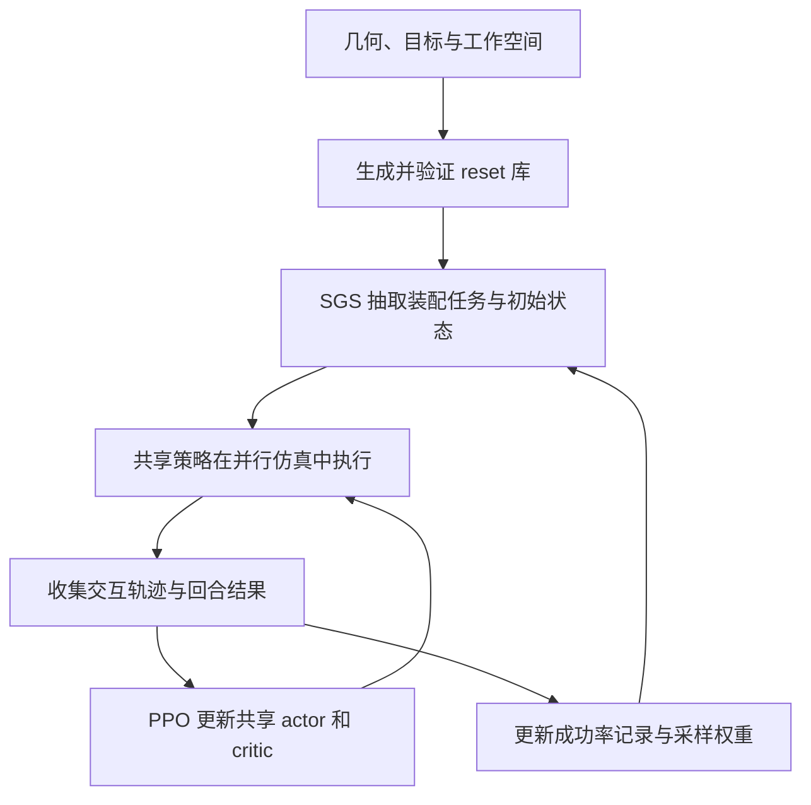

## The connection

A robot can spend billions of simulation steps trying to assemble a part and seldom reach the contact configurations where assembly becomes learnable. These three papers intervene at different points in that problem. **OmniReset supplies diverse starting states; Success-Guided Sampling (SGS) decides which configurations deserve more practice; AlphaNIST combines both with a shared policy and a common assembly objective.** Their relationship is explicit inheritance, with changes in training scope and reward formulation.

| Work | Main question | Contribution carried forward |
|---|---|---|
| OmniReset | Which robot–object states should training encounter? | Programmatically generated, validated resets |
| SGS / A Balanced Data Diet | Which available configurations should the current policy practice? | Adaptive sampling from recent success histories |
| AlphaNIST | Can heterogeneous assemblies improve one another through joint training? | One policy across 20 assembly tasks, using resets and SGS |

These notes follow **OmniReset v3**, *Emergent Dexterity via Diverse Resets and Large-Scale Reinforcement Learning*, by Patrick Yin, Tyler Westenbroek, Octi Zhang et al. ([paper](https://arxiv.org/html/2603.15789v3), [project; ICLR 2026](https://omnireset.github.io/)); **SGS v1**, *A Balanced Data Diet: Addressing the Exploration Bottleneck in Mega-Scale RL for Robot Control*, by Octi Zhang, Mateo Guaman Castro, Patrick Yin et al. ([paper](https://arxiv.org/html/2610.12465v1), [project; CoRL 2026](https://sgs-rl.github.io/)); and **AlphaNIST v1**, *AlphaNIST: Emergent Assembly Skills from Binary Task Rewards*, by Octi Zhang, Iretiayo Akinola, Rosario Scalise et al. ([preprint](https://arxiv.org/html/2610.13354v1), [project](https://alpha-nist.github.io/)). The October preprints were submitted on October 8 and 9, respectively. This is a methodological progression; it should not be read as three long, separate development cycles inferred from publication dates.

## What the reset generator actually supplies

OmniReset starts with a specified object, goal configurations, and workspace. It precomputes feasible grasps and nearby goal configurations. For the latter, it places the object at the goal and applies small random forces: a fully inserted peg can produce partially inserted configurations through simulated dynamics. Candidate resets cover reaching, proximity to the object, stable grasping, and proximity to the goal. Collision checking and several simulation steps reject invalid candidates before caching the accepted states. [OmniReset §3.1–3.2](https://arxiv.org/html/2603.15789v3#S3.SS2)

The result is a bank of **states**. PPO subsequently generates the **action trajectories**. A near-goal reset might let a policy practice the last part of insertion before it can reliably pick up the part. Starting from the table then requires the policy to learn the whole sequence. These are different episode starts: the system does not teleport the robot to a later configuration after each successful substep. The paper does not prescribe connections between the cached states.

“Good initialization data” therefore needs two meanings kept separate. A state can be useful for learning because it exposes a rare interaction. Physical validity asks whether that state obeys the simulator's constraints. Neither property establishes that a particular robot can reliably reach it from the deployment distribution. That last distinction is an interpretation of the setup, and it is where I would focus a reproduction audit.

The physical model also matters. SGS's transfer appendix identifies excessively high gripper-pad friction in the earlier OmniReset setup as a source of unrealistic grasps. A contact state that survives simulation can still exploit the simulator. Short stabilization is evidence of simulator feasibility, not a certificate of real-world grasp stability. [SGS Appendix C.2](https://arxiv.org/html/2610.12465v1#A3.SS2)

## SGS changes practice frequency

Uniform sampling gives the same opportunity to configurations the robot has mastered and configurations it cannot yet solve. SGS records recent binary outcomes for each configuration and assigns more probability near a target success rate. Its general kernel has a tunable target, concentration, and sampling temperature; it leaves every configuration sampleable. In assembly, configurations include the initial robot/object state and the assembly goal. SGS also studies locomotion, where terrain is part of the configuration. [SGS §3](https://arxiv.org/html/2610.12465v1#S3)

AlphaNIST writes its adopted sampling rule as

$$
q_i\propto\varepsilon_q+\sqrt{\hat p_i(1-\hat p_i)}.
$$

Here $\hat p_i$ is the recent success rate of reset entry $i$. This weight peaks at 0.5. It is AlphaNIST's stated rule; SGS's original formulation includes additional parameters and temperature. [AlphaNIST §IV-B](https://arxiv.org/html/2610.13354v1#S4.SS2)

For intuition, imagine three starts with estimated success rates of 0%, 50%, and 100%. The middle one receives the largest weight, while the others retain a probability floor. As the policy changes, the preferred starts change too. This is adaptive practice allocation, with success rate serving as a proxy for useful experience. It does not guarantee that every moderately successful configuration produces a large learning gain.

Coverage still limits this mechanism. In SGS's UR5e rod-in-hole ablation, removing near-goal resets produced zero success on the remaining reset families over three training seeds. Reweighting a bank cannot sample a missing configuration. [SGS Appendix B.3](https://arxiv.org/html/2610.12465v1#A2.SS3)

## AlphaNIST shares the learner across assemblies

The main AlphaNIST setting trains one policy across all 20 NIST ATB1 assembly tasks. An entry stores an assembly identity and an initial state; sampling selects both. Rollouts from those entries update shared actor and critic networks with PPO. The actor receives robot information and surface point clouds, with geometry carrying the task variation. The assembly experiments in SGS trained separate policies per task; its locomotion experiments already shared a policy across terrains. [AlphaNIST §II-A and §IV](https://arxiv.org/html/2610.13354v1#S4)

This diagram separates two feedback loops: PPO changes what the robot does; SGS changes where the next episode starts. The bank provides no expert action labels. Task definitions, geometry, and initialization rules still supply prior information.

Multi-task training also needs to be distinguished from multi-part execution. In the main experiment, an episode concerns one assembly pair. Separate extended experiments train policies for several active pairs in one episode, up to ten, with reward only after all are complete. The picture of the fully assembled 20-part board depicts the benchmark goal configurations. It does not establish a policy that completes all 20 parts in one episode. [AlphaNIST §V-D–VI](https://arxiv.org/html/2610.13354v1#S5.SS4)

## Where task-specific knowledge remains

AlphaNIST uses the following reward structure, with $d_{\mathrm{asm}}^e$ measuring error relative to task $e$'s completed assembly:

$$
r_t=\mathbf{1}\!\left[d_{\mathrm{asm}}^e(s_{t+1})<\epsilon\right]
-c\left(\lVert a_t\rVert^2+\lVert\dot q_t\rVert^2+\lVert\tau_t\rVert^2\right).
$$

The task reward is issued once on success. Control costs apply throughout the episode. The common threshold is $\epsilon=0.001\,\mathrm{m}$ under the paper's assembly-error definition. Task-specific geometry defines what “assembled” means; reward form and control-cost coefficient are shared. [AlphaNIST §IV-C](https://arxiv.org/html/2610.13354v1#S4.SS3)

| Design choice | Prior information supplied | What learning still has to discover |
|---|---|---|
| Goal definition | Completed configuration for each assembly | Actions that achieve it |
| Reset bank | Useful interaction regions and feasible configurations | How to reach and connect those regions |
| SGS | A preference for intermediate empirical success | Which behaviors increase success |
| Shared policy | A common representation and parameter set | Which experience transfers across assemblies |

Reward inheritance needs a source qualification. OmniReset explicitly includes object–goal and gripper–object distance terms. AlphaNIST describes SGS as retaining grasp-related shaping, but **SGS's own Appendix A.3.2 lists assembly success, terminal failure, and action/velocity regularization**. Those descriptions do not align. I would not base the progression on a claim that AlphaNIST first introduced binary task rewards. The clearer development is joint assembly learning with its stated common objective. [OmniReset §3.3](https://arxiv.org/html/2603.15789v3#S3.SS3), [SGS reward specification](https://arxiv.org/html/2610.12465v1#A1.SS3.SSS2), [AlphaNIST §II-C](https://arxiv.org/html/2610.13354v1#S2.SS3)

## What the evidence supports

SGS demonstrates better scaling of simulation experience, including Franka nut assembly at roughly one million parallel environments, and reports RGB policy transfer on UR5e hardware. AlphaNIST reports **98.2% training success at 64K environments**, compared with an 81.4% mean for separately trained policies at the same 25K-iteration checkpoints. Each specialist receives its own run budget, so the collection costs more overall. Its separate 256K scaling evaluation reports **97.4% with beta sampling versus 84.3% with uniform sampling**. Its results are entirely in simulation. The different robots, tasks, reset distributions, and evaluation protocols prevent treating these numbers as a common leaderboard. [SGS §4](https://arxiv.org/html/2610.12465v1#S4), [AlphaNIST §V–VI](https://arxiv.org/html/2610.13354v1#S5)

My reading is that these works move part of the engineering burden into the training distribution. That is valuable when a simulator can cheaply supply plausible intermediate states. If those states are expensive to generate, physically misleading, or poorly connected to real deployment starts, reset construction becomes a central engineering problem again.

For a new assembly family, I would first audit the reset bank and success predicate, then compare uniform sampling with SGS under the same interaction budget. To test the value of shared learning, I would compare joint and separate policies on full-task starts, including configurations outside the cached bank. The unresolved question is how much generation and validation work each new geometry requires, and how well those simulated starting states prepare the policy for physical contact on hardware.

## 三篇论文的关系

机器人即使在仿真中交互数十亿步，也可能很少进入真正能学会装配的接触配置。这三篇论文分别处理这个问题的不同部分：**OmniReset 提供多样起点，Success-Guided Sampling（SGS）分配练习机会，AlphaNIST 将二者与共享策略、统一装配目标结合。** 它们存在明确的方法继承，同时扩展了训练范围并调整了奖励设计。

| 工作 | 核心问题 | 后续继承的贡献 |
|---|---|---|
| OmniReset | 训练应该接触哪些机器人—物体状态？ | 程序化生成并验证的 reset |
| SGS / A Balanced Data Diet | 当前策略应该多练哪些已有配置？ | 根据近期成功率调整采样 |
| AlphaNIST | 不同装配能否通过联合训练互相促进？ | 使用 reset 和 SGS，让一个策略学习 20 项装配 |

本文依据 **OmniReset v3**，*Emergent Dexterity via Diverse Resets and Large-Scale Reinforcement Learning*，作者 Patrick Yin、Tyler Westenbroek、Octi Zhang 等（[论文](https://arxiv.org/html/2603.15789v3)，[项目主页；ICLR 2026](https://omnireset.github.io/)）；**SGS v1**，*A Balanced Data Diet: Addressing the Exploration Bottleneck in Mega-Scale RL for Robot Control*，作者 Octi Zhang、Mateo Guaman Castro、Patrick Yin 等（[论文](https://arxiv.org/html/2610.12465v1)，[项目主页；CoRL 2026](https://sgs-rl.github.io/)）；以及 **AlphaNIST v1**，*AlphaNIST: Emergent Assembly Skills from Binary Task Rewards*，作者 Octi Zhang、Iretiayo Akinola、Rosario Scalise 等（[预印本](https://arxiv.org/html/2610.13354v1)，[项目主页](https://alpha-nist.github.io/)）。后两篇预印本分别于 10 月 8 日和 9 日提交。这里讨论的是方法递进，不能仅凭发表日期推断它们经历了三个相隔很久的研发周期。

## Reset 生成器具体提供了什么

OmniReset 需要指定目标物体、目标配置和工作空间。它先预计算可行抓持以及目标附近的配置。生成后者时，系统把物体放在完成状态，施加小幅随机力，使物体脱离目标位置；完全插入的插销由此产生部分插入的状态。候选 reset 覆盖接近物体、物体附近、稳定抓持和目标附近四类区域，再通过碰撞检查与若干步仿真筛掉无效配置，缓存通过验证的状态。[OmniReset §3.1–3.2](https://arxiv.org/html/2603.15789v3#S3.SS2)

得到的是**状态库**，随后 PPO 在线生成**动作轨迹**。例如，机器人尚不能稳定抓起零件时，接近目标的 reset 已经允许它练习插入的最后一段；从桌面起步的回合则要求它学会完整流程。这些是不同回合的起点，系统不会在每完成一个子步骤后把机器人传送到下一阶段。论文也没有预先规定缓存状态之间的连接方式。

“好的初始化数据”因此包含两个需要分开的判断：状态是否覆盖了难以遇到、值得练习的交互，以及状态是否满足仿真器的物理约束。两者都没有直接证明机器人能从实际部署的初态可靠到达该状态。这是我对训练设置的理解，也是复现时会重点检查的地方。

物理模型本身还会影响验证结果。SGS 的实机迁移附录指出，早期 OmniReset 设置中很高的夹爪垫摩擦会产生不真实的抓持。能在仿真里维持的接触仍可能利用了模型偏差，因此短时稳定化只能提供仿真可行性的证据，不能认证真实抓持的稳定性。[SGS 附录 C.2](https://arxiv.org/html/2610.12465v1#A3.SS2)

## SGS 改变每种配置的练习频率

均匀采样会把相同机会分给已经掌握的配置和暂时完全做不到的配置。SGS 为每个配置记录近期的二值结果，让接近目标成功率的配置获得更高采样概率。其一般形式包含可调的目标成功率、集中程度和采样温度，同时保留所有配置被抽中的机会。装配配置包含机器人与物体初态及装配目标；在 SGS 研究的运动控制任务中，地形也属于配置的一部分。[SGS §3](https://arxiv.org/html/2610.12465v1#S3)

AlphaNIST 将采用的采样规则写为：

$$
q_i\propto\varepsilon_q+\sqrt{\hat p_i(1-\hat p_i)}.
$$

其中 $\hat p_i$ 是 reset 条目 $i$ 的近期成功率，权重在 0.5 附近最高。这是 AlphaNIST 明确给出的公式；SGS 原始形式还包含其他参数与温度，不能把两者的最终采样概率直接视为完全相同。[AlphaNIST §IV-B](https://arxiv.org/html/2610.13354v1#S4.SS2)

可以设想三个起点的成功率分别为 0%、50% 和 100%：中间那个获得最高权重，其余仍保留非零概率。随着策略变化，优先练习的起点也变化。成功率在这里是衡量经验价值的代理信号，不能保证每个中等成功率的配置都会带来很大的学习进展。

状态覆盖仍然限制采样的作用。在 SGS 的 UR5e 杆孔插入消融中，去掉 near-goal reset 后，三个训练种子在剩余 reset 类别上均得到零成功率。调整权重无法抽到状态库中缺失的配置。[SGS 附录 B.3](https://arxiv.org/html/2610.12465v1#A2.SS3)

## AlphaNIST 让不同装配共享学习过程

AlphaNIST 主实验用一个策略学习 NIST ATB1 的全部 20 项装配。每条状态库记录同时包含装配身份与初始状态，抽中一个条目就确定了“练哪项装配、从哪里开始”。不同条目的 rollout 共同通过 PPO 更新共享的 actor 和 critic。Actor 接收机器人信息与表面点云，通过几何观察任务差异。SGS 的装配实验为不同任务分别训练策略，而其运动控制实验已经在多个地形间共享策略。[AlphaNIST §II-A、§IV](https://arxiv.org/html/2610.13354v1#S4)

图中有两个反馈环：PPO 改变机器人如何行动，SGS 改变下一个回合从哪里开始。状态库没有提供专家动作标签；任务定义、几何和初始化规则仍然提供了先验。

还需要区分多任务训练与多零件执行。主实验中的一个回合处理一对装配；扩展实验另外训练同一回合处理多个装配对的策略，最多测试十对，全部完成才获得任务奖励。论文里整块板全部装好的图片展示的是目标配置，尚不能据此认为一个策略已经能在单回合装完全部 20 个零件。[AlphaNIST §V-D–VI](https://arxiv.org/html/2610.13354v1#S5.SS4)

## Task-specific 的知识留在哪里

AlphaNIST 的奖励结构如下，其中 $d_{\mathrm{asm}}^e$ 衡量相对于任务 $e$ 完整装配状态的误差：

$$
r_t=\mathbf{1}\!\left[d_{\mathrm{asm}}^e(s_{t+1})<\epsilon\right]
-c\left(\lVert a_t\rVert^2+\lVert\dot q_t\rVert^2+\lVert\tau_t\rVert^2\right).
$$

任务奖励在成功时发放一次，控制代价则贯穿整个回合。在论文的装配误差定义下，共同阈值为 $\epsilon=0.001\,\mathrm{m}$。每项任务的目标几何决定什么叫“装好了”，奖励形式和控制代价系数保持共享。[AlphaNIST §IV-C](https://arxiv.org/html/2610.13354v1#S4.SS3)

| 设计 | 提供的先验 | 仍需学习的内容 |
|---|---|---|
| 目标定义 | 每项装配的完成配置 | 达到目标的动作 |
| Reset 库 | 有用的交互区域与可行配置 | 如何到达和连接这些区域 |
| SGS | 优先选择中等经验成功率的配置 | 哪些操作能够提高成功率 |
| 共享策略 | 共同的表示与参数 | 哪些经验能在任务间迁移 |

奖励的继承关系存在一处需要保留的来源差异。OmniReset 明确使用物体到目标、夹爪到物体的距离项。AlphaNIST 将 SGS 描述为仍含抓持相关 shaping，但 **SGS 自己的附录 A.3.2 列出的是装配成功、终止失败，以及动作和速度正则项**。这两个描述没有完全对齐。因此，我不会把“AlphaNIST 首次引入二值任务奖励”作为这条发展线的依据；更清楚的推进是，在它所定义的共同目标下联合学习不同装配。[OmniReset §3.3](https://arxiv.org/html/2603.15789v3#S3.SS3)、[SGS 奖励定义](https://arxiv.org/html/2610.12465v1#A1.SS3.SSS2)、[AlphaNIST §II-C](https://arxiv.org/html/2610.13354v1#S2.SS3)

## 实验支持到哪一步

SGS 展示了仿真经验随规模扩大的更好利用，包括约百万并行环境下的 Franka 螺母装配，并报告了 RGB 策略向 UR5e 实机的迁移。AlphaNIST 报告在 **64K 环境下达到 98.2% 训练成功率**，相同 25K 迭代检查点上的独立策略平均为 81.4%。每个独立策略都有自己的运行预算，因此训练整组独立策略的总成本更高。另一组 256K 规模评估中，**beta 采样为 97.4%，均匀采样为 84.3%**。AlphaNIST 的结果全部来自仿真。机器人、任务、初态分布和评估协议不同，这些数字不能拼成一张统一排行榜。[SGS §4](https://arxiv.org/html/2610.12465v1#S4)、[AlphaNIST §V–VI](https://arxiv.org/html/2610.13354v1#S5)

我的理解是，这些工作把一部分工程负担移到了训练分布上。当仿真器能低成本提供合理的中间状态时，这种做法很有价值。如果这些状态难以生成、物理模型有误导，或与实际部署起点缺乏有效连接，reset 构建就会重新成为主要的工程难题。

面对新的装配类别，我会先检查 reset 库与成功判据，再在相同交互预算下比较均匀采样与 SGS。要判断共享学习的价值，则需要在完整任务起点上比较联合策略与独立策略，并纳入缓存库之外的配置。接下来真正需要回答的是：每引入一种新几何，要增加多少生成与验证工作，以及这些仿真起点究竟能在多大程度上为真实硬件接触做好准备。


