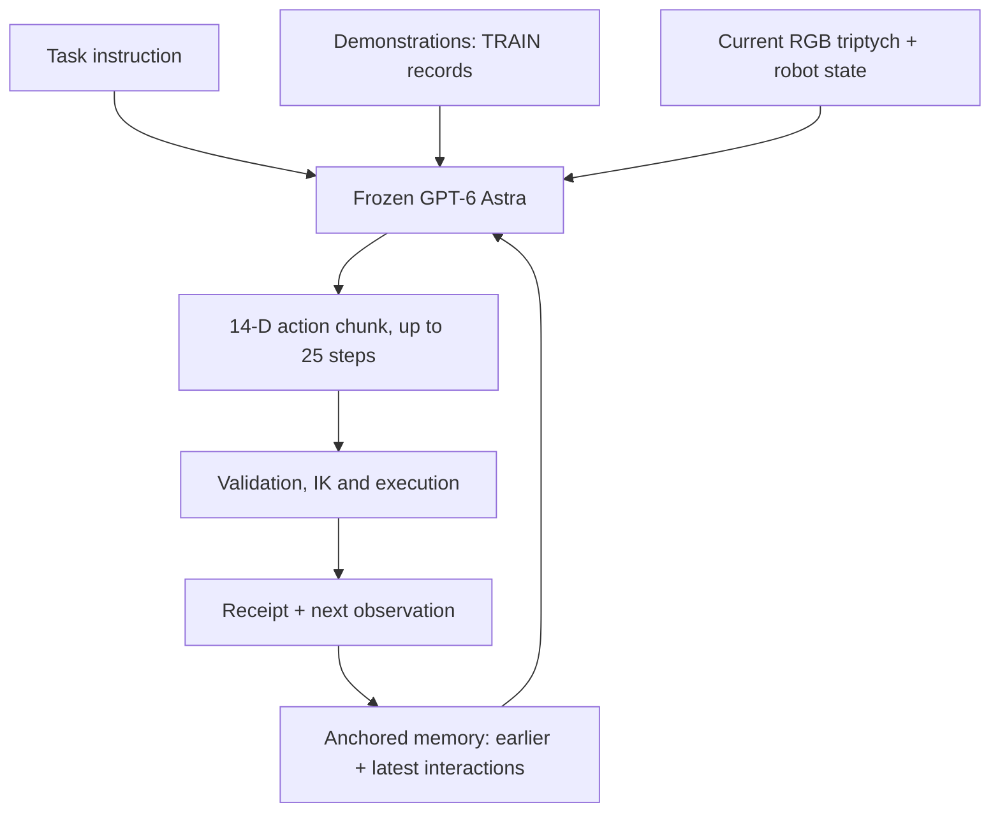
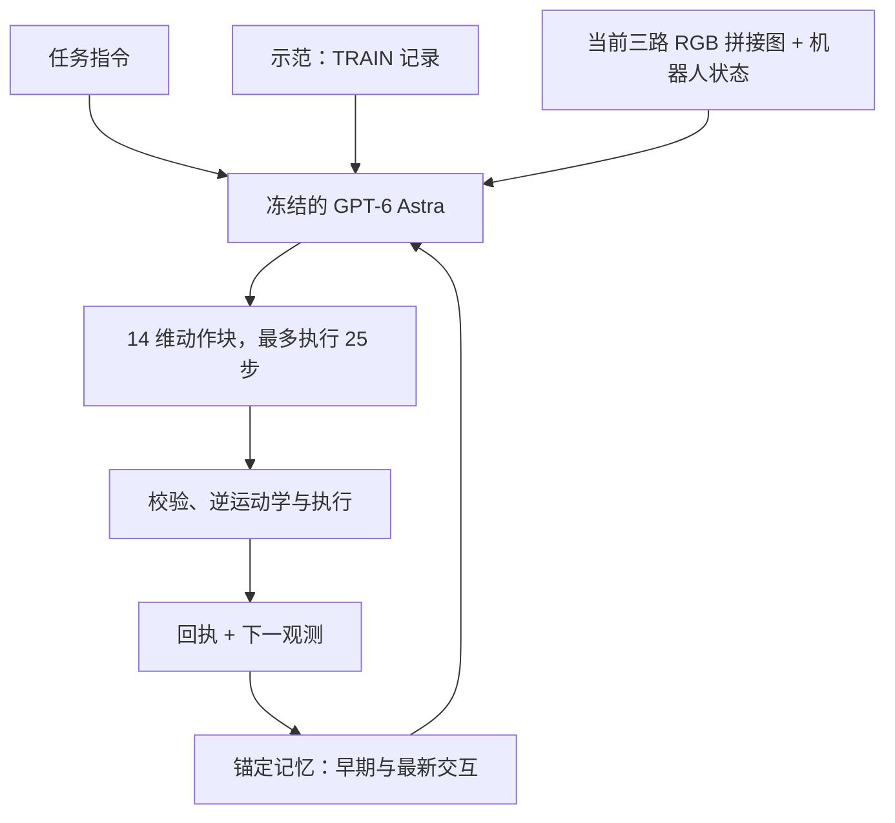

**RoboICL** asks what changes when the model stays fixed but the record handed back to it improves. Its two sources of context serve different jobs. A demonstration supplies a task procedure; the robot's own execution history supplies evidence about what happened in the current trial. Both are formatted as the same observation-action-receipt-observation sequence, so GPT-6 Astra can inspect expert behavior and live controller feedback through one interface.

Fangcheng Liu, Yeqing Shen, Anda Cheng, Weishi Mi, Chao Tang, Chenyuan Liu, Yushun Xiang, Tingguang Li, Yong-Lu Li and Yehui Tang. [arXiv:2609.34261v1](https://arxiv.org/abs/2609.34261v1), September 28, 2026 · [Code](https://github.com/Mosi-AI/RoboICL) · [Project page](https://mosi-ai.github.io/RoboICL-GPT6-Astra.github.io/)

### Two memories, one grammar

At round $t$, the model receives the task $g$, the current image and proprioceptive state $(o_t,z_t)$, $K$ recorded demonstrations, and interaction memory $M_t$. It predicts an action chunk $A_t\in\mathbb{R}^{H\times d_a}$ without updating its weights. On RoboDojo, each row contains seven values per arm: three position increments, a three-dimensional rotation-vector increment, and one gripper target. The paper's controller validates the chunk, solves inverse kinematics, and executes an admissible prefix at 25 Hz. [Method, Eq. 1-2](https://arxiv.org/html/2609.34261v1#S3)

Each retained interaction records the state before an action, the proposed chunk, a receipt, and the next state. For expert data, the receipt is reconstructed from the recording and identifies which actions were executed. For a live rollout, it reports dispatched and executed steps, target tracking, interruptions, and the observed result. Robot calls that execute no motion remain in the latest request, while memory stores only positive-length transitions.

The memory policy is the paper's most reusable design choice. With $B$ slots, the first $B-1$ slots keep observations at fixed temporal targets $\lfloor iT/B\rfloor$; the last slot keeps the newest interaction. Omitted ranges are marked with `<TRAJECTORY_GAP>`. This differs from a sliding window by preserving the initial state and intermediate stages, which matters when a later step depends on a layout or a procedure established much earlier.

### Why the context allocation matters

The context budget is limited to 50 images. Demonstration blocks and memory blocks compete for that space, so adding more examples can starve the live history. With one demonstration and a total of 24 interaction blocks, the tested $(J,B)$ allocations of $(8,16)$, $(12,12)$, $(16,8)$ and $(22,2)$ scored 57.50, 80.25, 80.00 and 60.75 on a four-task panel. The balanced $(12,12)$ setting became the main one-shot configuration.

A second ablation compares temporal anchors with a first-plus-recent selector. Anchored memory scored 80.25, against 73.50 for first-plus-recent, on the same four tasks and five layouts each. The gap is 14 points on Build Tower, nine on Put Bottles into Dustbin and four on Insert Tubes. This evidence supports keeping distributed events; it does not show that the specific anchor formula is optimal. [Context ablations, §4.1](https://arxiv.org/html/2609.34261v1#S4.SS1)

### What the benchmark shows

On 30 RoboDojo tasks, RoboICL used interaction memory alone for Open tasks and one demonstration for the other categories. Its 30-task Overall progress score was **50.64**, compared with **33.68** for the strongest listed baseline. Category means were 54.75 on Open, 70.00 on Memory, 38.53 on Precision and 44.11 on Long-Horizon. The precision result is close to Liber-0 Preview's 38.28; the long-horizon result trails Simate-beta's 57.84.

Deposit Coin is a useful precision case. RoboICL averaged 78.00 over 50 layouts, with 37 full-score episodes, while every comparison method scored at most 18.67. The selected trace shows repeated visual checks after failed retention, a transfer between wrists, and millimetre-scale insertion corrections. That trace explains how the system can correct an action, but one selected layout does not establish that the same recovery mechanism accounts for the aggregate gain.

On a separate ten-task panel, one-shot RoboICL reached 60.60, versus 45.60 for zero-shot RoboICL, 38.50 for GPT-as-Policy Direct and 62.60 for a $\pi_{0.5}$ + GPT-6 Astra hybrid. On three Franka Research 3 tasks, mean progress rose from 14.45 with no demonstration to 63.33 with one and 78.89 with three. Each condition contains five randomized trials per task, so this is directional evidence from a small real-robot study.

The optional Jev gate reused selected action suffixes and reduced GPT-6 Astra calls by 33-48% on two development tasks. Provider counters also showed a 92.4% token-weighted KV-cache hit rate across 1,810 calls. These numbers make context layout part of the systems result: stable prefixes and fewer repeated calls can matter as much as the instruction wording.

### What I take from it

RoboICL's contribution is a controlled treatment of context serialization. The model, cameras and benchmark remain similar while the experiment changes demonstrations, memory density, temporal selection and action horizon. That makes the result more informative than another leaderboard entry alone. It also connects directly to GPT-Policy and RoboProbe: GPT-Policy compiles richer demonstrations into tool requests, RoboProbe measures a lean direct-action interface, and RoboICL formalizes how execution records are retained across a rollout.

The remaining evidence gaps are substantial. RoboDojo evaluations use seed zero, the main comparison covers 30 tasks, and several tasks are waived or use fewer layouts. Real-robot trials cover three tasks with five trials per condition. The paper tests one model, and the development layouts also guided context choices. I would next want held-out layouts, more seeds, a latency and token breakdown against the official harness, and a memory ablation on tasks whose decisive evidence appears late without having inspired the anchor design.

**RoboICL** 研究的是：模型参数保持不变时，交给模型的历史记录怎样组织，控制结果会怎样变化。它把上下文分成两类。示范提供任务流程，机器人自己的执行历史提供当前试验中实际发生了什么。两类记录都写成 observation-action-receipt-observation 序列，GPT-6 Astra 因而可以用同一套接口阅读专家行为和实时控制反馈。

作者为 Fangcheng Liu、Yeqing Shen、Anda Cheng、Weishi Mi、Chao Tang、Chenyuan Liu、Yushun Xiang、Tingguang Li、Yong-Lu Li 和 Yehui Tang。[arXiv:2609.34261v1](https://arxiv.org/abs/2609.34261v1)，2026 年 9 月 28 日 · [代码](https://github.com/Mosi-AI/RoboICL) · [项目页](https://mosi-ai.github.io/RoboICL-GPT6-Astra.github.io/)

### 两类记忆，共用一种语法

在第 $t$ 轮，模型接收任务 $g$、当前图像与本体状态 $(o_t,z_t)$、$K$ 段示范和交互记忆 $M_t$，再输出动作块 $A_t\in\mathbb{R}^{H\times d_a}$，整个过程不更新权重。在 RoboDojo 上，动作矩阵的每一行包含每条机械臂的七个值：三个位置增量、三维旋转向量增量和夹爪目标。控制器检查动作块，求解逆运动学，再以 25 Hz 执行合法前缀。[方法，公式 1-2](https://arxiv.org/html/2609.34261v1#S3)

每条保留的交互记录动作前状态、提出的动作块、回执和下一状态。示范中的回执由录制数据重建，说明哪些动作实际执行过；实时回执则报告下发步数、执行步数、目标跟踪、控制中断和观测结果。没有产生运动的拒绝调用会留在最新请求中，只有真正执行了动作的转移才进入记忆。

这段记忆策略最有复用价值。设记忆有 $B$ 个槽位，前 $B-1$ 个槽保留时间目标 $\lfloor iT/B\rfloor$ 附近的观测，最后一个槽保留最新交互，省略区间用 `<TRAJECTORY_GAP>` 标出。固定时间锚让任务早期的布局和操作阶段不会随着滑动窗口消失。当后续动作依赖开头看到的场景，或者依赖很久以前建立的任务状态，这类记录就有用处。

### 上下文容量怎样分配

每次请求最多包含 50 张图像，示范块和实时记忆会竞争这个配额。增加示范数量可能挤压机器人自己的执行记录。作者只给一段示范，并把示范块数与记忆块数固定为总数 24，比较 $(J,B)=(8,16)$、$(12,12)$、$(16,8)$ 和 $(22,2)$。四任务面板上的得分分别为 57.50、80.25、80.00 和 60.75，最终采用均衡的 $(12,12)$ 作为主要 one-shot 配置。

另一组消融比较固定时间锚与“第一次交互加最近交互”。在相同四个任务、每个任务五个布局上，锚定记忆得到 80.25，first-plus-recent 得到 73.50。Build Tower 上相差 14 分，Put Bottles into Dustbin 上相差 9 分，Insert Tubes 上相差 4 分。这组结果支持保留分布在不同阶段的交互，还不足以证明当前锚点公式最优。[上下文消融，第 4.1 节](https://arxiv.org/html/2609.34261v1#S4.SS1)

### 基准结果说明了什么

在 30 个 RoboDojo 任务上，Open 类别仅使用交互记忆，其余类别各给一段示范。RoboICL 的 30 任务 Overall 进度分为 **50.64**，最强对照基线为 **33.68**。四个类别的均值分别是 Open 54.75、Memory 70.00、Precision 38.53 和 Long-Horizon 44.11。Precision 与 Liber-0 Preview 的 38.28 接近，Long-Horizon 则低于 Simate-beta 的 57.84。

Deposit Coin 能说明精度任务的收益。RoboICL 在 50 个布局上平均得到 78.00，其中 37 次满分；其他对照方法最高只有 18.67。作者展示的一条轨迹包含多次抓取失败后的视觉检查、左右手交接和毫米级插入修正。它能说明系统会在执行后改动作，单条挑选出的轨迹仍不足以解释全部聚合收益。

在另一组十任务实验里，one-shot RoboICL 得到 60.60，零示范版本为 45.60，GPT-as-Policy Direct 为 38.50，$\pi_{0.5}$ + GPT-6 Astra 混合系统为 62.60。三台 Franka Research 3 的真机任务把平均进度从零示范的 14.45 提高到 one-shot 的 63.33 和 three-shot 的 78.89。每个条件、每个任务只有五次随机试验，因此这里适合看作方向性证据。

可选的 Jev 门控会复用部分动作后缀，在两项开发任务上把 GPT-6 Astra 调用量减少 33-48%。1,810 次调用中，提供方统计的 token 加权 KV 缓存命中率为 92.4%。这提醒我们，稳定前缀和避免重复计算也会影响系统成本，不能只比较 prompt 写得好不好。

### 我的判断

RoboICL 的价值在于系统地改变上下文呈现方式。模型、相机和 benchmark 大体保持不变，实验分别改变示范、记忆密度、时间选择与动作时域，因此结果比单纯刷一个榜单更有解释力。它也与 GPT-Policy 和 RoboProbe 形成清晰对照：GPT-Policy 把更丰富的示范编译为工具请求，RoboProbe 测量一个精简的直接动作接口，RoboICL 研究整段 rollout 的执行记录如何保留。

证据仍有明显缺口。主实验只使用 seed 0，榜单比较覆盖 30 个任务，部分任务被豁免或使用较少布局。真机只测试三个任务，每个条件五次试验。作者只评估一个模型，布局选择也参与了上下文配置的设计。下一步值得加入完全留出的布局、更多随机种子、与官方 harness 的延迟和 token 对照，并在没有参与锚点设计的任务上检验长期记忆。

