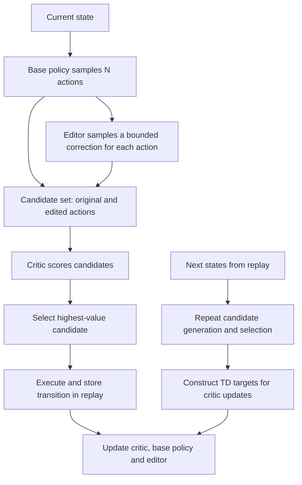
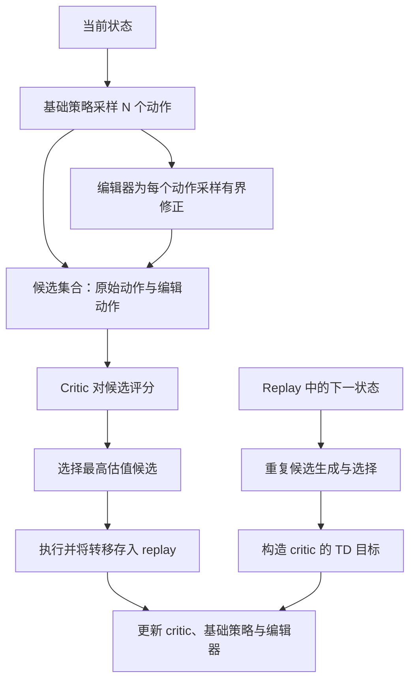

## TL;DR

**EXpressive Policy Optimization (EXPO)** improves a diffusion policy through a separate, small action-editing network and Q-based candidate selection. The base policy keeps learning with a supervised denoising objective. The edit policy receives a state and a proposed action, then samples a bounded correction trained to increase Q while retaining exploration. At execution time, EXPO compares the original and edited candidates and chooses the highest-value action. It repeats this selection at the next state when constructing the critic's TD target.

The resulting learning loop has two routes for improvement: Q gradients train the editor directly, while selected actions enter replay through environment interaction and subsequently become imitation targets for the base policy. **The base policy is updated online, but Q gradients never pass through its denoising chain.** [Paper, Sections 4.1–4.4](https://arxiv.org/pdf/2507.07986v3)

## Paper and reading version

**EXPO: Stable Reinforcement Learning with Expressive Policies**, by Perry Dong, Qiyang Li, Dorsa Sadigh, and Chelsea Finn, appeared at **ICLR 2026**. These notes use the 16-page [arXiv v3](https://arxiv.org/abs/2507.07986v3), revised April 30, 2026, and the [official implementation](https://github.com/pd-perry/EXPO) at commit `bbd5713`, checked November 16, 2026. The method concerns online RL with prior data and offline-to-online fine-tuning; its main experiments instantiate the expressive policy with DDPM.

## The editor operates in action space

Let the base policy generate $a_0\sim\pi_\psi(\cdot\mid s)$. The editor conditions on **both $s$ and $a_0$**. In the implementation, the observation and action vectors are concatenated and passed through an MLP that predicts a Gaussian mean and state-dependent standard deviation. A tanh transformation and scale $\beta$ produce the residual:

$$
u\sim\mathcal N(\mu_\theta(s,a_0),\operatorname{diag}(\sigma_\theta^2(s,a_0))),\qquad
\delta=\beta\tanh(u),\qquad \widetilde a=a_0+\delta.
$$

Thus $\delta_j\in[-\beta,\beta]$ in every action dimension. The editor changes the final action vector after base-policy sampling; it does not modify a diffusion latent or execute another denoising chain. The bound constrains the correction coordinate by coordinate. It provides no guarantee that the final action is optimal or physically safe.

Conditioning on the proposed action matters when the base distribution has several modes: different candidates at the same state can require different corrections. The paper interprets this as local refinement within modes, followed by candidate selection across modes. The editor remains stochastic, so its entropy also supplies exploration around those proposals. [Equation 1 and Section 4.1](https://arxiv.org/pdf/2507.07986v3) · [Editor implementation](https://github.com/pd-perry/EXPO/blob/bbd571306b413e05d5d4b01a6efa20352c2b891a/expo/agents/sac/expo_learner.py)

The editor minimizes a SAC-style objective:

$$
\mathcal L_{\mathrm{edit}}(\theta)=
\mathbb E_{(s,a)\sim\mathcal D,\,\delta\sim\pi_\theta(\cdot\mid s,a)}
\left[\alpha\log\pi_\theta(\delta\mid s,a)-Q_\phi(s,a+\delta)\right].
$$

The Q term favors useful corrections; the entropy term discourages premature collapse to a single correction. During this update, critic parameters are held fixed while gradients flow through Q's action input into the editor. The implementation includes the log-density correction for residual scaling, subtracting $d\log\beta$ for action dimension $d$, and learns the temperature $\alpha$.

There is an important distinction between **training anchors and execution anchors**. Equation 2 and `update_edit_actor` take $(s,a)$ from replay: the anchor is the recorded dataset action. During rollout and TD candidate generation, the anchor is freshly sampled from the base policy. Describing every editor update as a call to the diffusion sampler would misrepresent the released code. [Equation 2](https://arxiv.org/pdf/2507.07986v3) · [update_edit_actor](https://github.com/pd-perry/EXPO/blob/bbd571306b413e05d5d4b01a6efa20352c2b891a/expo/agents/sac/expo_learner.py#L434)

## The executed policy includes a selection step

For each state, sample $N$ base actions and one edit per base action. Form a set containing both versions:

$$
\mathcal C(s)=\{a_i,\ a_i+\delta_i\}_{i=1}^{N},\qquad
 a^*=\operatorname*{arg\,max}_{a\in\mathcal C(s)}Q_{\mathrm{select}}(s,a).
$$

EXPO calls this the **on-the-fly (OTF) policy**. It is a sampling-and-selection procedure built from the base policy, editor, and critic. Keeping the original candidates lets the selector reject an edit whose estimated value is lower. Selection only maximizes the learned critic over the sampled set; critic error and insufficient candidate coverage remain possible.

With $N=8$, this gives sixteen candidates. The same construction supplies $a^{*\prime}$ at each next state in a replay minibatch, producing the basic target

$$
y=r+\gamma m\,Q_{\bar\phi}(s',a^{*\prime}),\qquad
\mathcal L_Q=\mathbb E_{\mathcal D}\left[(Q_\phi(s,a)-\operatorname{stopgrad}(y))^2\right],
$$

where $m$ is the bootstrap mask and $\bar\phi$ denotes target-critic parameters. This makes TD learning account for the candidate improvement used during execution. Backing up a single unselected imitation-policy action would train against a weaker next-state decision rule. The paper's Can and Square ablation finds candidate maximization in the backup important for sample efficiency. [Section 4.2, Algorithm 1, Figure 5](https://arxiv.org/pdf/2507.07986v3)

The released learner uses ten critics. For selection and target evaluation it subsamples two and takes their minimum; the editor's loss uses the mean of the online critic ensemble. Sampling during rollout uses an averaged target base policy, while the batched next-action sampler uses the current base parameters. These are implementation details beyond the paper's single-$Q$ notation. [Official learner](https://github.com/pd-perry/EXPO/blob/bbd571306b413e05d5d4b01a6efa20352c2b891a/expo/agents/sac/expo_learner.py)

## What the base policy learns online

Given a replay action $a$, draw diffusion timestep $t$ and Gaussian noise $\epsilon$, then train the base network to predict that noise:

$$
a_t=\sqrt{\bar\alpha_t}\,a+\sqrt{1-\bar\alpha_t}\,\epsilon,\qquad
\mathcal L_{\mathrm{base}}(\psi)=
\mathbb E_{(s,a),t,\epsilon}\left[\|\epsilon-\epsilon_\psi(a_t,s,t)\|_2^2\right].
$$

This is ordinary DDPM denoising MSE, as implemented in `update_actor`. There is no Q weighting of individual imitation examples and no backpropagation through the sampled candidate argmax. Offline demonstrations remain useful targets; online data contribute actions actually executed by the OTF policy, including selected edits. Improvements can therefore enter the base policy through the changing replay distribution, alongside unsuccessful exploratory behavior. EXPO does not train the base solely on successful trajectories or relabel every replay action with a newly optimized action. [Section 4.4](https://arxiv.org/pdf/2507.07986v3) · [update_actor](https://github.com/pd-perry/EXPO/blob/bbd571306b413e05d5d4b01a6efa20352c2b891a/expo/agents/sac/expo_learner.py)

## A complete training iteration

The following sequence follows Algorithm 1 and the released training loop. The repository's default sampling mix is 50% offline and 50% online data.

1. **Initialize.** Optionally pretrain the base policy with imitation learning on the offline dataset. Initialize the editor and critic randomly. The online-with-prior-data setting skips pretraining but still uses offline demonstrations during learning.
2. **Interact.** At the current state, generate original and edited candidates, score them, execute the selected action, and store the actual transition $(s,a^*,r,s',m)$ in online replay.
3. **Update the critic repeatedly.** Sample mixed offline/online data. For each critic minibatch, generate and select candidates at its next states, form TD targets, regress Q, and softly update the target critics.
4. **Update the base once.** Use the last minibatch's recorded actions for DDPM noise prediction, then update the averaged target base policy.
5. **Update the editor once.** Use the same minibatch's state–action pairs as anchors, sample bounded residuals, optimize the entropy-regularized Q objective, and update the entropy temperature.

With **UTD = 20**, the released loop performs twenty critic updates per environment step, followed by one base-policy update and one editor update. It does not perform twenty updates of every network. Offline pretraining also has separate flags for the critic and editor; the supplied Square fine-tuning script disables both. [Algorithm 1](https://arxiv.org/pdf/2507.07986v3) · [Training loop](https://github.com/pd-perry/EXPO/blob/bbd571306b413e05d5d4b01a6efa20352c2b891a/train_robo.py) · [Square script](https://github.com/pd-perry/EXPO/blob/bbd571306b413e05d5d4b01a6efa20352c2b891a/scripts/expo_robomimic/expo_square_pretrain.sh)

## Configuration details that change the algorithm

| Item | Paper's main setting or released task script |
|---|---|
| Base policy | DDPM with 10 diffusion steps; 3 residual blocks, hidden width 256 |
| Editor | Gaussian MLP with 3 hidden layers of width 256, tanh-bounded residual |
| Candidate sampling | 8 base actions plus 8 edited actions |
| Optimization | Batch size 256, learning rate $3\times10^{-4}$, discount 0.99 |
| Critics | Ensemble of 10, two sampled for minimum-Q targets; target update rate 0.005 |
| Update schedule | 20 critic updates per environment step, then one update per policy |
| Edit scale examples | Robomimic: 0.05 online, 0.1 offline-to-online; Adroit: 0.7 |

A smaller $\beta$ preserves a useful behavior prior closely; a larger value permits broader exploration. The paper tunes this parameter over 0.05, 0.1, 0.3, and 0.7. The bounds are in the action coordinates used by the environment, so their meaning depends on action scaling.

The generic `expo_config.py` defaults to **N = 32 and `n_edit_samples = 0`**. Used unchanged, it disables the edit branch. The supplied task scripts override these to **8 and 8** and set the edit scale. To reproduce the reported method, inspect the task script as well as the configuration module. Also, Table 1 lists 20k Adroit pretraining steps, while Section 5.2 says EXPO skips Adroit pretraining because the dataset is narrow; the supplied pen script has no pretraining, and the separate editor ablation explicitly uses 20k. Those statements should not be collapsed into a universal Adroit recipe. [Appendix B and Section 5.5](https://arxiv.org/pdf/2507.07986v3) · [Config](https://github.com/pd-perry/EXPO/blob/bbd571306b413e05d5d4b01a6efa20352c2b891a/configs/expo_config.py)

## Entropy in the editor versus entropy in the backup

The main editor already has an entropy term. Section 4.3 proposes a further variant for limited offline data: replace hard argmax over candidates with a categorical distribution $p_j\propto\exp(\eta Q(s,a_j))$, and use its log probability in an entropy-augmented TD target. Here $\eta$ is a selection inverse temperature, distinct from the residual scale $\beta$. This finite-candidate distribution makes the sampling entropy tractable; it does not provide the exact entropy of the diffusion policy.

On Square, the paper reports that this variant can reach nearly perfect performance after one million environment steps even when the prior's imitation success is below 10%, averaged over three seeds. The released learner inspected here uses hard argmax and a TD target with no entropy bonus. Its `backup_entropy` field does not implement the soft-candidate backup in `update_critic`, and the supplied scripts set it to false. Treat Section 4.3 as a paper variant requiring additional implementation work in this revision. [Sections 4.3–4.4 and Figure 7](https://arxiv.org/pdf/2507.07986v3) · [Released critic update](https://github.com/pd-perry/EXPO/blob/bbd571306b413e05d5d4b01a6efa20352c2b891a/expo/agents/sac/expo_learner.py)

## Evidence and practical limits

The evaluation covers twelve sparse-reward simulation tasks across Antmaze, Adroit, Robomimic, and MimicGen, with three seeds; error bands show the minimum and maximum. The paper reports up to **2–3× improvement in sample efficiency on average** over prior methods. This is an environment-interaction claim, not a wall-clock speedup. Removing action edits hurts Pen and Square, while removing candidate maximization from the backup hurts Can and Square. These ablations support treating the editor and OTF backup as separate, necessary parts of the method. [Sections 5.1–5.5 and Appendix B](https://arxiv.org/pdf/2507.07986v3)

My main implementation takeaway is to track three different quantities: whether edits improve estimated Q, whether the selected actions improve measured return, and whether the base policy alone improves as replay changes. Only the second establishes task improvement; a critic can overvalue edited actions. The method also depends on a useful prior and incurs repeated diffusion sampling for every next state in every critic minibatch. I would consider EXPO when online interactions are expensive and a behavior prior already exists, while checking the compute cost before choosing a large candidate count or UTD ratio. The paper leaves computational efficiency and completely uninformed priors as open problems. [Section 6](https://arxiv.org/pdf/2507.07986v3)

## 核心概括

**EXpressive Policy Optimization（EXPO）** 通过独立的小型动作编辑网络，以及基于 Q 值的候选选择，改进扩散策略。基础策略继续使用监督去噪目标；edit policy 接收状态和一个候选动作，采样有界修正量，通过提高 Q 值并保持探索来学习。执行时，EXPO 比较原始与修正后的动作，选择估值最高者；构造 critic 的 TD 目标时，也在下一状态重复这套选择。

这个学习循环有两条改进路径：Q 梯度直接训练编辑器，选中的动作则经过环境交互进入 replay，随后成为基础策略的模仿目标。**基础策略在线更新，但 Q 梯度不穿过它的去噪链。** [论文第 4.1–4.4 节](https://arxiv.org/pdf/2507.07986v3)

## 论文与阅读版本

论文 **EXPO: Stable Reinforcement Learning with Expressive Policies**，作者为 Perry Dong、Qiyang Li、Dorsa Sadigh 和 Chelsea Finn，发表于 **ICLR 2026**。本文依据 2026 年 4 月 30 日修订的 16 页 [arXiv v3](https://arxiv.org/abs/2507.07986v3)，并核对[官方代码](https://github.com/pd-perry/EXPO)提交 `bbd5713`，核对日期为 2026 年 11 月 16 日。论文研究利用先验数据的在线 RL，以及离线预训练后的在线微调；主要实验使用 DDPM 作为高表达能力的基础策略。

## Edit policy 在动作空间中工作

令基础策略生成 $a_0\sim\pi_\psi(\cdot\mid s)$。编辑器同时以 **状态 $s$ 和候选动作 $a_0$** 为条件。实现将观察向量与动作拼接，输入 MLP，输出高斯均值和依赖输入的标准差。经过 tanh 变换及尺度 $\beta$，得到残差：

$$
u\sim\mathcal N(\mu_\theta(s,a_0),\operatorname{diag}(\sigma_\theta^2(s,a_0))),\qquad
\delta=\beta\tanh(u),\qquad \widetilde a=a_0+\delta.
$$

每个动作维度都满足 $\delta_j\in[-\beta,\beta]$。编辑器在基础策略采样完成后修改最终动作向量，不涉及扩散隐变量，也无需再执行一条去噪链。这个限制逐坐标约束修正幅度，并不保证最终动作最优或物理安全。

当基础策略具有多个动作模态时，同一状态下的不同候选可能需要不同修正，因此编辑器必须看到原动作。论文将其理解为模态内的局部细化，再通过候选选择比较不同模态。编辑器保留随机性，其熵也为候选周围的探索提供来源。[公式 1 与第 4.1 节](https://arxiv.org/pdf/2507.07986v3) · [编辑器实现](https://github.com/pd-perry/EXPO/blob/bbd571306b413e05d5d4b01a6efa20352c2b891a/expo/agents/sac/expo_learner.py)

编辑器最小化类似 SAC 的目标：

$$
\mathcal L_{\mathrm{edit}}(\theta)=
\mathbb E_{(s,a)\sim\mathcal D,\,\delta\sim\pi_\theta(\cdot\mid s,a)}
\left[\alpha\log\pi_\theta(\delta\mid s,a)-Q_\phi(s,a+\delta)\right].
$$

Q 项鼓励有用的修正，熵项避免过早收缩到单一修正。在这一更新中，critic 参数固定，梯度通过 Q 的动作输入流向编辑器。实现还修正了残差缩放后的对数密度：动作维数为 $d$ 时减去 $d\log\beta$，并学习温度参数 $\alpha$。

这里需要区分**训练时的修正起点和执行时的修正起点**。公式 2 以及 `update_edit_actor` 从 replay 中取 $(s,a)$，起点是数据里记录的动作；rollout 和 TD 候选生成时，起点才是基础策略新采样的动作。因此，不能把每次编辑器更新都描述成先调用一次扩散采样器。[公式 2](https://arxiv.org/pdf/2507.07986v3) · [update_edit_actor](https://github.com/pd-perry/EXPO/blob/bbd571306b413e05d5d4b01a6efa20352c2b891a/expo/agents/sac/expo_learner.py#L434)

## 实际执行策略还包含一次候选选择

在每个状态采样 $N$ 个基础动作，并分别生成一个修正，保留两个版本：

$$
\mathcal C(s)=\{a_i,\ a_i+\delta_i\}_{i=1}^{N},\qquad
 a^*=\operatorname*{arg\,max}_{a\in\mathcal C(s)}Q_{\mathrm{select}}(s,a).
$$

EXPO 将其称为 **on-the-fly（OTF）policy**：由基础策略、编辑器和 critic 共同组成的采样与选择过程。原始候选仍在集合中，因此当修正后的估值更低时，选择器可以放弃该修正。这一步只在有限候选中最大化学习到的 Q，仍可能受 critic 误差和候选覆盖不足影响。

当 $N=8$ 时，共有十六个候选。对 replay minibatch 中的每个下一状态，同样构造 $a^{*\prime}$，基础 TD 目标为：

$$
y=r+\gamma m\,Q_{\bar\phi}(s',a^{*\prime}),\qquad
\mathcal L_Q=\mathbb E_{\mathcal D}\left[(Q_\phi(s,a)-\operatorname{stopgrad}(y))^2\right],
$$

其中 $m$ 为 bootstrap 掩码，$\bar\phi$ 表示目标 critic 参数。这样，TD 学习会考虑执行时使用的候选改进能力。如果 backup 只用模仿策略的一次未筛选采样，学习目标对应的下一步决策就较弱。论文在 Can 和 Square 上的消融显示，backup 中的候选最大化对样本效率很重要。[第 4.2 节、算法 1、图 5](https://arxiv.org/pdf/2507.07986v3)

公开实现使用十个 critic；候选选择和目标估值时抽取其中两个并取最小值，编辑器损失则使用在线 critic 集成的均值。Rollout 从滑动平均的目标基础策略采样，而批量下一动作采样使用当前基础策略参数。这些实现细节比论文的单个 $Q$ 记号更具体。[官方 learner](https://github.com/pd-perry/EXPO/blob/bbd571306b413e05d5d4b01a6efa20352c2b891a/expo/agents/sac/expo_learner.py)

## 基础策略在线学习什么

给定 replay 中的动作 $a$，采样扩散时间步 $t$ 和高斯噪声 $\epsilon$，训练基础网络预测噪声：

$$
a_t=\sqrt{\bar\alpha_t}\,a+\sqrt{1-\bar\alpha_t}\,\epsilon,\qquad
\mathcal L_{\mathrm{base}}(\psi)=
\mathbb E_{(s,a),t,\epsilon}\left[\|\epsilon-\epsilon_\psi(a_t,s,t)\|_2^2\right].
$$

这就是 `update_actor` 中的 DDPM 去噪均方误差。样本没有按 Q 值加权，候选 argmax 也不会反向传播。离线示范继续提供模仿目标，在线数据则包含 OTF 策略真正执行过的动作，其中包括被选中的修正动作。因此，改进可以通过不断变化的 replay 分布进入基础策略，但失败的探索行为也会进入同一个训练过程。EXPO 没有只保留成功轨迹，也没有把每个 replay 动作重新标成当前优化后的动作。[第 4.4 节](https://arxiv.org/pdf/2507.07986v3) · [update_actor](https://github.com/pd-perry/EXPO/blob/bbd571306b413e05d5d4b01a6efa20352c2b891a/expo/agents/sac/expo_learner.py)

## 一次完整训练迭代

下面的顺序对应算法 1 和公开训练循环。仓库默认按 50% 离线、50% 在线数据混合采样。

1. **初始化。** 可先用离线数据做基础策略的模仿预训练；编辑器和 critic 随机初始化。带先验数据的在线设置跳过预训练，但训练过程中仍使用离线示范。
2. **环境交互。** 在当前状态生成原始与编辑候选，评分并执行选中动作，将真实转移 $(s,a^*,r,s',m)$ 存入在线 replay。
3. **多次更新 critic。** 从离线和在线数据混合采样。对每个 critic minibatch 的下一状态生成并筛选候选，构造 TD 目标，回归 Q，并软更新目标 critic。
4. **更新一次基础策略。** 使用最后一个 minibatch 中记录的动作训练 DDPM 噪声预测，再更新滑动平均的目标基础策略。
5. **更新一次编辑器。** 以同一 minibatch 中的状态—动作对为修正起点，采样有界残差，优化带熵正则的 Q 目标，再更新熵温度。

当 **UTD = 20** 时，公开循环每个环境步做二十次 critic 更新，然后各更新一次基础策略和编辑器；并非每个网络都更新二十次。离线预训练也有单独的 critic 和 editor 开关，提供的 Square 微调脚本关闭了两者。[算法 1](https://arxiv.org/pdf/2507.07986v3) · [训练循环](https://github.com/pd-perry/EXPO/blob/bbd571306b413e05d5d4b01a6efa20352c2b891a/train_robo.py) · [Square 脚本](https://github.com/pd-perry/EXPO/blob/bbd571306b413e05d5d4b01a6efa20352c2b891a/scripts/expo_robomimic/expo_square_pretrain.sh)

## 哪些配置会改变算法行为

| 项目 | 论文主要设置或公开任务脚本 |
|---|---|
| 基础策略 | DDPM，10 个扩散步，3 个残差块，隐藏宽度 256 |
| 编辑器 | 三层、每层宽度 256 的 Gaussian MLP，tanh 有界残差 |
| 候选采样 | 8 个基础动作，加 8 个编辑动作 |
| 优化 | Batch size 256，学习率 $3\times10^{-4}$，折扣 0.99 |
| Critic | 10 个集成成员，抽取 2 个取最小值构造目标；目标更新率 0.005 |
| 更新频率 | 每个环境步更新 critic 20 次，两种策略各 1 次 |
| 修正尺度示例 | Robomimic：在线 0.05，离线到在线 0.1；Adroit：0.7 |

较小的 $\beta$ 更贴近有用的行为先验，较大的值允许更广的探索。论文在 0.05、0.1、0.3、0.7 中调整该参数。约束使用环境的动作坐标，具体幅度还取决于动作缩放方式。

通用 `expo_config.py` 的默认值却是 **N = 32、`n_edit_samples = 0`**，直接使用会关闭编辑分支。任务脚本将两者覆盖为 **8 和 8**，并指定编辑尺度。复现时应同时查看任务脚本和配置模块。此外，表 1 列出 Adroit 预训练 20k 步，第 5.2 节却说明由于数据分布窄，EXPO 在 Adroit 上跳过预训练；提供的 pen 脚本没有预训练，单独的编辑器消融则明确使用 20k 步。这些设置不能合并成一套统一的 Adroit 配方。[附录 B 与第 5.5 节](https://arxiv.org/pdf/2507.07986v3) · [配置文件](https://github.com/pd-perry/EXPO/blob/bbd571306b413e05d5d4b01a6efa20352c2b891a/configs/expo_config.py)

## 编辑器熵与 backup 熵是两件事

主要方法的编辑器已经带有熵项。第 4.3 节还针对离线数据不足提出另一种变体：将候选上的硬 argmax 改为分类分布 $p_j\propto\exp(\eta Q(s,a_j))$，并把其对数概率放入带熵奖励的 TD 目标。这里的 $\eta$ 是候选选择的逆温度，与残差尺度 $\beta$ 区分。有限候选分布使采样熵可计算，但并不等于获得了扩散策略的精确熵。

在 Square 上，论文报告该变体经过一百万环境步，即使先验的模仿成功率低于 10%，也能学到接近满分的策略，结果平均三个种子。本次检查的公开 learner 使用硬 argmax，TD 目标没有熵奖励；`backup_entropy` 字段没有在 `update_critic` 中实现候选软选择的 backup，提供的脚本也将其设为 false。因此，第 4.3 节应作为当前代码版本还需补充实现的论文变体来理解。[第 4.3–4.4 节与图 7](https://arxiv.org/pdf/2507.07986v3) · [公开 critic 更新](https://github.com/pd-perry/EXPO/blob/bbd571306b413e05d5d4b01a6efa20352c2b891a/expo/agents/sac/expo_learner.py)

## 实验证据与使用边界

评测覆盖 Antmaze、Adroit、Robomimic 和 MimicGen 四组共十二个稀疏奖励仿真任务，每项使用三个种子，误差带表示最大值与最小值。论文报告相对已有方法，平均样本效率提升最高可达 **2–3 倍**；这是环境交互效率，不能解释成训练耗时同比减少。去掉编辑会损害 Pen 和 Square 的表现，去掉 backup 中的候选最大化则损害 Can 和 Square。这些消融支持把编辑器和 OTF backup 分别视为方法的重要组成部分。[第 5.1–5.5 节与附录 B](https://arxiv.org/pdf/2507.07986v3)

我认为实现时最值得分别跟踪三个量：编辑是否提高估计 Q，选中动作是否提高实测回报，以及随着 replay 变化，单独的基础策略是否也在改善。只有第二项能直接证明任务性能提高，critic 可能高估编辑动作。方法还依赖有用的先验，并且每次 critic 更新都要为 minibatch 中各个下一状态重复扩散采样。如果在线交互昂贵、已有行为先验，我会考虑 EXPO；决定增大候选数或 UTD 前，则先核算计算成本。论文也将计算效率和完全缺乏信息的先验列为未解决问题。[第 6 节](https://arxiv.org/pdf/2507.07986v3)

