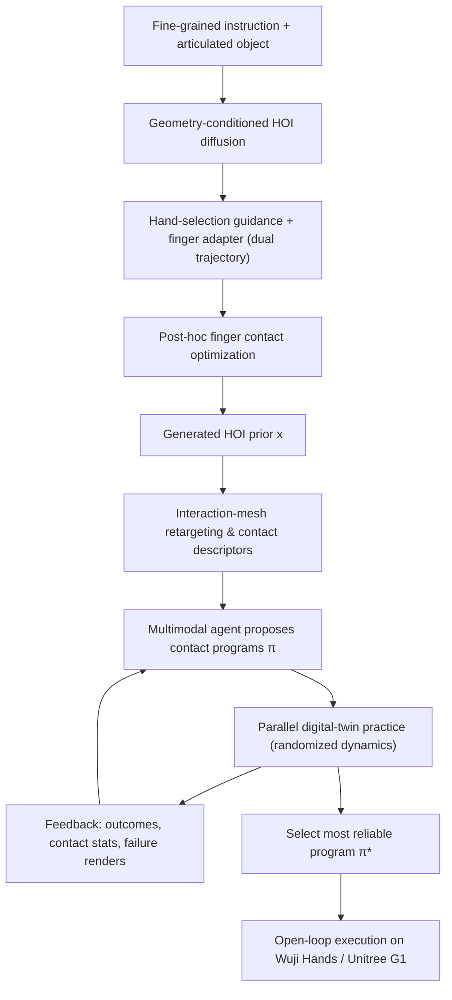
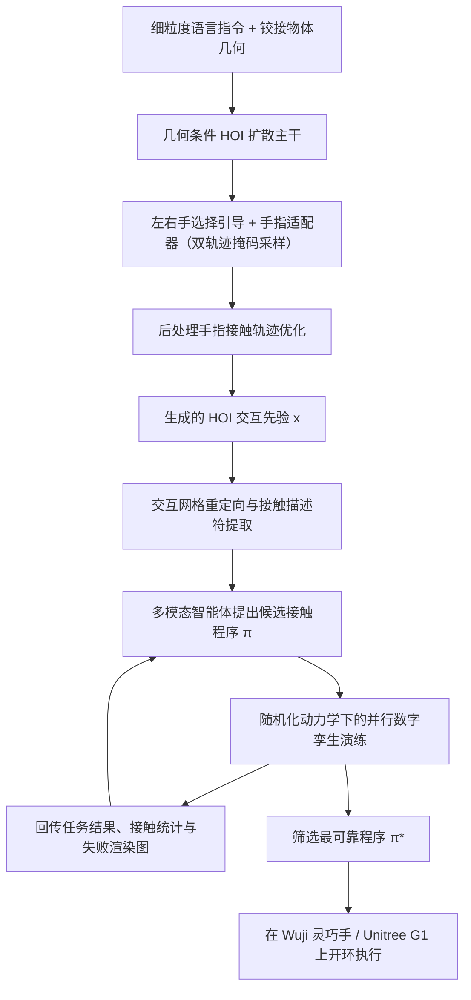

## TL;DR

Most dexterous manipulation pipelines optimize task completion alone, treating a five-fingered hand like a gripper or copying whichever contacts appear in one demonstration. **FineDex** splits finger-level manipulation into two stages: a language-conditioned diffusion generator expresses *what* a human would do (which hand, which fingers, and which contact region on an articulated object), and a multimodal planning agent discovers *how* a robot can execute that intent by proposing contact programs and practicing them in a physics-based digital twin at test time.

On ARCTIC, FineDex lowers bimanual HOI FID from **1.51 to 0.65** and whole-body FID from **2.32 to 1.61**. On the authors' new **FingerBench** suite, baselines score **0.0%** on finger motion control (A1–A5) and at most **0.8%** on counterfactual finger contact (B3), whereas FineDex reaches **37.0–92.5%** on A1–A5 and **64.9%** on B3. In physics-based execution, direct retargeted replay succeeds in only **6.2%** of floating-hand trials, while digital-twin practice lifts task success to **75.0%** (GPT-6 Astra) and **77.3%** (Claude Fable 5.2), with **42.2% / 46.9%** on a Unitree G1 humanoid and open-loop real-world trials on a G1 with Wuji Hand 2.2.

## Paper and reading version

**FineDex: Bridging Fine-Grained Human–Object Interaction Generation to Dexterous Humanoid Manipulation**, by Yujia Zeng, Yuxin Chen, Yuzhen Song, Runhan Huang, Chensheng Peng, Yiyang Shao, Koushil Sreenath, Masayoshi Tomizuka, and Yilun Du (UC Berkeley and Harvard University). These notes cover **arXiv:2611.34884v1**, submitted November 25, 2026. [arXiv abstract](https://arxiv.org/abs/2611.34884v1) · [PDF](https://arxiv.org/pdf/2611.34884v1) · [HTML](https://arxiv.org/html/2611.34884v1) · [Project page](https://finedex.github.io/)

## Decoupling finger-level intent from physical grounding

Two bottlenecks stall instruction-following dexterity. Text-conditioned HOI generators respond mainly to task-level verbs and ignore requests to switch hands or use a specific finger. Meanwhile, generated human motions violate robot kinematics and contact dynamics, so direct trajectory replay fails, and training a separate reference-tracking RL policy per instruction scales poorly across new constraints or object configurations.

FineDex treats generated HOI as an **actionable sketch** for test-time search. Human interaction data captures rich finger-level intent; parallel simulation under randomized dynamics grounds that intent in physically executable contact programs without per-instance policy retraining.

## Stage 1: Fine-grained HOI generation

The generator is trained on **ARCTIC** (11 articulated objects, 32-frame windows with stride 16), augmented with fine-grained annotations describing hand roles, finger actions, contact regions, and articulation changes. Annotations were generated with Gemini 3.8 and verified with Claude, which corrected 497 of 13,472 windows (mostly hand assignments and part references). Each interaction sequence $\mathbf{x}=\{\mathbf{x}^t\}_{t=1}^{N}$ stores human root pose, body joint rotations, bilateral hand articulations, and the object state: rigid base transform $\mathbf{T}_t^{\mathcal{O}}\in SE(3)$ plus hinge angle $\theta_t$. [Paper §§3.1, 4.1](https://arxiv.org/html/2611.34884v1#S3.SS1)

**Geometry-conditioned diffusion.** A conditional Transformer denoiser $p_\phi(\mathbf{x}\mid\ell,\mathcal{O},\mathbf{x}^{1:K})$ attends to token-level language features, sampled object surface points, an object-state token (relative base pose and hinge angle), and anatomical anchor tokens across the fingers. At diffusion step $s$, it predicts the clean motion as a residual over a damped constant-velocity extrapolation $\mathcal{P}(\mathbf{x}^{1:K})$ (with finger channels holding the last context pose):

$$
\widehat{\mathbf{x}}_0 = \mathcal{P}(\mathbf{x}^{1:K}) + D_\phi(\mathbf{x}_s, s; \mathcal{C}),
$$

where $\mathcal{C}$ is the conditioning memory. Training uses reconstruction, kinematic, and contact-weighted losses; sampling uses 40-step DDIM with text classifier-free guidance while keeping object and structural controls fixed.

**Hand selection, finger motion, and finger contact.** FineDex separates three control knobs so text prompting does not carry every constraint:

- **Hand selection** guides each denoising step via temporally interpolated body-pose offsets at sparse temporal knots, penalizing motion of the stationary hand's wrist and anchor centroid while attracting the acting hand toward an object- and part-specific contact prototype. Inactive arm joints stay fixed to their observed pose.
- **Compositional finger motion control** freezes the pretrained diffusion backbone and adds a lightweight adapter trained on synthetic finger edits. Control tokens encode finger identity and keyframe curl targets, injecting residuals into anatomical anchor tokens. At inference, two DDIM branches share the same initial noise—a reference branch $\widehat{\mathbf{x}}_0^{\mathrm{ref}}$ (task text + hand guidance) and a finger-controlled branch $\widehat{\mathbf{x}}_0^{\mathrm{ctrl}}$—and blend only commanded finger channels via a mask $\mathbf{M}_{\mathcal{F}}$:

$$
\widehat{\mathbf{x}}_0^{\mathrm{edit}} = \widehat{\mathbf{x}}_0^{\mathrm{ref}} + \mathbf{M}_{\mathcal{F}} \odot \left(\widehat{\mathbf{x}}_0^{\mathrm{ctrl}} - \widehat{\mathbf{x}}_0^{\mathrm{ref}}\right).
$$

- **Finger-specific contact control** applies post-hoc trajectory optimization over temporal offsets $\boldsymbol{\Delta}$ on the acting arm and fingers while holding the torso, inactive hand, and object fixed:

$$
\min_{\boldsymbol{\Delta}} \; \mathcal{L}_{\mathrm{touch}} + \mathcal{L}_{\mathrm{pen}} + \lambda_e \mathcal{L}_{\mathrm{excl}} + \lambda_a \mathcal{L}_{\mathrm{smooth}}.
$$

Here $\mathcal{L}_{\mathrm{touch}}$ pulls distal pads of the designated fingers $\mathcal{F}^\star$ onto the moving-part surface, $\mathcal{L}_{\mathrm{pen}}$ prevents finger penetration, $\mathcal{L}_{\mathrm{excl}}$ keeps non-designated fingers and the palm clear under exclusive-contact instructions, and $\mathcal{L}_{\mathrm{smooth}}$ limits wrist and fingertip acceleration. This post-hoc stage enables counterfactual contacts absent from training data. [Paper §3.1](https://arxiv.org/html/2611.34884v1#S3.SS1)

## Stage 2: Generation-guided agentic manipulation

To cross the kinematic and dynamics gap, FineDex retargets generated hand motions using an interaction mesh over hand and object keypoints in the object frame, preserving Laplacian coordinates subject to joint limits and non-penetration. Direct replay of the retargeted motion is just one candidate option.

The generated object articulation is segmented into $S$ opening or closing phases, and the agent searches over parameterized **contact programs**:

$$
\pi = (m, \kappa_{1:S}, b, \boldsymbol{\eta}),
$$

where $m$ specifies the acting hand and object-motion plan, $\kappa_s$ gives a part-relative wrist pose and finger configuration for segment $s$, $b$ sets the supporting-hand behavior, and $\boldsymbol{\eta}$ specifies approach, pressing, timing, and closure parameters. Candidate contacts come from three pools: contacts extracted from the generated HOI, geometrically synthesized push/hook contacts ranked by hinge-driving leverage and proximity to the generated contact, and human grasps from a non-test ARCTIC library.

A multimodal planning agent (default **GPT-6 Astra**; alternative **Claude Fable 5.2**) sees the instruction, object state, rendered HOI keyframes, and contact descriptors, then proposes contact programs and predicts outcomes. Parallel digital twins evaluate each candidate under randomized dynamics and return task outcomes, contact statistics, and failure renders for iterative refinement (4 rounds by default). Candidates are ranked by empirical success rate—breaking ties by articulation progress, execution penalties, and deviation from the HOI prior—and the top four goal-reaching candidates undergo extra randomized rehearsals to pick $\pi^\star$. The chosen program is compiled into wrist and finger targets and executed **open-loop** on floating Wuji hands or a Unitree G1 humanoid with Wuji hands. [Paper §3.2](https://arxiv.org/html/2611.34884v1#S3.SS2)

## FingerBench and experimental results

Because standard motion quality metrics miss instruction compliance, the authors introduce **FingerBench** (evaluated on 9 shared ARCTIC objects) with two tracks: a **generation track** testing hand selection (Switch/Still), finger motion (A1–A5: single finger, same-direction, opposite-direction, bimanual, temporal), and finger contact (B1–B4: reference, exclusive, counterfactual, thumb–index pinch); and a **robot track** on floating Wuji hands with a shared search planner, reporting finger-conditioned success rate (**FC-SR**, requiring task success plus dominant impulse share from the designated finger) and **Robo-SR** (also bounding unintended contact duration from other hand regions). [Paper §§3.3, 4.3](https://arxiv.org/html/2611.34884v1#S3.SS3)

### HOI quality and fine-grained controllability

All HOI baselines are retrained on the same ARCTIC split with FineDex's fine-grained annotations and identical first-frame conditioning. FineDex leads every bimanual and whole-body quality metric (bimanual FID **0.65** vs. Text2HOI's **1.51**; whole-body FID **1.61** vs. EmbodyHOI's **2.32**; wrist error **58.3 mm** vs. **77.9 mm**; foot skating **0.0030 m/s** vs. **0.0064 m/s**). On FingerBench, the gap is stark:

| Method | Motion A1–A5 (%) | Contact B3 Counterfactual (%) | Hand Switch / Still (%) | Robot FC-SR / Robo-SR (%) |
| --- | ---: | ---: | ---: | ---: |
| Text2HOI | 0.0 across A1–A5 | 0.4 | 1.1 / 0.0 | 9.4 / 6.2 |
| MAD-HOI† | 0.0 across A1–A5 | 0.4 | 8.0 / 0.0 | 1.3 / 0.9 |
| EmbodyHOI† | 0.0 across A1–A5 | 0.6 | 0.0 / 0.0 | 0.9 / 0.9 |
| Ground-truth motion prior | – | – | – | 6.2 / 5.4 |
| **FineDex** | **92.5 / 91.2 / 37.0 / 73.4 / 45.6** | **64.9** | **83.9 / 100.0** | **21.9 / 19.2** |

Ablations in Table 5 pinpoint why the generation controls work. Single-trajectory finger conditioning leaks **11.9°** into uncommanded fingers and drops A1 success from **92.5% to 41.2%**; masked dual-trajectory sampling cuts leakage to **0.0°** by construction. Even when HandMDM is trained on the same finger-edit data, it reaches 65.6% finger identification and only 3.8% success because adjacent fingers drift along. For contact refinement, fingertip attraction alone (Contact IK) triggers unintended contacts in **97.9%** of trials and scores **0.8%** on counterfactual B3; adding penetration and exclusion losses cuts unintended contacts to **41.5%** and raises B3 to **64.9%**. [Paper Tables 1, 2, 5](https://arxiv.org/pdf/2611.34884v1#page=5)

### Digital-twin practice, prior alignment, and real-world deployment

Table 3(a) isolates how practice and priors drive execution success:

| Execution setup | Floating Wuji (%) | Unitree G1 (%) |
| --- | ---: | ---: |
| Direct replay of retargeted HOI | 6.2 | 13.3 |
| FineDex w/o practice (round-1 proposal) | 19.5 | 11.7 |
| Search planner + priors | 48.4 | 39.1 |
| Astra w/o priors or grasp library | 59.4 | 28.9 |
| Astra w/o priors (keeps grasp library) | 68.8 | 35.2 |
| **FineDex (GPT-6 Astra)** | **75.0** | **42.2** |
| **FineDex (Claude Fable 5.2)** | **77.3** | **46.9** |

Three findings clarify what is doing the heavy lifting. First, **rehearsal matters most**: direct replay reaches 6.2% on floating hands, one-shot agent planning reaches 19.5%, stopping after one or two practice rounds yields 43.8% and 57.0% (25.0% and 30.5% on G1), and gains plateau around six rounds. Second, **the HOI prior acts primarily as a structural guide**: only **21%** of committed programs directly reuse generated contacts. In 10 of 14 configurations that succeed at least half the time with priors and never without them, the generated HOI supplies a stabilizing support-hand pose that pure geometric search misses; dropping the grasp library too causes box-opening success to collapse to 0%. Third, **instruction alignment of the prior is critical** (Table 3(b)): under test-time finger constraints, Astra + finger instructions scores 40.2% task success and 19.4% FC-SR; adding an *unedited* HOI prior degrades both to **29.7% / 15.2%** because its contacts conflict with the instructed finger; adding a *finger-edited* prior restores task success to **40.3%** and lifts FC-SR to **24.4%** (**60.5%** of successful trials use the designated finger).

Across **174 shifted object configurations** (placement, size, and initial articulation angle of seen objects in Table 4), FineDex raises overall success from **50.0% to 54.8%** without retraining (floating hands **70.3% vs. 63.4%**, largest gain on size shifts at **68.9% vs. 59.6%**; G1 **39.4% vs. 36.6%**). On a physical **Unitree G1 + Wuji Hand 2.2**, the digital twin chooses a pelvis stance $\mathbf{T}^{\mathcal{P}}$ that maximizes reachable, collision-free wrist poses, and the 3D-printed object (known mesh and mass, fixed control gains) is placed at $(\mathbf{T}^{\mathcal{P}})^{-1}\mathbf{T}^{\mathcal{O}}_1$. Under fixed object placement, the left-middle-finger program succeeds in **5/5** consecutive trials, alongside qualitative demonstrations on left index+middle manipulation and right-hand espresso machine and microwave tasks. [Paper §4.4, Tables 3–4](https://arxiv.org/html/2611.34884v1#S4.SS4)

## Strengths, limitations, and takeaways

FineDex makes a clean architectural point: **generative HOI models are better used as structured priors for test-time physics practice than as kinematic trajectories to replay or track**. Separating hand selection, masked dual-trajectory finger editing, and post-hoc contact optimization lets the generator handle counterfactual finger requests that never appear in human demonstrations, and Table 3(b) proves empirically that an unaligned prior can hurt worse than no prior at all.

The paper is also candid about the remaining gaps:

- **Sharp cost of finger constraints.** Adding a test-time finger constraint drops floating-hand task success from 78.1% (unconstrained Astra) to 40.3%, and FingerBench robot execution sits at 21.9% FC-SR / 19.2% Robo-SR.
- **Humanoid embodiment bottleneck.** G1 performance trails floating hands by roughly 30 percentage points (42.2% vs. 75.0% with Astra; 39.4% vs. 70.3% on shifted configs), driven by arm reach limits and imperfect wrist tracking.
- **Digital-twin and open-loop assumptions.** Real-world transfer relies on known 3D-printed object meshes and masses, calibrated object placement relative to the chosen stance, and open-loop playback without tactile or visual replanning—meaning recovery from slip or perception error remains open.
- **Modest marginal gain over a strong agent + grasp library.** On shifted configurations, removing generated HOI priors while keeping the ARCTIC grasp library and geometric synthesis drops overall success by 4.8 points (54.8% → 50.0%), showing that much of the raw task-completion power already resides in the agentic digital-twin practice loop, while generated priors shine most for bimanual support-hand placement and fine-grained instruction compliance.

For robotics research, the immediate takeaway is twofold: evaluate dexterous generation on *instruction compliance* (as FingerBench does) alongside FID, and pair generative motion priors with parallel physics rehearsal so contact timing, approach, and feasibility are solved by simulation feedback once the human prior has narrowed the search space.

## TL;DR

多数灵巧操作方法只看任务是否完成，要么把五指灵巧手简化成夹爪，要么直接照搬单条人类示范里的接触方式。**FineDex** 把精细到手指级别的灵巧操作拆成两个阶段：第一阶段由语言条件扩散模型生成“人会怎么做”的交互先验（指定左右手、具体手指以及铰接物体的接触区域）；第二阶段由多模态规划智能体在物理数字孪生中提出并反复演练接触程序，测试时自适应找到物理可行的机器人执行方案，无需为每条指令单独重训策略。

在 ARCTIC 上，FineDex 将双手 HOI 生成的 FID 从 **1.51 降至 0.65**，全身 FID 从 **2.32 降至 1.61**。在作者提出的新基准 **FingerBench** 上，现有基线在手指动作控制（A1–A5）上全部为 **0.0%**，在反事实手指接触（B3）上最高仅 **0.8%**，而 FineDex 在 A1–A5 上达到 **37.0%–92.5%**，在 B3 上达到 **64.9%**。在物理仿真执行中，直接重定向回放生成轨迹的悬浮手成功率只有 **6.2%**，引入数字孪生演练后提升至 **75.0%**（GPT-6 Astra）和 **77.3%**（Claude Fable 5.2）；在 Unitree G1 人形机器人上达到 **42.2% / 46.9%**，并在真机 G1 + Wuji Hand 2.2 上完成了开环部署验证。

## 论文信息与阅读版本

**FineDex: Bridging Fine-Grained Human–Object Interaction Generation to Dexterous Humanoid Manipulation**，作者为加州大学伯克利分校与哈佛大学的 Yujia Zeng、Yuxin Chen、Yuzhen Song、Runhan Huang、Chensheng Peng、Yiyang Shao、Koushil Sreenath、Masayoshi Tomizuka 和 Yilun Du。本文依据 **arXiv:2611.34884v1**（2026 年 11 月 25 日提交）。[arXiv 摘要](https://arxiv.org/abs/2611.34884v1) · [PDF](https://arxiv.org/pdf/2611.34884v1) · [HTML](https://arxiv.org/html/2611.34884v1) · [项目主页](https://finedex.github.io/)

## 将手指级意图表达与物理落地解耦

指令驱动的灵巧操作面临两处断层。在表达侧，文本条件 HOI 生成模型通常只响应任务级动词，哪怕指令要求换左手或只用食指，生成的动作也几乎不变。在执行侧，生成的人体交互存在物理误差，叠加机器人运动学与接触动力学差异，直接回放极易失败；若为每条参考轨迹单独训练跟踪型 RL 策略，又难以扩展到多样的手指约束与物体构型。

FineDex 的核心思路是把生成的 HOI 视为**可执行的动作草图**，用生成模型刻画细粒度的人类交互意图，再用测试时的物理数字孪生演练完成机器人落地，避免针对单个任务实例重新训练策略。

## 第一阶段：细粒度 HOI 交互生成

生成器在 **ARCTIC**（11 类铰接物体，32 帧窗口、步长 16）上训练，并配套构建了细粒度语言标注，覆盖左右手分工、单指动作、接触区域和铰接状态变化。标注先由 Gemini 3.8 生成，再由 Claude 复核，在 13,472 个窗口中修正了 497 处（主要是左右手归属和部件指代）。每段交互序列 $\mathbf{x}=\{\mathbf{x}^t\}_{t=1}^{N}$ 包含人体根位姿、身体关节旋转、双手关节姿态以及物体状态：刚体基座变换 $\mathbf{T}_t^{\mathcal{O}}\in SE(3)$ 与铰接角 $\theta_t$。[论文 §§3.1, 4.1](https://arxiv.org/html/2611.34884v1#S3.SS1)

**几何条件扩散主干。** 条件 Transformer 去噪器 $p_\phi(\mathbf{x}\mid\ell,\mathcal{O},\mathbf{x}^{1:K})$ 以词元级语言特征、物体表面采样点特征、物体状态 token（相对基座姿态与铰接角）以及分布在手指上的解剖锚点 token 作为条件记忆 $\mathcal{C}$。在扩散步 $s$，模型预测干净序列相对于阻尼常速外推 $\mathcal{P}(\mathbf{x}^{1:K})$ 的残差（手指通道保持最后一帧上下文姿态）：

$$
\widehat{\mathbf{x}}_0 = \mathcal{P}(\mathbf{x}^{1:K}) + D_\phi(\mathbf{x}_s, s; \mathcal{C}).
$$

训练结合重建损失、运动学损失与接触加权损失；推理采用 40 步 DDIM，仅对文本条件做无分类器引导，物体与结构控制项在两条分支间保持一致。

**左右手选择、手指动作与手指接触解耦控制。** 论文将细粒度控制拆成三个独立模块，避免全部塞给文本提示：

- **左右手选择**：在每个去噪步引入稀疏时间节点上的低维身体姿态偏移（时间插值到全窗口），惩罚静止手腕和锚点质心位移，同时将操作手拉向训练集中估计出的物体-部件接触原型，并将非操作臂关节固定在观测姿态。
- **组合式手指动作控制**：冻结预训练扩散主干，加入在合成手指编辑数据上训练的轻量适配器。控制 token 编码手指身份与关键帧弯曲目标，将残差注入对应解剖锚点 token。推理时，两条共享相同初始噪声的 DDIM 分支并行去噪——参考分支 $\widehat{\mathbf{x}}_0^{\mathrm{ref}}$ 仅带任务文本与左右手选择引导，控制分支 $\widehat{\mathbf{x}}_0^{\mathrm{ctrl}}$ 加入手指条件——每步通过掩码 $\mathbf{M}_{\mathcal{F}}$ 仅替换被指令控制的手指通道：

$$
\widehat{\mathbf{x}}_0^{\mathrm{edit}} = \widehat{\mathbf{x}}_0^{\mathrm{ref}} + \mathbf{M}_{\mathcal{F}} \odot \left(\widehat{\mathbf{x}}_0^{\mathrm{ctrl}} - \widehat{\mathbf{x}}_0^{\mathrm{ref}}\right).
$$

- **指定手指接触控制**：在采样后的动作上做后处理轨迹优化，仅优化操作臂与手指的时间偏移量 $\boldsymbol{\Delta}$，保持躯干、另一只手与物体不动：

$$
\min_{\boldsymbol{\Delta}} \; \mathcal{L}_{\mathrm{touch}} + \mathcal{L}_{\mathrm{pen}} + \lambda_e \mathcal{L}_{\mathrm{excl}} + \lambda_a \mathcal{L}_{\mathrm{smooth}}.
$$

其中 $\mathcal{L}_{\mathrm{touch}}$ 将指定手指集合 $\mathcal{F}^\star$ 的指腹拉向活动部件表面，$\mathcal{L}_{\mathrm{pen}}$ 防止穿模，$\mathcal{L}_{\mathrm{excl}}$ 在排他接触指令下推开非指定手指和手掌，$\mathcal{L}_{\mathrm{smooth}}$ 约束手腕与指尖加速度。这一步使模型能够生成训练集中从未出现过的反事实手指接触。[论文 §3.1](https://arxiv.org/html/2611.34884v1#S3.SS1)

## 第二阶段：生成先验引导的智能体操作

为跨越人体与机器人的运动学和动力学鸿沟，FineDex 在物体坐标系中构造覆盖手与物体关键点的交互网格，在关节限位与无穿模约束下保持拉普拉斯坐标完成重定向。直接回放重定向结果只是候选方案之一。

方法先将生成的物体铰接过程划分为 $S$ 个开合阶段，再由智能体搜索参数化的**接触程序**：

$$
\pi = (m, \kappa_{1:S}, b, \boldsymbol{\eta}),
$$

其中 $m$ 指定操作手与物体运动规划，$\kappa_s$ 为第 $s$ 阶段相对活动部件的手腕位姿与手部构型，$b$ 描述辅助手的支撑行为，$\boldsymbol{\eta}$ 包含接近、按压、时序与闭合参数。候选接触来自三个来源：生成的 HOI 交互、按驱动铰接能力与先验邻近度排序的几何合成推/钩接触，以及由非测试集 ARCTIC 序列构建的人类抓取库。

多模态规划智能体（默认 **GPT-6 Astra**，备选 **Claude Fable 5.2**）输入语言指令、物体状态、HOI 关键帧渲染图及结构化接触描述符，提出候选接触程序并预判结果。并行数字孪生在随机化动力学下仿真评估每个候选，将成败结果、接触统计与失败渲染图反馈给智能体迭代修正（默认 4 轮）。候选按实测成功率排序（平局时依次比较铰接进度、执行惩罚和与 HOI 先验的偏离），排名前四的达标候选再经额外随机化排练选出最可靠程序 $\pi^\star$，最终编译为手腕与手指目标，在悬浮 Wuji 手或搭载 Wuji 手的 Unitree G1 人形机器人上**开环执行**。[论文 §3.2](https://arxiv.org/html/2611.34884v1#S3.SS2)

## FingerBench 基准与核心实验结果

常规运动生成指标无法衡量是否真正遵守了手指级指令。作者在 9 个共享 ARCTIC 物体上提出 **FingerBench**，包含两条赛道：**生成赛道**评测左右手选择（Switch/Still）、手指动作控制（A1–A5：单指、同向、反向、双手、时序）和手指接触控制（B1–B4：参考指、排他接触、反事实接触、拇食指捏取）；**机器人赛道**在悬浮 Wuji 手与统一搜索规划器上评测手指条件成功率 **FC-SR**（要求完成任务且指定手指贡献主导冲量）与 **Robo-SR**（进一步限制其他手部区域的误触时长）。[论文 §§3.3, 4.3](https://arxiv.org/html/2611.34884v1#S3.SS3)

### HOI 生成质量与细粒度可控性

所有 HOI 基线均在相同的 ARCTIC 划分、相同的细粒度标注和相同的首帧条件下重新训练。FineDex 在所有双手和全身质量指标上均居首位（双手 FID **0.65** 对比 Text2HOI 的 **1.51**；全身 FID **1.61** 对比 EmbodyHOI 的 **2.32**；手腕误差 **58.3 mm** 对比 **77.9 mm**；足部滑步 **0.0030 m/s** 对比 **0.0064 m/s**）。在 FingerBench 上，差距更加悬殊：

| 方法 | 手指动作 A1–A5 (%) | 反事实接触 B3 (%) | 左右手 Switch / Still (%) | 机器人 FC-SR / Robo-SR (%) |
| --- | ---: | ---: | ---: | ---: |
| Text2HOI | A1–A5 均为 0.0 | 0.4 | 1.1 / 0.0 | 9.4 / 6.2 |
| MAD-HOI† | A1–A5 均为 0.0 | 0.4 | 8.0 / 0.0 | 1.3 / 0.9 |
| EmbodyHOI† | A1–A5 均为 0.0 | 0.6 | 0.0 / 0.0 | 0.9 / 0.9 |
| 真实人体动作先验（GT） | – | – | – | 6.2 / 5.4 |
| **FineDex** | **92.5 / 91.2 / 37.0 / 73.4 / 45.6** | **64.9** | **83.9 / 100.0** | **21.9 / 19.2** |

表 5 的消融进一步验证了两个控制模块的作用。单轨迹手指条件会在未指令控制的手指上泄漏 **11.9°** 的多余运动，使 A1 成功率从 **92.5% 掉到 41.2%**；双轨迹掩码采样从构造上把泄漏压到 **0.0°**。即便用同样的手指编辑数据训练 HandMDM，其手指识别率达 65.6%，成功率却只有 3.8%，原因同样是其他手指跟着联动。在接触控制中，仅靠指尖吸引（Contact IK）在 **97.9%** 的测试中都会发生误触，反事实 B3 成功率只有 **0.8%**；加入防穿模与排他项后，误触率降至 **41.5%**，B3 跃升至 **64.9%**。[论文表 1、2、5](https://arxiv.org/pdf/2611.34884v1#page=5)

### 数字孪生演练、先验对齐与真机部署

表 3(a) 拆解了演练循环、生成先验和抓取库各自对执行成功率的贡献：

| 执行配置 | 悬浮 Wuji 手 (%) | Unitree G1 人形 (%) |
| --- | ---: | ---: |
| 直接回放重定向 HOI | 6.2 | 13.3 |
| FineDex 无演练（首轮最自信程序） | 19.5 | 11.7 |
| 搜索规划器 + 先验 | 48.4 | 39.1 |
| Astra 无先验且无抓取库 | 59.4 | 28.9 |
| Astra 无先验（保留抓取库） | 68.8 | 35.2 |
| **FineDex (GPT-6 Astra)** | **75.0** | **42.2** |
| **FineDex (Claude Fable 5.2)** | **77.3** | **46.9** |

有三个实验细节值得特别注意。第一，**仿真演练是成功率跃升的主力**：直接回放仅 6.2%，单轮规划仅 19.5%；在四轮默认演练中，第 1、2 轮后悬浮手成功率分别升至 43.8% 与 57.0%（G1 为 25.0% 与 30.5%），约 6 轮后趋于平缓。第二，**HOI 先验主要起结构引导作用**：最终采纳的接触程序里只有 **21%** 直接沿用了生成接触，更多时候它用于排序候选接触和摆放辅助手——在 14 个“有先验至少成功一半、无先验全败”的配置中，有 10 个靠生成先验给出了稳定物体的辅助手姿态；若连抓取库也移除，纯几何搜索在打开盒盖任务上成功率为 0%。第三，**先验必须与手指指令对齐**（表 3(b)）：测试时指定手指后，Astra 仅靠文字指令达到 40.2% 任务成功率和 19.4% FC-SR；加入**未编辑的** HOI 先验反而把两项拉低到 **29.7% / 15.2%**（先验接触与指令手指冲突）；改用**手指编辑后的**先验后，任务成功率回升至 **40.3%**，FC-SR 提高到 **24.4%**（成功试验中 **60.5%** 使用了指定手指）。

在 **174 个构型偏移测试**（已知物体的摆放位置、尺寸和初始开合角变化，表 4）中，FineDex 无需重训就把总体成功率从 **50.0% 提到 54.8%**（悬浮手 **70.3% 对比 63.4%**，尺寸变化增益最大为 **68.9% 对比 59.6%**；G1 **39.4% 对比 36.6%**）。真机实验在 **Unitree G1 + Wuji Hand 2.2** 上展开：数字孪生先选出令可达且无碰撞手腕位姿比例最大的站姿 $\mathbf{T}^{\mathcal{P}}$，再将已知网格和质量的 3D 打印物体摆放到骨盆系下的 $(\mathbf{T}^{\mathcal{P}})^{-1}\mathbf{T}^{\mathcal{O}}_1$ 处，控制增益跨任务固定。在固定摆放条件下，左手中指操作程序连续 **5/5** 成功，同时展示了左手食中指协作以及右手操作咖啡机和微波炉的案例。[论文 §4.4，表 3–4](https://arxiv.org/html/2611.34884v1#S4.SS4)

## 优势、局限与研究启发

FineDex 清晰验证了一个系统层面的设计判断：**把生成式 HOI 当作测试时物理演练的结构化先验，比当作直接回放或逐帧跟踪的参考轨迹更稳健**。将左右手选择引导、双轨迹掩码手指编辑和后处理接触优化解耦，使生成器能表达训练集中不存在的反事实手指用法；表 3(b) 则直观证明，一旦先验与细粒度指令不一致，引入先验反而会拖累执行。

论文同时暴露出几个现实边界：

- **手指约束带来明显成功率代价。** 引入测试时手指约束后，悬浮手任务成功率从无约束 Astra 的 78.1% 降到 40.3%；FingerBench 机器人赛道的 FC-SR / Robo-SR 也还停留在 21.9% / 19.2%。
- **人形本体瓶颈突出。** G1 的成功率比悬浮手低约 30 个百分点（Astra 下 42.2% 对比 75.0%，构型偏移下 39.4% 对比 70.3%），主要受限于双臂工作空间与手腕跟踪误差。
- **数字孪生建模与开环假设。** 真机部署依赖 3D 打印物体的已知网格与质量、按选定站姿精确定位物体，且全程开环执行、缺少视觉或触觉闭环重规划，发生滑移或定位偏差时无法在线纠偏。
- **相对“强智能体 + 抓取库”的边际增益有限。** 在 174 个偏移配置上，去掉生成先验但保留 ARCTIC 抓取库和几何合成后，总体成功率仅下降 4.8 个百分点（54.8% → 50.0%）；这说明大量基础任务完成能力来自智能体与数字孪生演练闭环本身，而生成先验的独特价值集中在双手辅助稳定以及细粒度手指指令遵循上。

对后续灵巧操作研究来说，这篇工作有两点可直接复用：评测生成式交互模型时，应把指令遵循度（如 FingerBench）与传统分布指标并列考察；搭建落地管线时，可以让人类交互先验缩小接触与辅助手搜索空间，把接触时序、按压力度与物理可行性交给并行仿真演练去收敛。

