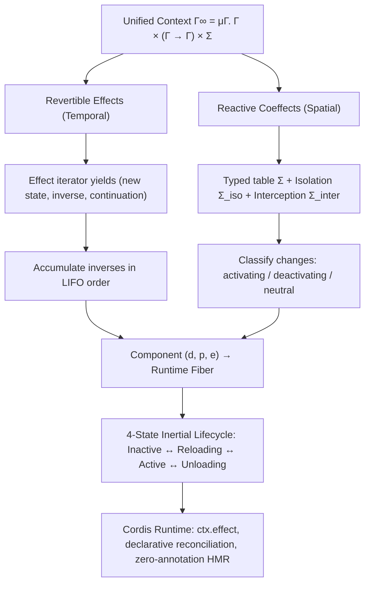
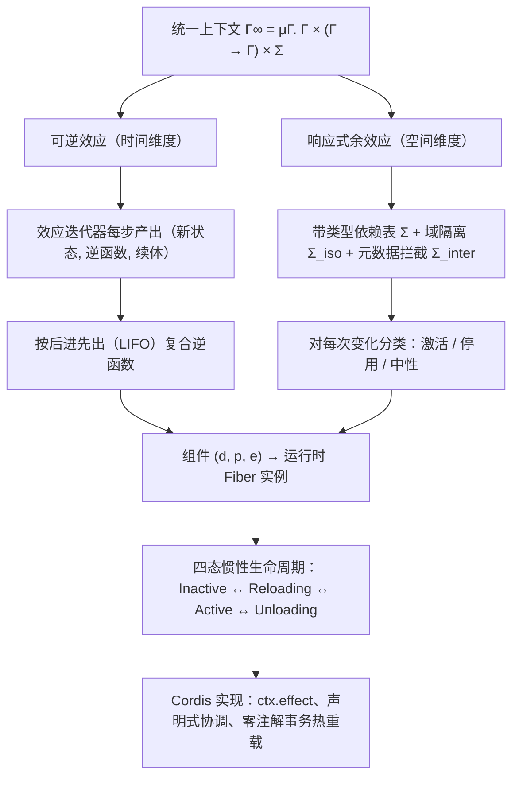

## TL;DR

Modern extensible software—from IDE plugin hosts to self-evolving AI agent harnesses—needs to add, swap, and remove stateful modules at runtime without restarting the whole process. **A Programming Paradigm for Spatiotemporal Composability** breaks dynamic composition into two orthogonal dimensions: **temporal composability** (completely undoing a component's side effects when it leaves) and **spatial composability** (declaring and reactively coordinating inter-component dependencies as providers appear, change, or vanish).

The authors lift classical static **effect** and **coeffect** systems into runtime mechanisms: **revertible effects** pair every context transformation with an explicit inverse held by the runtime, while **reactive coeffects** classify every context change against declared dependency sets to drive component activation and deactivation. Unifying both into a single recursive context type $\Gamma^\infty$ yields the **context paradigm**, paired with a nine-rule operational calculus that proves exact interleaved rollback (**Theorem 68**), provider-outlives-consumer ordering (**Theorem 70**), deadlock freedom and termination (**Theorem 73**), and history-independent **Confluence** (**Theorem 80**). The paradigm is implemented in **Cordis**—validated in production across **4,000+ plugins** in Koishi and used as the microkernel underneath DeepSeek's open-source agent runtime (`deepseek-harness`).

## Paper and reading version

**A Programming Paradigm for Spatiotemporal Composability**, by Yifan Shi (Peking University, DeepSeek-AI), Wei Zhang (Peking University), and Tianyi Cui (DeepSeek-AI). These notes cover the 92-page **arXiv:2608.25512v1**, submitted August 26, 2026. [arXiv abstract](https://arxiv.org/abs/2608.25512v1) · [PDF](https://arxiv.org/pdf/2608.25512v1) · [Cordis](https://cordis.js.org/) · [DeepSeek Harness](https://github.com/deepseek-ai/deepseek-harness)

## Why dynamic composition breaks today

Static composition enjoys mature foundations: lexical scoping (RAII, bracket patterns) handles cleanup in time, and module imports handle dependencies in space. Once components arrive and depart at runtime, both break down.

The paper illustrates the failure with two concrete domains ([§1.2](https://arxiv.org/pdf/2608.25512v1#page=4)):

- **Plugin hosts (VSCode audit, June 9, 2026).** Among the top 100 Visual Studio Code extensions by install count, **87** contain executable code and require restarting the entire extension host to unload; the `deactivate` hook only fires on host shutdown and separates cleanup from registration. Spatially, only **7** of the top 100 declare `extensionDependencies` on non-built-in extensions, and cross-extension `exports` defaults to untyped `any`.
- **Self-evolving agent harnesses.** An AI agent that synthesizes and hot-deploys changes to its own tools, memory, permissions, or subagent loops modifies itself continuously with minimal human supervision. Process restarts discard accumulated caches and disrupt in-flight tasks—and a faulty self-edit can disable the very process required to recover—while naive module swaps silently break dependents or introduce reload-time cycles.

Operating systems and container orchestrators (like Kubernetes) offer only a **coarse-grained workaround**: temporal recovery at process granularity and spatial wiring at service granularity, paying seconds-to-minutes rebuild latency, redundant replica overhead, and network serialization where in-process calls belong ([§1.2.3](https://arxiv.org/pdf/2608.25512v1#page=5)).

## Core paradigm: Revertible effects, reactive coeffects, and $\Gamma^\infty$

Classical effect systems ($\Gamma \vdash t : T^{\text{effect}}$) describe how a computation modifies its environment, and coeffect systems ($\Gamma^{\text{coeffect}} \vdash t : T$) describe what it demands from its environment—both checked statically over fixed lexical scopes. Section 3 reifies both into runtime structures ([§3](https://arxiv.org/pdf/2608.25512v1#page=9)).

### Revertible effects (local temporal composability)

Start with an **effect context** $\partial \Gamma \coloneqq \Gamma \times (\Gamma \to \Gamma)$ pairing the current state $\gamma$ with an inverse accumulator $\varphi$ (maintaining the soundness invariant $\varphi(\gamma) = \gamma_0$). Pairs of forward/inverse transformations compose via **twisted composition**, accumulating inverses in reverse (LIFO) order:

$$
(f_1, g_1) \circ (f_2, g_2) \coloneqq (f_1 \circ f_2,\; g_2 \circ g_1),
\qquad
\mathrm{track}_\Gamma(f, g)(\gamma, \varphi) = (f(\gamma),\, \varphi \circ g).
$$

`track` is a monoid homomorphism (**Theorem 5**), and $\mathrm{recover}_\Gamma(\gamma, \varphi) = (\varphi(\gamma), \mathrm{id}_\Gamma)$ restores the starting state whenever $g(f(\gamma)) = \gamma$ (**Theorem 7**). Because a real inverse often depends on the state at application time (and callers need selective rollback), the authors lift this to **effect functions** and **effect iterators**:

$$
\mathfrak{E}_\Gamma \coloneqq \Gamma \to \Gamma \times (\Gamma \to \Gamma),
\qquad
\mathfrak{I}_\Gamma \coloneqq \mu \mathfrak{I}.\; \Gamma \to \Gamma \times (\Gamma \to \Gamma) \times \mathsf{Maybe}(\mathfrak{I}).
$$

In a witnessed effect function $\mathfrak{E}_\Gamma^*$, each application $e(\gamma) = (\delta, g)$ carries a per-state witness $g(\delta) = \gamma$, closed under effect composition $\diamond$ (**Theorem 11**). Effect iterators reify delimited continuations (mapping directly onto `yield` generators in mainstream languages), exposing clean interruption boundaries where an aborted load rolls back only the steps already executed in LIFO order (**Theorem 16**, [§3.1.3](https://arxiv.org/pdf/2608.25512v1#page=15)).

### Reactive coeffects (local spatial composability)

A **coeffect context** is a dependent partial map $\Sigma \coloneqq (k : K) \rightharpoonup \mathcal{V}_k$. Crucially, dependency registration $\mathrm{set}(k, v) : \Sigma \rightharpoonup \Sigma \times (\Sigma \rightharpoonup \Sigma)$ returns $(\sigma[k \mapsto v],\, \lambda\sigma'.\,\sigma' \setminus k)$—making `set` itself a witnessed effect function $\mathfrak{E}_\Sigma^*$ that automatically inherits effect tracking and withdrawal.

A component declares a dependency set $d \subseteq K$ with decidable satisfaction $\sigma \models d \coloneqq \forall k \in d.\, k \in \mathrm{dom}(\sigma)$. Every context transition $(\sigma, \sigma')$ is classified by $\mathrm{notify}_d(\sigma, \sigma')$ into **activating** ($\sigma \not\models d \land \sigma' \models d$), **deactivating** ($\sigma \models d \land \sigma' \not\models d$), or **neutral** ([§3.2.2](https://arxiv.org/pdf/2608.25512v1#page=18)). Two derived-realization extensions leave the shared table untouched and return a fresh child context (so recovery simply discards the child):

- **Coeffect isolation** $\Sigma_{\mathrm{iso}} \coloneqq (K \rightharpoonup R) \times ((r : R) \rightharpoonup \mathcal{V}_r)$ adds a realm indirection $k \mapsto \rho(k) \mapsto \sigma(\rho(k))$, enabling runtime ad-hoc polymorphism for multi-tenancy, sandboxes, and testing.
- **Coeffect interception** $\Sigma_{\mathrm{inter}}$ pairs keys with monoidal metadata $(\mathcal{M}_k, \oplus_k, \epsilon_k)$; reading key $k$ invokes $\sigma(k)(d(k) \oplus_k \iota(k))$, where right-biased merging lets an enclosing context attenuate or constrain a component's permissions without editing the provider ([§3.2.3](https://arxiv.org/pdf/2608.25512v1#page=19)).

### The unified context paradigm and observational equivalence

Making $\partial\Gamma$ recursive and merging it with $\Sigma$ produces a single self-similar context type:

$$
\Gamma^\infty \coloneqq \mu \Gamma.\; \Gamma \times (\Gamma \to \Gamma) \times \Sigma.
$$

Every shared state is encoded as a coeffect key $(k, \mathcal{V}_k, \mathcal{A}_k)$ whose operations act solely on $\mathcal{V}_k$, and every component interaction passes through $\Gamma^\infty$ (**Definition 30**). Because physical runtime state never literally rewinds (e.g., `free` does not restore prior heap layout and fresh IDs stay consumed), equalities are read up to **observational equivalence** $\simeq_k$: two values are equivalent when every finite test sequence of $\mathcal{A}_k$'s forward and inverse operations yields identical definedness and outcomes ([§3.3.2](https://arxiv.org/pdf/2608.25512v1#page=23)). Operations at distinct keys are automatically independent (**Theorem 45**); together with per-key commutativity witnesses, interleaved components can revert without disturbing one another ([§3.4](https://arxiv.org/pdf/2608.25512v1#page=26)).

## Dynamic composition calculus and global metatheory

Section 4 lifts local single-component guarantees to an arbitrary system of interleaved components ([§4](https://arxiv.org/pdf/2608.25512v1#page=31)). A **component** is a triple $(d, p, e)$ (required keys, provided keys, witnessed effect iterator); a runtime instantiation is a **fiber** carrying a unique name $n$, parent $\pi$, private coeffect table $\sigma$, retirement flag $\tau$, and four-state lifecycle $\theta \in \{\mathsf{Inactive}, \mathsf{Reloading}(i, g, \omega), \mathsf{Active}(g, \omega), \mathsf{Unloading}(g, \omega)\}$.

The **committed view** $\omega : d \to \mathfrak{N}$ maps each declared key to its provider's *fiber name* (never just the value), so replacing a provider with another yielding an equal value still triggers re-resolution. The calculus consists of **three orchestration rules** (`O-Insert`, `O-Retire`, `O-Remove`) and **six automatic lifecycle rules** (`L-Begin`, `L-Iter`, `L-Finish`, `L-Divert`, `L-Leave`, `L-Unload`). A key design move separates deactivation into two steps: `L-Leave` stops a fiber from providing its keys while keeping its bindings intact for existing consumers, and `L-Unload` carries the guard $\neg \mathrm{relied}_n(\gamma)$, holding off provider teardown until every consumer resolving a key to $n$ has finished its own deactivation ([§4.2.2](https://arxiv.org/pdf/2608.25512v1#page=36)).

| Property | Formal Result | System-Level Guarantee |
| --- | --- | --- |
| **Preservation** | Theorem 64 | Every orchestration or lifecycle step preserves registry well-formedness. |
| **Temporal composability** | Theorem 68 & Corollary 69 | Applying fiber $n$'s accumulator yields $g_n^u(\gamma^u) \simeq_K (\Psi_{t_l} \circ \cdots \circ \Psi_{t_1})(\gamma^b)$, erasing $n$'s contribution up to $\simeq_K$ across arbitrary interleavings. |
| **Spatial ordering** | Theorem 70 | Consumers start strictly after providers ($b < b'$), finish teardown before providers withdraw ($u' < u$), and read a stable provider throughout teardown. |
| **Resolution coherence** | Theorem 71 | An activation runs against one fixed resolution $\omega$; any mid-load resolution change diverts via `L-Divert` and rolls back cleanly. |
| **Progress** | Theorem 73 | Under acyclic precedence $\prec$ and bounded iterators ($\le K$ steps), the system never deadlocks and terminates in a quiescent state with $S(n) \le (K+3)(V(n)+1)$. |
| **Confluence** | Theorem 80 | Under total provisions and acyclic $\prec$, the quiescent state depends strictly on the surviving configuration—dynamic history leaves no trace compared to a from-scratch load. |

## Implementation in Cordis and the Koishi case study

**Cordis** realizes the paradigm in TypeScript across three tiers ([§5](https://arxiv.org/pdf/2608.25512v1#page=57)):

- **Core library ([§5.1](https://arxiv.org/pdf/2608.25512v1#page=57)).** Every context mutation reduces to `ctx.effect(callback)` (Algorithm 1), which drives a generator/callback, guards each iteration boundary, returns an idempotent `dispose` closure, and composes it in LIFO order onto `ctx.dispose`. Coeffect operations act on three symbol-keyed slots (`@@store`, `@@isolate`, `@@intercept`), while an inertial async state machine (`refresh` / `reload` / `unload`, Algorithm 5) drains notified dependents before awaiting `fiber.dispose()`. A JavaScript `Proxy` mediates `ctx[key]` property access against `fiber.committed`, raising `INACTIVE_ACCESS` or `UNDECLARED_ACCESS` on violations (Algorithm 6).
- **Declarative loader & zero-annotation HMR ([§5.2](https://arxiv.org/pdf/2608.25512v1#page=64)).** Orchestrators describe desired composition as a tree of entries (`id`, `url`, `isolate`, `intercept`, `config`, `disabled`), including `@cordisjs/group` and `@cordisjs/include`. Justified by Confluence (Theorem 80), the loader fetches modules concurrently without manual ordering and reconciles field changes with minimal disruption (e.g., in-place `intercept` updates trigger no reload; realm reassignment uses context-inherited delimiter tags in Algorithm 7). Because fibers already bound all module effects, `@cordisjs/hmr` delivers **zero-annotation hot module replacement** in three phases—fixed-point module classification, stale-entry detection, and transactional cache-backup reload with automatic rollback on import failure (Algorithms 8–10)—eliminating manual accept boundaries required by Webpack or Vite.
- **Production case study: Koishi ([§5.3](https://arxiv.org/pdf/2608.25512v1#page=69)).** Over four years, the open-source chatbot framework Koishi (running Cordis v3; this paper formalizes v4) accumulated **4,000+ community plugins** across both Node.js server bots and a separate browser web console. Plugin authors obtain ordered live unloading and on-save HMR without writing uninstall hooks, and independent authors compose across IM adapters, database drivers, and feature plugins coordinated solely by coeffect declarations.

## Strengths, limitations, and takeaways

The paper's strongest contribution is bridging formal PL metatheory and real runtime engineering: the mapping from `ctx.effect` and `ctx.isolate`/`ctx.intercept` all the way to Confluence (Theorem 80) explains *why* concurrent module loading, incremental config reconciliation, and zero-annotation HMR actually remain sound.

At the same time, the authors document clear boundaries ([§5.3, §6, §8](https://arxiv.org/pdf/2608.25512v1#page=69)):

- **Unchecked runtime obligations.** `ctx.effect` cannot verify that a supplied inverse truly reverts its effect, nor that operations on a shared key commute; both remain author obligations.
- **System boundary and irreversible emissions (§6.1).** Revertibility applies per location inside the system boundary. Resource *acquisition* (file descriptors, allocations, child processes) stays inside and reverts cleanly; external *emission* (bytes written to shared files, packets on the wire) leaves the boundary and requires output withholding or coarser application-level compensation, which falls outside the metatheory.
- **Cycles and nominal linking (§6.5–6.6).** Mutual dependency cycles leave fibers permanently inactive (resolved by splitting bidirectional pairs into core + integration components, which can grow component count quadratically $O(n^2)$). Dependency linking is nominal by key name, exposing interface drift and key collisions across independent packages; Cordis currently relies on npm peer dependencies, leaving structural subtyping open.
- **Access control vs. sandboxing (§6.3).** Proxy-mediated checks enforce capability-based access control for cooperative code, while untrusted code still requires process, container, or Wasm isolation bridged via RPC.
- **Observational validation scope (§5.3, §8).** The Koishi study is observational in a single TypeScript ecosystem with no controlled overhead or productivity benchmark against baselines. Notably, the paper itself lists **self-evolving agent harnesses** as future validation in §8—a direction DeepSeek's open-source `deepseek-harness` has since begun testing in practice.

For AI agent and robotics engineers alike, the takeaway is concrete: if an agent harness (or a modular robot software stack) expects to hot-swap tools, memory backends, safety monitors, or control plugins at runtime without losing live state, treat every registration as a revertible effect and every service dependency as a reactive coeffect, and separate "stop providing" (`L-Leave`) from "tear down" (`L-Unload`) so dependents can clean up cleanly before their underlying services disappear.

## TL;DR

从 IDE 插件宿主到能够自我演化的 AI Agent Harness，现代动态软件越来越需要在**不重启整个进程**的前提下，在运行时加载、替换和卸载有状态模块。**《A Programming Paradigm for Spatiotemporal Composability》**将动态组合拆解为两个正交维度：**时间可组合性（temporal composability）**——组件移除时彻底、有序地回滚其对共享环境造成的副作用；以及**空间可组合性（spatial composability）**——以结构化方式声明组件间依赖，并在提供者出现、替换或消失时响应式地协调生命周期。

论文把经典编程语言理论中静态的 **effect（效应）** 与 **coeffect（余效应）** 提升为运行时机制：**可逆效应（revertible effects）**让每次上下文变换都显式返回由运行时托管的逆操作；**响应式余效应（reactive coeffects）**根据组件声明的依赖集合对每次上下文变化做分类，驱动组件自动激活与停用。将两者统一为递归上下文类型 $\Gamma^\infty$ 后，作者提出**上下文范式（context paradigm）**，并用一套 9 条规则的操作演算证明了全局元理论：保持性（**定理 64**）、交错执行下的精确回滚（**定理 68**）、提供者生命周期覆盖消费者（**定理 70**）、无死锁与终止性（**定理 73**）以及与动态加载历史无关的**汇合性（Confluence，定理 80）**。该范式落地为 TypeScript 元框架 **Cordis**，已在 **Koishi**（4,000+ 社区插件）生产验证，并成为 DeepSeek 开源智能体框架 `deepseek-harness` 的底层微内核。

## 论文信息与阅读版本

**A Programming Paradigm for Spatiotemporal Composability**，作者为 Yifan Shi（北京大学、DeepSeek-AI）、Wei Zhang（北京大学）和 Tianyi Cui（DeepSeek-AI）。本文阅读的是 92 页预印本 **arXiv:2608.25512v1**（2026 年 8 月 26 日提交）。[arXiv 摘要](https://arxiv.org/abs/2608.25512v1) · [PDF](https://arxiv.org/pdf/2608.25512v1) · [Cordis 官网](https://cordis.js.org/) · [DeepSeek Harness](https://github.com/deepseek-ai/deepseek-harness)

## 为什么现有的动态组合总在“靠重启解决”

静态组合早已有成熟抽象：词法作用域（RAII、bracket 模式）管时间维度的资源回收，模块导入管空间维度的依赖解析。一旦组件在运行时动态进出，这两条路都会失效。

论文用两个典型场景点出了痛点（[§1.2](https://arxiv.org/pdf/2608.25512v1#page=4)）：

- **插件系统（VSCode 市场统计，2026 年 6 月 9 日）。** 安装量前 100 的 VSCode 扩展中，有 **87 个**包含可执行代码，禁用或卸载它们必须重启整个 extension host 进程；`deactivate` 钩子仅在宿主退出时触发，且将清理代码与注册逻辑割裂。在空间维度上，前 100 个扩展中只有 **7 个**通过 `extensionDependencies` 声明了对非内置扩展的依赖，跨扩展导出的 `exports` 默认还是无类型的 `any`。
- **自演化 Agent Harness。** 现代 AI Agent 依赖运行时 harness 编排工具、权限沙箱、会话记忆与多智能体流程；当未来的 harness 在持续服务期间自主生成并热部署组件修改时，整进程重启会丢光本地缓存、打断在途任务，一次有缺陷的自修改甚至可能把负责恢复的进程一起弄挂；缺少响应式依赖管理则会让代码热替换悄悄破坏下游模块，或在重载时暴露循环依赖。

操作系统（进程级时间隔离）和容器编排器如 Kubernetes（服务级空间编排）只提供了**粗粒度替代品**：进程重启往往耗费数秒到数分钟重建状态并需要冗余副本，而容器编排无法表达同进程内组件间的依赖，还会把本地函数调用强行变成网络开销（[§1.2.3](https://arxiv.org/pdf/2608.25512v1#page=5)）。

## 核心范式：可逆效应、响应式余效应与统一上下文 $\Gamma^\infty$

经典效应系统（$\Gamma \vdash t : T^{\text{effect}}$）刻画计算如何**改变**环境，余效应系统（$\Gamma^{\text{coeffect}} \vdash t : T$）刻画计算如何**依赖**环境，但两者都停留在编译期与固定词法作用域。论文第 3 节将它们实体化为运行时机制（[§3](https://arxiv.org/pdf/2608.25512v1#page=9)）。

### 可逆效应：单组件局部时间可组合性

给定上下文 $\Gamma$，先构造**效应上下文** $\partial\Gamma \coloneqq \Gamma \times (\Gamma \to \Gamma)$，把当前状态 $\gamma$ 与逆操作累加器 $\varphi$ 绑定在一起（保持可靠性不变量 $\varphi(\gamma) = \gamma_0$）。正向变换与逆变换成对采用**扭曲复合（twisted composition）**，使逆操作自然按后进先出（LIFO）顺序累积：

$$
(f_1, g_1) \circ (f_2, g_2) \coloneqq (f_1 \circ f_2,\; g_2 \circ g_1),
\qquad
\mathrm{track}_\Gamma(f, g)(\gamma, \varphi) = (f(\gamma),\, \varphi \circ g).
$$

`track` 是幺半群同态（**定理 5**），而 $\mathrm{recover}_\Gamma(\gamma, \varphi) = (\varphi(\gamma), \mathrm{id}_\Gamma)$ 在满足 $g(f(\gamma)) = \gamma$ 时保证还原初态（**定理 7**）。由于实际逆操作往往依赖执行瞬间的状态，且系统需要选择性撤销单个效应，作者进一步推广为**效应函数**与**效应迭代器**：

$$
\mathfrak{E}_\Gamma \coloneqq \Gamma \to \Gamma \times (\Gamma \to \Gamma),
\qquad
\mathfrak{I}_\Gamma \coloneqq \mu \mathfrak{I}.\; \Gamma \to \Gamma \times (\Gamma \to \Gamma) \times \mathsf{Maybe}(\mathfrak{I}).
$$

带见证的效应函数 $\mathfrak{E}_\Gamma^*$ 在每个状态应用时返回对应的逐态逆操作（满足 $g(\delta)=\gamma$），并对效应复合 $\diamond$ 封闭（**定理 11**）。效应迭代器则是实体化的定界续体（直接对应主流语言的 `yield` 生成器），在任意两步之间提供中断边界：加载中途被打断时，仅按 LIFO 顺序精确撤销已经执行过的那几步（**定理 16**，[§3.1.3](https://arxiv.org/pdf/2608.25512v1#page=15)）。

### 响应式余效应：单组件局部空间可组合性

**余效应上下文**是依赖类型偏函数 $\Sigma \coloneqq (k : K) \rightharpoonup \mathcal{V}_k$。最巧妙的耦合在于：注册依赖 $\mathrm{set}(k, v) : \Sigma \rightharpoonup \Sigma \times (\Sigma \rightharpoonup \Sigma)$ 返回 $(\sigma[k \mapsto v],\, \lambda\sigma'.\,\sigma' \setminus k)$，它本身就是一个带见证的效应函数 $\mathfrak{E}_\Sigma^*$，因此依赖的注册与撤回天然享受可逆效应的自动追踪与回收。

组件声明依赖集合 $d \subseteq K$，满足性谓词为可判定的 $\sigma \models d \coloneqq \forall k \in d.\, k \in \mathrm{dom}(\sigma)$。每次状态转移 $(\sigma, \sigma')$ 都会被 $\mathrm{notify}_d(\sigma, \sigma')$ 分类为**激活（activating）**、**停用（deactivating）**或**中性（neutral）**（[§3.2.2](https://arxiv.org/pdf/2608.25512v1#page=18)）。在此基础上，作者通过“派生实现（derived realization）”——派生子上下文且不改共享表，因此回收只需丢弃子上下文——引入两项关键扩展：

- **余效应隔离（Isolation）** $\Sigma_{\mathrm{iso}} \coloneqq (K \rightharpoonup R) \times ((r : R) \rightharpoonup \mathcal{V}_r)$：增加一层隔离域映射 $k \mapsto \rho(k) \mapsto \sigma(\rho(k))$，让同一个逻辑键在不同上下文中解析到不同实例，适用于多租户、测试隔离与组件沙箱。
- **余效应拦截（Interception）** $\Sigma_{\mathrm{inter}}$：为每个键配备幺半群元数据 $(\mathcal{M}_k, \oplus_k, \epsilon_k)$，读取键 $k$ 时计算 $\sigma(k)(d(k) \oplus_k \iota(k))$。右偏合并使外层上下文优先级高于组件自身声明，无需改动提供者代码就能动态收紧权限（例如把某社区插件的数据库权限降级为只读，[§3.2.3](https://arxiv.org/pdf/2608.25512v1#page=19)）。

### 统一上下文范式与观测等价

把 $\partial\Gamma$ 递归化并与 $\Sigma$ 合并，得到自相似的统一上下文类型：

$$
\Gamma^\infty \coloneqq \mu \Gamma.\; \Gamma \times (\Gamma \to \Gamma) \times \Sigma.
$$

所有跨组件共享状态都编码为余效应键 $(k, \mathcal{V}_k, \mathcal{A}_k)$，其操作严格局限在对应键值 $\mathcal{V}_k$ 上，一切交互都必须经由 $\Gamma^\infty$ 中介（**定义 30**）。由于物理状态无法逐比特倒流（`free` 不会还原堆内存布局，已分配的新鲜 ID 也不会收回），论文将所有状态还原放宽到**观测等价** $\simeq_k$：只要在键 $k$ 允许的所有正逆操作测试序列下可定义性与返回值完全一致，两个状态即视为等价（[§3.3.2](https://arxiv.org/pdf/2608.25512v1#page=23)）。不同键上的操作天然独立（**定理 45**），配合同键操作的交换性见证，多组件交错执行时的独立回滚才成为可能（[§3.4](https://arxiv.org/pdf/2608.25512v1#page=26)）。

## 动态组合演算与全局元理论

第 4 节给出完整的操作语义，将单组件保证推广到任意交错执行的多组件系统（[§4](https://arxiv.org/pdf/2608.25512v1#page=31)）。一个**组件**是三元组 $(d, p, e)$（依赖集、提供集、带见证效应迭代器）；一次运行时实例化称为一个 **fiber**，记录唯一名称 $n$、父指针 $\pi$、私有余效应表 $\sigma$、退役标记 $\tau$ 以及四态生命周期 $\theta \in \{\mathsf{Inactive}, \mathsf{Reloading}(i, g, \omega), \mathsf{Active}(g, \omega), \mathsf{Unloading}(g, \omega)\}$。

Fiber 持有的**已提交视图** $\omega : d \to \mathfrak{N}$ 把每个依赖键映射到提供者的 *fiber 名称*（与值本身解耦），因此即使新旧两个提供者给出相等的值，替换行为依然会被准确识别。整套演算由 **3 条编排规则**（`O-Insert`、`O-Retire`、`O-Remove`）与 **6 条自动生命周期规则**（`L-Begin`、`L-Iter`、`L-Finish`、`L-Divert`、`L-Leave`、`L-Unload`）组成。停用过程刻意拆成两步：`L-Leave` 先让提供者停止对外提供服务，但保留其绑定值；`L-Unload` 带有守卫条件 $\neg \mathrm{relied}_n(\gamma)$，等待所有引用它的消费者完成清理之后才真正执行提供者的逆操作——从而保证消费者在关闭连接池等收尾阶段仍能安全读取即将离场的依赖（[§4.2.2](https://arxiv.org/pdf/2608.25512v1#page=36)）。

| 性质 | 对应定理 | 全局系统级保证 |
| --- | --- | --- |
| **保持性** | 定理 64 | 任意编排步与生命周期步均保持注册表结构良构。 |
| **时间可组合性** | 定理 68、推论 69 | 在任意交错下执行 fiber $n$ 的累加器满足 $g_n^u(\gamma^u) \simeq_K (\Psi_{t_l} \circ \cdots \circ \Psi_{t_1})(\gamma^b)$，在 $\simeq_K$ 意义下彻底抹除 $n$ 的净影响。 |
| **空间有序性** | 定理 70 | 消费者严格在提供者激活之后启动（$b < b'$）、在提供者撤回之前完成停用（$u' < u$），且整个停用期读到的提供者保持稳定。 |
| **解析一致性** | 定理 71 | 一次激活全程面对同一份依赖解析 $\omega$；加载中途若目标视图变化，则经 `L-Divert` 转向卸载并完整回滚。 |
| **活性与终止性** | 定理 73 | 当依赖偏序 $\prec$ 无环且迭代器步数有界（$\le K$）时，系统永不死锁，且必在有限步 $S(n) \le (K+3)(V(n)+1)$ 内收敛到静默态。 |
| **汇合性（Confluence）** | 定理 80 | 在提供全定义且 $\prec$ 无环时，最终静默态仅由存活的终态配置决定——动态加载与卸载的历史不留任何痕迹，等价于从零按依赖顺序一次性加载。 |

## Cordis 实现与 Koishi 生产案例

**Cordis** 用 TypeScript 分三层将上述模型工程化（[§5](https://arxiv.org/pdf/2608.25512v1#page=57)）：

- **核心库（[§5.1](https://arxiv.org/pdf/2608.25512v1#page=57)）。** 所有上下文变更全部归约到单一原语 `ctx.effect(callback)`（算法 1）：驱动生成器回调、在每步边界检查守卫、返回幂等的 `dispose` 闭包并按 LIFO 挂到 `ctx.dispose` 上。余效应操作落在 `@@store`、`@@isolate`、`@@intercept` 三个内部符号槽位；惯性异步状态机（`refresh` / `reload` / `unload`，算法 5）在调用 `fiber.dispose()` 之前先等待所有受影响的下游 fiber 排空；`Proxy` 拦截 `ctx[key]` 属性访问，对照 `fiber.committed` 拦截未激活访问（`INACTIVE_ACCESS`）与未声明访问（`UNDECLARED_ACCESS`，算法 6）。
- **声明式加载器与零注解热重载（[§5.2](https://arxiv.org/pdf/2608.25512v1#page=64)）。** 编排者用包含 `id`、`url`、`isolate`、`intercept`、`config`、`disabled` 的树状配置条目（配合 `@cordisjs/group` 与 `@cordisjs/include`）声明目标架构。得益于汇合性（定理 80），加载器可以并发拉取全部模块而无需人工排加载顺序，并按字段最小化增量协调（例如修改 `intercept` 直接原位生效、不触发重载；迁移隔离域时靠上下文继承的定界符标签 `δ_k` 精确判定归属，算法 7）。因为 fiber 已经完整圈定了模块的副作用边界，`@cordisjs/hmr` 通过“固定点模块分类 → 过期条目检测 → 带模块缓存备份的事务式重载”（算法 8–10）实现了**零注解热模块替换（HMR）**——导入报错时自动恢复缓存并回滚，摆脱了 Webpack 或 Vite 中手写 accept 边界的负担。
- **生产验证：Koishi（[§5.3](https://arxiv.org/pdf/2608.25512v1#page=69)）。** 开源聊天机器人框架 Koishi（现行使用 Cordis v3，本文形式化的是 v4）在四年里积累了 **4,000+ 社区插件**，且同时运行在 Node.js 服务端机器人与浏览器 Web 控制台两套截然不同的运行时中。插件作者无需手写卸载钩子即可获得有序热卸载与保存即重载，来自不同作者的 IM 适配器、数据库驱动与业务插件仅凭余效应声明即可在开放生态中稳定协作。

## 优势、局限与工程启发

这篇论文最扎实的地方，在于把编程语言元理论直接打通到了生产运行时设计：从 `ctx.effect`、`ctx.isolate`/`ctx.intercept` 一路推到汇合性（定理 80），清晰解释了为什么并发加载、声明式配置协调与零注解 HMR 在任意动态变更后仍然可靠。

作者同时明确界定了若干边界与未解问题（[§5.3、§6、§8](https://arxiv.org/pdf/2608.25512v1#page=69)）：

- **运行时不自动校验见证义务。** `ctx.effect` 无法在运行时自动验证开发者提供的逆函数确实还原了状态，也无法验证同键操作是否真正可交换，这两项仍由组件作者承担。
- **系统边界与不可逆外部输出（§6.1）。** 可逆性按“位置”界定。资源**获取**（打开文件描述符、分配内存、拉起子进程）位于系统边界之内，可以精确回滚；对外**发射**（向共享文件写入字节、向网络发包）跨出了边界，只能通过延迟提交或更粗粒度的应用级补偿（如删文件、发起退款）处理，此时元理论保证需在更粗等价关系下重新建立。
- **循环依赖与名义链接（§6.5–6.6）。** 相互依赖的环会让相关 fiber 永久停留在未激活态；虽然双向交互总能拆成“核心组件 + 集成组件”来消环，但 $n$ 个互交组件最坏会导致集成组件数量呈 $O(n^2)$ 增长。此外，依赖绑定仅靠键名匹配，跨包独立演化时容易遇到接口漂移与键名冲突，目前 Cordis 借助 npm peer dependencies 缓解，通用结构子类型仍属开放问题。
- **访问控制与强沙箱分离（§6.3）。** Proxy 拦截提供面向合作代码的基于能力的访问控制，对抗恶意或不可信代码仍需要进程、容器或 Wasm 隔离配合 RPC 桥接。
- **验证范围（§5.3、§8）。** Koishi 案例属于单一 TypeScript 生态中的观察性证据，尚缺少与对照架构的运行时开销及开发效率定量实验；论文第 8 节也将**自演化 Agent Harness**列为未来验证方向（DeepSeek 随后开源的 `deepseek-harness` 正是在将 Cordis 推向这一场景）。

对于 AI Agent Harness 乃至模块化机器人软件栈的设计，这篇论文给出了一条可直接落地的架构原则：只要系统需要在保留实时状态的前提下热插拔工具、记忆后端、安全守卫或控制器插件，就把每次状态注册封装成自带逆函数的可逆效应，把服务依赖声明为响应式余效应，并严格区分“停止对外提供（`L-Leave`）”与“执行清理（`L-Unload`）”，让下游组件在底层服务撤离前体面完成收尾。

